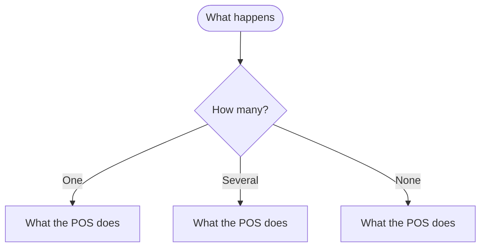

import LinkCards from '@site/src/components/LinkCards';
import LinkCard from '@site/src/components/LinkCard';
import JourneyShot from '@site/src/components/JourneyShot';
import manifest from '@site/static/img/2.x/<section>/<task>/en/manifest.json';

{/*
  Leaf template (draft, roadmap#534). One subject, a layer below a task page:
  more specific, more examples, the technical detail for troubleshooting.
  Never a catch-all ("X in Detail"): if a section could be its own search, split it.
  Rules: docs/style-guide.md. Frontmatter stays first. Delete every template
  comment before the page ships; keep pending: markers.
*/}

{/* Pro-only leaf: this call-out first. A leaf that is partly Pro marks Pro where it applies instead. */}
:::info Pro Feature
This needs WCPOS Pro. See [Free vs Pro](../../getting-started/free-vs-pro.mdx).
:::

{/* Lead: what the subject is, in one or two sentences, and which task page it sits under. */}
**Subject** is …. You reach it from [Task Page](./index.mdx#<anchor>) when ….

## The common case {#common}

{/* Common to rare. Start with what most cashiers meet. */}
….

{/* Capture slot, optional on a leaf: one shot of the control this leaf explains, labelled as densely as the eye needs. */}
<JourneyShot manifest={manifest} device="tablet" step={4} offsets={[[0, 0], [0, 0], [0, 0], [0, 0], [0, 0]]} alt="What the screen shows, region by region, in legend order" />

1. **App Label** — what it does.
2. **App Label** — what it does, and what each state means.
3. **App Label** — ….
4. **App Label** — ….
5. **App Label** — ….

## Every state and what it means {#states}

{/* Every status chip, badge or message the subject can show, in the app's words. */}

| What the screen shows | What it means | What to do |
|---|---|---|
| **App Label** | …. | …. |
| **App Label** | …. | …. |

## Examples {#examples}

{/* Worked examples with real figures from the showcase store. One per variant that behaves differently. */}

**A … of $12.50 with ….** ….

## Settings that change it {#settings}

{/* Every setting, its default and where the owner changes it. The owner-operator reads this section. */}

| Setting | Default | Where |
|---|---|---|
| **Exact Setting Label** | Off | [Setting Page](../../settings/wp-admin/<page>.mdx#<anchor>) |
| **Exact Setting Label** | … | [POS Settings](../../settings/store/<page>.mdx#<anchor>) |

## With WCPOS Pro {#pro}

{/* Only on a leaf that is partly Pro. What Pro changes about this subject. Otherwise delete. */}
….

{/* Flow-chart slot: only where the path branches in a way prose cannot carry. Node text in the app's words. Otherwise delete.

*/}

## Troubleshooting {#troubleshooting}

{/* Bold symptom in the screen's words, the cause, then the fix. Link every error code by name. */}

**"Exact message" or what the cashier sees.** Why it happens. What to do. See [ERROR123](../../error-codes/ERROR123.mdx).

{/* pending: monorepo#NNNN */}
**A ruled behaviour the app does not show yet.** What to do, as ruled.

## Related Documentation {#related-documentation}

<LinkCards>
  <LinkCard to="/<route>" title="Task Page" description="The task this subject belongs to" />
  <LinkCard to="/<route>" title="Sibling Leaf" description="The next subject a reader looks for" />
</LinkCards>
