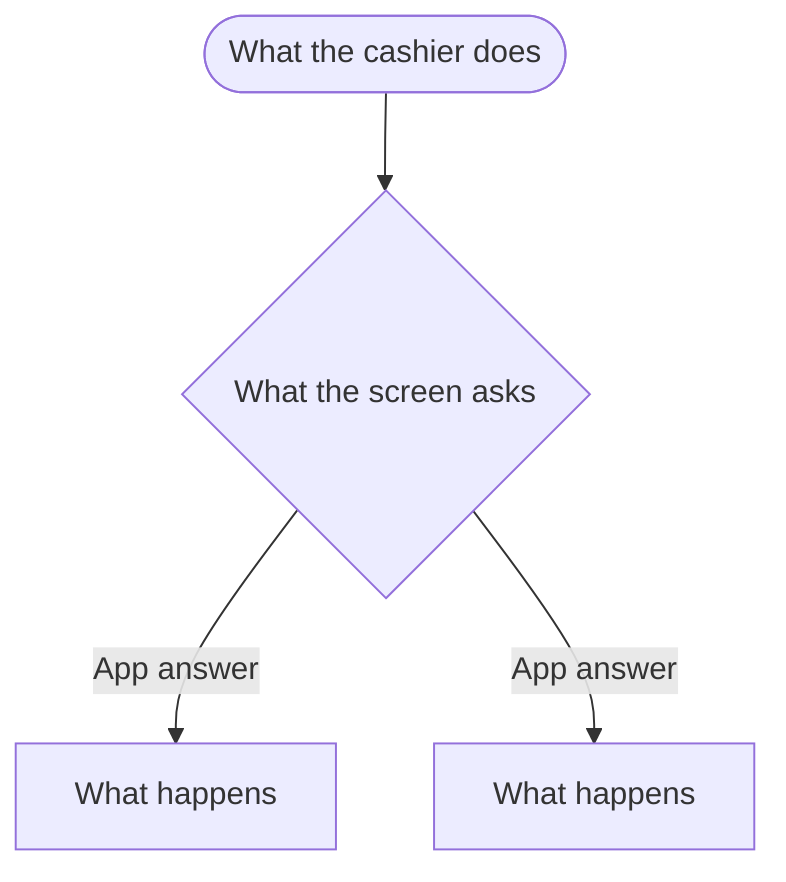

import LinkCards from '@site/src/components/LinkCards';
import LinkCard from '@site/src/components/LinkCard';
import JourneyShot from '@site/src/components/JourneyShot';
import manifest from '@site/static/img/2.x/<section>/<task>/en/manifest.json';

{/*
  Task-page template (draft, roadmap#534). One job from start to finish, in the
  order the cashier does it. Copy into versioned_docs/version-2.x/<section>/<task>/index.mdx.
  Rules: docs/style-guide.md. Exemplars: pos/checkout, pos/register, pos/product-panel.
  Frontmatter stays first. Delete every template comment before the page ships;
  keep pending: markers. Floor (proposed): 600–1,200 words of prose, at least two
  captures, five or more labels on every capture of a working screen, zero to two call-outs.
*/}

{/* Lead: one or two sentences. Who walks up, and what this page walks through. */}
A customer … This page walks through one …, from … to ….

{/* Precondition note: only when something must be true first. Otherwise delete. */}
:::note What must be true first
With **Exact Setting Label** switched on, …. See [Setting Page](../../settings/wp-admin/<page>.mdx#<anchor>) for the setting.
:::

## First step in plain words {#first-step}

{/* Two or three sentences: what the cashier sees and does. A default names its setting and links it. */}
Tap …. Each … starts with …, which [Exact Setting Label](../../settings/wp-admin/<page>.mdx#<anchor>) decides.

{/* Capture slot: step number from the journey manifest. Offsets: one pair per pin, so no pin covers its target. */}
<JourneyShot manifest={manifest} device="tablet" step={1} offsets={[[0, 0], [0, 0], [0, 0], [0, 0], [0, 0], [0, 0]]} alt="What the screen shows, region by region, in legend order" />

{/* Pin slot: one entry per pin, in the manifest's order. App label in bold, or a plain name for an unlabelled region. Most entries link down. */}

1. **App Label** — what it does. See [Leaf](./<leaf>.mdx).
2. **App Label** — what it does. See [Leaf](./<leaf>.mdx#<anchor>).
3. **App Label** (WCPOS Pro) — what it does. See [Leaf](./<leaf>.mdx).
4. **Plain name of a region** — what it shows.
5. **App Label** — what it does, and the setting that changes it: [Setting](../../settings/wp-admin/<page>.mdx#<anchor>).
6. **App Label** — press it to …

## Next step in plain words {#next-step}

Press **App Label**. ….

<JourneyShot manifest={manifest} device="tablet" step={2} offsets={[[0, 0], [0, 0], [0, 0], [0, 0], [0, 0]]} alt="What the screen shows" />

1. **App Label** — ….
2. **App Label** — ….
3. **App Label** — ….
4. **App Label** — ….
5. **App Label** — ….

{/* A step with no screen of its own: prose and a short list, no capture. */}
## A step without its own screen {#prose-step}

…:

- **What the screen says** — what it means and what to do.
- **What the screen says** — ….

{/* Flow-chart slot: only where the path branches in a way prose cannot carry. Most task pages delete this. Node text in the app's words.

*/}

## Last step in plain words {#last-step}

….

<JourneyShot manifest={manifest} device="tablet" step={3} offsets={[[0, 0], [0, 0]]} alt="The confirmation state" />

1. **App Label** — what it confirms. See [Leaf](./<leaf>.mdx).
2. **App Label** — back to …, ready for the next ….

## If something goes wrong {#goes-wrong}

{/* Or name the task's own failure: "When you can't find it". Bold symptom in the screen's words, then what to do and a link. The detail goes a layer down. */}

**What the screen says, or what the cashier sees.** What to do. See [Leaf](./<leaf>.mdx#<anchor>).

**"Exact message".** What to do. See [ERROR123](../../error-codes/ERROR123.mdx).

{/* pending: monorepo#NNNN */}
**A ruled behaviour the app does not show yet.** What to do, as ruled.

:::info With WCPOS Pro
What Pro adds to this task, in one or two sentences. See [Leaf](./<leaf>.mdx#<anchor>).
:::

## Related Documentation {#related-documentation}

{/* Optional when the task has many leaves: list them first, as J2 does. */}

<LinkCards>
  <LinkCard to="/<route>" title="Next Task" description="What the cashier does next" />
  <LinkCard to="/<route>" title="Leaf" description="The detail behind one step" />
  <LinkCard to="/<route>" title="Setting" description="Where the owner changes it" />
</LinkCards>
