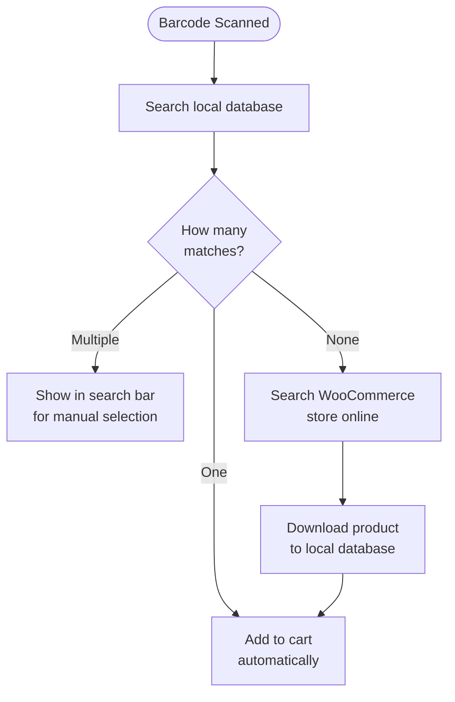

import Image from "@theme/IdealImage";
import Accordion from '@site/src/components/Accordion';
import AccordionItem from '@site/src/components/AccordionItem';

تتصرّف معظم قارئات الباركود مثل لوحة مفاتيح موصّلة بجهازك.
عندما تقرأ باركود، يكتشف WCPOS أن الأحرف أُدخلت أسرع من الكتابة العادية.
ويستخدم هذه "ضغطات المفاتيح السريعة" لتمييز الإدخال على أنه قراءة باركود.
يعمل هذا مباشرةً مع كل قارئ تقريبًا — لكن القارئات تدعم أيضًا [أوضاع اتصال](#connection-modes) أخرى يمكن لـ WCPOS الاتصال بها مباشرةً.

## إعداد قراءة الباركود {#configuring-barcode-scanning}

بما أن قراءة الباركود تحدث بسرعة كبيرة، يمكن لنقطة البيع التمييز بين الباركود وشيء مكتوب يدويًا.
في إعدادات نقطة البيع، ستجد خيارات لضبط طريقة عمل كشف الباركود بدقة.

  <Image
    alt="إعدادات قراءة الباركود في إعدادات نقطة البيع"
    img="/img/barcode-scanning-settings.png"
    style={{ maxHeight: 500 }}
  />
  
إعدادات قراءة الباركود في إعدادات نقطة البيع

| الإعداد | الغرض | القيمة النموذجية |
|---|---|---|
| **متوسط زمن الإدخال** | السرعة المطلوبة لاعتبار الإدخال قراءة باركود | فاصل زمني قصير بما يكفي لعدم اعتبار الكتابة اليدوية قراءة باركود |
| **الحد الأدنى للطول** | الطول المطلوب لسلسلة الأحرف المتصلة حتى تُعامل كباركود | طابق أقصر باركود تستخدمه (مثل 8 لـ EAN-8) |
| **إزالة البادئة/اللاحقة** | يزيل الأحرف الإضافية التي يضيفها القارئ (بادئة أو لاحقة) للإبقاء على الباركود الأساسي فقط | اتركه فارغًا ما لم يكن القارئ مُعدًّا لإضافتها |

## أوضاع الاتصال {#connection-modes}

للحصول على إرشادات خطوة بخطوة للإعداد أو استكشاف الأخطاء وإصلاحها، استخدم [معالج إعداد القارئ](/1.x/hardware/scanners/setup-wizard).

يأتي كل قارئ باركود مضبوطًا على أحد أوضاع محددة، ويحدد هذا الوضع كيفية استقبال WCPOS لقراءاته:

| الوضع | طريقة وصول القراءة | الإعداد |
|---|---|---|
| **لوحة المفاتيح (HID)** — الإعداد المصنعي الافتراضي في معظم القارئات | «يكتب» القارئ الباركود؛ ويتعرف WCPOS على ضغطات المفاتيح السريعة | لا حاجة إلى إعداد — أقرن القارئ أو وصّله وابدأ القراءة |
| **تسلسلي (SPP / USB-COM)** | اتصال مباشر عبر USB التسلسلي أو Bluetooth SPP | بدّل وضع القارئ، ثم وصّله في إعدادات الباركود |
| **HID-POS** | اتصال مباشر لقارئات USB (عبر WebHID) | بدّل وضع القارئ، ثم وصّله في إعدادات الباركود |
| **Bluetooth LE (GATT من المُصنّع)** | اتصال Bluetooth منخفض الطاقة مباشر | أقرن القارئ، ثم أضفه في إعدادات الباركود باستخدام معرّف الخدمة UUID الخاص به |

لا يحتاج وضع لوحة المفاتيح إلى إعداد، وهو مناسب لمعظم المتاجر. يفيد الاتصال المباشر إذا كانت القراءات تصل أحيانًا مشوّهة (خلط بين الأحرف الكبيرة والرموز بسبب اختلاف تخطيط لوحة المفاتيح)، أو تُدخل في المكان الخطأ عندما لا يكون التركيز على مربع البحث — إذ يرسل القارئ المتصل مباشرةً كل قراءة إلى WCPOS، بغض النظر عن سرعة الكتابة أو تخطيط لوحة المفاتيح أو موضع التركيز.

:::info لا يمكن توصيل قارئ في وضع لوحة المفاتيح مباشرةً
يعامل جهازك القارئ الذي يعمل في وضع لوحة المفاتيح تمامًا مثل لوحة مفاتيح، ولا يُسمح لأي تطبيق بالاستحواذ على لوحة المفاتيح.
إذا ضغطت على **توصيل قارئ تسلسلي** أو **توصيل قارئ HID** في إعدادات الباركود ولم يظهر القارئ في القائمة، فمن شبه المؤكد أنه لا يزال في وضع لوحة المفاتيح.
:::

**لتبديل الأوضاع**، ابحث عن باركود الإعداد في دليل القارئ (ابحث عن *«وضع SPP»* أو *«الوضع التسلسلي»* أو *«وضع HID-POS»*) واقرأه — سيعيد القارئ ضبط نفسه. لقارئات Bluetooth، احذف الاقتران القديم من إعدادات Bluetooth في جهازك ثم أقرن القارئ مجددًا بعد تبديل الوضع. يمكنك إعادته إلى وضع لوحة المفاتيح في أي وقت بقراءة باركود *«HID»* أو *«لوحة المفاتيح»* من الدليل.

تُدعم الاتصالات المباشرة في تطبيق سطح المكتب والمتصفحات المبنية على Chrome (باستخدام دعم المتصفح لـ Web Serial وWebHID). يعرض تطبيق سطح المكتب أداة اختيار الأجهزة داخل التطبيق، بينما يعرض Chrome أداة الاختيار الخاصة به. على iOS وAndroid، يتوفر وضع لوحة المفاتيح والقراءة بالكاميرا، ويعترض Android أيضًا إدخال مفاتيح القارئ المادي مباشرةً.

## القراءة بالكاميرا {#camera-scanning}

تدعم جميع المنصات — الويب وسطح المكتب وiOS وAndroid — القراءة بكاميرا الجهاز، لذا لا تحتاج إلى قارئ مخصص للبدء. افتح الكاميرا من أيقونة القراءة في شريط البحث؛ تظهر في **لوحة قابلة لتغيير الحجم أسفل عوامل التصفية مباشرةً**، لتظل قائمة المنتجات مرئية أثناء القراءة. وجّه الكاميرا نحو الباركود، وسيقرؤه WCPOS بالطريقة نفسها التي يتعامل بها مع قراءة جهاز الباركود.

## ماذا يحدث عند اكتشاف باركود؟ {#what-happens-when-a-barcode-is-detected}

عندما يكتشف POS باركودًا، يبحث في قاعدة بياناته المحلية عن منتج أو متغيّر منتج مطابق.
هناك ثلاث نتائج محتملة:

عندما لا تعثر القراءة على تطابق محلي، يبحث WCPOS في متجرك عبر الإنترنت وينزّل المنتج المطابق و**يضيفه إلى السلة تلقائيًا** — لذا يمكن إتمام البيع حتى مع باركود غير معروف محليًا، وتصبح قراءته فورية في المرة التالية.

:::tip وجود مطابقات متعددة يشير عادةً إلى مشكلة في البيانات
إذا اشترك أكثر من منتج في الباركود نفسه، فلن يعرف POS أيّها يضيف، لذا يضع الرمز في شريط البحث لتختار المنتج. يشير ذلك عادةً إلى أن بيانات منتجاتك تحتاج إلى تنظيم — ينبغي أن يكون لكل منتج باركود **فريد**.
:::

## إشعارات القراءة وسلوكها {#scan-feedback-and-behaviour}

- **أصوات القراءة** — يمكن لـ WCPOS تشغيل صوت مع كل قراءة ليحصل أمناء الصندوق على تأكيد فوري دون النظر إلى الشاشة. الأصوات اختيارية، وتتوفر لها عدة نغمات؛ فعّلها واختر نغمة من [إعدادات الباركود](/1.x/settings/store/barcode).
- **على شاشة الطلبات** — تُوجّه القراءات إلى حقل بحث الطلبات، لتتمكن من قراءة باركود والعثور على الطلب أو المنتج الذي تبحث عنه.
- **باركود UPC-A** — تنتج عن قراءة UPC-A الأرقام المطبوعة على العبوة، فتكون القيمة التي يبحث POS عن تطابق لها هي نفسها المستخدمة في بيانات منتجك.

## فهم مزامنة المنتجات {#understanding-product-synchronisation}

ينزّل POS كتالوجك على دفعات صغيرة في الخلفية، لذا لن تكون جميع المنتجات على الجهاز منذ الدقيقة الأولى — راجع [مزامنة المنتجات](/1.x/products/sync) لمعرفة كيفية عمل ذلك.

### أهمية ذلك لقراءة الباركود {#why-it-matters-for-barcode-scanning}

عندما تقرأ باركودًا لم يُخزّن محليًا بعد، يتصل POS بمتجر WooCommerce عبر الإنترنت ويعثر على المنتج وينزّله، لتصبح القراءة نفسها فورية في المرة التالية. لا تحتاج إلى اتخاذ أي إجراء لتسريع ذلك: يستكمل التحميل الأولي للكتالوج في الخلفية تنزيل بقية مخزونك تلقائيًا، ويمكنك متابعة التقدم في **صحة المتجر → قاعدة البيانات**.

## الأسئلة الشائعة {#faq}

<Accordion>
  <AccordionItem question="لماذا تظهر رسالة «تم العثور على 0 منتج محليًا» عندما أقرأ باركودًا؟">

لا تتوفر جميع المنتجات على الجهاز منذ البداية — يُحمّل POS كتالوجك مبدئيًا في الخلفية خلال الدقائق الأولى من استخدامه.
إذا لم يكن المنتج الذي قرأت باركوده للتو مخزّنًا بعد، تدفع القراءة POS إلى البحث عنه عبر الإنترنت وتنزيله، لتصبح قراءته فورية في المرة التالية.

  </AccordionItem>

  <AccordionItem question="هل ينشئ POS الباركود ويطبعه؟">

لا، ليس في الوقت الحالي. صُمم POS لقراءة الباركود الموجود، لكنه لا يتضمن وظائف لإنشائه أو طباعته.
إذا كنت بحاجة إلى إنشاء باركود لمنتجاتك، يمكنك استخدام إضافات WooCommerce من جهات خارجية متخصصة في إنشاء الباركود وطباعته. من أمثلتها:

- [EAN for WooCommerce](https://wordpress.org/plugins/ean-for-woocommerce/)
- [A4 Barcode Generator](https://wordpress.org/plugins/a4-barcode-generator/)

بمجرد إنشاء باركود لمنتجاتك، يمكنك قراءته بسهولة على نقطة البيع لتسريع عملية الدفع فيها.

  </AccordionItem>
</Accordion>
