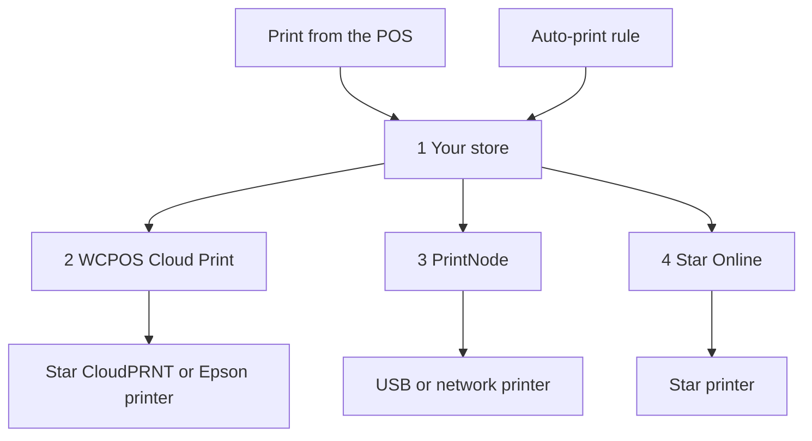

import LinkCards from '@site/src/components/LinkCards';
import LinkCard from '@site/src/components/LinkCard';

ترسل الطباعة السحابية الإيصالات إلى طابعة عبر الإنترنت، فلا يلزم توصيل الطابعة بالجهاز الذي يشغّل POS. استخدمها لطابعة على شبكة مختلفة عن شبكة جهاز نقطة البيع، أو لطابعة مطبخ تطبع كل طلب تلقائيًا، أو لطباعة قسيمة تعبئة لكل عملية بيع عبر الإنترنت.

تُعدّ الطابعة السحابية مرة واحدة من **WP Admin → نقطة البيع → الإعدادات → الطباعة السحابية**. بعد ذلك، تظهر في قائمة الطابعات على كل جهاز، ويطبع أمناء الصندوق عليها من POS كأي طابعة أخرى.

## الطباعة من POS {#manual}

ينشئ المتجر إيصال الطابعة السحابية من الطلب، لذا يجب أن تكون عملية البيع مسجلة في المتجر قبل الطباعة.

1. في شاشة اكتمال الدفع، أو في نافذة **إيصال** الطلب، افتح قائمة **الطابعة** واختر الطابعة السحابية.
2. اضغط على **طباعة الإيصال**.
3. تعرض الشاشة **تمت الطباعة إلى** واسم الطابعة. وهذا يعني أن المتجر استلم مهمة الطباعة؛ تأكد من خروج الإيصال. إذا لم يخرج، يستطيع المدير معرفة ما حدث للمهمة في [قائمة انتظار الطباعة](#print-queue).

راجع [طباعة الإيصال](./at-checkout.mdx#print-receipt). لإرسال نموذج إلى طابعة سحابية في كل مرة، اختر طابعة ذلك النموذج من **الإعدادات → الطباعة**: راجع [توجيه الطباعة](../hardware/printers/index.mdx#print-routing).

- **يجب أن يكون الطلب مسجلًا في المتجر.** إذا لم يؤكد المتجر عملية البيع بعد، كعملية أُجريت دون اتصال، يعرض POS الرسالة *تطبع هذه الطابعة نسخة المتجر، ولم يؤكد المتجر عملية البيع هذه بعد. أعد الطباعة بعد تأكيدها.* اضغط على **طباعة الإيصال** مجددًا بعد اتصال جهاز نقطة البيع بالإنترنت وتأكيد المتجر لعملية البيع. ما دام جهاز نقطة البيع غير متصل بالإنترنت، تفشل الطباعة على طابعة سحابية، حتى لطلب سابق.
- عند إرسال **تقارير الجلسات والإغلاق** إلى طابعة سحابية، يُفتح مربع حوار الطباعة الخاص بالنظام بدلًا من ذلك.
- عند استخدام **نموذج HTML على طابعة سحابية من Star أو Epson**، تظهر الرسالة *تطبع هذه الطابعة السحابية النماذج الحرارية فقط، لذا لن تتم طباعة أي شيء. اختر نموذجًا حراريًا.*

تظهر الطابعات السحابية تلقائيًا في **الإعدادات → الطباعة** على كل جهاز، ضمن **الطابعات**. يعرض السطر الثاني من الصف نوع الطابعة، مثل *Star CloudPRNT · تُدار بواسطة WCPOS*. يستطيع أمين الصندوق الضغط على **طباعة اختبارية** في الصف أو **نسخ تقرير الإعداد** في قائمة **⋯**، لكنه لا يستطيع تعديل الطابعة أو حذفها؛ يتم ذلك من شاشة **الطباعة السحابية**. راجع [إعداد الطابعة](../hardware/printers/index.mdx#printers-list).

## اختيار نوع الطابعة {#providers}

:::note تحتاج إلى WP Admin للخطوات التالية
يتولى مالك المتجر أو مديره إضافة الطابعات والقواعد من **WP Admin → نقطة البيع → الإعدادات → الطباعة السحابية**.
:::

تطرح شاشة **الطباعة السحابية** السؤال **ما نوع الطابعة التي تريد توصيلها؟** اختر النوع المطابق لطابعتك.

- **Star CloudPRNT** — لطابعة Star مزودة بتقنية CloudPRNT مدمجة (mC-Print وTSP143IV…)، عندما تريد اتصالًا مجانيًا دون حساب إضافي. تجلب الطابعة مهامها من متجرك. *النماذج الحرارية فقط.*
- **Epson Server Direct Print** — لطابعة TM «ذكية» من Epson (TM-T88VI/VII وTM-m30III وسلسلة TM-i). تجلب الطابعة مهامها من متجرك. *النماذج الحرارية فقط.*
- **Star Online** — لطابعة Star مرتبطة بحساب stario.online (mC-Print3 وTSP143IV وmC-Label3). يسلّم متجرك المهمة إلى Star Online التي تتولى إيصالها. *النماذج الحرارية فقط.*
- **PrintNode** — لطابعة USB أو طابعة شبكة عادية، عندما يمكنك تشغيل تطبيق PrintNode الصغير على حاسوب في المتجر. يسلّم متجرك المهمة إلى PrintNode، ويطبعها تطبيقها على ذلك الحاسوب. *أي نموذج.*

لا تستطيع طابعة سحابية من Star أو Epson طباعة نموذج HTML؛ إذ يجب تحويل الإيصال إلى أوامر خاصة بالطابعة. لنماذج HTML ونماذج الصفحة الكاملة، استخدم PrintNode. راجع [النماذج الحرارية](./thermal-templates.mdx).

<details>
<summary>كيف تصل المهام إلى طابعتك</summary>



<div className="pinned-legend">

1. **متجرك** — ينشئ الإيصال من الطلب والنموذج، ويحتفظ بالمهمة في [قائمة انتظار الطباعة](#print-queue). تبدأ هنا كل من الطباعة من POS و[قاعدة الطباعة التلقائية](#auto-print).
2. **WCPOS Cloud Print** — [خدمة الترحيل](#relay). تجلب طابعة Star CloudPRNT أو Epson مهامها عادةً من خلالها، لذا تنتظر المهمة حتى تتصل الطابعة في المرة التالية.
3. **PrintNode** — يسلّم متجرك المهمة إلى PrintNode، ويطبعها تطبيق PrintNode على حاسوب في المتجر.
4. **Star Online** — يسلّم متجرك المهمة إلى Star Online التي توصلها إلى الطابعة.

</div>

</details>

## إضافة طابعة {#setup}

1. انتقل إلى **WP Admin → نقطة البيع → الإعدادات → الطباعة السحابية**. ضمن **طابعاتك السحابية**، اضغط على **+ إضافة طابعة**.
2. اختر النوع.
3. أدخل **اسم الطابعة**، مثل *طابعة المطبخ*. ينشئ WCPOS **معرّف الطابعة** من الاسم. لا يمكن تغيير المعرّف لاحقًا؛ لتغييره، أزل الطابعة وأضفها مجددًا.
4. أكمل الخطوات الخاصة بالنوع الذي اخترته: [Star CloudPRNT أو Epson](#setup-polling) أو [PrintNode](#setup-printnode) أو [Star Online](#setup-star-online).
5. تظهر الطابعة كبطاقة ضمن **طابعاتك السحابية**. اضغط على **طباعة اختبارية** فيها. راجع [بطاقة الطابعة](#status).

### Star CloudPRNT أو Epson Server Direct Print {#setup-polling}

تجلب هذه الطابعات مهامها بنفسها، لذا لا يوجد حساب لربطه. وبما أن الطابعة هي التي تتصل بمتجرك، فلا تحتاج إلى فتح منفذ أو تعيين عنوان IP ثابت أو تغيير جدار الحماية. تُطبع المهمة في المرة التالية التي تتصل فيها الطابعة. تعرض الخطوة الأخيرة من **+ إضافة طابعة** **عنوان URL للاستقصاء** الخاص بالطابعة، ويتضمن رمزًا سريًا.

<details>
<summary>توصيل طابعة Star CloudPRNT أو Epson</summary>

1. اضغط على **نسخ** بجوار **عنوان URL للاستقصاء**. يُعرض العنوان الكامل **مرة واحدة فقط**. إذا فقدته، فأزل الطابعة وأضفها مجددًا للحصول على عنوان جديد؛ إذ يعرضه خيار **الإعداد والرمز** في البطاقة مع إخفاء الرمز.
2. افتح صفحة إعدادات الطابعة نفسها والصق العنوان في حقل عنوان URL للخادم: إعدادات **CloudPRNT** في طابعة Star، وإعدادات **Server Direct Print** في طابعة Epson. فعّل الاستقصاء، واحفظ، ثم أعد تشغيل الطابعة.
3. عند العودة إلى البطاقة، تتغير الحالة من **بانتظار الطابعة** إلى **متصلة** بمجرد أن تجلب الطابعة المهام للمرة الأولى.

يبدأ العنوان عادةً بـ `https://cloudprint.wcpos.com`. وهو عنوان [خدمة الترحيل WCPOS Cloud Print](#relay)، وهو الخيار المناسب. يعرض خيار **متقدم: الاتصال مباشرة بهذا الموقع (دون خدمة ترحيل)** أسفل العنوان **عنوان URL المباشر** بدلًا منه؛ لا تستطيع بعض الطابعات الوصول إلى الموقع مباشرة وتظل في حالة **بانتظار الطابعة**.

في طابعة Epson، اترك **Server Direct Print** مفعّلًا ما دام WCPOS يطبع عليها بهذه الطريقة. راجع [Server Direct Print](../hardware/printers/server-direct-print.mdx).

</details>

### PrintNode {#setup-printnode}

تحتاج PrintNode إلى تشغيل برنامج العميل الخاص بها على حاسوب بجوار الطابعة، وإلى مفتاح API من حسابك في PrintNode.

<details>
<summary>توصيل طابعة PrintNode</summary>

1. ثبّت برنامج عميل PrintNode على حاسوب بجوار الطابعة وسجّل الدخول. يجب أن يكون الحاسوب قيد التشغيل وبرنامج العميل يعمل حتى تتم الطباعة.
2. أنشئ مفتاح API في حسابك في PrintNode.
3. في **+ إضافة طابعة**، اختر **PrintNode**، والصق المفتاح في **مفتاح API لـ PrintNode** ثم اضغط على **جلب طابعاتي**.
4. ضمن **اختيار طابعة**، اختر الطابعة التي يعرضها برنامج العميل، وأكمل الخطوات. تعرض الخطوة الأخيرة **تم الربط بـ PrintNode**؛ لا يوجد عنوان أو رمز لنسخه.

</details>

بعد ربط الطابعة، اضبط **تنسيق الطباعة** في بطاقتها:

- يطبع خيار **PDF (موصى به)** أي نموذج، سواء كان حراريًا أو HTML، بصيغة PDF. اترك هذا الخيار ما لم يكن لديك سبب لتغييره.
- يرسل خيار **ESC/POS RAW — النماذج الحرارية فقط** النموذج الحراري على هيئة أوامر لطابعة الإيصالات بدلًا من ملف PDF. وتظل نماذج HTML تُرسل بصيغة PDF.

### Star Online {#setup-star-online}

تحتاج Star Online إلى عنوان مجموعة الطابعة ومفتاح API، وكلاهما من حسابك في stario.online.

<details>
<summary>توصيل طابعة Star Online</summary>

1. في stario.online، افتح **مجموعات الأجهزة** وانسخ **عنوان URL لـ CloudPRNT** الخاص بالمجموعة. يكون على غرار `https://device.stario.online/cloudprnt/...`، أو `https://eu-device.stario.online/cloudprnt/...` في الاتحاد الأوروبي.
2. في stario.online، أنشئ مفتاح API بالصلاحيات **EnumDevices** و**ViewDevice** و**PrintToDevice** و**ViewDeviceGroups**. يُقبل المفتاح الذي لا يملك هذه الصلاحيات، لكنه لا يستطيع عرض الأجهزة أو الطباعة.
3. في **+ إضافة طابعة**، اختر **Star Online**. الصق **عنوان URL لـ CloudPRNT** و**مفتاح API لـ Star Online**، ثم اضغط على **جلب أجهزتي**.
4. ضمن **اختيار جهاز**، اختر الطابعة وأكمل الخطوات. تعرض البطاقة بعد ذلك **الجهاز** و**المجموعة** و**معرّف الوصول** الخاص بها.

</details>

## بطاقة الطابعة {#status}

لكل طابعة سحابية بطاقة ضمن **طابعاتك السحابية**:

- **الاسم** — انقر عليه لإعادة تسمية الطابعة. يظهر النوع تحته.
- **الحالة** — راجع القائمة أدناه. تُحدّث كل 30 ثانية.
- **آخر اتصال** — وقت آخر جلب للمهام أجرته طابعة Star CloudPRNT أو Epson، أو *لم تتصل مطلقًا*.
- **معرّف الطابعة** — يُحدَّد عند إضافة الطابعة ولا يتغير.
- **تنسيق الطباعة** — لطابعات PrintNode فقط: **PDF (موصى به)** أو **ESC/POS RAW — النماذج الحرارية فقط**. راجع [PrintNode](#setup-printnode).
- **طباعة اختبارية** — يرسل صفحة اختبار قصيرة. تظهر رسالة *تم إرسال طباعة اختبارية إلى …*، أو سبب فشلها.
- **إجراءات الطابعة** (**⋮**) — يعيد **الإعداد والرمز** فتح خطوة الإعداد الأخيرة؛ ويوقف **إزالة الطابعة** استقبال الطابعة للمهام. يمكنك إضافتها مجددًا لاحقًا.

<details id="status-polling">
<summary>حالات Star CloudPRNT وEpson Server Direct Print</summary>

- **بانتظار الطابعة** — لم تجلب الطابعة المهام بعد. تحقق من عنوان URL للاستقصاء في الطابعة: راجع [بقاء الحالة على بانتظار الطابعة](#trouble-polling).
- **متصلة** — جلبت الطابعة المهام خلال الدقيقتين والنصف الماضيتين.
- **غير متصلة** — سبق أن جلبت الطابعة المهام، لكنها لم تفعل ذلك مؤخرًا. تأكد من أنها قيد التشغيل ومتصلة بالإنترنت.
- **محظورة** — لا تستطيع خدمة الترحيل الوصول إلى متجرك. توضح البطاقة السبب: تحظرها خدمة أمان مثل Cloudflare أو إضافة جدار حماية، أو أن موقعك رد بخطأ في الخادم. راجع [مشكلات Star CloudPRNT أو Epson](#trouble-polling).

</details>

<details id="status-services">
<summary>حالات Star Online وPrintNode</summary>

- **متصلة بالإنترنت** — تفيد الخدمة بأن الطابعة متاحة.
- **غير متصلة** — تفيد الخدمة بأن الطابعة، أو حاسوب PrintNode، غير متاح. بالنسبة إلى PrintNode، تأكد من أن الحاسوب ليس في وضع السكون وأن برنامج العميل يعمل.
- **غير معروفة** — تعذّر على WCPOS الحصول على الحالة من الخدمة. تحقق من مفتاح API في [PrintNode](#setup-printnode) أو [Star Online](#setup-star-online).

</details>

## طباعة الطلبات تلقائيًا {#auto-print}

تطبع قواعد الطباعة التلقائية الطلبات دون أن يضغط أحد على أي زر. وهي اختيارية: في غياب القواعد، لا تطبع الطابعات السحابية إلا عندما يطبع أمين الصندوق من POS.

ضمن **قواعد الطباعة التلقائية**، اضغط على **+ إضافة قاعدة**. تُعرض كل قاعدة في صورة جملة، وكل جزء مسطّر فيها هو قائمة:

> اطبع تلقائيًا **كل طلب داخل المتجر (POS)** على **طابعة المطبخ** باستخدام نموذج **تذكرة المطبخ**، بعدد **2 نسخة**، **بمجرد إنشائه**.

- **الطلبات المطلوبة** — **كل طلب** أو **كل طلب داخل المتجر (POS)** أو **كل طلب عبر الإنترنت**. مع WCPOS Pro، يتوفر أيضًا خيار **طلبات متجر** لتحديد متجر واحد: راجع [طابعات خاصة بكل متجر](#per-store-printers).
- **الطابعة** — إحدى طابعاتك السحابية.
- **النموذج** — لا تُعرض إلا النماذج التي تستطيع الطابعة طباعتها. تأتي النماذج من **نقطة البيع › النماذج**.
- **النسخ** — من 1 إلى 5.
- **التوقيت** — **بعد الدفع** (الخيار الافتراضي)، أو **بمجرد إنشائه**. في طلب POS، يُقصد بالإنشاء لحظة حفظ السلة للمرة الأولى، لذا تُطبع تذكرة المطبخ قبل الدفع.

يمكن لأكثر من قاعدة طباعة الطلب نفسه، مثل تذكرة مطبخ وإيصال عميل. تطبع كل قاعدة الطلب الواحد مرة واحدة فقط. يُنشأ الإيصال في المتجر من الطلب والنموذج، فلا يحتاج أمين الصندوق إلى فعل شيء. لا تفتح الطباعة التلقائية درج النقد مطلقًا.

إذا غيّرت طابعة قاعدة إلى طابعة لا تستطيع طباعة نموذجها، تنتقل القاعدة إلى أول نموذج تستطيع تلك الطابعة طباعته، لذا تأكد من أنه النموذج الذي تريده. إذا لم تستطع الطابعة طباعة أي من نماذجك، يُترك النموذج فارغًا ولا تطبع القاعدة حتى تختار نموذجًا.

### طابعات خاصة بكل متجر (Pro) {#per-store-printers}

مع [WCPOS Pro](../getting-started/pro-license.mdx) ووجود أكثر من [متجر](../stores/index.mdx)، تتضمن قائمة **الطلبات المطلوبة** أيضًا خيار **طلبات متجر** لكل متجر. تطبع قاعدة المتجر الطلبات التابعة له: الطلبات التي تسجلها أجهزة نقاط البيع فيه، وأي طلب تُسنده إلى المتجر من شاشة تحرير الطلب. لا تتبع الطلبات عبر الإنترنت أي متجر ما لم تُسندها إلى متجر، لذا لا تطبعها إلا القواعد التي تشمل جميع المتاجر.

تُطبَّق القواعد معًا: يُطبع طلب المتجر وفق قواعد ذلك المتجر **وكذلك** وفق كل قاعدة تخص **كل طلب** أو **كل طلب داخل المتجر (POS)** أو **كل طلب عبر الإنترنت**. لمنع طباعة تذاكر مطبخ أحد الفروع على طابعة فرع آخر، خصص لكل فرع قاعدة متجر مستقلة، ولا تضف قاعدة تشمل جميع المتاجر لتلك التذكرة.

## قائمة انتظار الطباعة {#print-queue}

أسفل القواعد، تعرض **قائمة انتظار الطباعة** كل مهمة: **الطلب** و**الطابعة** و**النموذج** و**الحالة** و**التفاصيل** و**وقت الإنشاء**. يرتبط رقم الطلب برابط إلى الطلب.

- استخدم **تصفية** حسب الحالة (**تحتاج إلى انتباه** أو **كل الحالات** أو إحدى الحالات **بانتظار الطباعة** و**قيد الطباعة** و**تمت الطباعة** و**فشلت** و**أُلغيت**) وحسب الطابعة.
- استخدم **إلغاء** لمهمة تنتظر الطباعة، أو **إعادة المحاولة** لمهمة فشلت (تعود كمهمة جديدة مع العبارة *أُعيدت المحاولة بالمهمة #…*)، أو **حذف** لحذف مهمة. حدد عدة صفوف لاستخدام **إلغاء المحدد** أو **حذف المحدد**.
- توضح **التفاصيل** سبب فشل المهمة، مثل *رفضت Star Online الطلب. تحقق من أن مفتاح API يملك الصلاحيات المطلوبة.*

عندما تكون لدى طابعة Star CloudPRNT أو Epson إيصالات تنتظر الطباعة ولم تجلب المهام منذ 10 دقائق، أو لم تجلبها مطلقًا، يظهر تحذير يذكر اسم الطابعة ووقت آخر جلب وعدد الإيصالات المنتظرة، ويتيح خيار **إلغاء الكل**.

:::warning مهمة لم تؤكدها الطابعة
تعني عبارة *لم تؤكد الطابعة هذه المهمة* أن WCPOS لا يستطيع معرفة ما إذا كانت قد طُبعت. لا تُرسل المهمة مجددًا تلقائيًا، لأن ذلك قد يؤدي إلى طباعتها مرتين. تحقق من الطابعة، ولا تضغط على **إعادة المحاولة** إلا إذا لم يخرج منها شيء.
:::

<details>
<summary>مدة الاحتفاظ بالمهام وإعادة المحاولة</summary>

تُحذف المهام المطبوعة والملغاة بعد 7 أيام، والمهام الفاشلة بعد 30 يومًا. يستطيع المطوّر تغيير ذلك باستخدام المرشّحين `wcpos_print_job_retention_days` و`wcpos_print_job_failed_retention_days`.

تجري محاولة تنفيذ المهمة التي يسلّمها WCPOS إلى PrintNode أو Star Online ثلاث مرات، بفاصل دقيقة ثم دقيقتين. إذا رفضت الخدمة المفتاح أو الحساب، تفشل المهمة فورًا ويظهر السبب في **التفاصيل**.

</details>

## WCPOS Cloud Print، خدمة الترحيل {#relay}

يشير عنوان URL للاستقصاء في طابعة Star CloudPRNT أو Epson إلى **cloudprint.wcpos.com**، وليس إلى موقعك. هذه هي **WCPOS Cloud Print**، وهي خدمة ترحيل مجانية تديرها WCPOS بين طابعاتك ومتجرك.

لا تحتاج إلى تفعيل أي شيء. تمر المهام عبر خدمة الترحيل في طريقها إلى الطابعة، لذا يؤدي الاتصال إلى مشاركة عنوان موقعك مع wcpos.com، كما تمر عبرها الإيصالات التي تتضمن تفاصيل الطلبات. راجع [سياسة الخصوصية](https://wcpos.com/privacy).

<details>
<summary>كيف تعمل خدمة الترحيل</summary>

تعمل طابعات الإيصالات ببرامج ثابتة صغيرة نادرًا ما تُحدَّث. لا يستطيع الكثير منها إنشاء اتصال آمن بمتجر على استضافة حديثة، أو ترفض اتصالها خدمة مثل Cloudflare تحمي الموقع. عندها تظل الطابعة في حالة **بانتظار الطابعة** رغم صحة جميع الإعدادات. توفر خدمة الترحيل للطابعة اتصالًا تستطيع إنشاءه، وتمرر طلباتها إلى متجرك.

- يتصل موقعك بخدمة الترحيل تلقائيًا في المرة الأولى التي تفتح فيها **الطباعة السحابية**.
- تتطلب خدمة الترحيل أن يستخدم موقعك **HTTPS**. إذا لم يكن كذلك، تُعلمك شاشة **الطباعة السحابية** بذلك.
- إذا تعذّر على موقعك الاتصال بخدمة الترحيل، كأن يكون موقع اختبار محليًا، يشير عنوان URL للاستقصاء إلى موقعك مباشرة.
- تعني حالة **محظورة** على البطاقة أن خدمة الترحيل وصلت إلى موقعك ورُفض اتصالها. اسمح بخدمة الترحيل في خدمة الأمان لديك، كما توضح البطاقة. راجع [مشكلات Star CloudPRNT أو Epson](#trouble-polling).

</details>

<details>
<summary>إيقاف خدمة الترحيل (للمطوّرين)</summary>

تتضمن خطوة الإعداد الأخيرة لطابعة Star CloudPRNT أو Epson خيار **متقدم: الاتصال مباشرة بهذا الموقع (دون خدمة ترحيل)** مع **عنوان URL المباشر** الخاص بها. لإيقاف خدمة الترحيل للموقع بأكمله:

```php
add_filter( 'wcpos_cloud_print_relay_enabled', '__return_false' );
```

قبل WCPOS 2.0، كان هذا المرشّح باسم `woocommerce_pos_cloud_print_relay_enabled`. لا يزال هذا الاسم يعمل، لكنه مُهمَل منذ 2.0، وسيُزال في 2.2 على أقرب تقدير. راجع [تسمية الخطّافات](../extensions/index.mdx#hook-naming).

</details>

<details>
<summary>كيف يصل الإيصال إلى طابعة Star CloudPRNT</summary>

يعرض WCPOS على الطابعة أوامر StarPRNT أولًا، ثم صورة PNG للإيصال، ثم نصًا عاديًا، ويستخدم أفضل صيغة تفيد الطابعة بأنها تستطيع قراءتها. لا تحصل طرازات Star القديمة التي لا تقرأ إلا Line Mode (TSP650II وTSP700II وTSP800II) على الشعارات إلا عبر الصورة. تتطلب الصورة امتدادَي GD وFreeType للغة PHP على خادمك. تتلقى طابعات Epson صيغة ePOS-Print XML، وتتلقى Star Online صيغة Star Document Markup.

</details>

## إذا حدثت مشكلة {#troubleshooting}

**طبع POS على طابعة سحابية، لكن لم يخرج أي إيصال.** لا يعرف POS سوى أن المتجر استلم المهمة. افتح [قائمة انتظار الطباعة](#print-queue) وابحث عن الطلب:

- **بانتظار الطباعة** — لم تستلمها الطابعة بعد. تحقق من حالة الطابعة في بطاقتها: [حالات Star CloudPRNT وEpson Server Direct Print](#status-polling) أو [حالات Star Online وPrintNode](#status-services).
- **قيد الطباعة** — المهمة في طريقها إلى الطابعة، ولم تؤكد الطابعة طباعتها بعد.
- **فشلت** — توضح **التفاصيل** السبب. عالج المشكلة ثم اضغط على **إعادة المحاولة**. إذا عرضت **التفاصيل** عبارة *لم تؤكد الطابعة هذه المهمة*، فقد تكون قد طُبعت؛ تحقق من الطابعة قبل الضغط على **إعادة المحاولة**.
- **تمت الطباعة** — استلمت الطابعة، أو PrintNode أو Star Online، المهمة. تحقق من الورق، ومن أن عمود **الطابعة** يعرض اسم الطابعة التي تقف أمامها.

**لا يظهر نموذجي ضمن الخيارات.** لا تقبل طابعات Star CloudPRNT وEpson وStar Online إلا [النماذج الحرارية](./thermal-templates.mdx). اختر أحدها، أو اطبع عبر PrintNode.

### مشكلات Star CloudPRNT أو Epson {#trouble-polling}

**بقاء الحالة على بانتظار الطابعة.** لم تصل الطابعة إلى متجرك مطلقًا. تحقق من تطابق عنوان URL للاستقصاء في الطابعة تمامًا؛ فحرف واحد خاطئ يؤدي إلى رفض كل محاولة جلب. إذا لم تكن متأكدًا، فأزل الطابعة وأضفها مجددًا للحصول على عنوان جديد. تأكد من تفعيل الاستقصاء في إعدادات **CloudPRNT** أو **Server Direct Print** في الطابعة، ثم أعد تشغيلها. إذا استخدمت **عنوان URL المباشر**، فانتقل إلى عنوان `cloudprint.wcpos.com`: [لهذا الغرض توجد خدمة الترحيل](#relay).

**محظورة.** ترفض خدمة أمان أو إضافة جدار حماية اتصال خدمة الترحيل، أو يعيد موقعك أخطاء في الخادم. اتبع الرسالة على البطاقة؛ وإذا كان الخطأ في الخادم، فتحقق من صحة موقعك وسجلات الأخطاء.

**أُعدّت الطابعة قبل توفر خدمة الترحيل.** تظل العناوين المحفوظة مسبقًا في الطابعة تعمل. إذا ظلت تلك الطابعة في حالة **بانتظار الطابعة**، فأزلها وأضفها مجددًا، ثم أدخل عنوان `cloudprint.wcpos.com` الجديد في الطابعة.

### مشكلات PrintNode {#trouble-printnode}

**فشل جلب طابعاتي.** تحقق من مفتاح API، ومن أن برنامج عميل PrintNode يعمل على الحاسوب.

**لا تُطبع مهمة PrintNode مطلقًا.** يجب أن يكون برنامج العميل قيد التشغيل ومتصلاً بالإنترنت؛ فالحاسوب في وضع السكون لا يطبع شيئًا. تحقق من أنك اخترت الطابعة التي يعرضها برنامج العميل، ومن أن المفتاح لم يُلغَ.

### مشكلات Star Online {#trouble-star-online}

**فشل جلب أجهزتي.** تظهر الرسالة *تعذّر عرض أجهزتك في Star Online. تحقق من عنوان URL لـ CloudPRNT ومفتاح API.* تحقق من نسخ المفتاح كاملًا، ومن أنه لم يُلغَ، وأنه يتبع حساب stario.online والمنطقة نفسيهما اللذين يتبعهما عنوان URL. ثم تحقق من أن المفتاح يملك الصلاحيات المذكورة في [Star Online](#setup-star-online). تعني عبارة *لم يُعثر على أجهزة في مجموعة Star Online هذه* أن المجموعة لا تحتوي على جهاز، أو أن عنوان URL يخص مجموعة أخرى.

## وثائق ذات صلة {#related-documentation}

<LinkCards>
  <LinkCard to="/hardware/receipt-printers" title="إعداد الطابعة" description="أضف طابعة على الجهاز، ووجّه النماذج إلى الطابعات" />
  <LinkCard to="/sell/print-email-receipts" title="الإيصالات عند الدفع" description="اطبع الإيصال وأرسله بالبريد الإلكتروني وأعد طباعته" />
  <LinkCard to="/settings/receipt-templates/thermal-templates" title="النماذج الحرارية" description="أنشئ إيصالات لطابعات Star وEpson" />
</LinkCards>
