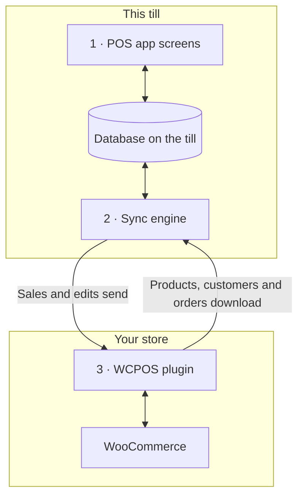

import LinkCards from '@site/src/components/LinkCards';
import LinkCard from '@site/src/components/LinkCard';
import JourneyShot from '@site/src/components/JourneyShot';
import manifest from '@site/static/img/2.x/reference/architecture/en/manifest.json';

يتكون WCPOS من جزأين: إضافة على موقع WordPress، وتطبيق POS على كل جهاز بيع. يجري الجهاز عمليات البيع اعتمادًا على نسخته الخاصة من بيانات متجرك، ويحافظ على تزامنها مع WooCommerce في الخلفية. توضح هذه الصفحة للمطورين وأصحاب المتاجر المهتمين أين تُحفَظ البيانات وما الذي يصل إلى الخادم.

هل تبحث عن حل لمشكلة بدلًا من قراءة تفاصيل التصميم؟

- **تحديث التطبيق:** [تحقق أولًا من أن جهاز البيع أرسل كل شيء](../getting-started/previous-versions.mdx#check-sync). راجع [المزامنة قبل التحديث](#storage).
- **منتج غير موجود على جهاز البيع:** راجع [عندما يكون منتج مفقودًا أو غير محدَّث](../products/sync.mdx#goes-wrong).
- **عملية بيع لم تصل إلى متجرك:** راجع [عمليات البيع التي تنتظر الإرسال](../getting-started/offline.mdx#offline-writes).

## الجزآن {#two-part-system}

1. يعمل **تطبيق POS** على كل جهاز بيع: في المتصفح على المسار `/pos/` في موقعك (يمكن تغيير العنوان)، أو في تطبيق سطح المكتب، أو في تطبيقَي iOS وAndroid. راجع [التثبيت](../getting-started/installation.mdx) لمعرفة متطلبات كل منها. تقرأ كل شاشة من قاعدة بيانات على جهاز البيع وتكتب فيها، فلا ينتظر البحث أو إضافة صنف استجابة الخادم.
2. ينقل **محرك المزامنة** داخل التطبيق التغييرات في الاتجاهين. يسحب ما تغير في متجرك ويرسل ما غيّره جهاز البيع.
3. تعمل **إضافة WCPOS** على موقع WordPress وتصل جهاز البيع بـ WooCommerce. ويظل WooCommerce المرجع الأساسي لكل منتج وعميل وطلب.

## ما يحتفظ به جهاز البيع محليًا {#local-database}

تعرض **الحالة** → **قاعدة البيانات** نسخة متجرك على جهاز البيع: صف لكل نوع من السجلات، مع عددها على هذا الجهاز (**على الجهاز**) وعددها في متجرك (**على الخادم**). لمعرفة وظائف قائمة كل صف، راجع [حالة المتجر](../support/store-health.mdx#coverage).

<JourneyShot manifest={manifest} device="tablet" step={1} offsets={[[186, 0], [186, 0], [186, 0], [186, 0], [186, 0], [186, 0], [186, 0], [186, 0]]} alt="الحالة، تبويب قاعدة البيانات: جدول السجلات على جهاز البيع هذا، من المنتجات إلى معدلات الضرائب، مع عدد كل منها على الجهاز وعلى الخادم والتغطية والحجم">

1. **المنتجات** — دفعة أولية من 100 منتج بترتيب POS الافتراضي (الاسم، من A إلى Z)، ثم البقية عندما يقل نشاط جهاز البيع. راجع [التنزيل والمزامنة](../products/sync.mdx).
2. **الأنواع** — تُنزَّل مع منتجاتها.
3. **الطلبات** — تبقى الطلبات المفتوحة والحديثة على جهاز البيع. وتُنزَّل الطلبات الأقدم عند فتحها.
4. **عمليات الاسترجاع** — عمليات الاسترجاع خلال آخر 92 يومًا، إضافةً إلى أي عملية استرجاع لطلب فتحته.
5. **العملاء** — تُنزَّل بياناتهم تدريجيًا عندما يقل نشاط جهاز البيع.
6. **التصنيفات** — وتحتها **العلامات التجارية** و**الوسوم**.
7. **الكوبونات** — موجودة على جهاز البيع سواء كنت تستخدم Pro أم لا.
8. **معدلات الضرائب** — معدلات الضرائب في متجرك.

</JourneyShot>

تعني الشارة الحمراء **N عالق** على أحد الصفوف أن سجلات من هذا النوع تحتاج إلى تدخلك. راجع [السجلات التي تحتاج إلى انتباه](../support/store-health.mdx#stuck-records).

فوق الجدول، راقب عدد **التغييرات التي تنتظر الإرسال**: وهي عمليات البيع والتعديلات التي أُجريت على جهاز البيع هذا ولم يتلقَّها متجرك بعد. تبقى على الجهاز حتى يتلقاها المتجر. ولا يشمل هذا العدد الطلبات المفتوحة التي لم تزامنها والتغييرات المدرجة في لوحة، وهي أيضًا لم تصل إلى متجرك. راجع [عمليات البيع التي تنتظر الإرسال](../getting-started/offline.mdx#offline-writes).

السجلات المحفوظة خارج هذا الجدول

تُحفَظ بعض البيانات خارج هذا الجدول. تُقرأ طرق الدفع وفئات الضرائب وطرق الشحن وحالات الطلبات من متجرك عند كل تشغيل للتطبيق، وتُحفَظ آخر استجابة للاستخدام عندما يكون جهاز البيع غير متصل. ولجلسات الصندوق وعمليات الإغلاق والحركات النقدية سجلاتها الخاصة وطابور إرسالها الخاص إلى متجرك.

### كيفية حفظ قاعدة البيانات {#storage}

لكل أمين صندوق في كل متجر نسخته الخاصة على جهاز البيع، وفي المتصفح تُشغِّل علامة تبويب واحدة POS لكل موقع في الوقت نفسه. وعندما يغيّر تحديث التطبيق طريقة تخزين هذه النسخة، ينزّلها جهاز البيع من جديد.

:::warning المزامنة قبل التحديث
لا تُرسَل عمليات البيع والتعديلات التي لا تزال تنتظر في النسخة القديمة. قبل تحديث التطبيق، تحقق في **الحالة** → **قاعدة البيانات** من أن عدد **التغييرات التي تنتظر الإرسال** هو 0 ومن عدم وجود لوحة أسفل الأرقام، وزامن كل طلب مفتوح. راجع [التحقق من أن جهاز البيع أرسل كل شيء](../getting-started/previous-versions.mdx#check-sync).
:::

تفاصيل للمطورين: محرك التخزين وعلامات التبويب وتحديثات التطبيق

- **قاعدة بيانات منفصلة لكل موقع ومتجر وأمين صندوق.** لا يتشارك أمينا صندوق على جهاز بيع واحد، أو أمين صندوق واحد في متجرين، البيانات المحلية مطلقًا.
- **SQLite على كل منصة.** في المتصفح، يعمل SQLite فوق مساحة تخزين الملفات الخاصة بالمتصفح ضمن عامل واحد؛ وفي تطبيقَي iOS وAndroid يُستخدم SQLite الخاص بالنظام؛ أما تطبيق سطح المكتب فيحفظ البيانات في SQLite ضمن العملية الرئيسية للتطبيق.
- **محفوظة على القرص.** تبقى نسخة جهاز البيع بعد إغلاق المتصفح أو التطبيق وإعادة تشغيل الجهاز.
- **علامة تبويب نشطة واحدة لكل موقع.** في المتصفح، تُشغِّل علامة تبويب واحدة POS لكل موقع. إذا فتحت علامة تبويب ثانية، فستعرض تولّي التشغيل وتتوقف الأولى.
- **تُعالَج القوائم داخل قاعدة البيانات.** تُنفَّذ التصفية والفرز وتقسيم الصفحات داخل قاعدة البيانات متى أمكن، فلا ترسل قائمة تضم آلاف الطلبات إلى الشاشة إلا الصفوف المعروضة.
- **لا ترحيل لقاعدة البيانات الحالية.** عندما يغيّر تحديث التطبيق بنية قاعدة البيانات، يفتح التطبيق قاعدة جديدة ويعيد التنزيل من متجرك. لا تُرسَل التغييرات التي لا تزال تنتظر في القاعدة القديمة، ولا تُنقَل الطلبات المفتوحة: زامن جهاز البيع قبل تحديث التطبيق.

## كيف يبقى جهاز البيع ومتجرك متزامنين {#data-synchronization}

لا ينسخ محرك المزامنة متجرك بالكامل وفق مؤقت. بل يعمل بحسب احتياجات شاشات جهاز البيع ويقلل طلباته إلى الخادم قدر الإمكان.

- **التحقق من التغييرات.** يسأل جهاز البيع متجرك عما تغير، بالتواتر الذي يحدده [إعداد المزامنة المسبق](../support/store-health.mdx#sync-presets) (**اقتصادي** أو **متوازن** أو **فوري**). يحتفظ كل جهاز بيع بإعداده الخاص: تغييره على جهاز لا يغيّر إعدادات الأجهزة الأخرى.
- **ما تحتاجه الشاشة.** تخبر كل شاشة المحرك بما تعرضه. يستجيب المحرك من قاعدة بيانات جهاز البيع إن كانت السجلات موجودة، ولا يطلبها من متجرك إلا إن لم تكن موجودة.
- **في الخلفية.** تُنزَّل أولًا الدفعة الأولى من المنتجات والطلبات المفتوحة والحديثة. ثم تتبعها بقية المنتجات والعملاء عندما يقل نشاط جهاز البيع.
- **إرسال التغييرات.** تُحفَظ كل عملية بيع أو تعديل على جهاز البيع أولًا، ثم تُرسَل إلى متجرك. لا تُعاد محاولة إرسال تغيير رفضه متجرك تلقائيًا: بل ينتظر ضمن **N تغيير لم يصل إلى خادمك**، مع خيارَي **إرسال مرة أخرى** و**تجاهل**. راجع [حالة المتجر](../support/store-health.mdx#refused-changes).

تفاصيل للمطورين: تدفق التغييرات وميزانيات الطلبات ومسارات المزامنة

- إذا لم يكن لدى المتجر أي جديد، يستجيب للتحقق من التغييرات بـ `304 Not Modified` دون متن للاستجابة.
- تمر عمليات الكتابة عبر طابور دائم على جهاز البيع، يرسلها إلى `wcpos/v2/push/{collection}`.
- تجد ميزانيات الطلبات والتراجع التدريجي والأرقام المقاسة في [أداء المزامنة](./sync-performance.mdx). وتجد كل مسارات المزامنة في [كيف يعمل محرك المزامنة](./sync-engine.mdx).

## كيف تُسجَّل عملية البيع عند الدفع {#checkout-architecture}

الدفع جزء من POS. يتولى جهاز البيع تحصيل كل دفعة ويسجلها لطلب WooCommerce واحد، بدلًا من فتح صفحة دفع الطلب في WooCommerce لكل عملية بيع.

:::warning الدفع دون اتصال يتطلب عملية بيع موجودة بالفعل في متجرك
لا يمكن تحصيل دفعة دون اتصال إلا لعملية بيع وصلت إلى متجرك قبل انقطاع الاتصال: يظهر رقم طلبها فوق الأصناف في [الدفع](../pos/checkout/index.mdx). أما عملية البيع التي بدأت بعد انقطاع الاتصال فتنتظر على جهاز البيع، ويُسدَّد ثمنها عند عودة الاتصال بالمتجر. راجع [تحصيل دفعة دون اتصال](../getting-started/offline.mdx#take-payment-offline).
:::

- **مربع لكل طريقة.** يعرض جهاز البيع مربعًا لكل طريقة دفع مُفعَّلة في POS. وتظهر الطريقة التي لا يستطيع تشغيلها باللون الرمادي مع توضيح السبب، ولا تُخفى أبدًا. راجع [عندما يتعذر استخدام مربع](../payment/index.mdx#unavailable-tiles).
- **طلب واحد ومدفوعات متعددة.** تظل عملية البيع المقسَّمة طلب WooCommerce واحدًا، بمجموعة واحدة من الأصناف والضرائب وتغييرات المخزون ورقم طلب واحد، فتُحتسَب مرة واحدة في التقارير. والاسترجاع هو عملية استرجاع عادية في WooCommerce، موزعة على المدفوعات التي تُعاد مبالغها.
- **القرار للمتجر.** بعد كل دفعة، يستجيب متجرك بالمبلغ المدفوع والمتبقي، ويُكمل جهاز البيع العملية بناءً على أرقام متجرك، لا أرقامه المحلية.
- **إعادة المحاولة آمنة.** لكل دفعة ID ينشئه جهاز البيع، لذا تُسجَّل الدفعة المرسلة مرتين مرة واحدة.
- **دون اتصال.** لعملية بيع موجودة بالفعل في متجرك، يظل الدفع النقدي يُكتمَل عند انقطاع الاتصال: تُسجَّل الدفعة بحالة **تُسوّى لاحقًا** وتُرسَل عند عودة الاتصال. راجع [تحصيل دفعة دون اتصال](../getting-started/offline.mdx#take-payment-offline).

أوضاع التحصيل ومسارات الدفع

يصف `GET wcpos/v2/payment-methods` كل بوابة دفع: نوعها `kind` (`cash` أو `card` أو `stored_value` أو `bank_transfer` أو `other`)، وكيفية تحصيلها الأموال (`capture`)، وما تتيحه (`capabilities`: مبالغ جزئية، وباقي المبلغ، واسترجاع، وإكراميات، وعمل دون اتصال، وإلغاء). كل دفعة صف في البيانات الوصفية `_wcpos_payments` للطلب، وبعد كل دفعة يستجيب المتجر بقيمتَي `paid` و`balance` للطلب.

تحدد `capture.mode` لكل طريقة الجهة التي تحصّل الأموال. ويوجَّه كل استدعاء دفع إلى المعالج المسجَّل لوضعه.

| الوضع | كيفية تحصيل الأموال | الإضافة |
| --- | --- | --- |
| `manual` | يحصّلها أمين الصندوق ويسجلها. الوضع الافتراضي للنقد والبطاقة والدفع عند الاستلام والتحويل المصرفي المباشر والمدفوعات بالشيكات. | المجانية |
| `webview` | صفحة الدفع الخاصة ببوابة الدفع، في تبويب **القديم** ضمن شاشة الدفع. الوضع الافتراضي لكل بوابات الدفع الأخرى. راجع [عندما لا تُحمَّل صفحة الدفع في تبويب القديم](../payment/index.mdx#legacy-notices). | المجانية |
| `gateway` | تُشغَّل `process_payment()` الخاصة ببوابة الدفع بالقيم التي جمعها جهاز البيع. تختار بوابة الدفع هذا الوضع عبر مرشح. | المجانية |
| `server` | يطلب متجرك من مزود جهاز الدفع بالبطاقة تحصيل الدفعة. | Pro |
| `device` | يشغّل جهاز البيع قارئ البطاقات عبر SDK الخاص بالمزود، ويؤكد المزود الدفعة. | Pro |

تتفرع مسارات الدفع من الطلب باستخدام ID الخاص به في WooCommerce:

- يسجّل `POST wcpos/v2/orders/{id}/payments` دفعة. ويجعل ID الخاص بالدفعة إعادة المحاولة آمنة.
- تعمل `.../payments/{uuid}/intent` و`/capture` و`/void` و`/refund` (`POST`)، و`/status` (`GET`) على دفعة واحدة. ويحمل كل أمر ID خاصًا به.
- يُكمل `POST wcpos/v2/orders/{id}/close` الطلب.

يحمل كل أمر قيمة `revision` للطلب؛ ويُرفَض أي أمر لا يحملها بالرمز `428`.

لبناء بوابة دفع مخصصة لـ POS فقط، ابدأ من [نموذج بوابة الدفع](./gateway-template.mdx).

## لماذا لا تصل بعض تغييرات الموقع إلى جهاز البيع {#api-extensions}

يحصل جهاز البيع على المنتجات والعملاء والطلبات من إضافة WCPOS، التي تقرؤها من WooCommerce. تصل إلى جهاز البيع تغييرات الإضافة التي تعدّل البيانات التي يرسلها WooCommerce إلى التطبيقات. أما الإضافة التي تغيّر مظهر موقعك فقط، أو الدفع عبر الإنترنت فقط، فلا تصل تغييراتها إليه. لفحص إضافة، ابدأ بصفحة [فهم REST API في WooCommerce](./wc-rest-api.mdx).

تفاصيل للمطورين: إصدارات API

يتواصل جهاز البيع مع متجرك فقط عبر مسارات REST الخاصة بالإضافة، التي تقرأ من WooCommerce داخل موقعك. تسجّل الإضافة نطاقَي أسماء إلى جانب `wc/v3` الخاص بـ WooCommerce.

- يستخدم التطبيق **`wcpos/v2`** لقراءة السجلات وتدفق التغييرات وطابور التغييرات والمدفوعات والصناديق والجلسات. تُمرِّر مسارات القراءة فيه إلى `wc/v3` داخل موقعك، لذا فإن الإضافة التي تغيّر استجابات REST في WooCommerce تغيّر ما يراه جهاز البيع.
- لا يزال **`wcpos/v1`** يُسجَّل. مسارات بياناته (المنتجات والأنواع والطلبات والعملاء والكوبونات والضرائب والتصنيفات والوسوم والعلامات التجارية) مجمَّدة. أما مسارات خدماته (المتاجر والإعدادات والإيصالات والنماذج ومهام الطباعة وغيرها) فتستخدم الشيفرة نفسها التي تستخدمها نظيراتها في `wcpos/v2`.

### تحديثات التطبيق وأدوات المزامنة الأخرى {#wcpos-v2-namespace}

يُحدَّث التطبيق والإضافة معًا: إذا كان التطبيق على جهاز البيع أقدم مما تتطلبه الإضافة، يظهر [SYNC341](../error-codes/SYNC341.mdx) حتى يُحدَّث التطبيق. تُخزَّن أسعار POS لبنود الطلب حيث تستطيع أدوات المزامنة الأخرى قراءتها؛ راجع [كيفية تخزين تجاوزات أسعار POS](./pos-discounts.mdx#how-pos-price-overrides-are-stored).

تفاصيل للمطورين: الطلبات وتسجيل الدخول ومعرّفات الطلبات

- **تُحمَّل المسارات لطلبات POS.** تسجّل الإضافة مساراتها فقط عند الطلبات الموجَّهة إليها: مسار `wcpos/` أو ترويسة `X-WCPOS` أو `?wcpos=1`. ولا تُحمِّلها بقية حركة REST في موقعك.
- **يتطور التطبيق والإضافة معًا.** يحمل كل طلب من التطبيق `X-WCPOS-Protocol`. وتستجيب الإضافة التي تتطلب بروتوكولًا أحدث بالرمز `426` مع `wcpos_update_required`، ويعرض جهاز البيع [SYNC341](../error-codes/SYNC341.mdx) حتى يُحدَّث التطبيق.
- **المسارات العامة.** لا تتطلب `wcpos/v2/site` و`wcpos/v2/ping` و`wcpos/v2/echo` تسجيل الدخول. يستخدمها التطبيق للعثور على موقعك واختبار الاتصال قبل تسجيل دخول أي شخص. على الاستضافات التي تُخفي `/wp-json/` أو تزيل الترويسات، يلجأ التطبيق إلى عنوان WordPress‏ `/?rest_route=` وإلى صيغ الترويسات في سلسلة الاستعلام (`?wcpos=1` و`wcpos_protocol`). وإذا لم يستجب أي منهما، يعرض جهاز البيع [AUTH431](../error-codes/AUTH431.mdx).
- **تسجيل الدخول.** يسجّل التطبيق الدخول عبر صفحة `/wcpos-auth` على موقعك، ويتلقى رمز وصول JWT صالحًا لمدة 30 دقيقة ورمز تحديث صالحًا لمدة 30 يومًا. يغيّر المرشحان `wcpos_jwt_access_token_expire` و`wcpos_jwt_refresh_token_expire` هاتين المدتين. لمعرفة المسارات المتاحة لكل دور، راجع [وصول الأدوار إلى نقاط النهاية](./role-endpoint-access.mdx).
- **تحمل الطلبات UUID.** ينشئ جهاز البيع UUID لكل طلب، ويرسله ضمن البيانات الوصفية `_woocommerce_pos_uuid`، ويحتفظ به متجرك. تعتمد عمليات سحب الطلبات على UUID كمفتاح.
- تُخزَّن **أسعار POS لبنود الطلب** بحيث تستطيع أدوات المزامنة الأخرى قراءتها. راجع [كيفية تخزين تجاوزات أسعار POS](./pos-discounts.mdx#how-pos-price-overrides-are-stored).
- **المتاجر (Pro).** عند وجود عدة متاجر، يرسل جهاز البيع متجره في ترويسة `X-WCPOS-Store`، وتمرره الإضافة إلى WooCommerce باسم `store_id`. يُحدَّد متجر الطلب من المدخل `_pos_store` في بياناته الوصفية. وتُسجَّل مسارات Pro الخاصة بتعديل المتاجر وإقران شاشة العميل ضمن نطاقَي الأسماء.

:::info مع WCPOS Pro
يضيف Pro قارئات البطاقات وتعديل المتاجر وإقران شاشة العميل. وعند وجود عدة متاجر، تكون لكل متجر أسعاره الخاصة على جهاز البيع. راجع [إعداد المتاجر](../stores/setup.mdx).
:::

## مزايا التصميم وما يقابلها من متطلبات {#architecture-pros-and-cons}

- **بحث وسلة فوريان.** كلاهما يقرأ قاعدة بيانات جهاز البيع نفسه.
  - **ما يقابل ذلك:** يجب إبقاء نسخة جهاز البيع متزامنة مع متجرك. وهذه هي مهمة محرك المزامنة بالكامل.
- **البيع أثناء انقطاع الاتصال.** تنتظر عمليات البيع والتعديلات على جهاز البيع وتُرسَل عند عودة الاتصال. ويظل الدفع النقدي يُكتمَل لعملية بيع موجودة بالفعل في متجرك.
  - **ما يقابل ذلك:** لا يُسدَّد ثمن عملية بيع بدأت بعد انقطاع الاتصال إلا عند عودة الاتصال بالمتجر. راجع [تحصيل دفعة دون اتصال](../getting-started/offline.mdx#take-payment-offline).
- **تطبيقات مصمَّمة لجهاز البيع.** تطبيقات لسطح المكتب وiOS وAndroid، وليست صفحة ويب داخل إطار.
  - **ما يقابل ذلك:** لا يصل POS إلى متجرك إلا عبر REST API. لا تستطيع قوالب WordPress وخطافاته تغيير مظهره، ولا تصل إليه تغييرات إضافة لا تعدّل إلا الدفع على الويب أو قالب موقعك. راجع [لماذا لا تعمل بعض الإضافات في POS؟](./wc-rest-api.mdx#why-dont-some-plugins-work-in-the-pos)

## وثائق ذات صلة {#related-documentation}

<LinkCards>
  <LinkCard title="كيف يعمل محرك المزامنة" to="/developers/sync-engine" description="مسارات المزامنة وتدفق التغييرات وطابور التغييرات بالتفصيل." />
  <LinkCard title="حالة المتجر" to="/troubleshooting/store-health" description="اطّلع على قاعدة بيانات جهاز البيع وإعدادات المزامنة المسبقة والتغييرات التي تنتظر الإرسال." />
  <LinkCard title="فهم REST API في WooCommerce" to="/developers/woocommerce-rest-api" description="ما هي REST API، ولماذا لا تصل بعض الإضافات إلى POS." />
</LinkCards>
