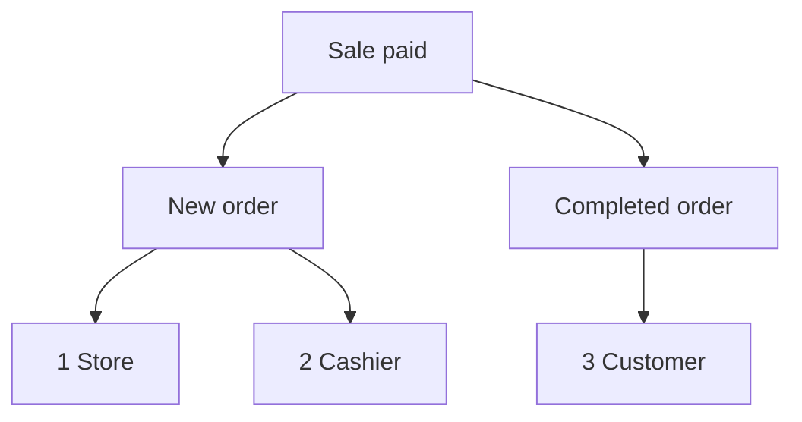

import Accordion from '@site/src/components/Accordion';
import AccordionItem from '@site/src/components/AccordionItem';
import LinkCards from '@site/src/components/LinkCards';
import LinkCard from '@site/src/components/LinkCard';

**لوحة إدارة WordPress:** `WP Admin → POS → Settings → Checkout`.

يرسل WooCommerce رسائل بريد إلكتروني بشأن الطلبات: رسالة طلب جديد إليك، ورسالة طلب مكتمل إلى العميل، وهكذا. بالنسبة إلى المبيعات التي تتم في POS، تختار هنا الرسائل التي تُرسل ومن يتلقاها. أما طلبات متجرك الإلكتروني فتحتفظ بإعدادات البريد الإلكتروني المعتادة في WooCommerce.

انتقل مباشرة إلى: [رسائل المدير](#admin-emails) · [رسائل العملاء](#customer-emails) · [إرسال إيصال يدويًا](#send-receipt-manually) · [رسائل أمين الصندوق](#cashier-emails) · [حالات شائعة](#common-scenarios) · [إذا حدث خطأ](#goes-wrong)

## تفعيل رسائل البريد الإلكتروني أو تعطيلها {#switches}

:::note لمبيعات POS
تتجاوز هذه المفاتيح إعداد **تفعيل هذا الإشعار بالبريد الإلكتروني** ضمن **WooCommerce > الإعدادات > رسائل البريد الإلكتروني** لطلبات POS. ويمكن إرسال رسالة معطّلة في WooCommerce إذا كان مربع اختيارها محددًا هنا.
:::

1. في WP Admin، انتقل إلى **نقطة البيع > الإعدادات > الدفع**.
2. ابحث عن مفاتيح البريد الإلكتروني الثلاثة أسفل **منع البيع الزائد**: **رسائل المدير** و**رسائل العملاء** و**رسائل أمين الصندوق**. وتوجد قائمة **بوابات الدفع** أسفلها.
3. فعّل أحد المفاتيح ليظهر مربع اختيار لكل رسالة في تلك المجموعة. أزل تحديد أي رسالة لإيقافها وحدها.
4. عطّل أحد المفاتيح لمنع إرسال أي رسالة من تلك المجموعة لمبيعات POS، بغض النظر عن حالة مربعات الاختيار.

يُحفظ كل تغيير فور إجرائه: تعرض الشاشة **جارٍ الحفظ**، ثم **تم الحفظ**.

{/* reshoot: WP Admin > POS > Settings > Checkout with all three email switches on and their checkboxes showing; see reshoot.md */}

مستلمو الرسائل لكل مفتاح، وحالته عند التثبيت:

- **رسائل المدير**: مفعّلة عند التثبيت\
  إلى العناوين في **المستلم (المستلمون)** لتلك الرسالة، ضمن **WooCommerce > الإعدادات > رسائل البريد الإلكتروني**
- **رسائل العملاء**: مفعّلة عند التثبيت\
  إلى عنوان البريد الإلكتروني للفوترة في الطلب
- **رسائل أمين الصندوق**: معطّلة عند التثبيت\
  إلى عنوان البريد الإلكتروني في حساب أمين الصندوق على WordPress

الرسائل التي تُرسل عند دفع قيمة عملية بيع واحدة عند الصندوق، عندما تكون **حالة الطلب** لطريقة الدفع المستخدمة هي مكتمل:

1. **المتجر** — **المستلم (المستلمون)** لرسالة **طلب جديد** في WooCommerce، إذا كانت **رسائل المدير** مفعّلة وكان مربع **طلب جديد** محددًا.
2. **أمين الصندوق** — عنوان أمين الصندوق نفسه، إذا كانت **رسائل أمين الصندوق** مفعّلة وكان مربع **طلب جديد** محددًا.
3. **العميل** — عنوان البريد الإلكتروني للفوترة في الطلب، إذا كانت **رسائل العملاء** مفعّلة وكان مربع **طلب مكتمل** محددًا وكان للطلب عنوان بريد إلكتروني للفوترة.

## رسائل المدير {#admin-emails}

تُرسل هذه الرسائل إليك بصفتك صاحب المتجر. تكون جميع مربعات اختيار الرسائل محددة عند التثبيت.

لتغيير مستلمي إحدى رسائل المدير، انتقل إلى **WooCommerce > الإعدادات > رسائل البريد الإلكتروني**، وافتح إعدادات تلك الرسالة وعدّل **المستلم (المستلمون)**.

| الرسالة | وقت الإرسال |
|---|---|
| **طلب جديد** | عند انتقال طلب POS إلى مكتمل أو قيد التنفيذ أو قيد الانتظار |
| **طلب ملغي** | عند إلغاء طلب قيد التنفيذ أو قيد الانتظار |
| **طلب فاشل** | عند فشل طلب بانتظار الدفع أو قيد الانتظار |

عندما ينتقل طلب POS من **نقطة البيع - مفتوح** أو **نقطة البيع - دفع جزئي** إلى مكتمل أو قيد التنفيذ أو قيد الانتظار، تُرسل رسالة **طلب جديد** إذا كان مربعها محددًا ضمن **رسائل المدير** أو **رسائل أمين الصندوق** وكان المفتاح المعني مفعّلًا، حتى لو كانت رسالة **طلب جديد** معطّلة في WooCommerce. الحالة التي تنتقل إليها كل عملية بيع هي **حالة الطلب** التي تحددها لطريقة الدفع المستخدمة: انظر [حالة الطلب](./checkout.mdx#order-status).

لماذا يرسل WCPOS بنفسه رسالة طلب جديد لمبيعات POS

لا يرسل WooCommerce رسالة **طلب جديد** إلا عندما يغادر الطلب إحدى حالات بانتظار الدفع أو فشل أو ملغي. أما طلب نقطة البيع، فيبقى في حالة **POS - مفتوح** أو **POS - دفع جزئي** بدلًا من ذلك، وهما حالتان لا يتعرّف عليهما WooCommerce، لذا لن يرسل الرسالة عند انتقال الطلب إلى الحالة التالية. ويرسلها WCPOS نيابةً عن WooCommerce في الأوقات الموضّحة أعلاه.

## رسائل العملاء {#customer-emails}

تُرسل هذه الرسائل إلى عنوان البريد الإلكتروني للفوترة في الطلب. إذا لم يكن للطلب عنوان بريد إلكتروني للفوترة، كما في عملية بيع لضيف لم تُدخل له عنوانًا، فلن تُرسل أي رسالة إلى العميل. تكون جميع مربعات اختيار الرسائل محددة عند التثبيت.

### إرسال إيصال يدويًا {#send-receipt-manually}

يعمل خيار **إرسال الإيصال بالبريد الإلكتروني** في شاشة إتمام الدفع بشكل مستقل. فهو يرسل رسالة الفاتورة من WooCommerce، التي لا تتحكم فيها هذه المفاتيح، لذا يعمل حتى عند تعطيل **رسائل العملاء**. انظر [إرسال الإيصال بالبريد الإلكتروني](../../receipts/at-checkout.mdx#email-receipt).

### الرسائل التي تُرسل تلقائيًا {#customer-emails-automatic}

| الرسالة | وقت الإرسال |
|---|---|
| **طلب قيد الانتظار** | عند انتقال طلب إلى قيد الانتظار من بانتظار الدفع أو فاشل أو ملغي |
| **طلب قيد التنفيذ** | عند انتقال طلب إلى قيد التنفيذ من بانتظار الدفع أو قيد الانتظار أو فاشل أو ملغي |
| **طلب مكتمل** | عند انتقال طلب إلى مكتمل |
| **طلب مسترد** | عند استرداد قيمة الطلب كليًا أو جزئيًا. انظر [الاستردادات](../../orders/refunds.mdx) |
| **طلب فاشل** | عند فشل طلب |

لا تُرسل رسالة **طلب قيد الانتظار** أو **طلب قيد التنفيذ** لعملية بيع تنتقل مباشرة من **نقطة البيع - مفتوح** إلى قيد التنفيذ أو قيد الانتظار، مثل البيع النقدي: يرسل WooCommerce هاتين الرسالتين فقط عند الانتقال من الحالات المذكورة. أما رسائل **طلب مكتمل** و**طلب مسترد** و**طلب فاشل** فلا تعتمد على الحالة السابقة، ولذلك تُرسل لمبيعات POS. لإرسال رسالة إلى العميل لعملية بيع تنتهي بحالة قيد التنفيذ أو قيد الانتظار، استخدم [إرسال الإيصال بالبريد الإلكتروني](#send-receipt-manually).

## رسائل أمين الصندوق {#cashier-emails}

يرسل هذا الخيار رسالة **طلب جديد** إلى أمين الصندوق الذي أجرى البيع، على عنوان البريد الإلكتروني في حسابه على WordPress. يكون المفتاح معطّلًا عند التثبيت؛ وعند تفعيله، يكون مربع **طلب جديد** محددًا.

يتلقى أمين الصندوق الرسالة في الأوقات نفسها التي يتلقاها فيها المدير (انظر [رسائل المدير](#admin-emails)). تعمل **رسائل المدير** و**رسائل أمين الصندوق** بشكل مستقل: تعطيل إحداهما لا يغيّر الأخرى. إذا كان عنوان أمين الصندوق ضمن مستلمي رسائل المدير بالفعل، مثل مالك يتولى الدورين، فإنه يتلقى نسخة واحدة لا نسختين.

تحدد صفحة [وصول أمين الصندوق](./access.mdx) مستخدمي WordPress الذين يمكنهم تسجيل الدخول إلى POS بصفتهم أمناء صندوق.

## حالات شائعة {#common-scenarios}

<Accordion>
  <AccordionItem question="منع امتلاء صندوق الوارد بالرسائل في الأيام المزدحمة">

أزل تحديد **طلب جديد** ضمن **رسائل المدير**. وأبقِ **طلب ملغي** و**طلب فاشل** محددين: فهاتان الرسالتان تخبرانك بما تحتاج إلى معرفته.

لمتابعة الإيرادات، استخدم [التقارير](../../reports/index.mdx) بدلًا من عدّ رسائل الطلبات الجديدة.

  </AccordionItem>

  <AccordionItem question="إرسال رسائل الطلبات الجديدة إلى أمين الصندوق المناوب بدلًا من المدير">

أزل تحديد **طلب جديد** ضمن **رسائل المدير**، أو عطّل **رسائل المدير**، وفعّل **رسائل أمين الصندوق**. يتلقى أمين الصندوق الذي يجري كل عملية بيع الرسالة على عنوانه، ولا تصل إلى صندوق وارد المدير.

يؤدي تعطيل **رسائل المدير** أيضًا إلى إيقاف رسالتي **طلب ملغي** و**طلب فاشل**، لذا فإن إزالة تحديد **طلب جديد** وحدها هي الخيار الأفضل عادةً.

  </AccordionItem>

  <AccordionItem question="عدم إرسال رسائل للعملاء عن المبيعات داخل المتجر">

غالبًا ما لا ترغب أكشاك الأسواق والمقاهي في إرسال بريد إلكتروني إلى عميل لديه إيصال مطبوع بالفعل. عطّل **رسائل العملاء**، ولن تُرسل أي رسالة عن طلب قيد التنفيذ أو مكتمل أو مسترد، أو أي رسالة أخرى للعملاء، لمبيعات POS.

تستمر طلبات متجرك الإلكتروني في إرسال رسائل العملاء كالمعتاد. ويظل بإمكان العميل الذي يطلب إيصالًا بالبريد الإلكتروني الحصول عليه: اضغط **إرسال الإيصال بالبريد الإلكتروني** في شاشة إتمام الدفع.

  </AccordionItem>

  <AccordionItem question="رقّيت من إصدار أقدم من 1.8.9 واختفى مفتاح «تفعيل رسائل البريد الإلكتروني» الوحيد">

استبدل الإصدار 1.8.9 مفتاح التفعيل والتعطيل الوحيد بالمجموعات الثلاث الموجودة في هذه الصفحة. يقرأ WCPOS إعدادك القديم: إذا كانت الرسائل معطّلة، تبقى **رسائل المدير** و**رسائل العملاء** معطّلتين؛ وإذا كانت مفعّلة، تبقيان مفعّلتين مع تحديد جميع الرسائل. وتبدأ **رسائل أمين الصندوق** معطّلة في الحالتين.

لا تحتاج إلى اتخاذ أي إجراء.

  </AccordionItem>
</Accordion>

## إذا حدث خطأ {#goes-wrong}

**لا يتلقى المدير رسالة طلب جديد.** تأكد من تفعيل **رسائل المدير** وتحديد **طلب جديد**. ثم تحقق من **المستلم (المستلمون)** لرسالة **طلب جديد** ضمن **WooCommerce > الإعدادات > رسائل البريد الإلكتروني**.

**لا يتلقى العميل أي رسالة.** تأكد من تفعيل **رسائل العملاء** وتحديد الرسالة المعنية. ثم افتح الطلب وتأكد من وجود عنوان بريد إلكتروني للفوترة. لإرسال إيصال الآن، استخدم **إرسال الإيصال بالبريد الإلكتروني**.

**لا يتلقى أمين الصندوق أي رسالة.** تأكد من تفعيل **رسائل أمين الصندوق** وتحديد **طلب جديد**، ومن وجود عنوان بريد إلكتروني في حساب أمين الصندوق على WordPress. إذا كان ذلك العنوان ضمن مستلمي رسائل المدير أيضًا، فلن يتلقى سوى نسخة واحدة.

**ما زالت رسالة عطّلتها في WooCommerce تصل لمبيعات POS.** بالنسبة إلى طلبات POS، تتحكم مربعات الاختيار هنا في الإرسال. أزل تحديد الرسالة هنا أيضًا.

## خطافات المطورين {#developer-hooks}

للمطور الذي يحتاج إلى تحكم يتجاوز هذه المفاتيح. يمكن لأصحاب المتاجر تجاوز هذا القسم.

أربعة مرشحات في WordPress وكيفية تحديد مستلمي رسالة طلب جديد

قبل WCPOS 2.0، كانت أسماء هذه المرشحات تبدأ بـ `woocommerce_pos_*` (مثل `woocommerce_pos_admin_emails`). ما زالت تلك الأسماء تعمل، لكنها مهملة منذ 2.0 ولن تُزال قبل 2.2. انظر [تسمية الخطافات](../../extensions/index.mdx#hook-naming).

**`wcpos_admin_emails`**: معرّفات رسائل المدير التي يتحكم فيها WCPOS. الافتراضي: `cancelled_order`، `failed_order`.

**`wcpos_customer_emails`**: معرّفات رسائل العملاء التي يتحكم فيها WCPOS. الافتراضي: `customer_failed_order`، `customer_on_hold_order`، `customer_processing_order`، `customer_completed_order`، `customer_refunded_order`.

**`wcpos_admin_email_enabled`**: ما إذا كانت رسالة واحدة للمدير تُرسل لطلب POS واحد. الوسائط: `$is_enabled`، `$email_id`، `$order`، `$email`.

**`wcpos_customer_email_enabled`**: ما إذا كانت رسالة واحدة للعميل تُرسل لطلب POS واحد. الوسائط نفسها.

لا تندرج رسالة **طلب جديد** ضمن `wcpos_admin_emails`. يحدد WCPOS مستلميها عبر مرشح `woocommerce_email_recipient_new_order` في WooCommerce: يزيل مستلمي المتجر عندما لا يريدها المدير، ويضيف عنوان أمين الصندوق عندما يريدها أمين الصندوق. وأمين الصندوق هو مستخدم WordPress المحفوظ في بيانات الطلب الوصفية `_pos_user`. يمكن لدالة رد النداء الخاصة بك على هذا المرشح إضافة عناوين أو إزالتها بالطريقة نفسها المتبعة مع أي رسالة بريد إلكتروني من WooCommerce.

## وثائق ذات صلة {#related-documentation}

<LinkCards>
  <LinkCard title="إعدادات الدفع" to="/settings/checkout" description="بوابات الدفع وحالة الطلب التي تحددها كل منها، في الشاشة نفسها." />
  <LinkCard title="الإيصالات عند الدفع" to="/sell/print-email-receipts" description="اطبع إيصالًا أو أرسله بالبريد الإلكتروني من شاشة إتمام الدفع." />
  <LinkCard title="الطلبات" to="/manage-store/orders" description="اعثر على طلبات POS التي تتعلق بها هذه الرسائل." />
</LinkCards>
