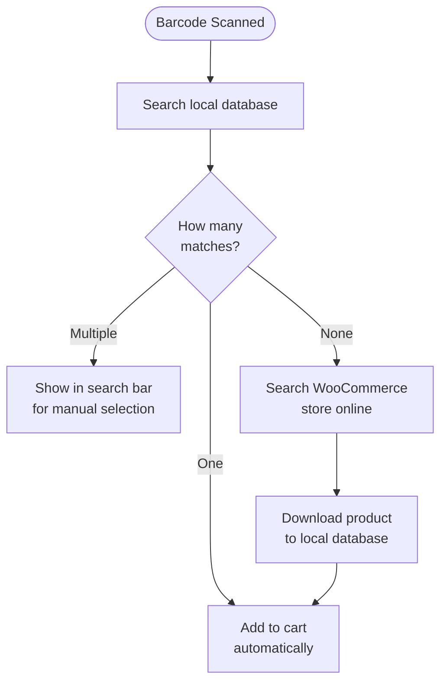

import Image from "@theme/IdealImage";
import Accordion from '@site/src/components/Accordion';
import AccordionItem from '@site/src/components/AccordionItem';

Die meisten Barcode-Scanner verhalten sich wie eine mit Ihrem Gerät verbundene Tastatur.
Wenn Sie einen Barcode scannen, erkennt WCPOS, dass die Zeichen schneller eingegeben wurden als bei normalem Tippen.
Es nutzt diese „schnellen Tastenanschläge“, um die Eingabe als Barcode-Scan zu identifizieren.
Das funktioniert mit nahezu jedem Scanner sofort — Scanner unterstützen aber auch andere [Verbindungsmodi](#connection-modes), mit denen sich WCPOS direkt verbinden kann.

## Barcode-Scannen konfigurieren {#configuring-barcode-scanning}

Da ein Barcode-Scan sehr schnell erfolgt, kann das POS zwischen einem Barcode und einer manuell eingegebenen Eingabe unterscheiden.
In den POS-Einstellungen finden Sie Optionen zur Feinabstimmung der Barcode-Erkennung.

  <Image
    alt="Einstellungen für das Barcode-Scannen in den POS-Einstellungen"
    img="/img/barcode-scanning-settings.png"
    style={{ maxHeight: 500 }}
  />
  
Einstellungen für das Barcode-Scannen in den POS-Einstellungen

| Einstellung | Zweck | Typischer Wert |
|---|---|---|
| **Durchschnittliche Eingabezeit** | Wie schnell die Eingabe erfolgen muss, um als Barcode erkannt zu werden | Ein kurzes Intervall — so kurz, dass manuelles Tippen die Erkennung nicht auslöst |
| **Mindestlänge** | Wie lang die zusammenhängende Zeichenfolge sein muss, um als Barcode behandelt zu werden | An den kürzesten verwendeten Barcode anpassen (z. B. 8 für EAN-8) |
| **Entfernung von Präfix/Suffix** | Entfernt zusätzliche Zeichen, die Ihr Scanner als Präfix oder Suffix hinzufügt, sodass nur der eigentliche Barcode übrig bleibt | Leer lassen, sofern Ihr Scanner nicht zum Hinzufügen solcher Zeichen konfiguriert ist |

## Verbindungsmodi {#connection-modes}

Für eine schrittweise Anleitung zur Einrichtung oder Fehlerbehebung verwenden Sie den [Scanner-Einrichtungsassistenten](/1.x/hardware/scanners/setup-wizard).

Jeder Barcode-Scanner wird in einem von mehreren Modi ausgeliefert. Der Modus bestimmt, wie WCPOS seine Scans empfangen kann:

| Modus | Übertragung | Einrichtung |
|---|---|---|
| **Tastatur (HID)** — die Werkseinstellung bei nahezu jedem Scanner | Der Scanner „tippt“ den Barcode; WCPOS erkennt die schnellen Tastenanschläge | Keine — koppeln oder anschließen und scannen |
| **Seriell (SPP / USB-COM)** | Eine direkte Verbindung über USB-Seriell oder Bluetooth SPP | Den Modus des Scanners umschalten und ihn anschließend in den Barcode-Einstellungen verbinden |
| **HID-POS** | Eine direkte Verbindung für USB-Scanner (über WebHID) | Den Modus des Scanners umschalten und ihn anschließend in den Barcode-Einstellungen verbinden |
| **Bluetooth LE (Hersteller-GATT)** | Eine direkte Bluetooth-Low-Energy-Verbindung | Den Scanner koppeln und ihn anschließend in den Barcode-Einstellungen anhand seiner Dienst-UUID hinzufügen |

Der Tastaturmodus erfordert keine Einrichtung und eignet sich für die meisten Geschäfte. Eine direkte Verbindung lohnt sich, wenn Scans gelegentlich fehlerhaft ankommen (etwa durch Verwechslungen bei Großbuchstaben oder Sonderzeichen aufgrund unterschiedlicher Tastaturlayouts) oder an der falschen Stelle landen, weil das Suchfeld nicht fokussiert ist. Ein direkt verbundener Scanner übermittelt jeden Scan unmittelbar an WCPOS, unabhängig von Tippgeschwindigkeit, Tastaturlayout oder Fokus.

:::info Ein Scanner im Tastaturmodus kann nicht direkt verbunden werden
Ihr Gerät behandelt einen Scanner im Tastaturmodus genau wie eine Tastatur, und keine App darf die Kontrolle über eine Tastatur übernehmen.
Wenn Sie in den Barcode-Einstellungen auf **Seriellen Scanner verbinden** oder **HID-Scanner verbinden** klicken und Ihr Scanner nicht in der Liste erscheint, befindet er sich mit ziemlicher Sicherheit noch im Tastaturmodus.
:::

**Zum Umschalten des Modus** suchen Sie den Einrichtungs-Barcode im Handbuch Ihres Scanners (achten Sie auf *„SPP-Modus“*, *„serieller Modus“* oder *„HID-POS-Modus“*) und scannen ihn — der Scanner konfiguriert sich dadurch neu. Entfernen Sie bei Bluetooth-Scannern die alte Kopplung in den Bluetooth-Einstellungen Ihres Geräts und koppeln Sie den Scanner nach dem Umschalten erneut. Durch Scannen des Barcodes für *„HID“* oder *„Tastatur“* im Handbuch können Sie jederzeit zurückwechseln.

Direkte Verbindungen werden in der Desktop-App und in Chrome-basierten Browsern unterstützt (über die Web Serial- und WebHID-Unterstützung des Browsers). Die Desktop-App zeigt eine Geräteauswahl innerhalb der App an; Chrome zeigt seine eigene Geräteauswahl. Unter iOS und Android werden der Tastaturmodus und das Kamera-Scannen unterstützt. Android erfasst zusätzlich die Tasteneingaben von Hardware-Scannern direkt.

## Kamera-Scannen {#camera-scanning}

Auf allen Plattformen — Web, Desktop, iOS und Android — können Sie mit der Gerätekamera scannen und benötigen daher zum Einstieg keinen separaten Scanner. Öffnen Sie die Kamera über das Scan-Symbol in der Suchleiste. Sie erscheint als **größenveränderbares Panel direkt unterhalb der Filter**, sodass die Produktliste beim Scannen sichtbar bleibt. Richten Sie die Kamera auf einen Barcode. WCPOS liest ihn genauso wie bei einem Scan mit einem Hardware-Scanner.

## Was passiert, wenn ein Barcode erkannt wird? {#what-happens-when-a-barcode-is-detected}

Wenn der POS einen Barcode erkennt, sucht er in seiner lokalen Datenbank nach einem passenden Produkt oder einer passenden Produktvariation.
Es gibt drei mögliche Ergebnisse:

Findet ein Scan lokal keinen Treffer, sucht WCPOS online in Ihrem Shop, lädt das passende Produkt herunter und **fügt es automatisch dem Warenkorb hinzu**. So können Sie den Verkauf auch mit einem bislang unbekannten Barcode abschließen, und beim nächsten Mal liefert derselbe Scan sofort ein Ergebnis.

:::tip Mehrere Treffer weisen meist auf ein Datenproblem hin
Wenn mehrere Produkte denselben Barcode haben, kann der POS nicht entscheiden, welches hinzugefügt werden soll. Er trägt den Code daher in die Suchleiste ein, damit Sie das Produkt auswählen können. Das weist meist darauf hin, dass Ihre Produktdaten bereinigt werden müssen — jedes Produkt sollte einen **eindeutigen** Barcode haben.
:::

## Scan-Rückmeldung und -Verhalten {#scan-feedback-and-behaviour}

- **Scan-Töne** — WCPOS kann bei jedem Scan einen Ton abspielen, damit Kassierer sofort eine Bestätigung erhalten, ohne auf den Bildschirm schauen zu müssen. Die Töne sind optional und stehen in verschiedenen Themen zur Auswahl. Aktivieren Sie sie und wählen Sie ein Thema in den [Barcode-Einstellungen](/1.x/settings/store/barcode).
- **Auf dem Bestellbildschirm** — Scans werden an das Suchfeld für Bestellungen weitergeleitet. So können Sie einen Barcode scannen, um die gesuchte Bestellung oder das gesuchte Produkt zu finden.
- **UPC-A-Barcodes** — Ein UPC-A-Scan liefert die auf der Verpackung aufgedruckten Ziffern. Damit gleicht der POS denselben Wert ab, der in Ihren Produktdaten verwendet wird.

## Produktsynchronisierung verstehen {#understanding-product-synchronisation}

Der POS lädt Ihren Katalog im Hintergrund in kleinen Paketen herunter. Daher befindet sich nicht von der ersten Minute an jedes Produkt auf dem Gerät. Wie das funktioniert, erfahren Sie unter [Produktsynchronisierung](/1.x/products/sync).

### Warum das für das Barcode-Scannen wichtig ist {#why-it-matters-for-barcode-scanning}

Wenn Sie einen Barcode scannen, der noch nicht lokal gespeichert ist, sucht der POS online in Ihrem WooCommerce-Shop nach dem Produkt und lädt es herunter. Beim nächsten Mal liefert derselbe Scan dann sofort ein Ergebnis. Sie müssen nichts tun, um diesen Vorgang zu beschleunigen: Der Katalog wird im Hintergrund automatisch um die übrigen Produkte ergänzt. Den Fortschritt können Sie unter **Shop-Zustand → Datenbank** prüfen.

## Häufig gestellte Fragen {#faq}

<Accordion>
  <AccordionItem question="Warum wird beim Scannen eines Barcodes „0 Produkte lokal gefunden“ angezeigt?">

Nicht alle Produkte befinden sich von Anfang an auf dem Gerät — der POS lädt Ihren Katalog während der ersten Nutzungsminuten im Hintergrund herunter.
Ist das gerade gescannte Produkt noch nicht gespeichert, sucht der POS es durch den Scan online und lädt es herunter. Beim nächsten Mal ist es dann sofort verfügbar.

  </AccordionItem>

  <AccordionItem question="Erzeugt und druckt der POS Barcodes?">

Nein, derzeit nicht. Unser POS ist darauf ausgelegt, vorhandene Barcodes zu scannen und zu lesen, bietet jedoch keine Funktion zum Erstellen oder Drucken von Barcodes.
Wenn Sie Barcodes für Ihre Produkte erzeugen möchten, können Sie WooCommerce-Plugins von Drittanbietern nutzen, die auf die Erstellung und den Druck von Barcodes spezialisiert sind. Einige Beispiele:

- [EAN for WooCommerce](https://wordpress.org/plugins/ean-for-woocommerce/)
- [A4 Barcode Generator](https://wordpress.org/plugins/a4-barcode-generator/)

Nachdem Sie Barcodes für Ihre Produkte erzeugt haben, können Sie sie an der Kasse einfach scannen, um den Kassenvorgang im POS zu beschleunigen.

  </AccordionItem>
</Accordion>
