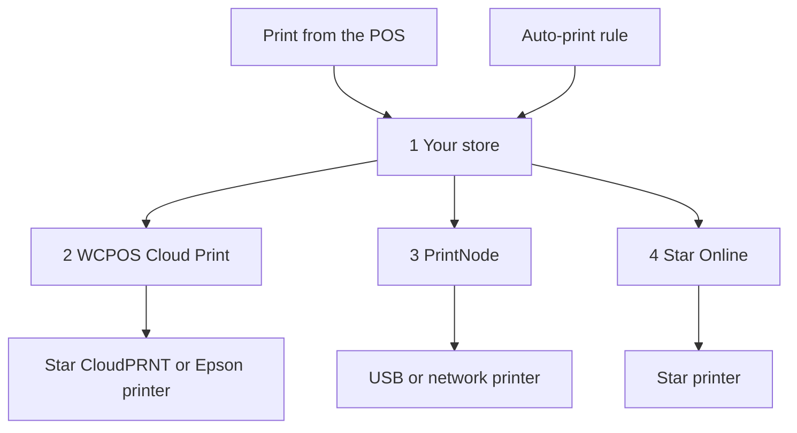

import LinkCards from '@site/src/components/LinkCards';
import LinkCard from '@site/src/components/LinkCard';

Beim Cloud-Druck werden Belege über das Internet an einen Drucker gesendet. Der Drucker muss daher nicht mit dem Gerät verbunden sein, auf dem der POS läuft. Nutzen Sie diese Funktion für einen Drucker in einem anderen Netzwerk als dem der Kasse, einen Küchendrucker, der jede Bestellung selbstständig druckt, oder einen Lieferschein für jeden Online-Verkauf.

Sie richten einen Cloud-Drucker einmalig unter **WP Admin → POS → Einstellungen → Cloud-Druck** ein. Danach wird er auf jedem Gerät angezeigt, und Kassierer können ihn im POS wie jeden anderen Drucker verwenden.

## Aus dem POS drucken {#manual}

Der Shop erstellt den Beleg für einen Cloud-Drucker aus der Bestellung. Deshalb muss der Verkauf im Shop vorliegen, bevor Sie drucken.

1. Öffnen Sie auf dem Bildschirm nach der Zahlung oder im Fenster **Beleg** einer Bestellung das Menü **Drucker** und wählen Sie den Cloud-Drucker aus.
2. Drücken Sie **Beleg drucken**.
3. Auf dem Bildschirm erscheint **Gedruckt auf** mit dem Namen des Druckers. Das bedeutet, dass der Druckauftrag im Shop vorliegt. Prüfen Sie, ob der Beleg gedruckt wurde. Falls nicht, kann eine Führungskraft in der [Druckwarteschlange](#print-queue) nachsehen, was mit dem Auftrag passiert ist.

Siehe [Beleg drucken](./at-checkout.mdx#print-receipt). Um eine Vorlage immer an einen Cloud-Drucker zu senden, wählen Sie unter **Einstellungen → Drucken** den Drucker für diese Vorlage aus: siehe [Druckerzuordnung](../hardware/printers/index.mdx#print-routing).

- **Die Bestellung muss im Shop vorliegen.** Wenn der Shop den Verkauf noch nicht bestätigt hat, beispielsweise bei einem offline erfassten Verkauf, meldet der POS: *Dieser Drucker druckt die Kopie des Shops, und der Shop hat diesen Verkauf noch nicht bestätigt. Drucken Sie erneut, sobald er bestätigt wurde.* Drücken Sie erneut **Beleg drucken**, sobald die Kasse online ist und der Shop den Verkauf bestätigt hat. Solange die Kasse offline ist, schlägt das Drucken auf einem Cloud-Drucker fehl, auch bei einer früheren Bestellung.
- **Sitzungsberichte und Abschlüsse**, die an einen Cloud-Drucker gesendet werden, öffnen stattdessen den Druckdialog des Systems.
- **Bei einer HTML-Vorlage auf einem Cloud-Drucker von Star oder Epson** erscheint: *Dieser Cloud-Drucker druckt nur Thermodruckvorlagen. Deshalb wird nichts gedruckt. Wählen Sie eine Thermodruckvorlage.*

Cloud-Drucker erscheinen auf jedem Gerät automatisch unter **Einstellungen → Drucken** im Bereich **Drucker**. Die zweite Zeile des Eintrags nennt den Typ, zum Beispiel *Star CloudPRNT · verwaltet von WCPOS*. Ein Kassierer kann im Eintrag **Testdruck** oder im Menü **⋯** die Option **Einrichtungsbericht kopieren** auswählen, den Drucker jedoch nicht bearbeiten oder löschen. Das erfolgt auf der Seite **Cloud-Druck**. Siehe [Druckereinrichtung](../hardware/printers/index.mdx#printers-list).

## Druckertyp auswählen {#providers}

:::note Ab hier benötigen Sie Zugriff auf WP Admin
Das Hinzufügen von Druckern und Regeln übernimmt der Shop-Inhaber oder eine Führungskraft unter **WP Admin → POS → Einstellungen → Cloud-Druck**.
:::

Auf der Seite **Cloud-Druck** erscheint die Frage **Welche Art von Drucker möchten Sie verbinden?** Wählen Sie den passenden Typ für Ihren Drucker aus.

- **Star CloudPRNT** — für einen Star-Drucker mit integriertem CloudPRNT (mC-Print, TSP143IV…), wenn Sie eine kostenlose Verbindung ohne zusätzliches Konto wünschen. Der Drucker ruft seine Aufträge von Ihrem Shop ab. *Nur Thermodruckvorlagen.*
- **Epson Server Direct Print** — für einen „intelligenten“ TM-Drucker von Epson (TM-T88VI/VII, TM-m30III, TM-i-Serie). Der Drucker ruft seine Aufträge von Ihrem Shop ab. *Nur Thermodruckvorlagen.*
- **Star Online** — für einen Star-Drucker, der mit einem stario.online-Konto verknüpft ist (mC-Print3, TSP143IV, mC-Label3). Ihr Shop übergibt den Auftrag an Star Online, das ihn zustellt. *Nur Thermodruckvorlagen.*
- **PrintNode** — für einen gewöhnlichen USB- oder Netzwerkdrucker, wenn Sie die kleine PrintNode-App auf einem Computer in der Filiale ausführen können. Ihr Shop übergibt den Auftrag an PrintNode, und dessen App auf diesem Computer druckt ihn. *Alle Vorlagen.*

Ein Cloud-Drucker von Star oder Epson kann keine HTML-Vorlage drucken: Der Beleg muss in die druckereigenen Befehle umgewandelt werden. Verwenden Sie für HTML- und ganzseitige Vorlagen PrintNode. Siehe [Thermodruckvorlagen](./thermal-templates.mdx).

<details>
<summary>So gelangen Aufträge zu Ihrem Drucker</summary>



<div className="pinned-legend">

1. **Ihr Shop** — erstellt den Beleg aus der Bestellung und der Vorlage und speichert den Auftrag in der [Druckwarteschlange](#print-queue). Sowohl ein Druck aus dem POS als auch eine [Regel für automatisches Drucken](#auto-print) beginnen hier.
2. **WCPOS Cloud Print** — der [Relay-Dienst](#relay). Ein Star CloudPRNT- oder Epson-Drucker ruft seine Aufträge normalerweise über diesen Dienst ab. Ein Auftrag wartet daher, bis sich der Drucker das nächste Mal meldet.
3. **PrintNode** — Ihr Shop übergibt den Auftrag an PrintNode, und die PrintNode-App auf einem Computer in der Filiale druckt ihn.
4. **Star Online** — Ihr Shop übergibt den Auftrag an Star Online, das ihn an den Drucker zustellt.

</div>

</details>

## Drucker hinzufügen {#setup}

1. Öffnen Sie **WP Admin → POS → Einstellungen → Cloud-Druck**. Drücken Sie unter **Ihre Cloud-Drucker** auf **+ Drucker hinzufügen**.
2. Wählen Sie den Typ aus.
3. Geben Sie unter **Druckername** einen Namen ein, zum Beispiel *Küchendrucker*. WCPOS erstellt daraus die **Drucker-ID**. Die ID lässt sich später nicht ändern. Wenn Sie sie ändern möchten, entfernen Sie den Drucker und fügen Sie ihn erneut hinzu.
4. Führen Sie die Schritte für Ihren Typ aus: [Star CloudPRNT oder Epson](#setup-polling), [PrintNode](#setup-printnode) oder [Star Online](#setup-star-online).
5. Der Drucker erscheint als Karte unter **Ihre Cloud-Drucker**. Drücken Sie dort **Testdruck**. Siehe [Die Druckerkarte](#status).

### Star CloudPRNT oder Epson Server Direct Print {#setup-polling}

Diese Drucker rufen ihre Aufträge selbst ab, daher müssen Sie kein Konto verknüpfen. Da der Drucker die Verbindung zu Ihrem Shop aufbaut, müssen Sie weder einen Port öffnen noch eine statische IP festlegen oder Ihre Firewall ändern. Ein Auftrag wird gedruckt, wenn sich der Drucker das nächste Mal meldet. Der letzte Schritt von **+ Drucker hinzufügen** zeigt die **Abfrage-URL** des Druckers, die ein geheimes Token enthält.

<details>
<summary>Star CloudPRNT- oder Epson-Drucker verbinden</summary>

1. Drücken Sie neben der **Abfrage-URL** auf **Kopieren**. Die vollständige Adresse wird **nur einmal** angezeigt. Wenn Sie sie verlieren, entfernen Sie den Drucker und fügen Sie ihn erneut hinzu, um eine neue zu erhalten: Unter **Einrichtung & Token** auf der Karte wird sie mit ausgeblendetem Token angezeigt.
2. Öffnen Sie die Einstellungsseite des Druckers und fügen Sie die Adresse als Server-URL ein: bei Star in den **CloudPRNT**-Einstellungen, bei Epson in den **Server Direct Print**-Einstellungen. Aktivieren Sie die Abfrage, speichern Sie und starten Sie den Drucker neu.
3. Auf der Karte wechselt der Status von **Warten auf Drucker** zu **Verbunden**, sobald der Drucker zum ersten Mal Aufträge abruft.

Die Adresse beginnt normalerweise mit `https://cloudprint.wcpos.com`. Das ist der [WCPOS Cloud Print-Relay-Dienst](#relay), den Sie verwenden sollten. Unter der Adresse zeigt **Erweitert: direkt mit dieser Website verbinden (ohne Relay-Dienst)** stattdessen eine **Direkte URL** an. Manche Drucker können eine Website nicht direkt erreichen und bleiben im Status **Warten auf Drucker**.

Lassen Sie bei einem Epson-Drucker **Server Direct Print** aktiviert, solange WCPOS auf diese Weise darauf druckt. Siehe [Server Direct Print](../hardware/printers/server-direct-print.mdx).

</details>

### PrintNode {#setup-printnode}

Für PrintNode muss der Client auf einem Computer beim Drucker laufen. Außerdem benötigen Sie einen API-Schlüssel aus Ihrem PrintNode-Konto.

<details>
<summary>PrintNode-Drucker verbinden</summary>

1. Installieren Sie den PrintNode-Client auf einem Computer beim Drucker und melden Sie sich an. Damit gedruckt werden kann, muss der Computer eingeschaltet sein und der Client laufen.
2. Erstellen Sie in Ihrem PrintNode-Konto einen API-Schlüssel.
3. Wählen Sie unter **+ Drucker hinzufügen** die Option **PrintNode**, fügen Sie den Schlüssel unter **PrintNode-API-Schlüssel** ein und drücken Sie **Meine Drucker abrufen**.
4. Wählen Sie unter **Drucker auswählen** den vom Client gemeldeten Drucker und schließen Sie die Einrichtung ab. Im letzten Schritt steht **Mit PrintNode verknüpft**: Sie müssen keine Adresse und kein Token kopieren.

</details>

Legen Sie nach der Verknüpfung auf der Druckerkarte das **Druckformat** fest:

- **PDF (empfohlen)** druckt jede Vorlage, ob Thermodruck oder HTML, als PDF. Behalten Sie diese Einstellung bei, sofern Sie keinen Grund haben, sie zu ändern.
- **ESC/POS RAW — nur Thermodruckvorlagen** sendet eine Thermodruckvorlage als Befehle für den Belegdrucker statt als PDF. HTML-Vorlagen werden weiterhin als PDF gesendet.

### Star Online {#setup-star-online}

Für Star Online benötigen Sie die Gruppenadresse des Druckers und einen API-Schlüssel, beides aus Ihrem stario.online-Konto.

<details>
<summary>Star Online-Drucker verbinden</summary>

1. Öffnen Sie in stario.online **Gerätegruppen** und kopieren Sie die **CloudPRNT-URL** der Gruppe. Sie hat die Form `https://device.stario.online/cloudprnt/...` oder in der EU `https://eu-device.stario.online/cloudprnt/...`.
2. Erstellen Sie in stario.online einen API-Schlüssel mit den Berechtigungen **EnumDevices**, **ViewDevice**, **PrintToDevice** und **ViewDeviceGroups**. Ein Schlüssel ohne diese Berechtigungen wird akzeptiert, kann aber weder Geräte auflisten noch drucken.
3. Wählen Sie unter **+ Drucker hinzufügen** die Option **Star Online**. Fügen Sie die **CloudPRNT-URL** und den **Star Online-API-Schlüssel** ein und drücken Sie dann **Meine Geräte abrufen**.
4. Wählen Sie unter **Gerät auswählen** den Drucker und schließen Sie die Einrichtung ab. Die Karte zeigt dann **Gerät**, **Gruppe** und **AccessIdentifier** an.

</details>

## Die Druckerkarte {#status}

Jeder Cloud-Drucker hat unter **Ihre Cloud-Drucker** eine Karte:

- **Der Name** — klicken Sie darauf, um den Drucker umzubenennen. Darunter steht der Typ.
- **Der Status** — siehe die Liste unten. Er wird alle 30 Sekunden aktualisiert.
- **Letzte Abfrage** — wann ein Star CloudPRNT- oder Epson-Drucker zuletzt Aufträge abgerufen hat, oder *nie*.
- **Drucker-ID** — wurde beim Hinzufügen des Druckers festgelegt.
- **Druckformat** — nur bei PrintNode: **PDF (empfohlen)** oder **ESC/POS RAW — nur Thermodruckvorlagen**. Siehe [PrintNode](#setup-printnode).
- **Testdruck** — sendet eine kurze Testseite. Eine Meldung zeigt *Testdruck an … gesendet* oder den Grund für den Fehler an.
- **Druckeraktionen** (**⋮**) — **Einrichtung & Token** öffnet den letzten Einrichtungsschritt erneut. **Drucker entfernen** verhindert, dass der Drucker weitere Aufträge erhält. Sie können ihn später wieder hinzufügen.

<details id="status-polling">
<summary>Statusanzeigen für Star CloudPRNT und Epson Server Direct Print</summary>

- **Warten auf Drucker** — der Drucker hat noch keine Aufträge abgerufen. Prüfen Sie die Abfrage-URL im Drucker: siehe [Status bleibt bei „Warten auf Drucker“](#trouble-polling).
- **Verbunden** — der Drucker hat innerhalb der letzten zweieinhalb Minuten Aufträge abgerufen.
- **Offline** — der Drucker hat früher Aufträge abgerufen, aber seit einiger Zeit nicht mehr. Prüfen Sie, ob er eingeschaltet und online ist.
- **Blockiert** — der Relay-Dienst kann Ihren Shop nicht erreichen. Die Karte zeigt den Grund an: Ein Sicherheitsdienst wie Cloudflare oder ein Firewall-Plugin blockiert ihn, oder Ihre Website hat mit einem Serverfehler geantwortet. Siehe [Probleme mit Star CloudPRNT oder Epson](#trouble-polling).

</details>

<details id="status-services">
<summary>Statusanzeigen für Star Online und PrintNode</summary>

- **Online** — der Dienst meldet, dass der Drucker verfügbar ist.
- **Offline** — der Dienst meldet, dass der Drucker oder der PrintNode-Computer nicht verfügbar ist. Prüfen Sie bei PrintNode, ob der Computer nicht im Ruhezustand ist und der Client läuft.
- **Unbekannt** — WCPOS konnte keinen Status vom Dienst abrufen. Prüfen Sie den API-Schlüssel unter [PrintNode](#setup-printnode) oder [Star Online](#setup-star-online).

</details>

## Bestellungen automatisch drucken {#auto-print}

Regeln für automatisches Drucken drucken Bestellungen, ohne dass jemand eine Taste drücken muss. Sie sind optional: Ohne Regeln drucken Cloud-Drucker nur, wenn ein Kassierer aus dem POS druckt.

Drücken Sie unter **Regeln für automatisches Drucken** auf **+ Regel hinzufügen**. Jede Regel ist als Satz formuliert, und jeder unterstrichene Teil ist ein Menü:

> Automatisch **jede Vor-Ort-Bestellung (POS)** auf **Küchendrucker** mit der Vorlage **Küchenbon** drucken, **2 Kopien**, **sobald sie erstellt wurde**.

- **Welche Bestellungen** — **jede Bestellung**, **jede Vor-Ort-Bestellung (POS)** oder **jede Online-Bestellung**. Mit WCPOS Pro auch **Bestellungen für** eine Filiale: siehe [Drucker je Filiale](#per-store-printers).
- **Drucker** — einer Ihrer Cloud-Drucker.
- **Vorlage** — es werden nur Vorlagen angeboten, die der Drucker drucken kann. Die Vorlagen stammen aus **POS › Vorlagen**.
- **Kopien** — 1 bis 5.
- **Wann** — **sobald sie bezahlt wurde** (Standard) oder **sobald sie erstellt wurde**. Bei einer POS-Bestellung bedeutet „erstellt“ den Zeitpunkt, zu dem der Warenkorb erstmals gespeichert wird. Ein Küchenbon wird dadurch vor der Zahlung gedruckt.

Mehrere Regeln können dieselbe Bestellung drucken, zum Beispiel einen Küchenbon und einen Kundenbeleg. Eine Regel druckt eine bestimmte Bestellung nur einmal. Der Beleg wird im Shop aus der Bestellung und der Vorlage erstellt, sodass der Kassierer nichts tun muss. Automatische Druckvorgänge öffnen niemals die Kassenschublade.

Wenn Sie den Drucker einer Regel durch einen ersetzen, der die zugehörige Vorlage nicht drucken kann, wechselt die Regel zur ersten Vorlage, die dieser Drucker drucken kann. Prüfen Sie deshalb, ob es die gewünschte Vorlage ist. Wenn der Drucker keine Ihrer Vorlagen drucken kann, bleibt die Vorlage leer, und die Regel druckt erst wieder, wenn Sie eine auswählen.

### Drucker je Filiale (Pro) {#per-store-printers}

Mit [WCPOS Pro](../getting-started/pro-license.mdx) und mehr als einer [Filiale](../stores/index.mdx) enthält das Menü **Welche Bestellungen** auch **Bestellungen für** jede Filiale. Eine Filialregel druckt die Bestellungen dieser Filiale: diejenigen, die an ihren Kassen erfasst werden, sowie alle Bestellungen, die Sie ihr auf der Bearbeitungsseite der Bestellung zuweisen. Online-Bestellungen gehören keiner Filiale an, solange Sie keine zuweisen. Sie werden daher nur von Regeln für alle Filialen gedruckt.

Regeln wirken zusammen: Eine Bestellung für eine Filiale wird nach den Regeln dieser Filiale **und** nach jeder Regel für **jede Bestellung**, **jede Vor-Ort-Bestellung (POS)** oder **jede Online-Bestellung** gedruckt. Damit Küchenbons eines Standorts nicht auf dem Drucker eines anderen Standorts landen, legen Sie für jeden Standort eine eigene Filialregel an und fügen Sie für diesen Bon keine Regel für alle Filialen hinzu.

## Die Druckwarteschlange {#print-queue}

Unterhalb der Regeln listet die **Druckwarteschlange** jeden Auftrag auf: **Bestellung**, **Drucker**, **Vorlage**, **Status**, **Details** und **Erstellt**. Die Bestellnummer verlinkt auf die Bestellung.

- Nutzen Sie **Filter** für den Status (**Handlungsbedarf**, **Alle Status** oder einen der Status **Wartend**, **Wird gedruckt**, **Gedruckt**, **Fehlgeschlagen**, **Storniert**) und den Drucker.
- Mit **Abbrechen** brechen Sie einen wartenden Auftrag ab, mit **Erneut versuchen** wiederholen Sie einen fehlgeschlagenen Auftrag (er erscheint als neuer Auftrag, *Erneut versucht als #…*), und mit **Löschen** löschen Sie einen Auftrag. Markieren Sie mehrere Zeilen für **Ausgewählte abbrechen** oder **Ausgewählte löschen**.
- Unter **Details** steht, warum ein Auftrag fehlgeschlagen ist, zum Beispiel *Star Online hat die Anfrage abgelehnt. Prüfen Sie, ob der API-Schlüssel die erforderlichen Berechtigungen hat.*

Wenn für einen Star CloudPRNT- oder Epson-Drucker Belege warten und er seit 10 Minuten oder noch nie Aufträge abgerufen hat, erscheint eine Warnung. Sie nennt den Drucker, den Zeitpunkt seiner letzten Abfrage und die Anzahl der wartenden Belege und bietet **Alle abbrechen** an.

:::warning Ein Auftrag, den der Drucker nie bestätigt hat
*Der Drucker hat diesen Auftrag nie bestätigt* bedeutet, dass WCPOS nicht feststellen kann, ob er gedruckt wurde. Er wird nicht automatisch erneut gesendet, da er dadurch doppelt gedruckt werden könnte. Prüfen Sie den Drucker und drücken Sie nur dann **Erneut versuchen**, wenn nichts gedruckt wurde.
:::

<details>
<summary>Aufbewahrungsdauer und Wiederholungsversuche für Aufträge</summary>

Gedruckte und stornierte Aufträge werden nach 7 Tagen gelöscht, fehlgeschlagene nach 30 Tagen. Entwickler können dies mit den Filtern `wcpos_print_job_retention_days` und `wcpos_print_job_failed_retention_days` ändern.

Für einen Auftrag, den WCPOS an PrintNode oder Star Online übergibt, gibt es drei Versuche, mit Abständen von zunächst einer und dann zwei Minuten. Lehnt der Dienst den Schlüssel oder das Konto ab, schlägt der Auftrag sofort fehl. Der Grund steht unter **Details**.

</details>

## WCPOS Cloud Print, der Relay-Dienst {#relay}

Die Abfrage-URL eines Star CloudPRNT- oder Epson-Druckers verweist auf **cloudprint.wcpos.com**, nicht auf Ihre eigene Website. Das ist **WCPOS Cloud Print**, ein kostenloser Relay-Dienst, den WCPOS zwischen Ihren Druckern und Ihrem Shop betreibt.

Sie müssen nichts aktivieren. Aufträge durchlaufen auf dem Weg zum Drucker den Relay-Dienst. Beim Verbinden wird daher die Adresse Ihrer Website an wcpos.com weitergegeben, und Belege mit Bestelldetails werden über diesen Dienst übertragen. Siehe die [Datenschutzerklärung](https://wcpos.com/privacy).

<details>
<summary>So funktioniert der Relay-Dienst</summary>

Belegdrucker verwenden eine schlanke Firmware, die selten aktualisiert wird. Viele können keine sichere Verbindung zu einem Shop auf modernem Hosting herstellen oder werden von einem vorgeschalteten Dienst wie Cloudflare abgewiesen. Der Drucker bleibt dann trotz korrekter Einstellungen im Status **Warten auf Drucker**. Der Relay-Dienst stellt dem Drucker eine Verbindung bereit, die dieser nutzen kann, und leitet seine Anfragen an Ihren Shop weiter.

- Ihre Website verbindet sich automatisch mit dem Relay-Dienst, wenn Sie **Cloud-Druck** zum ersten Mal öffnen.
- Für den Relay-Dienst muss Ihre Website **HTTPS** verwenden. Ist das nicht der Fall, erscheint unter **Cloud-Druck** ein entsprechender Hinweis.
- Wenn Ihre Website keine Verbindung zum Relay-Dienst herstellen kann, zum Beispiel bei einer lokalen Testwebsite, verweist die Abfrage-URL direkt auf Ihre Website.
- **Blockiert** auf einer Karte bedeutet, dass der Relay-Dienst Ihre Website erreicht hat, aber abgewiesen wurde. Lassen Sie den Relay-Dienst in Ihrem Sicherheitsdienst zu, wie auf der Karte angegeben. Siehe [Probleme mit Star CloudPRNT oder Epson](#trouble-polling).

</details>

<details>
<summary>Relay-Dienst deaktivieren (für Entwickler)</summary>

Der letzte Einrichtungsschritt eines Star CloudPRNT- oder Epson-Druckers enthält **Erweitert: direkt mit dieser Website verbinden (ohne Relay-Dienst)** mit der zugehörigen **Direkte URL**. So deaktivieren Sie den Relay-Dienst für die gesamte Website:

```php
add_filter( 'wcpos_cloud_print_relay_enabled', '__return_false' );
```

Vor WCPOS 2.0 hieß dieser Filter `woocommerce_pos_cloud_print_relay_enabled`. Dieser Name funktioniert weiterhin, gilt seit 2.0 als veraltet und wird frühestens in 2.2 entfernt. Siehe [Benennung von Hooks](../extensions/index.mdx#hook-naming).

</details>

<details>
<summary>So gelangt ein Beleg zu einem Star CloudPRNT-Drucker</summary>

WCPOS bietet dem Drucker zuerst StarPRNT-Befehle, dann ein PNG-Bild des Belegs und schließlich reinen Text an. Verwendet wird das beste Format, das der Drucker laut eigener Angabe lesen kann. Ältere Star-Modelle, die nur Line Mode lesen (TSP650II, TSP700II, TSP800II), erhalten Logos nur über das Bild. Dafür werden die PHP-Erweiterungen GD und FreeType auf Ihrem Server benötigt. Epson-Drucker erhalten ePOS-Print XML, Star Online erhält Star Document Markup.

</details>

## Wenn etwas schiefgeht {#troubleshooting}

**Der POS hat an einen Cloud-Drucker gedruckt, aber es kam kein Beleg heraus.** Der POS weiß nur, dass der Auftrag im Shop vorliegt. Öffnen Sie die [Druckwarteschlange](#print-queue) und suchen Sie die Bestellung:

- **Wartend** — der Drucker hat den Auftrag noch nicht abgerufen. Prüfen Sie den Status auf der Druckerkarte: [Statusanzeigen für Star CloudPRNT und Epson Server Direct Print](#status-polling) oder [Statusanzeigen für Star Online und PrintNode](#status-services).
- **Wird gedruckt** — der Auftrag wird übertragen, und der Drucker hat den Druck noch nicht bestätigt.
- **Fehlgeschlagen** — unter **Details** steht der Grund. Beheben Sie das Problem und drücken Sie dann **Erneut versuchen**. Steht unter **Details** die Meldung *Der Drucker hat diesen Auftrag nie bestätigt*, wurde möglicherweise bereits gedruckt. Prüfen Sie den Drucker, bevor Sie **Erneut versuchen** drücken.
- **Gedruckt** — der Drucker, PrintNode oder Star Online hat den Auftrag angenommen. Prüfen Sie das Papier und ob in der Spalte **Drucker** der Drucker steht, vor dem Sie sich befinden.

**Meine Vorlage wird nicht angeboten.** Star CloudPRNT-, Epson- und Star Online-Drucker akzeptieren nur [Thermodruckvorlagen](./thermal-templates.mdx). Wählen Sie eine solche Vorlage oder drucken Sie über PrintNode.

### Probleme mit Star CloudPRNT oder Epson {#trouble-polling}

**Status bleibt bei „Warten auf Drucker“.** Der Drucker hat Ihren Shop noch nie erreicht. Prüfen Sie, ob die Abfrage-URL im Drucker exakt übereinstimmt: Schon ein falsches Zeichen führt dazu, dass jede Abfrage abgewiesen wird. Wenn Sie unsicher sind, entfernen Sie den Drucker und fügen Sie ihn erneut hinzu, um eine neue URL zu erhalten. Stellen Sie sicher, dass die Abfrage in den **CloudPRNT**- oder **Server Direct Print**-Einstellungen des Druckers aktiviert ist, und starten Sie ihn dann neu. Wenn Sie die **Direkte URL** verwendet haben, wechseln Sie zur Adresse `cloudprint.wcpos.com`: [Dafür ist der Relay-Dienst da](#relay).

**Blockiert.** Ein Sicherheitsdienst oder Firewall-Plugin weist den Relay-Dienst ab, oder Ihre Website gibt Serverfehler zurück. Folgen Sie dem Hinweis auf der Karte. Prüfen Sie bei einem Serverfehler den Website-Zustand und die Fehlerprotokolle Ihrer Website.

**Vor Einführung des Relay-Dienstes eingerichtet.** Bereits im Drucker gespeicherte Adressen funktionieren weiterhin. Wenn der Drucker im Status **Warten auf Drucker** bleibt, entfernen Sie ihn und fügen Sie ihn erneut hinzu. Tragen Sie anschließend die neue Adresse mit `cloudprint.wcpos.com` im Drucker ein.

### Probleme mit PrintNode {#trouble-printnode}

**„Meine Drucker abrufen“ schlägt fehl.** Prüfen Sie den API-Schlüssel und ob der PrintNode-Client auf dem Computer läuft.

**Ein PrintNode-Auftrag wird nie gedruckt.** Der Client muss laufen und online sein: Ein Computer im Ruhezustand druckt nichts. Prüfen Sie, ob Sie den vom Client gemeldeten Drucker ausgewählt haben und der Schlüssel nicht widerrufen wurde.

### Probleme mit Star Online {#trouble-star-online}

**„Meine Geräte abrufen“ schlägt fehl.** Die Meldung lautet *Ihre Star Online-Geräte konnten nicht aufgelistet werden. Prüfen Sie die CloudPRNT-URL und den API-Schlüssel.* Prüfen Sie, ob der Schlüssel vollständig kopiert wurde, nicht widerrufen wurde und zum selben stario.online-Konto und derselben Region wie die URL gehört. Prüfen Sie anschließend, ob der Schlüssel die unter [Star Online](#setup-star-online) genannten Berechtigungen hat. *Keine Geräte in dieser Star Online-Gruppe gefunden* bedeutet, dass die Gruppe kein Gerät enthält oder die URL zu einer anderen Gruppe gehört.

## Weiterführende Dokumentation {#related-documentation}

<LinkCards>
  <LinkCard to="/hardware/receipt-printers" title="Druckereinrichtung" description="Einen Drucker auf dem Gerät hinzufügen und Vorlagen Druckern zuordnen" />
  <LinkCard to="/sell/print-email-receipts" title="Belege an der Kasse" description="Belege drucken, per E-Mail senden und erneut drucken" />
  <LinkCard to="/settings/receipt-templates/thermal-templates" title="Thermodruckvorlagen" description="Belege für Star- und Epson-Drucker erstellen" />
</LinkCards>
