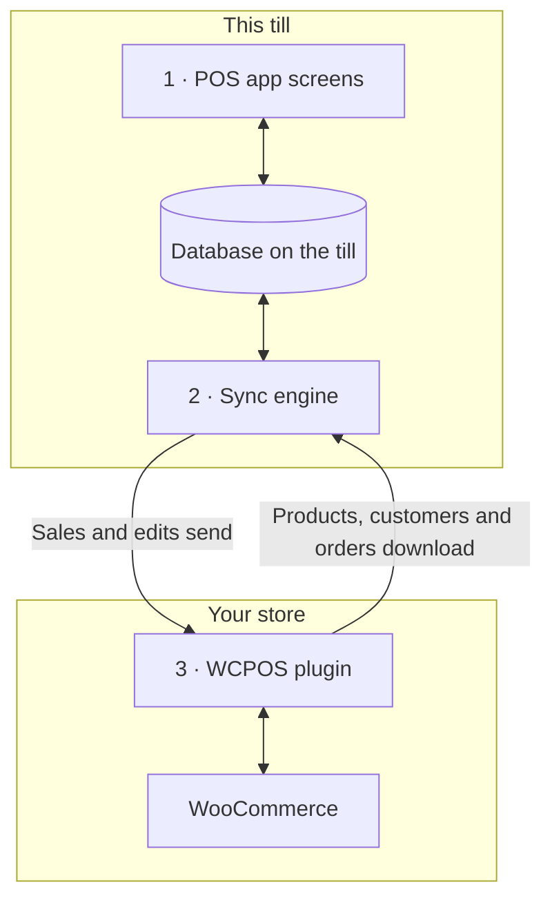

import LinkCards from '@site/src/components/LinkCards';
import LinkCard from '@site/src/components/LinkCard';
import JourneyShot from '@site/src/components/JourneyShot';
import manifest from '@site/static/img/2.x/reference/architecture/en/manifest.json';

WCPOS besteht aus zwei Teilen: einem Plugin auf Ihrer WordPress-Website und der POS-App auf jeder Kasse. Die Kasse verkauft auf Grundlage ihrer eigenen Kopie Ihrer Shopdaten und hält diese im Hintergrund mit WooCommerce synchron. Diese Seite zeigt Entwicklern und interessierten Shopbetreibern, wo ihre Daten liegen und was ihren Server erreicht.

Sie möchten ein Problem beheben, statt sich mit dem Aufbau zu befassen?

- **App aktualisieren:** [Prüfen Sie zuerst, ob die Kasse alles gesendet hat](../getting-started/previous-versions.mdx#check-sync). Siehe [Vor dem Aktualisieren synchronisieren](#storage).
- **Ein Produkt fehlt auf der Kasse:** Siehe [Wenn ein Produkt fehlt oder veraltet ist](../products/sync.mdx#goes-wrong).
- **Ein Verkauf ist nicht in Ihrem Shop angekommen:** Siehe [Verkäufe, die auf den Versand warten](../getting-started/offline.mdx#offline-writes).

## Die beiden Teile {#two-part-system}

1. **Die POS-App** läuft auf jeder Kasse: im Browser unter `/pos/` auf Ihrer Website (die Adresse lässt sich ändern), in der Desktop-App oder in den Apps für iOS und Android. Die jeweiligen Voraussetzungen finden Sie unter [Installation](../getting-started/installation.mdx). Jede Ansicht liest und schreibt in einer Datenbank auf der Kasse. Eine Suche oder das Hinzufügen eines Artikels muss daher nie auf Ihren Server warten.
2. **Die Synchronisierungsengine** in der App überträgt Änderungen in beide Richtungen. Sie ruft Änderungen aus Ihrem Shop ab und sendet die Änderungen der Kasse.
3. **Das WCPOS-Plugin** läuft auf Ihrer WordPress-Website und verbindet die Kasse mit WooCommerce. WooCommerce bleibt die maßgebliche Datenquelle für jedes Produkt, jeden Kunden und jede Bestellung.

## Was die Kasse auf dem Gerät speichert {#local-database}

**Systemzustand** → **Datenbank** zeigt die Kopie Ihrer Shopdaten auf der Kasse: eine Zeile pro Datensatzart, jeweils mit der Anzahl auf diesem Gerät (**Auf dem Gerät**) und in Ihrem Shop (**Auf dem Server**). Was das Menü jeder Zeile bietet, erfahren Sie unter [Shopzustand](../support/store-health.mdx#coverage).

<JourneyShot manifest={manifest} device="tablet" step={1} offsets={[[186, 0], [186, 0], [186, 0], [186, 0], [186, 0], [186, 0], [186, 0], [186, 0]]} alt="Systemzustand, Tab Datenbank: die Datensatztabelle dieser Kasse, von Produkten bis Steuersätzen, jeweils mit Anzahl auf dem Gerät, Anzahl auf dem Server, Abdeckung und Größe">

1. **Produkte** — zunächst 100 in der Standardsortierung des POS (Name, A bis Z), dann die übrigen, während die Kasse nicht beschäftigt ist. Siehe [Download und Synchronisierung](../products/sync.mdx).
2. **Varianten** — werden zusammen mit ihren Produkten heruntergeladen.
3. **Bestellungen** — offene und kürzlich erstellte Bestellungen bleiben auf der Kasse. Ältere werden heruntergeladen, sobald jemand sie öffnet.
4. **Rückerstattungen** — Rückerstattungen der letzten 92 Tage sowie alle Rückerstattungen zu Bestellungen, die Sie geöffnet haben.
5. **Kunden** — werden nach und nach heruntergeladen, während die Kasse nicht beschäftigt ist.
6. **Kategorien** — darunter **Marken** und **Schlagwörter**.
7. **Gutscheine** — mit oder ohne Pro auf der Kasse verfügbar.
8. **Steuersätze** — die Steuersätze Ihres Shops.

</JourneyShot>

Eine rote Markierung **N festgefahren** an einer Zeile bedeutet, dass Datensätze dieser Art Ihre Aufmerksamkeit benötigen. Siehe [Datensätze, die Aufmerksamkeit benötigen](../support/store-health.mdx#stuck-records).

Achten Sie oberhalb der Tabelle auf die Zahl bei **Änderungen warten auf Versand**: Das sind Verkäufe und Änderungen auf dieser Kasse, die Ihr Shop noch nicht erhalten hat. Bis dahin bleiben sie auf dem Gerät. Nicht synchronisierte offene Bestellungen und Änderungen, die in einem separaten Bereich aufgeführt sind, werden nicht mitgezählt und haben Ihren Shop ebenfalls noch nicht erreicht. Siehe [Verkäufe, die auf den Versand warten](../getting-started/offline.mdx#offline-writes).

Datensätze außerhalb dieser Tabelle

Einige Daten liegen außerhalb dieser Tabelle. Zahlungsarten, Steuerklassen, Versandarten und Bestellstatus werden bei jedem App-Start aus Ihrem Shop gelesen. Die letzte Antwort wird für den Offlinebetrieb der Kasse gespeichert. Kassensitzungen, Kassenabschlüsse und Bargeldbewegungen haben eigene Datensätze und eine eigene Warteschlange für die Übertragung an Ihren Shop.

### So wird die Datenbank gespeichert {#storage}

Jeder Kassierer hat in jeder Filiale eine eigene Kopie auf der Kasse. Im Browser läuft der POS für eine Website jeweils in einem Tab. Wenn ein App-Update die Speicherung dieser Kopie ändert, lädt die Kasse sie erneut herunter.

:::warning Vor dem Aktualisieren synchronisieren
Verkäufe und Änderungen, die noch in der alten Kopie warten, werden nicht gesendet. Prüfen Sie vor dem App-Update unter **Systemzustand** → **Datenbank**, ob **Änderungen warten auf Versand** den Wert 0 anzeigt und unter den Zahlen kein weiterer Bereich erscheint. Synchronisieren Sie außerdem jede offene Bestellung. Siehe [Prüfen, ob eine Kasse alles gesendet hat](../getting-started/previous-versions.mdx#check-sync).
:::

Details für Entwickler: Speicherengine, Tabs und App-Updates

- **Eine Datenbank pro Website, Filiale und Kassierer.** Zwei Kassierer an einer Kasse oder ein Kassierer in zwei Filialen teilen sich niemals lokale Daten.
- **SQLite auf jeder Plattform.** Im Browser läuft SQLite in einem Worker auf dem privaten Dateispeicher des Browsers; die Apps für iOS und Android verwenden SQLite des jeweiligen Systems; die Desktop-App speichert die Daten in SQLite im Hauptprozess der App.
- **Auf dem Datenträger gespeichert.** Die Kopie auf der Kasse bleibt erhalten, wenn der Browser oder die App geschlossen oder das Gerät neu gestartet wird.
- **Ein aktiver Tab pro Website.** Im Browser läuft der POS für eine Website in einem Tab. Wenn Sie einen zweiten Tab öffnen, bietet dieser an, zu übernehmen; der erste Tab hält an.
- **Listen werden in der Datenbank aufbereitet.** Filtern, Sortieren und Seiteneinteilung erfolgen nach Möglichkeit innerhalb der Datenbank. So liefert eine Liste mit Tausenden von Bestellungen nur die tatsächlich angezeigten Zeilen an die Ansicht.
- **Keine Migration der bestehenden Datenbank.** Wenn ein App-Update die Datenbankstruktur ändert, öffnet die App eine neue Datenbank und lädt die Daten erneut aus Ihrem Shop herunter. Änderungen, die noch in der alten Datenbank warten, werden nicht gesendet, und offene Bestellungen werden nicht übernommen: Synchronisieren Sie die Kasse vor dem App-Update.

## So bleiben Kasse und Shop synchron {#data-synchronization}

Die Synchronisierungsengine spiegelt nicht Ihren gesamten Shop in festen Zeitabständen. Sie richtet sich nach dem Bedarf der Ansichten auf der Kasse und stellt möglichst wenige Anfragen an Ihren Server.

- **Auf Änderungen prüfen.** Die Kasse fragt Ihren Shop nach Änderungen ab, und zwar so oft, wie es ihr [Synchronisierungsprofil](../support/store-health.mdx#sync-presets) vorgibt (**Sparsam**, **Ausgewogen** oder **Echtzeit**). Jede Kasse hat ihr eigenes Profil: Eine Änderung auf einer Kasse wirkt sich nicht auf die anderen aus.
- **Was die Ansicht benötigt.** Jede Ansicht teilt der Engine mit, was sie anzeigt. Sind die Datensätze bereits vorhanden, liefert die Engine sie aus der Kassendatenbank. Nur andernfalls fragt sie Ihren Shop ab.
- **Im Hintergrund.** Zuerst werden die ersten Produkte sowie die offenen und kürzlich erstellten Bestellungen heruntergeladen. Die übrigen Produkte und Kunden folgen, während die Kasse nicht beschäftigt ist.
- **Änderungen senden.** Jeder Verkauf und jede Änderung wird zunächst auf der Kasse gespeichert und dann an Ihren Shop gesendet. Lehnt Ihr Shop eine Änderung ab, wird sie nie automatisch erneut gesendet: Sie wartet unter **N Änderungen haben Ihren Server nie erreicht**, mit den Optionen **Erneut senden** und **Verwerfen**. Siehe [Shopzustand](../support/store-health.mdx#refused-changes).

Details für Entwickler: Änderungsfeed, Anfragebudgets und Verarbeitungsspuren

- Gibt es im Shop nichts Neues, beantwortet er die Änderungsabfrage mit `304 Not Modified` und ohne Antwortinhalt.
- Schreibvorgänge durchlaufen eine dauerhaft gespeicherte Warteschlange auf der Kasse, die sie per POST an `wcpos/v2/push/{collection}` sendet.
- Anfragebudgets, Wartezeiten nach Fehlschlägen und Messwerte finden Sie unter [Synchronisierungsleistung](./sync-performance.mdx). Alle Verarbeitungsspuren werden unter [So funktioniert die Synchronisierungsengine](./sync-engine.mdx) beschrieben.

## So erfasst der Checkout einen Verkauf {#checkout-architecture}

Der Checkout ist Teil des POS. Die Kasse nimmt jede Zahlung selbst entgegen und ordnet sie einer WooCommerce-Bestellung zu, statt für jeden Verkauf die WooCommerce-Seite zur Bestellungszahlung zu öffnen.

:::warning Offlinezahlungen erfordern einen Verkauf, der bereits im Shop vorliegt
Eine Zahlung lässt sich offline nur für einen Verkauf annehmen, der Ihren Shop vor dem Verbindungsabbruch erreicht hat: Seine Bestellnummer steht über den Artikeln im [Checkout](../pos/checkout/index.mdx). Ein Verkauf, der nach dem Verbindungsabbruch begonnen wurde, wartet auf der Kasse und wird bezahlt, sobald der Shop wieder erreichbar ist. Siehe [Eine Zahlung offline annehmen](../getting-started/offline.mdx#take-payment-offline).
:::

- **Eine Kachel pro Zahlungsart.** Die Kasse zeigt für jede im POS aktivierte Zahlungsart eine Kachel. Eine Zahlungsart, die sie nicht ansteuern kann, wird mit Begründung ausgegraut und niemals ausgeblendet. Siehe [Wenn eine Kachel nicht verwendet werden kann](../payment/index.mdx#unavailable-tiles).
- **Eine Bestellung, mehrere Zahlungen.** Auch bei aufgeteilter Zahlung bleibt ein Verkauf eine einzige WooCommerce-Bestellung mit einem Satz von Artikeln, Steuern, Bestandsänderungen und einer Bestellnummer. Berichte zählen ihn daher nur einmal. Eine Rückerstattung ist eine normale WooCommerce-Rückerstattung, verteilt auf die Zahlungen, die sie zurückerstattet.
- **Der Shop entscheidet.** Nach jeder Zahlung meldet Ihr Shop, was bezahlt wurde und was noch offen ist. Die Kasse schließt den Verkauf anhand der Zahlen Ihres Shops ab, nicht anhand ihrer eigenen.
- **Sicher wiederholen.** Jede Zahlung hat eine von der Kasse erzeugte ID. Eine zweimal gesendete Zahlung wird dadurch nur einmal erfasst.
- **Offline.** Bei einem Verkauf, der bereits in Ihrem Shop vorliegt, lässt sich eine Barzahlung auch nach einem Verbindungsabbruch abschließen: Die Zahlung wird als **Wird später abgerechnet** erfasst und gesendet, sobald die Verbindung wiederhergestellt ist. Siehe [Eine Zahlung offline annehmen](../getting-started/offline.mdx#take-payment-offline).

Zahlungserfassungsmodi und Zahlungsrouten

`GET wcpos/v2/payment-methods` beschreibt jedes Zahlungsgateway: seine Art `kind` (`cash`, `card`, `stored_value`, `bank_transfer` oder `other`), wie es Geld entgegennimmt (`capture`) und was es erlaubt (`capabilities`: Teilbeträge, Wechselgeld, Rückerstattungen, Trinkgelder, Offlinebetrieb, Aufhebung). Jede Zahlung ist eine Zeile in den `_wcpos_payments`-Metadaten der Bestellung. Nach jeder Zahlung antwortet der Shop mit `paid` und `balance` der Bestellung.

Der Wert `capture.mode` jeder Zahlungsart bestimmt, wer das Geld entgegennimmt. Jeder Zahlungsaufruf geht an den für seinen Modus registrierten Handler.

| Modus | So wird das Geld entgegengenommen | Plugin |
| --- | --- | --- |
| `manual` | Der Kassierer nimmt es entgegen und erfasst es. Der Standard für Bargeld, Karte, Nachnahme, Direkte Banküberweisung und Scheckzahlungen. | Kostenlos |
| `webview` | Die eigene Zahlungsseite des Zahlungsgateways im Tab **Legacy** des Checkouts. Der Standard für alle anderen Zahlungsgateways. Siehe [Wenn die Zahlungsseite im Tab Legacy nicht lädt](../payment/index.mdx#legacy-notices). | Kostenlos |
| `gateway` | Die eigene Methode `process_payment()` des Zahlungsgateways läuft mit den von der Kasse erfassten Werten. Ein Zahlungsgateway aktiviert diesen Modus über einen Filter. | Kostenlos |
| `server` | Ihr Shop fordert den Anbieter des Kartenterminals auf, die Zahlung entgegenzunehmen. | Pro |
| `device` | Die Kasse steuert das Kartenlesegerät über das SDK des Anbieters, und der Anbieter bestätigt die Zahlung. | Pro |

Die Zahlungsrouten sind über die WooCommerce-ID der Bestellung zugeordnet:

- `POST wcpos/v2/orders/{id}/payments` erfasst eine Zahlung. Die ID der Zahlung macht eine Wiederholung sicher.
- `.../payments/{uuid}/intent`, `/capture`, `/void` und `/refund` (`POST`) sowie `/status` (`GET`) beziehen sich auf eine einzelne Zahlung. Jeder Befehl enthält seine eigene Befehls-ID.
- `POST wcpos/v2/orders/{id}/close` schließt die Bestellung ab.

Jeder Befehl enthält die `revision` der Bestellung; ein Befehl ohne diesen Wert wird mit `428` abgelehnt.

Wenn Sie ein Zahlungsgateway ausschließlich für den POS entwickeln möchten, beginnen Sie mit der [Gateway-Vorlage](./gateway-template.mdx).

## Warum manche Website-Änderungen die Kasse nicht erreichen {#api-extensions}

Die Kasse erhält Produkte, Kunden und Bestellungen vom WCPOS-Plugin, das sie aus WooCommerce liest. Ein Plugin, das die von WooCommerce an Apps gesendeten Daten verändert, wirkt sich auf die Kasse aus. Ein Plugin, das nur das Erscheinungsbild Ihrer Website oder den Online-Checkout verändert, tut das nicht. Um ein Plugin zu prüfen, beginnen Sie mit [Die WooCommerce REST API verstehen](./wc-rest-api.mdx).

Details für Entwickler: API-Versionen

Die Kasse kommuniziert mit Ihrem Shop ausschließlich über die REST-Routen des Plugins. Diese lesen innerhalb Ihrer Website aus WooCommerce. Das Plugin registriert zwei Namensräume neben dem WooCommerce-eigenen `wc/v3`.

- **`wcpos/v2`** wird von der App verwendet: zum Lesen von Datensätzen, für den Änderungsfeed, die Warteschlange für Änderungen, Zahlungen, Kassen und Sitzungen. Seine Leserouten leiten innerhalb Ihrer Website an `wc/v3` weiter. Ein Plugin, das die REST-Antworten von WooCommerce verändert, verändert daher auch das, was die Kasse sieht.
- **`wcpos/v1`** wird weiterhin registriert. Seine Datenrouten (Produkte, Varianten, Bestellungen, Kunden, Gutscheine, Steuern, Kategorien, Schlagwörter, Marken) werden nicht mehr weiterentwickelt. Seine Servicerouten (Filialen, Einstellungen, Belege, Vorlagen, Druckaufträge und weitere) verwenden denselben Code wie ihre `wcpos/v2`-Versionen.

### App-Updates und andere Synchronisierungswerkzeuge {#wcpos-v2-namespace}

App und Plugin werden gemeinsam aktualisiert: Ist die App auf einer Kasse älter als vom Plugin benötigt, zeigt die Kasse [SYNC341](../error-codes/SYNC341.mdx), bis die App aktualisiert wurde. POS-Preise an Bestellpositionen werden so gespeichert, dass andere Synchronisierungswerkzeuge sie lesen können. Siehe [So werden POS-Preisüberschreibungen gespeichert](./pos-discounts.mdx#how-pos-price-overrides-are-stored).

Details für Entwickler: Anfragen, Anmeldung und Bestell-IDs

- **Routen werden für POS-Anfragen geladen.** Das Plugin registriert seine Routen nur bei Anfragen, die an sie gerichtet sind: eine `wcpos/`-Route, ein `X-WCPOS`-Header oder `?wcpos=1`. Der übrige REST-Verkehr Ihrer Website lädt sie nicht.
- **App und Plugin werden gemeinsam weiterentwickelt.** Jede App-Anfrage enthält `X-WCPOS-Protocol`. Ein Plugin, das ein neueres Protokoll benötigt, antwortet mit `426` und `wcpos_update_required`. Die Kasse zeigt dann [SYNC341](../error-codes/SYNC341.mdx), bis die App aktualisiert wurde.
- **Öffentliche Routen.** `wcpos/v2/site`, `wcpos/v2/ping` und `wcpos/v2/echo` erfordern keine Anmeldung. Die App nutzt sie, um Ihre Website zu finden und die Verbindung vor der Anmeldung zu testen. Bei Hosts, die `/wp-json/` verbergen oder Header entfernen, greift die App auf die WordPress-Adresse `/?rest_route=` und auf Abfrageparameter für ihre Header (`?wcpos=1`, `wcpos_protocol`) zurück. Antwortet keine der beiden Varianten, zeigt die Kasse [AUTH431](../error-codes/AUTH431.mdx).
- **Anmeldung.** Die App meldet sich über die Seite `/wcpos-auth` Ihrer Website an und erhält ein JWT-Zugriffstoken mit 30 Minuten Gültigkeit sowie ein Aktualisierungstoken mit 30 Tagen Gültigkeit. Die Filter `wcpos_jwt_access_token_expire` und `wcpos_jwt_refresh_token_expire` ändern diese Zeiträume. Welche Rolle auf welche Route zugreifen kann, steht unter [Endpunktzugriff nach Rolle](./role-endpoint-access.mdx).
- **Bestellungen haben eine UUID.** Die Kasse erzeugt für jede Bestellung eine UUID und sendet sie als Metadatum `_woocommerce_pos_uuid`; Ihr Shop speichert sie. Beim Abrufen von Bestellungen dient die UUID als Schlüssel.
- **POS-Preise an Bestellpositionen** werden so gespeichert, dass andere Synchronisierungswerkzeuge sie lesen können. Siehe [So werden POS-Preisüberschreibungen gespeichert](./pos-discounts.mdx#how-pos-price-overrides-are-stored).
- **Filialen (Pro).** Bei mehreren Filialen sendet die Kasse ihre Filiale im Header `X-WCPOS-Store`, und das Plugin übergibt sie als `store_id` an WooCommerce. Die Filiale einer Bestellung stammt aus dem Eintrag `_pos_store` in ihren Metadaten. Die Pro-Routen zum Bearbeiten von Filialen und zum Koppeln einer Kundenanzeige werden unter beiden Namensräumen registriert.

:::info Mit WCPOS Pro
Pro ergänzt Kartenlesegeräte, das Bearbeiten von Filialen und das Koppeln einer Kundenanzeige. Bei mehreren Filialen erhält jede Filiale ihre eigenen Preise auf der Kasse. Siehe [Filialen einrichten](../stores/setup.mdx).
:::

## Vorteile und Nachteile dieses Aufbaus {#architecture-pros-and-cons}

- **Sofortige Reaktion bei Suche und Warenkorb.** Beide lesen aus der eigenen Datenbank der Kasse.
  - **Der Nachteil:** Die Kopie auf der Kasse muss mit Ihrem Shop synchron gehalten werden. Genau das ist die Aufgabe der Synchronisierungsengine.
- **Verkaufen trotz Verbindungsabbruch.** Verkäufe und Änderungen warten auf der Kasse und werden gesendet, sobald die Verbindung wiederhergestellt ist. Barzahlungen lassen sich weiterhin abschließen, wenn der Verkauf bereits in Ihrem Shop vorliegt.
  - **Der Nachteil:** Ein Verkauf, der nach dem Verbindungsabbruch begonnen wurde, kann erst bezahlt werden, wenn der Shop wieder erreichbar ist. Siehe [Eine Zahlung offline annehmen](../getting-started/offline.mdx#take-payment-offline).
- **Für die Kasse entwickelte Apps.** Apps für Desktop, iOS und Android statt einer Webseite in einem Rahmen.
  - **Der Nachteil:** Der POS greift nur über die REST API auf Ihren Shop zu. WordPress-Themes und -Hooks können sein Erscheinungsbild nicht ändern. Ein Plugin, das nur den Web-Checkout oder Ihr Theme verändert, wirkt sich nicht auf die Kasse aus. Siehe [Warum funktionieren manche Plugins nicht im POS?](./wc-rest-api.mdx#why-dont-some-plugins-work-in-the-pos)

## Weiterführende Dokumentation {#related-documentation}

<LinkCards>
  <LinkCard title="So funktioniert die Synchronisierungsengine" to="/developers/sync-engine" description="Verarbeitungsspuren, Änderungsfeed und die Warteschlange für Änderungen im Detail." />
  <LinkCard title="Shopzustand" to="/troubleshooting/store-health" description="Kassendatenbank, Synchronisierungsprofile und Änderungen, die auf den Versand warten, einsehen." />
  <LinkCard title="Die WooCommerce REST API verstehen" to="/developers/woocommerce-rest-api" description="Was die REST API ist und warum manche Plugins den POS nicht erreichen." />
</LinkCards>
