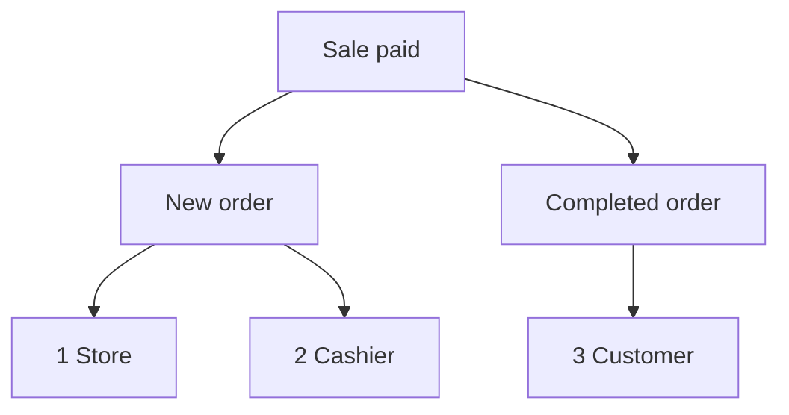

import Accordion from '@site/src/components/Accordion';
import AccordionItem from '@site/src/components/AccordionItem';
import LinkCards from '@site/src/components/LinkCards';
import LinkCard from '@site/src/components/LinkCard';

**WP Admin:** `WP Admin → POS → Settings → Checkout`.

WooCommerce versendet E-Mails zu Bestellungen: eine E-Mail zu neuen Bestellungen an Sie, eine E-Mail zu abgeschlossenen Bestellungen an den Kunden und so weiter. Für Verkäufe im POS legen Sie hier fest, welche dieser E-Mails versendet werden und wer sie erhält. Für Online-Bestellungen gelten weiterhin Ihre üblichen WooCommerce-E-Mail-Einstellungen.

Direkt zu: [Administrator-E-Mails](#admin-emails) · [Kunden-E-Mails](#customer-emails) · [Beleg manuell senden](#send-receipt-manually) · [Kassierer-E-Mails](#cashier-emails) · [Häufige Anwendungsfälle](#common-scenarios) · [Wenn etwas schiefgeht](#goes-wrong)

## E-Mails ein- oder ausschalten {#switches}

:::note Für POS-Verkäufe
Diese Schalter überschreiben für POS-Bestellungen die Einstellung **Diese E-Mail-Benachrichtigung aktivieren** unter **WooCommerce > Einstellungen > E-Mails**. Eine in WooCommerce ausgeschaltete E-Mail kann dennoch versendet werden, wenn sie hier angehakt ist.
:::

1. Gehen Sie in WP Admin zu **POS > Einstellungen > Kasse**.
2. Unter **Überverkäufe verhindern** finden Sie die drei E-Mail-Schalter: **Administrator-E-Mails**, **Kunden-E-Mails** und **Kassierer-E-Mails**. Darunter befindet sich die Liste **Zahlungsgateways**.
3. Wenn Sie einen Schalter einschalten, erscheint für jede E-Mail dieser Gruppe ein Kontrollkästchen. Entfernen Sie das Häkchen bei einer E-Mail, um nur diese zu deaktivieren.
4. Wenn Sie einen Schalter ausschalten, wird bei POS-Verkäufen keine E-Mail dieser Gruppe versendet, unabhängig von den gesetzten Häkchen.

Jede Änderung wird sofort gespeichert: Auf dem Bildschirm erscheint **Wird gespeichert**, dann **Gespeichert**.

{/* reshoot: WP Admin > POS > Settings > Checkout with all three email switches on and their checkboxes showing; see reshoot.md */}

An wen die einzelnen Schalter E-Mails senden und wie sie bei der Installation eingestellt sind:

- **Administrator-E-Mails**: bei der Installation eingeschaltet\
  An die Adressen unter **Empfänger** für die jeweilige E-Mail unter **WooCommerce > Einstellungen > E-Mails**
- **Kunden-E-Mails**: bei der Installation eingeschaltet\
  An die Rechnungs-E-Mail-Adresse der Bestellung
- **Kassierer-E-Mails**: bei der Installation ausgeschaltet\
  An die E-Mail-Adresse im WordPress-Konto des Kassierers

Welche E-Mails ein an der Kasse bezahlter Verkauf auslöst, wenn der **Bestellstatus** seiner Zahlungsart auf Abgeschlossen gesetzt ist:

1. **Filiale** — die **Empfänger** von **Neue Bestellung** in WooCommerce, wenn **Administrator-E-Mails** eingeschaltet und **Neue Bestellung** angehakt ist.
2. **Kassierer** — die eigene Adresse des Kassierers, wenn **Kassierer-E-Mails** eingeschaltet und **Neue Bestellung** angehakt ist.
3. **Kunde** — die Rechnungs-E-Mail-Adresse der Bestellung, wenn **Kunden-E-Mails** eingeschaltet und **Abgeschlossene Bestellung** angehakt ist und die Bestellung eine Rechnungs-E-Mail-Adresse enthält.

## Administrator-E-Mails {#admin-emails}

Diese E-Mails gehen an Sie als Betreiber der Filiale. Bei der Installation sind alle E-Mails angehakt.

Um die Empfänger einer Administrator-E-Mail zu ändern, gehen Sie zu **WooCommerce > Einstellungen > E-Mails**, öffnen Sie die Einstellungen der betreffenden E-Mail und bearbeiten Sie **Empfänger**.

| E-Mail | Wird versendet, wenn |
|---|---|
| **Neue Bestellung** | Eine POS-Bestellung zu Abgeschlossen, In Bearbeitung oder Wartend wechselt |
| **Stornierte Bestellung** | Eine Bestellung mit dem Status In Bearbeitung oder Wartend storniert wird |
| **Fehlgeschlagene Bestellung** | Eine Bestellung mit dem Status Zahlung ausstehend oder Wartend fehlschlägt |

Wenn eine POS-Bestellung von **POS - Offen** oder **POS - Teilzahlung** zu Abgeschlossen, In Bearbeitung oder Wartend wechselt, wird **Neue Bestellung** versendet, sofern diese E-Mail unter **Administrator-E-Mails** oder **Kassierer-E-Mails** angehakt und der jeweilige Schalter eingeschaltet ist. Das gilt auch dann, wenn **Neue Bestellung** in WooCommerce ausgeschaltet ist. In welchen Status ein Verkauf wechselt, bestimmt der **Bestellstatus**, den Sie für seine Zahlungsart festlegen: siehe [Bestellstatus](./checkout.mdx#order-status).

Warum WCPOS die E-Mail Neue Bestellung bei POS-Verkäufen selbst versendet

WooCommerce versendet **Neue Bestellung** nur, wenn eine Bestellung den Status Zahlung ausstehend, Fehlgeschlagen oder Storniert verlässt. Eine POS-Bestellung wartet stattdessen im Status **POS - Offen** oder **POS - Teilzahlung**. Diese Status kennt WooCommerce nicht und würde die E-Mail daher beim nächsten Statuswechsel nicht versenden. WCPOS übernimmt den Versand anstelle von WooCommerce zu den oben genannten Zeitpunkten.

## Kunden-E-Mails {#customer-emails}

Diese E-Mails gehen an die Rechnungs-E-Mail-Adresse der Bestellung. Für eine Bestellung ohne Rechnungs-E-Mail-Adresse wird keine Kunden-E-Mail versendet, etwa bei einem Gastverkauf, bei dem Sie keine Adresse eingegeben haben. Bei der Installation sind alle E-Mails angehakt.

### Beleg manuell senden {#send-receipt-manually}

**Beleg per E-Mail senden** auf dem Bildschirm nach der Zahlung funktioniert unabhängig davon. Diese Funktion versendet die Rechnungs-E-Mail von WooCommerce, die von diesen Schaltern nicht gesteuert wird. Sie funktioniert daher auch bei ausgeschalteten **Kunden-E-Mails**. Siehe [Beleg per E-Mail senden](../../receipts/at-checkout.mdx#email-receipt).

### Automatisch versendete E-Mails {#customer-emails-automatic}

| E-Mail | Wird versendet, wenn |
|---|---|
| **Bestellung wartend** | Eine Bestellung von Zahlung ausstehend, Fehlgeschlagen oder Storniert zu Wartend wechselt |
| **Bestellung in Bearbeitung** | Eine Bestellung von Zahlung ausstehend, Wartend, Fehlgeschlagen oder Storniert zu In Bearbeitung wechselt |
| **Abgeschlossene Bestellung** | Eine Bestellung zu Abgeschlossen wechselt |
| **Rückerstattete Bestellung** | Eine Bestellung ganz oder teilweise rückerstattet wird. Siehe [Rückerstattungen](../../orders/refunds.mdx) |
| **Fehlgeschlagene Bestellung** | Eine Bestellung fehlschlägt |

Bei einem Verkauf, der direkt von **POS - Offen** zu In Bearbeitung oder Wartend wechselt, etwa einem Barverkauf, werden **Bestellung wartend** und **Bestellung in Bearbeitung** nicht versendet: WooCommerce versendet diese E-Mails nur ausgehend von den aufgeführten Status. **Abgeschlossene Bestellung**, **Rückerstattete Bestellung** und **Fehlgeschlagene Bestellung** sind nicht vom vorherigen Status abhängig und werden daher auch bei POS-Verkäufen versendet. Um dem Kunden eine E-Mail zu einem Verkauf zu senden, der mit In Bearbeitung oder Wartend endet, verwenden Sie [Beleg per E-Mail senden](#send-receipt-manually).

## Kassierer-E-Mails {#cashier-emails}

Damit wird die E-Mail **Neue Bestellung** an den Kassierer gesendet, der den Verkauf abgewickelt hat, und zwar an die E-Mail-Adresse in seinem WordPress-Konto. Bei der Installation ist der Schalter ausgeschaltet. Wenn Sie ihn einschalten, ist **Neue Bestellung** angehakt.

Der Kassierer erhält die E-Mail zu denselben Zeitpunkten wie der Administrator (siehe [Administrator-E-Mails](#admin-emails)). **Administrator-E-Mails** und **Kassierer-E-Mails** funktionieren unabhängig voneinander: Wenn Sie einen Schalter ausschalten, bleibt der andere unverändert. Gehört die Adresse des Kassierers bereits zu den Administrator-Empfängern, etwa bei einem Inhaber, der beide Rollen übernimmt, erhält er eine Kopie, nicht zwei.

Welche WordPress-Benutzer sich als Kassierer im POS anmelden können, legen Sie unter [Kassiererzugriff](./access.mdx) fest.

## Häufige Anwendungsfälle {#common-scenarios}

<Accordion>
  <AccordionItem question="Eine E-Mail-Flut an umsatzstarken Tagen verhindern">

Entfernen Sie unter **Administrator-E-Mails** das Häkchen bei **Neue Bestellung**. Lassen Sie **Stornierte Bestellung** und **Fehlgeschlagene Bestellung** angehakt: Über diese Vorgänge sollten Sie informiert werden.

Nutzen Sie [Berichte](../../reports/index.mdx), um Ihre Einnahmen zu verfolgen, statt die E-Mails zu neuen Bestellungen zu zählen.

  </AccordionItem>

  <AccordionItem question="E-Mails zu neuen Bestellungen an den diensthabenden Kassierer statt an den Administrator senden">

Entfernen Sie unter **Administrator-E-Mails** das Häkchen bei **Neue Bestellung** oder schalten Sie **Administrator-E-Mails** aus, und schalten Sie **Kassierer-E-Mails** ein. Der Kassierer, der den jeweiligen Verkauf abwickelt, erhält die E-Mail an seine eigene Adresse. Das Postfach des Administrators bleibt davon verschont.

Wenn Sie **Administrator-E-Mails** ausschalten, werden auch **Stornierte Bestellung** und **Fehlgeschlagene Bestellung** nicht mehr versendet. Daher ist es meist besser, nur das Häkchen bei **Neue Bestellung** zu entfernen.

  </AccordionItem>

  <AccordionItem question="Keine Kunden-E-Mails bei Verkäufen in der Filiale">

Marktstände und Cafés möchten Kunden, die bereits einen gedruckten Beleg haben, häufig keine E-Mail senden. Schalten Sie **Kunden-E-Mails** aus. Dann werden bei POS-Verkäufen keine E-Mails zu Bestellungen in Bearbeitung, abgeschlossenen oder rückerstatteten Bestellungen und auch keine anderen Kunden-E-Mails versendet.

Für Online-Bestellungen werden die Kunden-E-Mails weiterhin wie gewohnt versendet. Ein Kunde, der einen Beleg per E-Mail wünscht, kann ihn weiterhin erhalten: Drücken Sie auf dem Bildschirm nach der Zahlung auf **Beleg per E-Mail senden**.

  </AccordionItem>

  <AccordionItem question="Ich habe ein Upgrade von einer Version vor 1.8.9 durchgeführt und der einzelne Schalter „E-Mails aktivieren“ ist verschwunden">

Version 1.8.9 hat den einzelnen Ein-/Aus-Schalter durch die drei Gruppen auf dieser Seite ersetzt. WCPOS übernimmt Ihre bisherige Einstellung: Waren E-Mails ausgeschaltet, sind **Administrator-E-Mails** und **Kunden-E-Mails** ausgeschaltet. Waren sie eingeschaltet, sind beide eingeschaltet und alle E-Mails angehakt. **Kassierer-E-Mails** ist in beiden Fällen zunächst ausgeschaltet.

Sie müssen nichts unternehmen.

  </AccordionItem>
</Accordion>

## Wenn etwas schiefgeht {#goes-wrong}

**Der Administrator erhält keine E-Mail zu neuen Bestellungen.** Prüfen Sie, ob **Administrator-E-Mails** eingeschaltet und **Neue Bestellung** angehakt ist. Prüfen Sie anschließend unter **WooCommerce > Einstellungen > E-Mails** die **Empfänger** für **Neue Bestellung**.

**Ein Kunde erhält keine E-Mail.** Prüfen Sie, ob **Kunden-E-Mails** eingeschaltet und die betreffende E-Mail angehakt ist. Öffnen Sie dann die Bestellung und prüfen Sie, ob eine Rechnungs-E-Mail-Adresse vorhanden ist. Um jetzt einen Beleg zu senden, verwenden Sie **Beleg per E-Mail senden**.

**Der Kassierer erhält keine E-Mail.** Prüfen Sie, ob **Kassierer-E-Mails** eingeschaltet und **Neue Bestellung** angehakt ist und ob im WordPress-Konto des Kassierers eine E-Mail-Adresse hinterlegt ist. Gehört diese Adresse auch zu den Administrator-Empfängern, erhält er nur eine Kopie.

**Eine in WooCommerce ausgeschaltete E-Mail wird bei POS-Verkäufen weiterhin versendet.** Für POS-Bestellungen sind die Kontrollkästchen hier maßgeblich. Entfernen Sie auch hier das Häkchen bei der betreffenden E-Mail.

## Hooks für Entwickler {#developer-hooks}

Für Entwickler, die über diese Schalter hinaus Einfluss nehmen müssen. Filialbetreiber können diesen Abschnitt überspringen.

Vier WordPress-Filter und die Festlegung der Empfänger für Neue Bestellung

Vor WCPOS 2.0 hießen diese Filter `woocommerce_pos_*` (zum Beispiel `woocommerce_pos_admin_emails`). Diese Namen funktionieren weiterhin, sind aber seit 2.0 veraltet und werden frühestens in 2.2 entfernt. Siehe [Benennung von Hooks](../../extensions/index.mdx#hook-naming).

**`wcpos_admin_emails`**: die IDs der Administrator-E-Mails, die WCPOS steuert. Standard: `cancelled_order`, `failed_order`.

**`wcpos_customer_emails`**: die IDs der Kunden-E-Mails, die WCPOS steuert. Standard: `customer_failed_order`, `customer_on_hold_order`, `customer_processing_order`, `customer_completed_order`, `customer_refunded_order`.

**`wcpos_admin_email_enabled`**: ob eine bestimmte Administrator-E-Mail für eine bestimmte POS-Bestellung versendet wird. Argumente: `$is_enabled`, `$email_id`, `$order`, `$email`.

**`wcpos_customer_email_enabled`**: ob eine bestimmte Kunden-E-Mail für eine bestimmte POS-Bestellung versendet wird. Dieselben Argumente.

**Neue Bestellung** ist nicht in `wcpos_admin_emails` enthalten. WCPOS legt die Empfänger über den WooCommerce-Filter `woocommerce_email_recipient_new_order` fest: Die Empfänger der Filiale werden entfernt, wenn der Administrator die E-Mail nicht erhalten soll. Die Adresse des Kassierers wird hinzugefügt, wenn dieser sie erhalten soll. Der Kassierer ist der WordPress-Benutzer, der im Metafeld `_pos_user` der Bestellung gespeichert ist. Ihr eigener Callback für diesen Filter kann Adressen genauso hinzufügen oder entfernen wie bei jeder anderen WooCommerce-E-Mail.

## Weiterführende Dokumentation {#related-documentation}

<LinkCards>
  <LinkCard title="Checkout-Einstellungen" to="/settings/checkout" description="Zahlungsgateways und der von ihnen gesetzte Bestellstatus auf demselben Bildschirm." />
  <LinkCard title="Belege beim Bezahlvorgang" to="/sell/print-email-receipts" description="Drucken oder versenden Sie einen Beleg per E-Mail vom Bildschirm nach der Zahlung aus." />
  <LinkCard title="Bestellungen" to="/manage-store/orders" description="Finden Sie die POS-Bestellungen, auf die sich diese E-Mails beziehen." />
</LinkCards>
