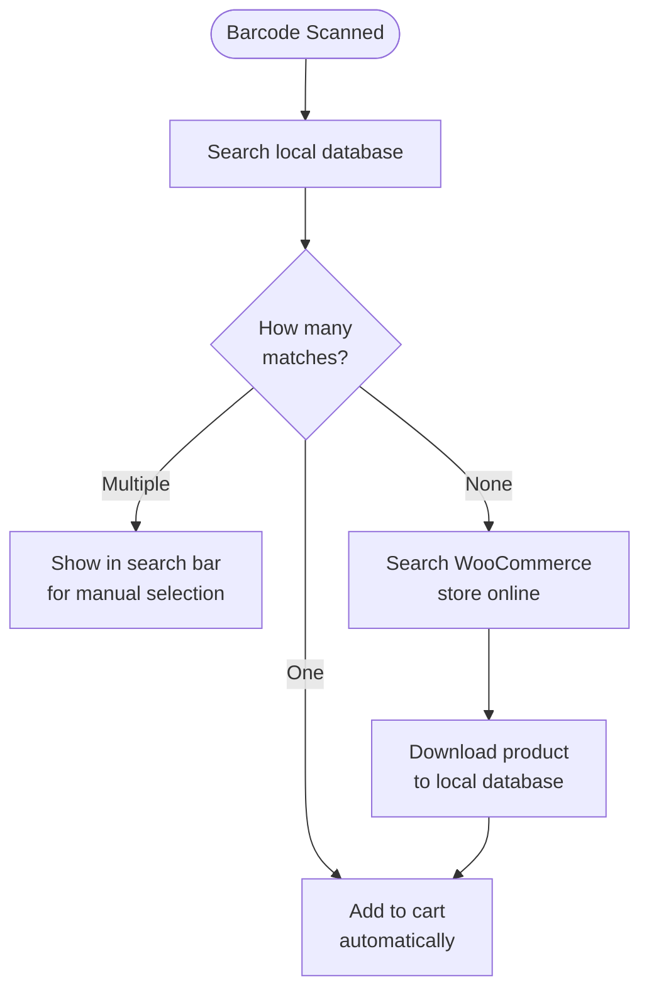

import Image from "@theme/IdealImage";
import Accordion from '@site/src/components/Accordion';
import AccordionItem from '@site/src/components/AccordionItem';

La mayoría de los escáneres de códigos de barras se comportan como un teclado conectado a su dispositivo.
Al escanear un código de barras, WCPOS detecta que los caracteres se introdujeron más rápido que una escritura normal.
Usa estas "pulsaciones rápidas de teclas" para identificar la entrada como un escaneo de código de barras.
Esto funciona sin configuración con casi cualquier escáner — pero los escáneres también admiten otros [modos de conexión](#connection-modes) a los que WCPOS puede conectarse directamente.

## Configuración del escaneo de códigos de barras {#configuring-barcode-scanning}

Dado que un escaneo de código de barras ocurre muy rápido, el POS puede distinguir entre un código de barras y algo escrito a mano.
En los ajustes del POS encontrará opciones para ajustar con precisión el funcionamiento de la detección de códigos de barras.

  <Image
    alt="Ajustes de escaneo de códigos de barras en los ajustes del POS"
    img="/img/barcode-scanning-settings.png"
    style={{ maxHeight: 500 }}
  />
  
Ajustes de escaneo de códigos de barras en los ajustes del POS

| Ajuste | Propósito | Valor típico |
|---|---|---|
| **Tiempo medio de entrada** | Velocidad que debe tener la entrada para reconocerse como un código de barras | Un intervalo corto — lo bastante rápido para que la escritura manual no lo active |
| **Longitud mínima** | Longitud que debe tener la cadena continua de caracteres para tratarse como un código de barras | Debe coincidir con el código de barras más corto que utilice (p. ej., 8 para EAN-8) |
| **Eliminación de prefijo/sufijo** | Elimina los caracteres adicionales que añade el escáner (un prefijo o sufijo) para que solo quede el código de barras principal | Déjelo vacío a menos que el escáner esté configurado para añadirlos |

## Modos de conexión {#connection-modes}

Para seguir una guía de configuración o resolución de problemas, utilice el [Asistente de configuración del escáner](/1.x/hardware/scanners/setup-wizard).

Cada escáner de códigos de barras viene configurado en uno de los modos disponibles, y ese modo determina cómo puede recibir WCPOS sus escaneos:

| Modo | Cómo se recibe | Configuración |
|---|---|---|
| **Teclado (HID)** — el modo predeterminado de fábrica en casi todos los escáneres | El escáner «escribe» el código de barras; WCPOS reconoce las pulsaciones rápidas | Ninguna — empareje o conecte el escáner y escanee |
| **Serie (SPP / USB-COM)** | Una conexión directa mediante puerto serie USB o Bluetooth SPP | Cambie el modo del escáner y conéctelo en los ajustes de códigos de barras |
| **HID-POS** | Una conexión directa para escáneres USB (mediante WebHID) | Cambie el modo del escáner y conéctelo en los ajustes de códigos de barras |
| **Bluetooth LE (GATT del fabricante)** | Una conexión directa Bluetooth Low Energy | Empareje el escáner y añádalo en los ajustes de códigos de barras mediante su UUID de servicio |

El modo teclado no necesita configuración y es adecuado para la mayoría de las tiendas. Una conexión directa resulta útil si los escaneos llegan a veces con caracteres incorrectos (confusiones de mayúsculas y símbolos por diferencias en la distribución del teclado) o se introducen en el lugar equivocado cuando el cuadro de búsqueda no tiene el foco. Un escáner conectado directamente envía cada escaneo a WCPOS, independientemente de la velocidad de escritura, la distribución del teclado o el foco.

:::info Un escáner en modo teclado no se puede conectar directamente
Su dispositivo trata un escáner en modo teclado exactamente igual que un teclado, y ninguna aplicación tiene permiso para tomar el control exclusivo de un teclado.
Si pulsa **Conectar escáner serie** o **Conectar escáner HID** en los ajustes de códigos de barras y el escáner no aparece en la lista, es casi seguro que sigue en modo teclado.
:::

**Para cambiar de modo**, localice el código de barras de configuración en el manual del escáner (busque *«modo SPP»*, *«modo serie»* o *«modo HID-POS»*) y escanéelo; el escáner se reconfigura automáticamente. En los escáneres Bluetooth, elimine el emparejamiento anterior en los ajustes de Bluetooth de su dispositivo y vuelva a emparejarlo después del cambio. Puede volver al modo teclado en cualquier momento escaneando el código de barras *«HID»* o *«teclado»* del manual.

Las conexiones directas son compatibles con la aplicación de escritorio y los navegadores basados en Chrome (mediante la compatibilidad del navegador con Web Serial y WebHID). La aplicación de escritorio muestra un selector de dispositivos dentro de la propia aplicación; Chrome muestra su propio selector. En iOS y Android, las opciones admitidas son el modo teclado y el escaneo por cámara; además, Android intercepta directamente las pulsaciones de los escáneres físicos.

## Escaneo por cámara {#camera-scanning}

Todas las plataformas — web, escritorio, iOS y Android — permiten escanear con la cámara del dispositivo, por lo que no necesita un escáner dedicado para empezar. Abra la cámara desde el icono de escaneo de la barra de búsqueda; aparece como un **panel redimensionable justo debajo de los filtros**, de modo que la lista de productos permanece a la vista mientras escanea. Apunte la cámara a un código de barras y WCPOS lo leerá igual que si utilizara un escáner físico.

## ¿Qué sucede cuando se detecta un código de barras? {#what-happens-when-a-barcode-is-detected}

Cuando el POS detecta un código de barras, busca en su base de datos local un producto o una variación de producto que coincida.
Hay tres resultados posibles:

Cuando un escaneo no encuentra ninguna coincidencia local, WCPOS consulta su tienda en línea, descarga el producto coincidente y **lo añade al carrito automáticamente**. Así, incluso un código de barras desconocido permite completar la venta, y el mismo escaneo será instantáneo la próxima vez.

:::tip Las coincidencias múltiples suelen indicar un problema con los datos
Si varios productos comparten el mismo código de barras, el POS no puede saber cuál añadir, por lo que coloca el código en la barra de búsqueda para que elija. Cuando esto ocurre, suele indicar que es necesario revisar los datos de los productos: cada producto debe tener un código de barras **único**.
:::

## Confirmación y comportamiento del escaneo {#scan-feedback-and-behaviour}

- **Sonidos de escaneo** — WCPOS puede reproducir un sonido con cada escaneo para que los cajeros reciban una confirmación instantánea sin mirar la pantalla. Los sonidos son opcionales y permiten elegir entre varios temas; actívelos y elija un tema en los [Ajustes de códigos de barras](/1.x/settings/store/barcode).
- **En la pantalla de Pedidos** — los escaneos se dirigen al campo de búsqueda de Pedidos, de modo que puede escanear un código de barras para encontrar el pedido o producto que busca.
- **Códigos de barras UPC-A** — un escaneo UPC-A devuelve los dígitos impresos en el envase, por lo que el valor que compara el POS coincide con el utilizado en los datos del producto.

## Comprensión de la sincronización de productos {#understanding-product-synchronisation}

El POS descarga el catálogo en pequeños lotes en segundo plano, por lo que no todos los productos están en el dispositivo desde el primer minuto. Consulte [Sincronización de productos](/1.x/products/sync) para saber cómo funciona.

### Por qué es importante para el escaneo de códigos de barras {#why-it-matters-for-barcode-scanning}

Cuando escanea un código de barras que aún no está almacenado localmente, el POS consulta su tienda WooCommerce en línea, encuentra el producto y lo descarga, de modo que el mismo escaneo será instantáneo la próxima vez. No necesita hacer nada para acelerar este proceso: la carga inicial del catálogo en segundo plano completa el resto del inventario por sí sola, y puede consultar el progreso en **Estado de la tienda → Base de datos**.

## Preguntas frecuentes {#faq}

<Accordion>
  <AccordionItem question="¿Por qué aparece '0 productos encontrados localmente' al escanear un código de barras?">

No todos los productos están en el dispositivo desde el principio: el POS realiza la carga inicial del catálogo en segundo plano durante los primeros minutos de uso.
Si el producto que acaba de escanear aún no está almacenado, el escaneo hace que el POS lo busque en línea y lo descargue, de modo que el siguiente escaneo sea instantáneo.

  </AccordionItem>

  <AccordionItem question="¿El POS genera e imprime códigos de barras?">

No, por el momento. Nuestro POS está diseñado para escanear y leer códigos de barras existentes, pero no incluye funciones para crearlos o imprimirlos.
Si necesita generar códigos de barras para sus productos, puede utilizar plugins de WooCommerce de terceros especializados en la creación e impresión de códigos de barras. Algunos ejemplos son:

- [EAN for WooCommerce](https://wordpress.org/plugins/ean-for-woocommerce/)
- [A4 Barcode Generator](https://wordpress.org/plugins/a4-barcode-generator/)

Una vez que haya generado códigos de barras para sus productos, puede escanearlos fácilmente en la caja para agilizar el proceso de cobro en el POS.

  </AccordionItem>
</Accordion>
