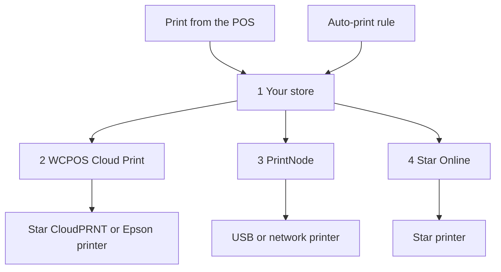

import LinkCards from '@site/src/components/LinkCards';
import LinkCard from '@site/src/components/LinkCard';

La impresión en la nube envía los recibos a una impresora a través de internet, por lo que no es necesario que la impresora esté conectada al dispositivo donde se ejecuta el POS. Úsela para una impresora en una red distinta a la de la caja, una impresora de cocina que imprima cada pedido por sí sola o un albarán para cada venta en línea.

La impresora en la nube se configura una sola vez, en **WP Admin → POS → Ajustes → Impresión en la nube**. A partir de entonces, aparece en todos los dispositivos y los cajeros pueden imprimir en ella desde el POS como en cualquier otra impresora.

## Imprimir desde el POS {#manual}

La tienda genera el recibo de una impresora en la nube a partir del pedido, por lo que debe tener registrada la venta antes de imprimir.

1. En la pantalla de pago realizado o en la ventana **Recibo** de un pedido, abra el menú **Impresora** y seleccione la impresora en la nube.
2. Pulse **Imprimir recibo**.
3. La pantalla muestra **Impreso en** y el nombre de la impresora. Esto significa que la tienda ha recibido el trabajo; compruebe que el recibo haya salido. Si no ha salido, un responsable puede consultar qué ha ocurrido en la [cola de impresión](#print-queue).

Consulte [Imprimir el recibo](./at-checkout.mdx#print-receipt). Para enviar siempre una plantilla a una impresora en la nube, seleccione la impresora para esa plantilla en **Ajustes → Impresión**: consulte [Asignación de impresoras](../hardware/printers/index.mdx#print-routing).

- **El pedido debe estar en la tienda.** Si la tienda aún no ha confirmado la venta, por ejemplo, una realizada sin conexión, el POS muestra *Esta impresora imprime la copia de la tienda y la tienda aún no ha confirmado esta venta. Vuelva a imprimir cuando la haya confirmado.* Pulse **Imprimir recibo** de nuevo cuando la caja tenga conexión y la tienda haya confirmado la venta. Mientras la caja esté sin conexión, la impresión en una impresora en la nube falla, incluso si se trata de un pedido anterior.
- Los **informes y cierres de caja** enviados a una impresora en la nube abren, en su lugar, el cuadro de diálogo de impresión del sistema.
- **Una plantilla HTML en una impresora en la nube Star o Epson** muestra *Esta impresora en la nube solo imprime plantillas térmicas, por lo que no se imprimirá nada. Elija una plantilla térmica.*

Las impresoras en la nube aparecen automáticamente en **Ajustes → Impresión** en todos los dispositivos, en **Impresoras**. La segunda línea de la fila indica el tipo, por ejemplo, *Star CloudPRNT · gestionada por WCPOS*. Un cajero puede pulsar **Impresión de prueba** en la fila o **Copiar informe de configuración** en su menú **⋯**, pero no puede editarla ni eliminarla: eso se hace en la pantalla **Impresión en la nube**. Consulte [Configuración de impresoras](../hardware/printers/index.mdx#printers-list).

## Elegir un tipo de impresora {#providers}

:::note A partir de aquí necesita acceso a WP Admin
Añadir impresoras y reglas es una tarea del propietario o responsable de la tienda, en **WP Admin → POS → Ajustes → Impresión en la nube**.
:::

La pantalla **Impresión en la nube** pregunta **¿Qué tipo de impresora va a conectar?** Elija el que corresponda a su impresora.

- **Star CloudPRNT** — para una impresora Star con CloudPRNT integrado (mC-Print, TSP143IV…), si desea una conexión gratuita sin otra cuenta. La impresora obtiene los trabajos de su tienda. *Solo plantillas térmicas.*
- **Epson Server Direct Print** — para una impresora TM «inteligente» de Epson (TM-T88VI/VII, TM-m30III, serie TM-i). La impresora obtiene los trabajos de su tienda. *Solo plantillas térmicas.*
- **Star Online** — para una impresora Star vinculada a una cuenta de stario.online (mC-Print3, TSP143IV, mC-Label3). Su tienda entrega el trabajo a Star Online, que se encarga de enviarlo. *Solo plantillas térmicas.*
- **PrintNode** — para una impresora USB o de red convencional, si puede ejecutar la pequeña aplicación de PrintNode en un ordenador de la tienda. Su tienda entrega el trabajo a PrintNode y su aplicación en ese ordenador lo imprime. *Cualquier plantilla.*

Una impresora en la nube Star o Epson no puede imprimir una plantilla HTML: el recibo debe convertirse en los comandos propios de la impresora. Para plantillas HTML y de página completa, utilice PrintNode. Consulte [Plantillas térmicas](./thermal-templates.mdx).

<details>
<summary>Cómo llegan los trabajos a su impresora</summary>



<div className="pinned-legend">

1. **Su tienda** — genera el recibo a partir del pedido y la plantilla, y mantiene el trabajo en la [cola de impresión](#print-queue). Tanto una impresión desde el POS como una [regla de impresión automática](#auto-print) comienzan aquí.
2. **WCPOS Cloud Print** — el [servicio intermediario](#relay). Una impresora Star CloudPRNT o Epson suele obtener los trabajos a través de él, por lo que el trabajo espera hasta la siguiente consulta de la impresora.
3. **PrintNode** — su tienda entrega el trabajo a PrintNode y la aplicación de PrintNode en un ordenador de la tienda lo imprime.
4. **Star Online** — su tienda entrega el trabajo a Star Online, que lo envía a la impresora.

</div>

</details>

## Añadir una impresora {#setup}

1. Vaya a **WP Admin → POS → Ajustes → Impresión en la nube**. En **Sus impresoras en la nube**, pulse **+ Añadir una impresora**.
2. Elija el tipo.
3. Introduzca un **Nombre de la impresora**, por ejemplo, *Impresora de cocina*. WCPOS genera el **ID de la impresora** a partir del nombre. El ID no se puede cambiar después; para cambiarlo, elimine la impresora y vuelva a añadirla.
4. Complete los pasos correspondientes a su tipo: [Star CloudPRNT o Epson](#setup-polling), [PrintNode](#setup-printnode) o [Star Online](#setup-star-online).
5. La impresora aparece como una tarjeta en **Sus impresoras en la nube**. Pulse **Impresión de prueba** en ella. Consulte [La tarjeta de la impresora](#status).

### Star CloudPRNT o Epson Server Direct Print {#setup-polling}

Estas impresoras obtienen sus propios trabajos, por lo que no hay ninguna cuenta que vincular. Como es la impresora la que se conecta a su tienda, no necesita abrir un puerto, configurar una IP estática ni modificar el cortafuegos. El trabajo se imprime la próxima vez que la impresora realiza una consulta. El último paso de **+ Añadir una impresora** muestra la **URL de consulta** de la impresora, que contiene un token secreto.

<details>
<summary>Conectar una impresora Star CloudPRNT o Epson</summary>

1. Pulse **Copiar** junto a la **URL de consulta**. La dirección completa se muestra **solo una vez**. Si la pierde, elimine la impresora y vuelva a añadirla para obtener una nueva: la opción **Configuración y token** de la tarjeta la muestra con el token oculto.
2. Abra la página de ajustes de la propia impresora y pegue la dirección en su URL del servidor: en los ajustes de **CloudPRNT** en una Star o de **Server Direct Print** en una Epson. Active las consultas periódicas, guarde y reinicie la impresora.
3. De vuelta en la tarjeta, el estado cambia de **Esperando a la impresora** a **Conectada** cuando la impresora realiza su primera consulta.

La dirección suele empezar por `https://cloudprint.wcpos.com`. Es el [servicio intermediario WCPOS Cloud Print](#relay) y es la dirección que debe usar. La opción **Avanzado: conectar directamente a este sitio (sin intermediario)**, debajo de la dirección, muestra una **URL directa** como alternativa; algunas impresoras no pueden conectarse directamente a un sitio y permanecen en **Esperando a la impresora**.

En una Epson, mantenga **Server Direct Print** activado mientras WCPOS imprima en ella de esta forma. Consulte [Server Direct Print](../hardware/printers/server-direct-print.mdx).

</details>

### PrintNode {#setup-printnode}

PrintNode necesita que su cliente se ejecute en un ordenador junto a la impresora y una clave API de su cuenta de PrintNode.

<details>
<summary>Conectar una impresora PrintNode</summary>

1. En un ordenador junto a la impresora, instale el cliente de PrintNode e inicie sesión. El ordenador debe estar encendido y el cliente en ejecución para poder imprimir.
2. En su cuenta de PrintNode, cree una clave API.
3. En **+ Añadir una impresora**, elija **PrintNode**, pegue la clave en **Clave API de PrintNode** y pulse **Obtener mis impresoras**.
4. En **Elegir una impresora**, seleccione la que indica el cliente y finalice. El último paso muestra **Vinculada a PrintNode**: no hay ninguna dirección ni token que copiar.

</details>

Una vez vinculada, configure **Formato de impresión** en la tarjeta de la impresora:

- **PDF (recomendado)** imprime cualquier plantilla, térmica o HTML, como un PDF. Mantenga esta opción salvo que tenga un motivo para cambiarla.
- **ESC/POS RAW — solo plantillas térmicas** envía una plantilla térmica como comandos de impresora de recibos en lugar de un PDF. Las plantillas HTML se siguen enviando como PDF.

### Star Online {#setup-star-online}

Star Online necesita la dirección del grupo de la impresora y una clave API, ambas de su cuenta de stario.online.

<details>
<summary>Conectar una impresora Star Online</summary>

1. En stario.online, abra **Grupos de dispositivos** y copie la **URL de CloudPRNT** del grupo. Tiene un formato similar a `https://device.stario.online/cloudprnt/...`, o `https://eu-device.stario.online/cloudprnt/...` en la UE.
2. En stario.online, cree una clave API con los permisos **EnumDevices**, **ViewDevice**, **PrintToDevice** y **ViewDeviceGroups**. Una clave sin ellos se acepta, pero no permite listar dispositivos ni imprimir.
3. En **+ Añadir una impresora**, elija **Star Online**. Pegue la **URL de CloudPRNT** y la **Clave API de Star Online** y, a continuación, pulse **Obtener mis dispositivos**.
4. En **Elegir un dispositivo**, seleccione la impresora y finalice. La tarjeta muestra entonces su **Dispositivo**, **Grupo** y **AccessIdentifier**.

</details>

## La tarjeta de la impresora {#status}

Cada impresora en la nube tiene una tarjeta en **Sus impresoras en la nube**:

- **El nombre** — haga clic en él para cambiar el nombre de la impresora. El tipo aparece debajo.
- **El estado** — consulte la lista siguiente. Se actualiza cada 30 segundos.
- **Última consulta** — cuándo realizó la última consulta una impresora Star CloudPRNT o Epson, o *nunca*.
- **ID de la impresora** — se fija al añadir la impresora.
- **Formato de impresión** — solo PrintNode: **PDF (recomendado)** o **ESC/POS RAW — solo plantillas térmicas**. Consulte [PrintNode](#setup-printnode).
- **Impresión de prueba** — envía una página de prueba breve. Un mensaje indica *Se ha enviado una impresión de prueba a …* o el motivo del fallo.
- **Acciones de la impresora** (**⋮**) — **Configuración y token** vuelve a abrir el último paso de configuración; **Eliminar impresora** impide que la impresora siga recibiendo trabajos. Puede volver a añadirla más adelante.

<details id="status-polling">
<summary>Estados de Star CloudPRNT y Epson Server Direct Print</summary>

- **Esperando a la impresora** — la impresora aún no ha realizado ninguna consulta. Compruebe la URL de consulta en la impresora: consulte [El estado no cambia de Esperando a la impresora](#trouble-polling).
- **Conectada** — la impresora ha realizado una consulta en los últimos dos minutos y medio.
- **Sin conexión** — la impresora ha realizado consultas antes, pero no recientemente. Compruebe que esté encendida y conectada a internet.
- **Bloqueada** — el servicio intermediario no puede acceder a su tienda. La tarjeta indica el motivo: un servicio de seguridad como Cloudflare o un plugin de cortafuegos lo está bloqueando, o su sitio ha respondido con un error del servidor. Consulte [Problemas con Star CloudPRNT o Epson](#trouble-polling).

</details>

<details id="status-services">
<summary>Estados de Star Online y PrintNode</summary>

- **En línea** — el servicio indica que la impresora está disponible.
- **Sin conexión** — el servicio indica que la impresora o el ordenador de PrintNode no están disponibles. En el caso de PrintNode, compruebe que el ordenador no esté en suspensión y que el cliente esté en ejecución.
- **Desconocido** — WCPOS no ha podido obtener el estado del servicio. Compruebe la clave API en [PrintNode](#setup-printnode) o [Star Online](#setup-star-online).

</details>

## Imprimir pedidos automáticamente {#auto-print}

Las reglas de impresión automática imprimen pedidos sin que nadie tenga que pulsar nada. Son opcionales: si no hay reglas, las impresoras en la nube solo imprimen cuando un cajero imprime desde el POS.

En **Reglas de impresión automática**, pulse **+ Añadir regla**. Cada regla se lee como una frase y cada parte subrayada es un menú:

> Imprimir automáticamente **cada pedido en tienda (POS)** en **Impresora de cocina** con la plantilla **Comanda de cocina**, **2 copias**, **en cuanto se cree**.

- **Qué pedidos** — **cada pedido**, **cada pedido en tienda (POS)** o **cada pedido en línea**. Con WCPOS Pro, también **pedidos de** una tienda: consulte [Impresoras por tienda](#per-store-printers).
- **Impresora** — una de sus impresoras en la nube.
- **Plantilla** — solo se ofrecen las plantillas que esa impresora puede imprimir. Las plantillas proceden de **POS › Plantillas**.
- **Copias** — de 1 a 5.
- **Cuándo** — **una vez pagado** (la opción predeterminada) o **en cuanto se cree**. Para un pedido del POS, la creación es el momento en que se guarda el carrito por primera vez, por lo que la comanda de cocina se imprime antes del pago.

Más de una regla puede imprimir el mismo pedido, por ejemplo, una comanda de cocina y un recibo para el cliente. Cada regla imprime un pedido determinado una sola vez. El recibo se genera en la tienda a partir del pedido y la plantilla, por lo que el cajero no tiene que hacer nada. Las impresiones automáticas nunca abren el cajón de efectivo.

Si cambia la impresora de una regla por otra que no puede imprimir su plantilla, la regla pasa a usar la primera plantilla que esa impresora pueda imprimir, así que compruebe que sea la que desea. Si la impresora no puede imprimir ninguna de sus plantillas, la plantilla queda vacía y la regla no imprime hasta que elija una.

### Impresoras por tienda (Pro) {#per-store-printers}

Con [WCPOS Pro](../getting-started/pro-license.mdx) y más de una [tienda](../stores/index.mdx), el menú **Qué pedidos** también muestra **pedidos de** cada tienda. Una regla de tienda imprime los pedidos que pertenecen a esa tienda: los que registran sus cajas y cualquier pedido que asigne a la tienda en la pantalla de edición del pedido. Los pedidos en línea no pertenecen a ninguna tienda salvo que les asigne una, por lo que solo los imprimen las reglas para todas las tiendas.

Las reglas se acumulan: un pedido de una tienda se imprime según las reglas de esa tienda **y** según cada regla para **cada pedido**, **cada pedido en tienda (POS)** o **cada pedido en línea**. Para evitar que las comandas de cocina de un local salgan por la impresora de otro, asigne a cada local su propia regla de tienda y no añada una regla para todas las tiendas para esa comanda.

## La cola de impresión {#print-queue}

Debajo de las reglas, **Cola de impresión** muestra cada trabajo: **Pedido**, **Impresora**, **Plantilla**, **Estado**, **Detalle** y **Creado**. El número de pedido enlaza al pedido.

- Use **Filtrar** por estado (**Requiere atención**, **Todos los estados** o uno de los estados **En espera**, **Imprimiendo**, **Impreso**, **Fallido**, **Cancelado**) y por impresora.
- Use **Cancelar** para un trabajo en espera, **Reintentar** para uno fallido (vuelve como un trabajo nuevo, *Reintentado como #…*) o **Eliminar** para borrar un trabajo. Marque varias filas para usar **Cancelar seleccionados** o **Eliminar seleccionados**.
- **Detalle** indica por qué ha fallado un trabajo, por ejemplo, *Star Online ha rechazado la solicitud. Compruebe que la clave API tenga los permisos necesarios.*

Cuando una impresora Star CloudPRNT o Epson tiene recibos en espera y no ha realizado consultas en 10 minutos, o nunca las ha realizado, aparece un aviso que indica el nombre de la impresora, cuándo realizó la última consulta y cuántos recibos están en espera, y ofrece la opción **Cancelar todos**.

:::warning Un trabajo que la impresora nunca confirmó
*La impresora nunca confirmó este trabajo* significa que WCPOS no puede determinar si se imprimió. No se vuelve a enviar automáticamente, porque podría imprimirse dos veces. Compruebe la impresora y pulse **Reintentar** solo si no ha salido nada.
:::

<details>
<summary>Cuánto tiempo se conservan los trabajos y cómo se reintentan</summary>

Los trabajos impresos y cancelados se eliminan al cabo de 7 días; los fallidos, al cabo de 30. Un desarrollador puede cambiar estos plazos con los filtros `wcpos_print_job_retention_days` y `wcpos_print_job_failed_retention_days`.

Un trabajo que WCPOS entrega a PrintNode o Star Online se intenta tres veces, con un intervalo de un minuto y después de dos minutos. Si el servicio rechaza una clave o una cuenta, el trabajo falla de inmediato y el motivo aparece en **Detalle**.

</details>

## WCPOS Cloud Print, el servicio intermediario {#relay}

La URL de consulta de una impresora Star CloudPRNT o Epson apunta a **cloudprint.wcpos.com**, no a su propio sitio. Se trata de **WCPOS Cloud Print**, un servicio intermediario gratuito gestionado por WCPOS entre sus impresoras y su tienda.

No hay que activar nada. Los trabajos pasan por el servicio intermediario de camino a la impresora, por lo que, al conectar una impresora, se comparte la dirección de su sitio con wcpos.com y los recibos, que incluyen los detalles del pedido, pasan por ese servicio. Consulte la [política de privacidad](https://wcpos.com/privacy).

<details>
<summary>Cómo funciona el servicio intermediario</summary>

Las impresoras de recibos ejecutan un firmware sencillo que rara vez se actualiza. Muchas no pueden establecer una conexión segura con una tienda en un alojamiento moderno, o un servicio como Cloudflare que protege el sitio les deniega el acceso. La impresora se queda entonces en **Esperando a la impresora** aunque todos los ajustes sean correctos. El servicio intermediario ofrece a la impresora una conexión que puede establecer y transmite sus solicitudes a la tienda.

- Su sitio se conecta automáticamente al servicio intermediario la primera vez que abre **Impresión en la nube**.
- El servicio intermediario necesita que su sitio use **HTTPS**. Si no lo usa, **Impresión en la nube** se lo indica.
- Si su sitio no puede conectarse al servicio intermediario, por ejemplo, si es un sitio de pruebas local, la URL de consulta apunta directamente a su sitio.
- El estado **Bloqueada** en una tarjeta significa que el servicio intermediario ha llegado a su sitio, pero se le ha denegado el acceso. Permita el acceso del servicio intermediario en su servicio de seguridad, tal como indica la tarjeta. Consulte [Problemas con Star CloudPRNT o Epson](#trouble-polling).

</details>

<details>
<summary>Desactivar el servicio intermediario (desarrolladores)</summary>

El último paso de configuración de una impresora Star CloudPRNT o Epson incluye **Avanzado: conectar directamente a este sitio (sin intermediario)** con su **URL directa**. Para desactivar el servicio intermediario en todo el sitio:

```php
add_filter( 'wcpos_cloud_print_relay_enabled', '__return_false' );
```

Antes de WCPOS 2.0, este filtro era `woocommerce_pos_cloud_print_relay_enabled`. Ese nombre sigue funcionando, está obsoleto desde 2.0 y se eliminará como pronto en 2.2. Consulte [Nomenclatura de hooks](../extensions/index.mdx#hook-naming).

</details>

<details>
<summary>Cómo llega un recibo a una impresora Star CloudPRNT</summary>

WCPOS ofrece a la impresora primero comandos StarPRNT, después una imagen PNG del recibo y, por último, texto sin formato, y usa la mejor opción que la impresora indique que puede leer. Los modelos Star antiguos que solo leen Line Mode (TSP650II, TSP700II, TSP800II) reciben los logotipos únicamente a través de la imagen. La imagen necesita las extensiones PHP GD y FreeType en su servidor. Las impresoras Epson reciben ePOS-Print XML; Star Online recibe Star Document Markup.

</details>

## Si algo sale mal {#troubleshooting}

**El POS ha enviado la impresión a una impresora en la nube, pero no ha salido ningún recibo.** El POS solo sabe que la tienda tiene el trabajo. Abra la [cola de impresión](#print-queue) y busque el pedido:

- **En espera** — la impresora aún no ha recogido el trabajo. Compruebe el estado de la impresora en su tarjeta: [Estados de Star CloudPRNT y Epson Server Direct Print](#status-polling) o [Estados de Star Online y PrintNode](#status-services).
- **Imprimiendo** — el trabajo está en camino y la impresora aún no ha indicado que lo haya impreso.
- **Fallido** — **Detalle** indica el motivo. Solucione el problema y pulse **Reintentar**. Si **Detalle** muestra *La impresora nunca confirmó este trabajo*, es posible que se haya impreso: compruebe la impresora antes de pulsar **Reintentar**.
- **Impreso** — la impresora, PrintNode o Star Online ha recibido el trabajo. Compruebe el papel y que la columna **Impresora** indique el nombre de la impresora que tiene delante.

**Mi plantilla no aparece entre las opciones.** Las impresoras Star CloudPRNT, Epson y Star Online solo admiten [plantillas térmicas](./thermal-templates.mdx). Elija una o imprima a través de PrintNode.

### Problemas con Star CloudPRNT o Epson {#trouble-polling}

**El estado no cambia de Esperando a la impresora.** La impresora nunca ha conseguido conectarse a su tienda. Compruebe que la URL de consulta de la impresora coincida exactamente: un solo carácter incorrecto hace que se rechacen todas las consultas. Si tiene dudas, elimine la impresora y vuelva a añadirla para obtener una nueva dirección. Asegúrese de que las consultas periódicas estén activadas en los ajustes de **CloudPRNT** o **Server Direct Print** de la impresora y, a continuación, reiníciela. Si usó la **URL directa**, cámbiela por la dirección `cloudprint.wcpos.com`: [para eso sirve el servicio intermediario](#relay).

**Bloqueada.** Un servicio de seguridad o un plugin de cortafuegos está denegando el acceso al servicio intermediario, o su sitio está devolviendo errores del servidor. Siga las indicaciones del mensaje de la tarjeta; si se trata de un error del servidor, compruebe el estado de su sitio y los registros de errores.

**Configurada antes de que existiera el servicio intermediario.** Las direcciones ya guardadas en una impresora siguen funcionando. Si esa impresora permanece en **Esperando a la impresora**, elimínela y vuelva a añadirla; después, introduzca la nueva dirección de `cloudprint.wcpos.com` en la impresora.

### Problemas con PrintNode {#trouble-printnode}

**Falla Obtener mis impresoras.** Compruebe la clave API y que el cliente de PrintNode esté en ejecución en el ordenador.

**Un trabajo de PrintNode nunca se imprime.** El cliente debe estar en ejecución y conectado a internet: un ordenador en suspensión no imprime nada. Compruebe que haya seleccionado la impresora que indica el cliente y que la clave no se haya revocado.

### Problemas con Star Online {#trouble-star-online}

**Falla Obtener mis dispositivos.** El mensaje es *No se han podido listar sus dispositivos de Star Online. Compruebe la URL de CloudPRNT y la clave API.* Compruebe que la clave se haya copiado completa, no se haya revocado y pertenezca a la misma cuenta y región de stario.online que la URL. Después, compruebe que la clave tenga los permisos indicados en [Star Online](#setup-star-online). *No se han encontrado dispositivos en este grupo de Star Online* significa que el grupo no tiene ningún dispositivo o que la URL corresponde a otro grupo.

## Documentación relacionada {#related-documentation}

<LinkCards>
  <LinkCard to="/hardware/receipt-printers" title="Configuración de impresoras" description="Añada una impresora en el dispositivo y asigne plantillas a impresoras" />
  <LinkCard to="/sell/print-email-receipts" title="Recibos al cobrar" description="Imprima, envíe por correo electrónico y vuelva a imprimir el recibo" />
  <LinkCard to="/settings/receipt-templates/thermal-templates" title="Plantillas térmicas" description="Cree recibos para impresoras Star y Epson" />
</LinkCards>
