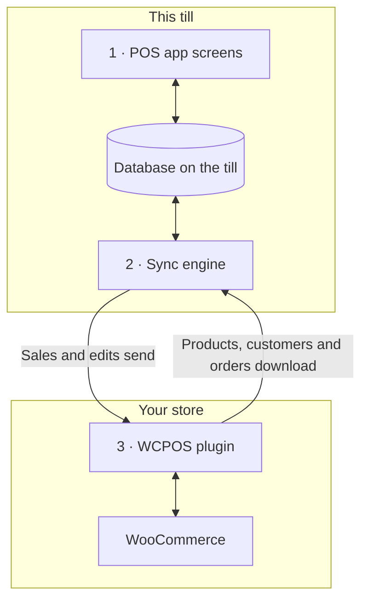

import LinkCards from '@site/src/components/LinkCards';
import LinkCard from '@site/src/components/LinkCard';
import JourneyShot from '@site/src/components/JourneyShot';
import manifest from '@site/static/img/2.x/reference/architecture/en/manifest.json';

WCPOS consta de dos partes: un plugin en su sitio WordPress y la aplicación POS en cada caja. La caja vende utilizando su propia copia de los datos de la tienda y la mantiene sincronizada con WooCommerce en segundo plano. Esta página explica dónde residen los datos y qué llega al servidor, tanto para desarrolladores como para propietarios de tiendas que quieran conocer estos detalles.

¿Busca resolver un problema en lugar de conocer el diseño?

- **Actualizar la aplicación:** primero [compruebe que la caja lo haya enviado todo](../getting-started/previous-versions.mdx#check-sync). Consulte [Sincronizar antes de actualizar](#storage).
- **Falta un producto en la caja:** consulte [Cuando falta un producto o está desactualizado](../products/sync.mdx#goes-wrong).
- **Una venta no ha llegado a su tienda:** consulte [Ventas pendientes de envío](../getting-started/offline.mdx#offline-writes).

## Las dos partes {#two-part-system}

1. **La aplicación POS** se ejecuta en cada caja: en un navegador, en la ruta `/pos/` de su sitio (la dirección se puede cambiar), en la aplicación de escritorio o en las aplicaciones para iOS y Android. Consulte los requisitos de cada una en [Instalación](../getting-started/installation.mdx). Todas las pantallas leen y escriben en una base de datos de la caja, de modo que buscar o añadir un artículo nunca requiere esperar al servidor.
2. **El motor de sincronización** de la aplicación transfiere los cambios en ambos sentidos. Descarga los cambios de la tienda y envía los realizados en la caja.
3. **El plugin de WCPOS** se ejecuta en su sitio WordPress y conecta la caja con WooCommerce. WooCommerce sigue siendo la fuente de referencia de cada producto, cliente y pedido.

## Qué guarda la caja en el dispositivo {#local-database}

**Estado** → **Base de datos** muestra la copia de los datos de la tienda que tiene la caja: una fila por tipo de registro, con la cantidad que hay en este dispositivo (**En el dispositivo**) y la que tiene la tienda (**En el servidor**). Las funciones del menú de cada fila se explican en [Estado de la tienda](../support/store-health.mdx#coverage).

<JourneyShot manifest={manifest} device="tablet" step={1} offsets={[[186, 0], [186, 0], [186, 0], [186, 0], [186, 0], [186, 0], [186, 0], [186, 0]]} alt="Estado, pestaña Base de datos: tabla de registros de esta caja, desde Productos hasta Tasas de impuestos, cada uno con su cantidad en el dispositivo, cantidad en el servidor, cobertura y tamaño">

1. **Productos** — un lote inicial de 100 con el orden predeterminado del POS (nombre, de A a Z) y después el resto cuando la caja tiene poca actividad. Consulte [Descarga y sincronización](../products/sync.mdx).
2. **Variaciones** — se descargan con sus productos.
3. **Pedidos** — los pedidos abiertos y recientes permanecen en la caja. Los más antiguos se descargan cuando alguien los abre.
4. **Reembolsos** — los reembolsos de los últimos 92 días, además de cualquier reembolso de un pedido que haya abierto.
5. **Clientes** — se descargan poco a poco cuando la caja tiene poca actividad.
6. **Categorías** — con **Marcas** y **Etiquetas** debajo.
7. **Cupones** — disponibles en la caja con o sin Pro.
8. **Tasas de impuestos** — las tasas de impuestos de su tienda.

</JourneyShot>

Una insignia roja **N bloqueados** en una fila indica que hay registros de ese tipo que requieren su atención. Consulte [Registros que requieren atención](../support/store-health.mdx#stuck-records).

Sobre la tabla, la cifra que debe vigilar es **cambios pendientes de envío**: ventas y modificaciones realizadas en esta caja que la tienda aún no ha recibido. Permanecen en el dispositivo hasta que las recibe. Los pedidos abiertos que no haya sincronizado y los cambios que aparecen en un panel no se incluyen en ese recuento y tampoco han llegado a su tienda. Consulte [Ventas pendientes de envío](../getting-started/offline.mdx#offline-writes).

Registros que se guardan fuera de esta tabla

Algunos datos se guardan fuera de esta tabla. Los métodos de pago, las clases de impuestos, los métodos de envío y los estados de pedido se leen de la tienda cada vez que se inicia la aplicación, y se conserva la última respuesta para cuando la caja no tenga conexión. Las sesiones de caja, los cierres y los movimientos de efectivo tienen sus propios registros y su propia cola de envío a la tienda.

### Cómo se conserva la base de datos {#storage}

Cada cajero de cada tienda tiene su propia copia en la caja y, en un navegador, solo una pestaña a la vez ejecuta el POS de un sitio. Cuando una actualización de la aplicación cambia la forma de almacenar esa copia, la caja vuelve a descargarla.

:::warning Sincronizar antes de actualizar
Las ventas y modificaciones que sigan pendientes en la copia antigua no se envían. Antes de actualizar la aplicación, compruebe en **Estado** → **Base de datos** que **cambios pendientes de envío** indique 0, que no haya ningún panel debajo de las cifras y sincronice cada pedido abierto. Consulte [Comprobar que una caja lo haya enviado todo](../getting-started/previous-versions.mdx#check-sync).
:::

Detalles para desarrolladores: motor de almacenamiento, pestañas y actualizaciones de la aplicación

- **Una base de datos por sitio, tienda y cajero.** Dos cajeros en una misma caja, o un cajero en dos tiendas, nunca comparten datos locales.
- **SQLite en todas las plataformas.** En el navegador, SQLite se ejecuta sobre el almacenamiento privado de archivos del navegador, en un único worker; en las aplicaciones para iOS y Android se utiliza el SQLite del sistema; la aplicación de escritorio conserva los datos en SQLite dentro de su proceso principal.
- **Almacenamiento en disco.** La copia de la caja se conserva al cerrar el navegador o la aplicación y al reiniciar el dispositivo.
- **Una pestaña activa por sitio.** En un navegador, una sola pestaña ejecuta el POS de un sitio. Al abrir una segunda pestaña, esta ofrece tomar el control; la primera se detiene.
- **Las listas se procesan en la base de datos.** El filtrado, la ordenación y la paginación se ejecutan dentro de la base de datos siempre que es posible, de modo que una lista de miles de pedidos solo entrega a la pantalla las filas que esta muestra.
- **Sin migración de la base de datos existente.** Cuando una actualización cambia la estructura de la base de datos, la aplicación abre una base de datos nueva y vuelve a descargar los datos de la tienda. Los cambios que siguen pendientes en la antigua no se envían y los pedidos abiertos no se trasladan: sincronice la caja antes de actualizar la aplicación.

## Cómo se mantienen sincronizadas la caja y la tienda {#data-synchronization}

El motor de sincronización no replica toda la tienda a intervalos fijos. Trabaja según lo que necesitan las pantallas de la caja y consulta al servidor lo mínimo posible.

- **Comprobación de cambios.** La caja consulta a la tienda qué ha cambiado con la frecuencia que indica su [perfil de sincronización](../support/store-health.mdx#sync-presets) (**Eco**, **Equilibrado** o **Tiempo real**). Cada caja conserva su propio perfil: cambiarlo en una caja no afecta a las demás.
- **Lo que necesita la pantalla.** Cada pantalla indica al motor qué está mostrando. El motor responde desde la base de datos de la caja cuando ya tiene los registros y solo los solicita a la tienda cuando no los tiene.
- **En segundo plano.** Primero se descargan el lote inicial de productos y los pedidos abiertos y recientes. Después se descargan los demás productos y clientes cuando la caja tiene poca actividad.
- **Envío de cambios.** Cada venta o modificación se guarda primero en la caja y después se envía a la tienda. Un cambio que la tienda rechaza nunca se vuelve a intentar automáticamente: queda pendiente en **N cambios nunca llegaron a su servidor**, con las opciones **Enviar de nuevo** y **Descartar**. Consulte [Estado de la tienda](../support/store-health.mdx#refused-changes).

Detalles para desarrolladores: flujo de cambios, límites de solicitudes y canales

- Una tienda sin novedades responde a la comprobación de cambios con `304 Not Modified` y sin cuerpo de respuesta.
- Las escrituras pasan por una cola persistente en la caja, que las envía mediante POST a `wcpos/v2/push/{collection}`.
- Los límites de solicitudes, los intervalos de espera progresivos y las cifras medidas se describen en [Rendimiento de la sincronización](./sync-performance.mdx). Todos los canales se explican en [Cómo funciona el motor de sincronización](./sync-engine.mdx).

## Cómo se registra una venta al cobrar {#checkout-architecture}

La pantalla de pago forma parte del POS. La propia caja cobra cada pago y lo registra en un único pedido de WooCommerce, en lugar de abrir la página de pago de pedidos de WooCommerce para cada venta.

:::warning Pagar sin conexión requiere una venta que ya esté en la tienda
Solo se puede cobrar sin conexión una venta que haya llegado a la tienda antes de perderse la conexión: su número de pedido aparece encima de los artículos en la [pantalla de pago](../pos/checkout/index.mdx). Una venta iniciada después de perderse la conexión queda pendiente en la caja y se paga cuando se restablece la conexión con la tienda. Consulte [Cobrar un pago sin conexión](../getting-started/offline.mdx#take-payment-offline).
:::

- **Una tarjeta por método.** La caja muestra una tarjeta para cada método de pago activado para el POS. Si no puede utilizar un método, lo muestra atenuado con el motivo; nunca lo oculta. Consulte [Cuando no se puede usar una tarjeta de método de pago](../payment/index.mdx#unavailable-tiles).
- **Un pedido, varios pagos.** Una venta con pago dividido sigue siendo un único pedido de WooCommerce, con un solo conjunto de artículos, impuestos y cambios de existencias, y un único número de pedido, por lo que los informes la cuentan una sola vez. Un reembolso es un reembolso normal de WooCommerce, repartido entre los pagos que devuelve.
- **La tienda decide.** Después de cada pago, la tienda responde con lo pagado y lo que queda por pagar, y la caja completa la venta según las cifras de la tienda, no las suyas propias.
- **Reintentos seguros.** Cada pago tiene un ID creado por la caja, de modo que un pago enviado dos veces se registra una sola vez.
- **Sin conexión.** En una venta que ya está en la tienda, Efectivo sigue permitiendo completar el cobro si se pierde la conexión: el pago se registra como **Se liquidará más tarde** y se envía cuando vuelve la conexión. Consulte [Cobrar un pago sin conexión](../getting-started/offline.mdx#take-payment-offline).

Modos de captura y rutas de pago

`GET wcpos/v2/payment-methods` describe cada pasarela de pago: su `kind` (`cash`, `card`, `stored_value`, `bank_transfer` u `other`), cómo cobra el dinero (`capture`) y qué permite (`capabilities`: importes parciales, cambio, reembolsos, propinas, uso sin conexión, anulación). Cada pago es una fila en el metadato `_wcpos_payments` del pedido y, después de cada pago, la tienda responde con los valores `paid` y `balance` del pedido.

El valor `capture.mode` de cada método indica quién cobra el dinero. Cada llamada de pago se dirige al controlador registrado para su modo.

| Modo | Cómo se cobra el dinero | Plugin |
| --- | --- | --- |
| `manual` | El cajero lo cobra y lo registra. Es el modo predeterminado para Efectivo, Tarjeta, Contra reembolso, Transferencia bancaria directa y Pagos por cheque. | Gratuito |
| `webview` | La página de pago de la propia pasarela, en la pestaña **Heredado** de la pantalla de pago. Es el modo predeterminado para todas las demás pasarelas. Consulte [Cuando no se carga la página de pago de la pestaña Heredado](../payment/index.mdx#legacy-notices). | Gratuito |
| `gateway` | Se ejecuta el método `process_payment()` de la propia pasarela con los valores recogidos por la caja. La pasarela activa este modo mediante un filtro. | Gratuito |
| `server` | La tienda solicita al proveedor del terminal de tarjetas que cobre el pago. | Pro |
| `device` | La caja controla el lector de tarjetas mediante el SDK del proveedor y el proveedor confirma el pago. | Pro |

Las rutas de pago dependen del pedido, mediante su ID de WooCommerce:

- `POST wcpos/v2/orders/{id}/payments` registra un pago. El ID del pago permite reintentar de forma segura.
- `.../payments/{uuid}/intent`, `/capture`, `/void` y `/refund` (`POST`), y `/status` (`GET`), actúan sobre un pago. Cada comando lleva su propio ID de comando.
- `POST wcpos/v2/orders/{id}/close` completa el pedido.

Cada comando lleva la `revision` del pedido; si no la incluye, se rechaza con `428`.

Para crear una pasarela de pago exclusiva para el POS, empiece por la [Plantilla de pasarela de pago](./gateway-template.mdx).

## Por qué algunos cambios del sitio web no llegan a la caja {#api-extensions}

La caja obtiene los productos, clientes y pedidos del plugin de WCPOS, que los lee de WooCommerce. Los cambios de un plugin que modifica los datos que WooCommerce envía a las aplicaciones llegan a la caja. Los de un plugin que solo cambia el aspecto del sitio web o el proceso de pago en línea no llegan. Para comprobar un plugin, empiece por [Comprender la API REST de WooCommerce](./wc-rest-api.mdx).

Detalles para desarrolladores: versiones de la API

La caja se comunica con la tienda únicamente mediante las rutas REST del plugin, que leen los datos de WooCommerce dentro del sitio. El plugin registra dos espacios de nombres junto al propio `wc/v3` de WooCommerce.

- **`wcpos/v2`** es el que utiliza la aplicación: lectura de registros, flujo de cambios, cola de cambios, pagos, cajas y sesiones. Sus rutas de lectura redirigen internamente a `wc/v3` dentro del sitio, por lo que un plugin que modifica las respuestas REST de WooCommerce cambia lo que recibe la caja.
- **`wcpos/v1`** sigue registrándose. Sus rutas de datos (productos, variaciones, pedidos, clientes, cupones, impuestos, categorías, etiquetas y marcas) están congeladas. Sus rutas de servicio (tiendas, ajustes, recibos, plantillas, trabajos de impresión y demás) utilizan el mismo código que sus versiones de `wcpos/v2`.

### Actualizaciones de la aplicación y otras herramientas de sincronización {#wcpos-v2-namespace}

La aplicación y el plugin se actualizan conjuntamente: una caja con una aplicación más antigua de lo que requiere el plugin muestra [SYNC341](../error-codes/SYNC341.mdx) hasta que se actualiza la aplicación. Los precios del POS en las líneas de pedido se almacenan donde otras herramientas de sincronización pueden leerlos; consulte [Cómo se almacenan los precios modificados en el POS](./pos-discounts.mdx#how-pos-price-overrides-are-stored).

Detalles para desarrolladores: solicitudes, inicio de sesión e ID de pedidos

- **Las rutas se cargan para las solicitudes del POS.** El plugin registra sus rutas solo para las solicitudes dirigidas a ellas: una ruta `wcpos/`, una cabecera `X-WCPOS` o `?wcpos=1`. El resto del tráfico REST del sitio no las carga.
- **La aplicación y el plugin avanzan juntos.** Cada solicitud de la aplicación lleva `X-WCPOS-Protocol`. Un plugin que necesita un protocolo más reciente responde con `426` y `wcpos_update_required`, y la caja muestra [SYNC341](../error-codes/SYNC341.mdx) hasta que se actualiza la aplicación.
- **Rutas públicas.** `wcpos/v2/site`, `wcpos/v2/ping` y `wcpos/v2/echo` no requieren iniciar sesión. La aplicación las utiliza para localizar el sitio y comprobar la conexión antes de que alguien inicie sesión. En alojamientos que ocultan `/wp-json/` o eliminan cabeceras, la aplicación recurre a la dirección `/?rest_route=` de WordPress y a las versiones de sus cabeceras como parámetros de consulta (`?wcpos=1`, `wcpos_protocol`). Si ninguna opción responde, la caja muestra [AUTH431](../error-codes/AUTH431.mdx).
- **Inicio de sesión.** La aplicación inicia sesión mediante la página `/wcpos-auth` del sitio y recibe un token de acceso JWT que dura 30 minutos y un token de renovación que dura 30 días. Los filtros `wcpos_jwt_access_token_expire` y `wcpos_jwt_refresh_token_expire` permiten modificar estas duraciones. Consulte qué perfiles acceden a cada ruta en [Acceso a endpoints por perfil](./role-endpoint-access.mdx).
- **Los pedidos llevan un UUID.** La caja crea un UUID para cada pedido, lo envía como metadato `_woocommerce_pos_uuid` y la tienda lo conserva. Las descargas de pedidos utilizan el UUID como clave.
- **Los precios del POS en las líneas de pedido** se almacenan de forma que otras herramientas de sincronización puedan leerlos. Consulte [Cómo se almacenan los precios modificados en el POS](./pos-discounts.mdx#how-pos-price-overrides-are-stored).
- **Tiendas (Pro).** Cuando hay varias tiendas, la caja envía la suya en la cabecera `X-WCPOS-Store` y el plugin la pasa a WooCommerce como `store_id`. La tienda de un pedido se obtiene de la entrada `_pos_store` de sus metadatos. Las rutas de Pro para editar tiendas y vincular una pantalla de cliente se registran en ambos espacios de nombres.

:::info Con WCPOS Pro
Pro añade lectores de tarjetas, edición de tiendas y vinculación de una pantalla de cliente. Cuando hay varias tiendas, cada una tiene sus propios precios en la caja. Consulte [Configurar tiendas](../stores/setup.mdx).
:::

## Ventajas y costes del diseño {#architecture-pros-and-cons}

- **Búsqueda y carrito instantáneos.** Ambos leen la base de datos de la propia caja.
  - **El coste:** la copia de la caja debe mantenerse sincronizada con la tienda. Esa es toda la función del motor de sincronización.
- **Seguir vendiendo si se pierde la conexión.** Las ventas y modificaciones quedan pendientes en la caja y se envían cuando vuelve la conexión. Efectivo sigue permitiendo completar el cobro de una venta que ya está en la tienda.
  - **El coste:** una venta iniciada después de perderse la conexión solo se puede pagar cuando se restablece la conexión con la tienda. Consulte [Cobrar un pago sin conexión](../getting-started/offline.mdx#take-payment-offline).
- **Aplicaciones diseñadas para la caja.** Aplicaciones de escritorio, iOS y Android, no una página web dentro de un marco.
  - **El coste:** el POS solo accede a la tienda mediante la API REST. Los temas y hooks de WordPress no pueden cambiar su estilo, y los cambios de un plugin que solo modifica el proceso de pago web o el tema no llegan a la caja. Consulte [¿Por qué algunos plugins no funcionan en el POS?](./wc-rest-api.mdx#why-dont-some-plugins-work-in-the-pos)

## Documentación relacionada {#related-documentation}

<LinkCards>
  <LinkCard title="Cómo funciona el motor de sincronización" to="/developers/sync-engine" description="Los canales, el flujo de cambios y la cola de cambios, en detalle." />
  <LinkCard title="Estado de la tienda" to="/troubleshooting/store-health" description="Consulte la base de datos de la caja, los perfiles de sincronización y los cambios pendientes de envío." />
  <LinkCard title="Comprender la API REST de WooCommerce" to="/developers/woocommerce-rest-api" description="Qué es la API REST y por qué los cambios de algunos plugins no llegan al POS." />
</LinkCards>
