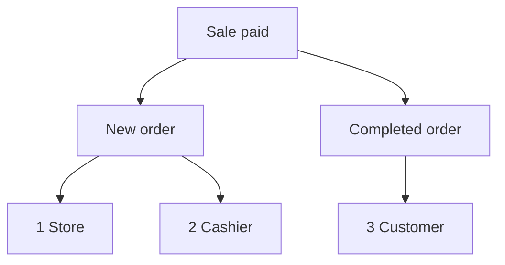

import Accordion from '@site/src/components/Accordion';
import AccordionItem from '@site/src/components/AccordionItem';
import LinkCards from '@site/src/components/LinkCards';
import LinkCard from '@site/src/components/LinkCard';

**Administración de WP:** `WP Admin → POS → Settings → Checkout`.

WooCommerce envía correos electrónicos sobre los pedidos: un correo de Nuevo pedido para usted, uno de Pedido completado para el cliente, etc. Para las ventas realizadas en el POS, aquí puede elegir cuáles de esos correos se envían y quién los recibe. Los pedidos en línea mantienen sus ajustes habituales de correo electrónico de WooCommerce.

Ir directamente a: [Correos al administrador](#admin-emails) · [Correos al cliente](#customer-emails) · [Enviar un recibo manualmente](#send-receipt-manually) · [Correos al cajero](#cashier-emails) · [Situaciones habituales](#common-scenarios) · [Si algo sale mal](#goes-wrong)

## Activar o desactivar los correos electrónicos {#switches}

:::note Para las ventas del POS
Estos interruptores prevalecen sobre **Activar esta notificación por correo electrónico** en **WooCommerce > Ajustes > Correos electrónicos** para los pedidos del POS. Un correo desactivado en WooCommerce puede enviarse si está marcado aquí.
:::

1. En WP Admin, vaya a **POS > Ajustes > Caja**.
2. Busque los tres interruptores de correo electrónico debajo de **Evitar la sobreventa**: **Correos al administrador**, **Correos al cliente** y **Correos al cajero**. La lista de **Pasarelas de pago** está debajo.
3. Al activar un interruptor, aparece una casilla para cada correo de ese grupo. Desmarque un correo para dejar de enviar solo ese.
4. Al desactivar un interruptor, no se envía ningún correo de ese grupo por las ventas del POS, independientemente de las casillas marcadas.

Cada cambio se guarda al realizarlo: la pantalla muestra **Guardando** y después **Guardado**.

{/* reshoot: WP Admin > POS > Settings > Checkout with all three email switches on and their checkboxes showing; see reshoot.md */}

A quién envía correos cada interruptor y cuál es su estado inicial tras la instalación:

- **Correos al administrador**: activado tras la instalación\
  A las direcciones de **Destinatario(s)** de ese correo, en **WooCommerce > Ajustes > Correos electrónicos**
- **Correos al cliente**: activado tras la instalación\
  Al correo electrónico de facturación del pedido
- **Correos al cajero**: desactivado tras la instalación\
  A la dirección de correo electrónico de la cuenta de WordPress del cajero

Qué correos se envían por una venta pagada en caja cuando el **Estado del pedido** de su método de pago es Completado:

1. **Tienda** — los **Destinatario(s)** de **Nuevo pedido** en WooCommerce, si **Correos al administrador** está activado y **Nuevo pedido** está marcado.
2. **Cajero** — la dirección del propio cajero, si **Correos al cajero** está activado y **Nuevo pedido** está marcado.
3. **Cliente** — el correo electrónico de facturación del pedido, si **Correos al cliente** está activado, **Pedido completado** está marcado y el pedido tiene un correo electrónico de facturación.

## Correos al administrador {#admin-emails}

Estos correos se envían a usted, como responsable de la tienda. Todos están marcados tras la instalación.

Para cambiar quién recibe un correo de administrador, vaya a **WooCommerce > Ajustes > Correos electrónicos**, abra los ajustes de ese correo y modifique **Destinatario(s)**.

| Correo electrónico | Se envía cuando |
|---|---|
| **Nuevo pedido** | Un pedido del POS pasa a Completado, Procesando o En espera |
| **Pedido cancelado** | Se cancela un pedido que está en Procesando o En espera |
| **Pedido fallido** | Falla un pedido que está en Pendiente de pago o En espera |

Cuando un pedido del POS pasa de **POS - Abierto** o **POS - Pago parcial** a Completado, Procesando o En espera, se envía **Nuevo pedido** si está marcado en **Correos al administrador** o **Correos al cajero** y el interruptor correspondiente está activado, aunque **Nuevo pedido** esté desactivado en WooCommerce. El estado al que pasa cada venta es el **Estado del pedido** que configure para su método de pago: consulte [Estado del pedido](./checkout.mdx#order-status).

Por qué WCPOS envía por su cuenta Nuevo pedido para las ventas del POS

WooCommerce envía **Nuevo pedido** solo cuando un pedido deja de estar en Pendiente de pago, Fallido o Cancelado. En cambio, un pedido del POS permanece en **POS - Abierto** o **POS - Pago parcial**, estados que WooCommerce no reconoce, por lo que WooCommerce no enviaría el correo cuando el pedido cambiara de estado. WCPOS lo envía en lugar de WooCommerce, en los momentos indicados arriba.

## Correos al cliente {#customer-emails}

Estos correos se envían al correo electrónico de facturación del pedido. Un pedido sin correo electrónico de facturación, como una venta a un invitado en la que no se haya introducido ninguno, no recibe correos para el cliente. Todos están marcados tras la instalación.

### Enviar un recibo manualmente {#send-receipt-manually}

**Enviar recibo por correo electrónico**, en la pantalla de pago realizado, funciona de forma independiente. Envía el correo de factura de WooCommerce, que no está controlado por estos interruptores, por lo que funciona aunque **Correos al cliente** esté desactivado. Consulte [Enviar el recibo por correo electrónico](../../receipts/at-checkout.mdx#email-receipt).

### Correos enviados automáticamente {#customer-emails-automatic}

| Correo electrónico | Se envía cuando |
|---|---|
| **Pedido en espera** | Un pedido pasa a En espera desde Pendiente de pago, Fallido o Cancelado |
| **Pedido procesando** | Un pedido pasa a Procesando desde Pendiente de pago, En espera, Fallido o Cancelado |
| **Pedido completado** | Un pedido pasa a Completado |
| **Pedido reembolsado** | Se reembolsa un pedido, total o parcialmente. Consulte [Reembolsos](../../orders/refunds.mdx) |
| **Pedido fallido** | Falla un pedido |

Una venta que pasa directamente de **POS - Abierto** a Procesando o En espera, como una venta en efectivo, no envía **Pedido en espera** ni **Pedido procesando**: WooCommerce solo los envía desde los estados indicados. **Pedido completado**, **Pedido reembolsado** y **Pedido fallido** no dependen del estado anterior, por lo que sí se envían para las ventas del POS. Para enviar al cliente un correo de una venta que termina en Procesando o En espera, utilice [Enviar recibo por correo electrónico](#send-receipt-manually).

## Correos al cajero {#cashier-emails}

Esta opción envía el correo de **Nuevo pedido** al cajero que realizó la venta, a la dirección de correo electrónico de su cuenta de WordPress. El interruptor está desactivado tras la instalación; al activarlo, **Nuevo pedido** queda marcado.

El cajero recibe el correo en los mismos momentos que el administrador (consulte [Correos al administrador](#admin-emails)). **Correos al administrador** y **Correos al cajero** funcionan de forma independiente: desactivar uno no modifica el otro. Si la dirección del cajero ya figura entre los destinatarios del administrador, por ejemplo, si el propietario desempeña ambos papeles, recibe una sola copia, no dos.

Los usuarios de WordPress que pueden iniciar sesión en el POS como cajeros se establecen en [Acceso de cajeros](./access.mdx).

## Situaciones habituales {#common-scenarios}

<Accordion>
  <AccordionItem question="Evitar que la bandeja de entrada se sature en los días de mucha actividad">

Desmarque **Nuevo pedido** en **Correos al administrador**. Mantenga marcados **Pedido cancelado** y **Pedido fallido**: son los que conviene recibir.

Para hacer un seguimiento de la recaudación, utilice [Informes](../../reports/index.mdx) en lugar de contar los correos de Nuevo pedido.

  </AccordionItem>

  <AccordionItem question="Enviar los correos de Nuevo pedido al cajero de turno en lugar de al administrador">

Desmarque **Nuevo pedido** en **Correos al administrador**, o desactive **Correos al administrador**, y active **Correos al cajero**. El cajero que realiza cada venta recibe el correo en su propia dirección y la bandeja de entrada del administrador deja de recibirlos.

Desactivar **Correos al administrador** también impide que se envíen **Pedido cancelado** y **Pedido fallido**, por lo que suele ser mejor desmarcar únicamente **Nuevo pedido**.

  </AccordionItem>

  <AccordionItem question="No enviar correos al cliente por las ventas en tienda">

Los puestos de mercado y las cafeterías a menudo prefieren no enviar correos a un cliente que ya tiene un recibo impreso. Desactive **Correos al cliente** y no se enviarán correos de Pedido procesando, Pedido completado, Pedido reembolsado ni ningún otro correo para el cliente por las ventas del POS.

Los pedidos en línea seguirán enviando sus correos al cliente con normalidad. Si un cliente solicita un recibo por correo electrónico, podrá recibirlo: pulse **Enviar recibo por correo electrónico** en la pantalla de pago realizado.

  </AccordionItem>

  <AccordionItem question="He actualizado desde una versión anterior a 1.8.9 y ha desaparecido el interruptor único «Activar correos electrónicos»">

La versión 1.8.9 sustituyó el interruptor único de activación por los tres grupos de esta página. WCPOS lee su ajuste anterior: si los correos estaban desactivados, **Correos al administrador** y **Correos al cliente** quedan desactivados; si estaban activados, ambos quedan activados con todos los correos marcados. **Correos al cajero** comienza desactivado en ambos casos.

No necesita hacer nada.

  </AccordionItem>
</Accordion>

## Si algo sale mal {#goes-wrong}

**El administrador no recibe el correo de Nuevo pedido.** Compruebe que **Correos al administrador** esté activado y **Nuevo pedido** esté marcado. Después, revise **Destinatario(s)** de **Nuevo pedido** en **WooCommerce > Ajustes > Correos electrónicos**.

**Un cliente no recibe ningún correo.** Compruebe que **Correos al cliente** esté activado y que ese correo esté marcado. Después, abra el pedido y compruebe que tenga un correo electrónico de facturación. Para enviar un recibo ahora, utilice **Enviar recibo por correo electrónico**.

**El cajero no recibe ningún correo.** Compruebe que **Correos al cajero** esté activado y **Nuevo pedido** esté marcado, y que la cuenta de WordPress del cajero tenga una dirección de correo electrónico. Si esa dirección también figura entre los destinatarios del administrador, solo recibe una copia.

**Un correo que desactivó en WooCommerce sigue llegando por las ventas del POS.** Para los pedidos del POS, las casillas de esta pantalla determinan qué se envía. Desmarque el correo también aquí.

## Hooks para desarrolladores {#developer-hooks}

Para desarrolladores que necesitan más control del que ofrecen estos interruptores. Los propietarios de tiendas pueden omitir esta sección.

Cuatro filtros de WordPress y cómo se establecen los destinatarios de Nuevo pedido

Antes de WCPOS 2.0, estos filtros se llamaban `woocommerce_pos_*` (por ejemplo, `woocommerce_pos_admin_emails`). Esos nombres siguen funcionando, pero están obsoletos desde la versión 2.0 y se eliminarán como pronto en la versión 2.2. Consulte [Nombres de los hooks](../../extensions/index.mdx#hook-naming).

**`wcpos_admin_emails`**: los ID de los correos al administrador que controla WCPOS. Por defecto: `cancelled_order`, `failed_order`.

**`wcpos_customer_emails`**: los ID de los correos al cliente que controla WCPOS. Por defecto: `customer_failed_order`, `customer_on_hold_order`, `customer_processing_order`, `customer_completed_order`, `customer_refunded_order`.

**`wcpos_admin_email_enabled`**: si se envía un correo al administrador para un pedido del POS. Argumentos: `$is_enabled`, `$email_id`, `$order`, `$email`.

**`wcpos_customer_email_enabled`**: si se envía un correo al cliente para un pedido del POS. Los mismos argumentos.

**Nuevo pedido** no figura en `wcpos_admin_emails`. WCPOS establece sus destinatarios mediante el filtro `woocommerce_email_recipient_new_order` de WooCommerce: elimina los destinatarios de la tienda cuando el administrador no desea recibirlo y añade la dirección del cajero cuando este sí desea recibirlo. El cajero es el usuario de WordPress guardado en el metadato `_pos_user` del pedido. Su propia función de retorno en ese filtro puede añadir o eliminar direcciones igual que para cualquier correo de WooCommerce.

## Documentación relacionada {#related-documentation}

<LinkCards>
  <LinkCard title="Ajustes de caja" to="/settings/checkout" description="Las pasarelas de pago y el estado del pedido que establece cada una, en la misma pantalla." />
  <LinkCard title="Recibos al pagar" to="/sell/print-email-receipts" description="Imprima o envíe un recibo por correo electrónico desde la pantalla de pago realizado." />
  <LinkCard title="Pedidos" to="/manage-store/orders" description="Encuentre los pedidos del POS a los que se refieren estos correos." />
</LinkCards>
