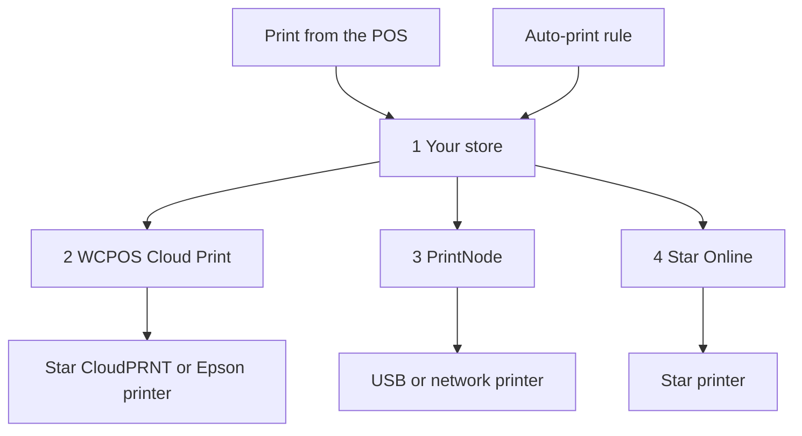

import LinkCards from '@site/src/components/LinkCards';
import LinkCard from '@site/src/components/LinkCard';

L’impression cloud envoie les reçus à une imprimante via Internet : l’imprimante n’a donc pas besoin d’être connectée à l’appareil sur lequel fonctionne le PDV. Utilisez-la pour une imprimante sur un réseau différent de celui de la caisse, une imprimante de cuisine qui imprime chaque commande automatiquement, ou un bon de livraison pour chaque vente en ligne.

Vous configurez une seule fois l’imprimante cloud, dans **WP Admin → PDV → Réglages → Impression cloud**. Elle apparaît ensuite sur tous les appareils, et les caissiers peuvent l’utiliser depuis le PDV comme n’importe quelle autre imprimante.

## Imprimer depuis le PDV {#manual}

La boutique génère le reçu destiné à une imprimante cloud à partir de la commande. La vente doit donc être enregistrée sur la boutique avant l’impression.

1. Sur l’écran de confirmation du paiement ou dans la fenêtre **Reçu** d’une commande, ouvrez le menu **Imprimante** et choisissez l’imprimante cloud.
2. Appuyez sur **Imprimer le reçu**.
3. L’écran affiche **Imprimé sur**, suivi du nom de l’imprimante. Cela signifie que la boutique a reçu la tâche d’impression ; vérifiez que le reçu est bien sorti. Sinon, un responsable peut consulter la [file d’impression](#print-queue) pour savoir ce qu’il en est.

Consultez [Imprimer le reçu](./at-checkout.mdx#print-receipt). Pour toujours envoyer un modèle à une imprimante cloud, choisissez l’imprimante de ce modèle dans **Réglages → Impression** : consultez [Routage des impressions](../hardware/printers/index.mdx#print-routing).

- **La commande doit être enregistrée sur la boutique.** Si la boutique n’a pas encore confirmé la vente, par exemple une vente effectuée hors ligne, le PDV affiche *Cette imprimante imprime la copie de la boutique, et la boutique n’a pas encore confirmé cette vente. Relancez l’impression une fois la vente confirmée.* Appuyez à nouveau sur **Imprimer le reçu** une fois la caisse en ligne et la vente confirmée par la boutique. Tant que la caisse est hors ligne, l’impression sur une imprimante cloud échoue, même pour une commande antérieure.
- **Les rapports de session et de clôture** envoyés à une imprimante cloud ouvrent à la place la boîte de dialogue d’impression du système.
- **Un modèle HTML envoyé à une imprimante cloud Star ou Epson** affiche *Cette imprimante cloud imprime uniquement les modèles thermiques : rien ne sera donc imprimé. Choisissez un modèle thermique.*

Les imprimantes cloud apparaissent automatiquement dans **Réglages → Impression** sur chaque appareil, sous **Imprimantes**. La deuxième ligne indique le type, par exemple *Star CloudPRNT · gérée par WCPOS*. Un caissier peut appuyer sur **Impression de test** sur la ligne ou sur **Copier le rapport de configuration** dans son menu **⋯**, mais ne peut ni la modifier ni la supprimer : ces opérations se font sur l’écran **Impression cloud**. Consultez [Configuration des imprimantes](../hardware/printers/index.mdx#printers-list).

## Choisir un type d’imprimante {#providers}

:::note À partir d’ici, vous devez avoir accès à WP Admin
L’ajout d’imprimantes et de règles est réservé au propriétaire ou au responsable de la boutique, dans **WP Admin → PDV → Réglages → Impression cloud**.
:::

L’écran **Impression cloud** vous demande **Quel type d’imprimante connectez-vous ?** Choisissez celui qui correspond à votre imprimante.

- **Star CloudPRNT** — pour une imprimante Star avec CloudPRNT intégré (mC-Print, TSP143IV…), si vous souhaitez une connexion gratuite sans compte supplémentaire. L’imprimante récupère ses tâches auprès de votre boutique. *Modèles thermiques uniquement.*
- **Epson Server Direct Print** — pour une imprimante Epson TM « intelligente » (TM-T88VI/VII, TM-m30III, série TM-i). L’imprimante récupère ses tâches auprès de votre boutique. *Modèles thermiques uniquement.*
- **Star Online** — pour une imprimante Star liée à un compte stario.online (mC-Print3, TSP143IV, mC-Label3). Votre boutique transmet la tâche à Star Online, qui l’achemine. *Modèles thermiques uniquement.*
- **PrintNode** — pour une imprimante USB ou réseau ordinaire, si vous pouvez faire fonctionner la petite application PrintNode sur un ordinateur de la boutique. Votre boutique transmet la tâche à PrintNode, et son application sur cet ordinateur l’imprime. *Tous les modèles.*

Une imprimante cloud Star ou Epson ne peut pas imprimer de modèle HTML : le reçu doit être converti en commandes propres à l’imprimante. Pour les modèles HTML et pleine page, utilisez PrintNode. Consultez [Modèles thermiques](./thermal-templates.mdx).

<details>
<summary>Comment les tâches parviennent à votre imprimante</summary>



<div className="pinned-legend">

1. **Votre boutique** — génère le reçu à partir de la commande et du modèle, et conserve la tâche dans la [file d’impression](#print-queue). Une impression depuis le PDV et une [règle d’impression automatique](#auto-print) passent toutes deux par cette étape.
2. **WCPOS Cloud Print** — le [relais](#relay). Une imprimante Star CloudPRNT ou Epson récupère normalement ses tâches par son intermédiaire : une tâche reste donc en attente jusqu’à la prochaine connexion de l’imprimante.
3. **PrintNode** — votre boutique transmet la tâche à PrintNode, et l’application PrintNode sur un ordinateur de la boutique l’imprime.
4. **Star Online** — votre boutique transmet la tâche à Star Online, qui l’achemine vers l’imprimante.

</div>

</details>

## Ajouter une imprimante {#setup}

1. Accédez à **WP Admin → PDV → Réglages → Impression cloud**. Sous **Vos imprimantes cloud**, appuyez sur **+ Ajouter une imprimante**.
2. Choisissez le type.
3. Saisissez un **Nom de l’imprimante**, par exemple *Imprimante de cuisine*. WCPOS génère l’**ID de l’imprimante** à partir de ce nom. L’ID ne peut pas être modifié par la suite ; pour le changer, supprimez l’imprimante et ajoutez-la à nouveau.
4. Terminez les étapes correspondant à votre type : [Star CloudPRNT ou Epson](#setup-polling), [PrintNode](#setup-printnode) ou [Star Online](#setup-star-online).
5. L’imprimante apparaît sous forme de fiche dans **Vos imprimantes cloud**. Appuyez sur **Impression de test** sur cette fiche. Consultez [La fiche de l’imprimante](#status).

### Star CloudPRNT ou Epson Server Direct Print {#setup-polling}

Ces imprimantes récupèrent elles-mêmes leurs tâches : aucun compte n’est donc à associer. Comme c’est l’imprimante qui contacte votre boutique, vous n’avez pas à ouvrir de port, à définir une IP statique ni à modifier votre pare-feu. Une tâche est imprimée à la prochaine connexion de l’imprimante. La dernière étape de **+ Ajouter une imprimante** affiche l’**URL d’interrogation** de l’imprimante, qui contient un jeton secret.

<details>
<summary>Connecter une imprimante Star CloudPRNT ou Epson</summary>

1. Appuyez sur **Copier** à côté de l’**URL d’interrogation**. L’adresse complète n’est affichée **qu’une seule fois**. Si vous la perdez, supprimez l’imprimante et ajoutez-la à nouveau pour en obtenir une nouvelle : l’option **Configuration et jeton** de la fiche l’affiche avec le jeton masqué.
2. Ouvrez la page de réglages de l’imprimante et collez l’adresse dans le champ URL du serveur : les réglages **CloudPRNT** sur une Star, les réglages **Server Direct Print** sur une Epson. Activez l’interrogation périodique, enregistrez et redémarrez l’imprimante.
3. De retour sur la fiche, l’état passe de **En attente de l’imprimante** à **Connectée** dès que l’imprimante effectue sa première interrogation.

L’adresse commence normalement par `https://cloudprint.wcpos.com`. Il s’agit du [relais WCPOS Cloud Print](#relay), et c’est l’adresse à utiliser. Sous cette adresse, **Avancé : se connecter directement à ce site (sans relais)** affiche à la place une **URL directe** ; certaines imprimantes ne peuvent pas accéder directement à un site et restent à l’état **En attente de l’imprimante**.

Sur une Epson, laissez **Server Direct Print** activé tant que WCPOS imprime de cette manière. Consultez [Server Direct Print](../hardware/printers/server-direct-print.mdx).

</details>

### PrintNode {#setup-printnode}

PrintNode nécessite que son client fonctionne sur un ordinateur à proximité de l’imprimante, ainsi qu’une clé API provenant de votre compte PrintNode.

<details>
<summary>Connecter une imprimante PrintNode</summary>

1. Sur un ordinateur à proximité de l’imprimante, installez le client PrintNode et connectez-vous. L’ordinateur doit être allumé et le client en cours d’exécution pour que l’impression fonctionne.
2. Dans votre compte PrintNode, créez une clé API.
3. Dans **+ Ajouter une imprimante**, choisissez **PrintNode**, collez la clé dans **Clé API PrintNode** et appuyez sur **Récupérer mes imprimantes**.
4. Sous **Choisir une imprimante**, sélectionnez celle que le client indique et terminez. La dernière étape affiche **Liée à PrintNode** : il n’y a ni adresse ni jeton à copier.

</details>

Une fois l’imprimante liée, réglez le **Format d’impression** sur sa fiche :

- **PDF (recommandé)** imprime tout modèle, thermique ou HTML, au format PDF. Conservez cette option, sauf si vous avez une raison de la changer.
- **ESC/POS RAW — modèles thermiques uniquement** envoie un modèle thermique sous forme de commandes pour imprimante de reçus plutôt que de PDF. Les modèles HTML sont toujours envoyés au format PDF.

### Star Online {#setup-star-online}

Star Online nécessite l’adresse du groupe de l’imprimante et une clé API, toutes deux disponibles dans votre compte stario.online.

<details>
<summary>Connecter une imprimante Star Online</summary>

1. Dans stario.online, ouvrez **Groupes d’appareils** et copiez l’**URL CloudPRNT** du groupe. Elle ressemble à `https://device.stario.online/cloudprnt/...`, ou à `https://eu-device.stario.online/cloudprnt/...` dans l’UE.
2. Dans stario.online, créez une clé API avec les autorisations **EnumDevices**, **ViewDevice**, **PrintToDevice** et **ViewDeviceGroups**. Une clé qui n’en dispose pas est acceptée, mais ne permet ni de lister les appareils ni d’imprimer.
3. Dans **+ Ajouter une imprimante**, choisissez **Star Online**. Collez l’**URL CloudPRNT** et la **Clé API Star Online**, puis appuyez sur **Récupérer mes appareils**.
4. Sous **Choisir un appareil**, sélectionnez l’imprimante et terminez. La fiche affiche alors son **Appareil**, son **Groupe** et son **AccessIdentifier**.

</details>

## La fiche de l’imprimante {#status}

Chaque imprimante cloud dispose d’une fiche sous **Vos imprimantes cloud** :

- **Le nom** — cliquez dessus pour renommer l’imprimante. Le type est indiqué en dessous.
- **L’état** — consultez la liste ci-dessous. Il est actualisé toutes les 30 secondes.
- **Dernière connexion** — la dernière fois qu’une imprimante Star CloudPRNT ou Epson a effectué une interrogation, ou *jamais*.
- **ID de l’imprimante** — défini lors de l’ajout de l’imprimante.
- **Format d’impression** — PrintNode uniquement : **PDF (recommandé)** ou **ESC/POS RAW — modèles thermiques uniquement**. Consultez [PrintNode](#setup-printnode).
- **Impression de test** — envoie une courte page de test. Un message indique *Impression de test envoyée à …*, ou la raison de l’échec.
- **Actions de l’imprimante** (**⋮**) — **Configuration et jeton** rouvre la dernière étape de configuration ; **Supprimer l’imprimante** empêche l’imprimante de recevoir des tâches. Vous pouvez l’ajouter à nouveau plus tard.

<details id="status-polling">
<summary>États de Star CloudPRNT et Epson Server Direct Print</summary>

- **En attente de l’imprimante** — l’imprimante n’a pas encore effectué d’interrogation. Vérifiez l’URL d’interrogation dans l’imprimante : consultez [Blocage sur En attente de l’imprimante](#trouble-polling).
- **Connectée** — l’imprimante a effectué une interrogation au cours des deux dernières minutes et demie.
- **Hors ligne** — l’imprimante a déjà effectué des interrogations, mais pas récemment. Vérifiez qu’elle est allumée et en ligne.
- **Bloquée** — le relais ne peut pas accéder à votre boutique. La fiche en indique la raison : un service de sécurité tel que Cloudflare ou une extension de pare-feu le bloque, ou votre site a répondu par une erreur serveur. Consultez [Problèmes avec Star CloudPRNT ou Epson](#trouble-polling).

</details>

<details id="status-services">
<summary>États de Star Online et PrintNode</summary>

- **En ligne** — le service indique que l’imprimante est disponible.
- **Hors ligne** — le service indique que l’imprimante, ou l’ordinateur PrintNode, n’est pas disponible. Pour PrintNode, vérifiez que l’ordinateur n’est pas en veille et que le client fonctionne.
- **Inconnu** — WCPOS n’a pas pu obtenir l’état auprès du service. Vérifiez la clé API dans [PrintNode](#setup-printnode) ou [Star Online](#setup-star-online).

</details>

## Imprimer automatiquement les commandes {#auto-print}

Les règles d’impression automatique impriment les commandes sans intervention. Elles sont facultatives : sans règle, les imprimantes cloud n’impriment que lorsqu’un caissier lance une impression depuis le PDV.

Sous **Règles d’impression automatique**, appuyez sur **+ Ajouter une règle**. Chaque règle se lit comme une phrase, et chaque partie soulignée est un menu :

> Imprimer automatiquement **chaque commande en boutique (PDV)** sur **Imprimante de cuisine** avec le modèle **Ticket de cuisine**, en **2 exemplaires**, **dès sa création**.

- **Quelles commandes** — **chaque commande**, **chaque commande en boutique (PDV)** ou **chaque commande en ligne**. Avec WCPOS Pro, également **commandes de** l’une des boutiques : consultez [Imprimantes par boutique](#per-store-printers).
- **Imprimante** — l’une de vos imprimantes cloud.
- **Modèle** — seuls les modèles que cette imprimante peut imprimer sont proposés. Les modèles proviennent de **PDV › Modèles**.
- **Exemplaires** — de 1 à 5.
- **Quand** — **une fois payée** (par défaut), ou **dès sa création**. Pour une commande PDV, la création correspond au premier enregistrement du panier : le ticket de cuisine s’imprime donc avant le paiement.

Plusieurs règles peuvent imprimer la même commande, par exemple un ticket de cuisine et un reçu client. Une règle n’imprime une commande donnée qu’une seule fois. Le reçu est généré sur la boutique à partir de la commande et du modèle : le caissier n’a donc rien à faire. Les impressions automatiques n’ouvrent jamais le tiroir-caisse.

Si vous remplacez l’imprimante d’une règle par une imprimante qui ne peut pas imprimer son modèle, la règle utilise le premier modèle que cette imprimante peut imprimer : vérifiez donc qu’il s’agit bien de celui que vous souhaitez. Si l’imprimante ne peut imprimer aucun de vos modèles, le champ du modèle reste vide et la règle n’imprime rien tant que vous n’en avez pas choisi un.

### Imprimantes par boutique (Pro) {#per-store-printers}

Avec [WCPOS Pro](../getting-started/pro-license.mdx) et plusieurs [boutiques](../stores/index.mdx), le menu **Quelles commandes** propose aussi **commandes de** pour chaque boutique. Une règle de boutique imprime les commandes qui appartiennent à cette boutique : celles enregistrées par ses caisses, ainsi que toute commande que vous attribuez à la boutique sur l’écran de modification de la commande. Les commandes en ligne n’appartiennent à aucune boutique tant que vous ne leur en attribuez pas une ; seules les règles couvrant toutes les boutiques les impriment donc.

Les règles se cumulent : une commande d’une boutique est imprimée selon les règles de cette boutique **et** selon chaque règle visant **chaque commande**, **chaque commande en boutique (PDV)** ou **chaque commande en ligne**. Pour éviter que les tickets de cuisine d’un établissement sortent sur l’imprimante d’un autre, créez une règle propre à chaque boutique et n’ajoutez pas de règle couvrant toutes les boutiques pour ce ticket.

## La file d’impression {#print-queue}

Sous les règles, la **File d’impression** répertorie toutes les tâches : **Commande**, **Imprimante**, **Modèle**, **État**, **Détail** et **Création**. Le numéro de commande est un lien vers la commande.

- Utilisez **Filtrer** pour filtrer par état (**Nécessite une intervention**, **Tous les états**, ou l’un des états **En attente**, **Impression en cours**, **Imprimée**, **Échouée**, **Annulée**) et par imprimante.
- Utilisez **Annuler** pour une tâche en attente, **Réessayer** pour une tâche échouée (elle revient sous forme de nouvelle tâche, *Relancée sous le n° #…*), ou **Supprimer** pour supprimer une tâche. Cochez plusieurs lignes pour utiliser **Annuler la sélection** ou **Supprimer la sélection**.
- **Détail** indique pourquoi une tâche a échoué, par exemple *Star Online a rejeté la requête. Vérifiez que la clé API dispose des autorisations requises.*

Lorsqu’une imprimante Star CloudPRNT ou Epson a des reçus en attente et n’a pas effectué d’interrogation depuis 10 minutes, ou n’en a jamais effectué, un avertissement indique son nom, la date de sa dernière interrogation et le nombre de reçus en attente, et propose **Tout annuler**.

:::warning Une tâche que l’imprimante n’a jamais confirmée
*L’imprimante n’a jamais confirmé cette tâche* signifie que WCPOS ne peut pas déterminer si elle a été imprimée. Elle n’est pas renvoyée automatiquement, car cela pourrait entraîner une double impression. Vérifiez l’imprimante et appuyez sur **Réessayer** uniquement si rien n’est sorti.
:::

<details>
<summary>Durée de conservation des tâches et nouvelles tentatives</summary>

Les tâches imprimées et annulées sont supprimées après 7 jours, les tâches échouées après 30 jours. Un développeur peut modifier ces durées avec les filtres `wcpos_print_job_retention_days` et `wcpos_print_job_failed_retention_days`.

Une tâche que WCPOS transmet à PrintNode ou Star Online fait l’objet de trois tentatives, espacées d’une minute puis de deux minutes. Si le service refuse la clé ou le compte, la tâche échoue immédiatement et la raison est indiquée dans **Détail**.

</details>

## WCPOS Cloud Print, le relais {#relay}

L’URL d’interrogation d’une imprimante Star CloudPRNT ou Epson pointe vers **cloudprint.wcpos.com**, et non vers votre propre site. Il s’agit de **WCPOS Cloud Print**, un relais gratuit exploité par WCPOS entre vos imprimantes et votre boutique.

Vous n’avez rien à activer. Les tâches passent par le relais pour parvenir à l’imprimante : la connexion partage donc l’adresse de votre site avec wcpos.com, et les reçus, qui contiennent les détails des commandes, transitent par ce service. Consultez la [politique de confidentialité](https://wcpos.com/privacy).

<details>
<summary>Fonctionnement du relais</summary>

Les imprimantes de reçus utilisent un micrologiciel léger, rarement mis à jour. Beaucoup ne peuvent pas établir de connexion sécurisée avec une boutique sur un hébergement moderne, ou sont bloquées par un service tel que Cloudflare placé devant le site. L’imprimante reste alors à l’état **En attente de l’imprimante**, même si tous les réglages sont corrects. Le relais fournit à l’imprimante une connexion qu’elle peut établir et transmet ses requêtes à votre boutique.

- Votre site se connecte automatiquement au relais la première fois que vous ouvrez **Impression cloud**.
- Le relais nécessite que votre site utilise **HTTPS**. Si ce n’est pas le cas, **Impression cloud** vous l’indique.
- Si votre site ne peut pas se connecter au relais, par exemple un site de test local, l’URL d’interrogation pointe directement vers votre site.
- L’état **Bloquée** sur une fiche signifie que le relais a atteint votre site, mais que l’accès lui a été refusé. Autorisez le relais dans votre service de sécurité, comme l’indique la fiche. Consultez [Problèmes avec Star CloudPRNT ou Epson](#trouble-polling).

</details>

<details>
<summary>Désactiver le relais (développeurs)</summary>

La dernière étape de configuration d’une imprimante Star CloudPRNT ou Epson propose **Avancé : se connecter directement à ce site (sans relais)** avec son **URL directe**. Pour désactiver le relais sur l’ensemble du site :

```php
add_filter( 'wcpos_cloud_print_relay_enabled', '__return_false' );
```

Avant WCPOS 2.0, ce filtre s’appelait `woocommerce_pos_cloud_print_relay_enabled`. Ce nom fonctionne toujours, est obsolète depuis la version 2.0 et sera supprimé au plus tôt dans la version 2.2. Consultez [Nommage des hooks](../extensions/index.mdx#hook-naming).

</details>

<details>
<summary>Comment un reçu parvient à une imprimante Star CloudPRNT</summary>

WCPOS propose d’abord à l’imprimante des commandes StarPRNT, puis une image PNG du reçu, puis du texte brut, et utilise le meilleur format que l’imprimante déclare pouvoir lire. Les anciens modèles Star qui ne lisent que le Line Mode (TSP650II, TSP700II, TSP800II) ne reçoivent les logos que via l’image. Celle-ci nécessite les extensions PHP GD et FreeType sur votre serveur. Les imprimantes Epson reçoivent du XML ePOS-Print ; Star Online reçoit du Star Document Markup.

</details>

## En cas de problème {#troubleshooting}

**Le PDV a envoyé une impression à une imprimante cloud, mais aucun reçu n’est sorti.** Le PDV sait seulement que la boutique a reçu la tâche. Ouvrez la [file d’impression](#print-queue) et recherchez la commande :

- **En attente** — l’imprimante n’a pas encore récupéré la tâche. Vérifiez l’état de l’imprimante sur sa fiche : [États de Star CloudPRNT et Epson Server Direct Print](#status-polling) ou [États de Star Online et PrintNode](#status-services).
- **Impression en cours** — la tâche est en cours d’acheminement et l’imprimante n’a pas encore confirmé son impression.
- **Échouée** — **Détail** en indique la raison. Corrigez le problème, puis appuyez sur **Réessayer**. Si **Détail** indique *L’imprimante n’a jamais confirmé cette tâche*, elle a peut-être été imprimée : vérifiez l’imprimante avant d’appuyer sur **Réessayer**.
- **Imprimée** — l’imprimante, PrintNode ou Star Online a pris en charge la tâche. Vérifiez le papier et assurez-vous que la colonne **Imprimante** indique bien l’imprimante devant laquelle vous vous trouvez.

**Mon modèle n’est pas proposé.** Les imprimantes Star CloudPRNT, Epson et Star Online acceptent uniquement les [modèles thermiques](./thermal-templates.mdx). Choisissez-en un ou imprimez via PrintNode.

### Problèmes avec Star CloudPRNT ou Epson {#trouble-polling}

**Blocage sur En attente de l’imprimante.** L’imprimante n’a jamais pu joindre votre boutique. Vérifiez que l’URL d’interrogation dans l’imprimante correspond exactement : un seul caractère erroné fait rejeter chaque interrogation. En cas de doute, supprimez l’imprimante et ajoutez-la à nouveau pour obtenir une nouvelle URL. Assurez-vous que l’interrogation périodique est activée dans les réglages **CloudPRNT** ou **Server Direct Print** de l’imprimante, puis redémarrez-la. Si vous avez utilisé l’**URL directe**, passez à l’adresse `cloudprint.wcpos.com` : [c’est le rôle du relais](#relay).

**Bloquée.** Un service de sécurité ou une extension de pare-feu refuse l’accès au relais, ou votre site renvoie des erreurs serveur. Suivez le message sur la fiche ; en cas d’erreur serveur, vérifiez la santé de votre site et ses journaux d’erreurs.

**Configuration effectuée avant la mise en place du relais.** Les adresses déjà enregistrées dans une imprimante continuent de fonctionner. Si cette imprimante reste à l’état **En attente de l’imprimante**, supprimez-la et ajoutez-la à nouveau, puis saisissez la nouvelle adresse `cloudprint.wcpos.com` dans l’imprimante.

### Problèmes avec PrintNode {#trouble-printnode}

**Récupérer mes imprimantes échoue.** Vérifiez la clé API et assurez-vous que le client PrintNode fonctionne sur l’ordinateur.

**Une tâche PrintNode ne s’imprime jamais.** Le client doit fonctionner et être en ligne : un ordinateur en veille n’imprime rien. Vérifiez que vous avez choisi l’imprimante indiquée par le client et que la clé n’a pas été révoquée.

### Problèmes avec Star Online {#trouble-star-online}

**Récupérer mes appareils échoue.** Le message est *Impossible de lister vos appareils Star Online. Vérifiez l’URL CloudPRNT et la clé API.* Vérifiez que la clé a été copiée intégralement, qu’elle n’a pas été révoquée et qu’elle appartient au même compte stario.online et à la même région que l’URL. Vérifiez ensuite qu’elle dispose des autorisations indiquées dans [Star Online](#setup-star-online). *Aucun appareil trouvé dans ce groupe Star Online* signifie que le groupe ne contient aucun appareil ou que l’URL correspond à un autre groupe.

## Documentation associée {#related-documentation}

<LinkCards>
  <LinkCard to="/hardware/receipt-printers" title="Configuration des imprimantes" description="Ajoutez une imprimante sur l’appareil et associez les modèles aux imprimantes" />
  <LinkCard to="/sell/print-email-receipts" title="Reçus à l’encaissement" description="Imprimez, envoyez par e-mail et réimprimez le reçu" />
  <LinkCard to="/settings/receipt-templates/thermal-templates" title="Modèles thermiques" description="Créez des reçus pour les imprimantes Star et Epson" />
</LinkCards>
