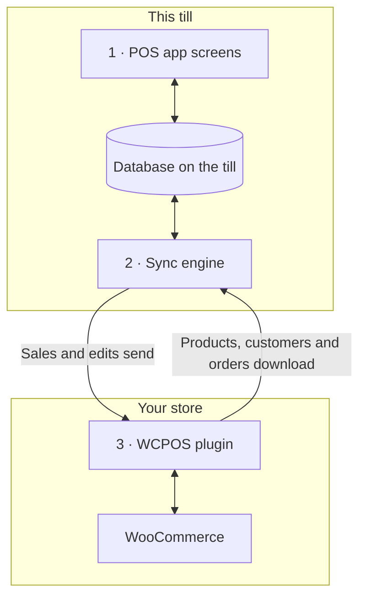

import LinkCards from '@site/src/components/LinkCards';
import LinkCard from '@site/src/components/LinkCard';
import JourneyShot from '@site/src/components/JourneyShot';
import manifest from '@site/static/img/2.x/reference/architecture/en/manifest.json';

WCPOS se compose de deux parties : une extension sur votre site WordPress et l’application PDV sur chaque caisse. La caisse effectue les ventes à partir de sa propre copie des données de votre boutique et la synchronise avec WooCommerce en arrière-plan. Cette page explique où se trouvent vos données et ce qui parvient à votre serveur, à l’intention des développeurs et des commerçants qui souhaitent le savoir.

Vous cherchez à résoudre un problème plutôt qu’à comprendre l’architecture ?

- **Mise à jour de l’application :** commencez par [vérifier que la caisse a tout envoyé](../getting-started/previous-versions.mdx#check-sync). Consultez [Synchroniser avant la mise à jour](#storage).
- **Un produit manque sur la caisse :** consultez [Lorsqu’un produit manque ou n’est pas à jour](../products/sync.mdx#goes-wrong).
- **Une vente n’est pas parvenue à votre boutique :** consultez [Ventes en attente d’envoi](../getting-started/offline.mdx#offline-writes).

## Les deux parties {#two-part-system}

1. **L’application PDV** s’exécute sur chaque caisse : dans un navigateur à l’adresse `/pos/` de votre site (cette adresse peut être modifiée), dans l’application de bureau ou dans les applications iOS et Android. Consultez [Installation](../getting-started/installation.mdx) pour connaître les prérequis de chacune. Chaque écran lit et écrit dans une base de données sur la caisse : une recherche ou l’ajout d’un article n’attend donc jamais votre serveur.
2. **Le moteur de synchronisation** intégré à l’application transfère les modifications dans les deux sens. Il récupère les modifications de votre boutique et envoie celles de la caisse.
3. **L’extension WCPOS** s’exécute sur votre site WordPress et relie la caisse à WooCommerce. WooCommerce reste la référence unique pour chaque produit, client et commande.

## Ce que la caisse conserve sur l’appareil {#local-database}

**État de santé** → **Base de données** affiche la copie des données de votre boutique conservée sur la caisse : une ligne par type d’enregistrement, avec leur nombre sur cet appareil (**Sur l’appareil**) et dans votre boutique (**Sur le serveur**). Les actions du menu de chaque ligne sont expliquées dans [État de santé de la boutique](../support/store-health.mdx#coverage).

<JourneyShot manifest={manifest} device="tablet" step={1} offsets={[[186, 0], [186, 0], [186, 0], [186, 0], [186, 0], [186, 0], [186, 0], [186, 0]]} alt="État de santé, onglet Base de données : le tableau des enregistrements sur cette caisse, de Produits à Taux de taxe, avec pour chacun le nombre sur l’appareil, le nombre sur le serveur, la couverture et la taille">

1. **Produits** — un premier lot de 100 selon le tri par défaut du PDV (nom, de A à Z), puis le reste lorsque la caisse est peu sollicitée. Consultez [Téléchargement et synchronisation](../products/sync.mdx).
2. **Variations** — téléchargées avec leurs produits.
3. **Commandes** — les commandes ouvertes et récentes restent sur la caisse. Les plus anciennes sont téléchargées lorsque quelqu’un les ouvre.
4. **Remboursements** — les remboursements des 92 derniers jours, ainsi que tout remboursement d’une commande que vous avez ouverte.
5. **Clients** — téléchargés progressivement lorsque la caisse est peu sollicitée.
6. **Catégories** — avec **Marques** et **Étiquettes** en dessous.
7. **Codes promo** — sur la caisse, avec ou sans Pro.
8. **Taux de taxe** — les taux de taxe de votre boutique.

</JourneyShot>

Un badge rouge **N bloqués** sur une ligne signifie que des enregistrements de ce type nécessitent votre intervention. Consultez [Enregistrements nécessitant une intervention](../support/store-health.mdx#stuck-records).

Au-dessus du tableau, le chiffre à surveiller est **modifications en attente d’envoi** : les ventes et les modifications effectuées sur cette caisse que votre boutique n’a pas encore reçues. Elles restent sur l’appareil jusqu’à leur réception. Les commandes ouvertes que vous n’avez pas synchronisées et les modifications affichées dans un panneau ne sont pas comptées et ne sont pas non plus parvenues à votre boutique. Consultez [Ventes en attente d’envoi](../getting-started/offline.mdx#offline-writes).

Enregistrements conservés en dehors de ce tableau

Certaines données ne figurent pas dans ce tableau. Les moyens de paiement, les classes de taxe, les méthodes d’expédition et les statuts de commande sont lus depuis votre boutique à chaque démarrage de l’application, et la dernière réponse est conservée pour les périodes hors ligne. Les sessions de caisse, les clôtures et les mouvements d’espèces disposent de leurs propres enregistrements et de leur propre file d’envoi vers votre boutique.

### Comment la base de données est conservée {#storage}

Chaque caissier de chaque boutique dispose de sa propre copie sur la caisse. Dans un navigateur, un seul onglet à la fois exécute le PDV pour un site. Lorsqu’une mise à jour de l’application modifie le stockage de cette copie, la caisse la télécharge à nouveau.

:::warning Synchroniser avant la mise à jour
Les ventes et les modifications encore en attente dans l’ancienne copie ne sont pas envoyées. Avant de mettre à jour l’application, vérifiez dans **État de santé** → **Base de données** que **modifications en attente d’envoi** affiche 0, sans panneau sous les chiffres, et synchronisez chaque commande ouverte. Consultez [Vérifier qu’une caisse a tout envoyé](../getting-started/previous-versions.mdx#check-sync).
:::

Détails pour les développeurs : moteur de stockage, onglets et mises à jour de l’application

- **Une base de données par site, boutique et caissier.** Deux caissiers sur une même caisse, ou un caissier dans deux boutiques, ne partagent jamais les données locales.
- **SQLite sur toutes les plateformes.** Dans le navigateur, SQLite s’exécute dans un worker et utilise le stockage de fichiers privé du navigateur ; dans les applications iOS et Android, il s’agit du SQLite du système ; l’application de bureau conserve les données dans SQLite au sein de son processus principal.
- **Conservation sur disque.** La copie de la caisse est conservée après la fermeture du navigateur ou de l’application et le redémarrage de l’appareil.
- **Un seul onglet actif par site.** Dans un navigateur, un seul onglet exécute le PDV pour un site. Si vous ouvrez un deuxième onglet, il vous propose de prendre le relais ; le premier s’arrête.
- **Les listes sont calculées dans la base de données.** Le filtrage, le tri et la pagination s’exécutent dans la base de données lorsque c’est possible : pour une liste de milliers de commandes, seules les lignes affichées sont transmises à l’écran.
- **Aucune migration sur place.** Lorsqu’une mise à jour de l’application modifie la structure de la base de données, l’application ouvre une nouvelle base et télécharge à nouveau les données de votre boutique. Les modifications encore en attente dans l’ancienne base ne sont pas envoyées et les commandes ouvertes ne sont pas transférées : synchronisez la caisse avant de mettre à jour l’application.

## Comment la caisse et votre boutique restent synchronisées {#data-synchronization}

Le moteur de synchronisation ne recopie pas toute votre boutique à intervalles réguliers. Il répond aux besoins des écrans de la caisse et sollicite votre serveur le moins possible.

- **Recherche de modifications.** La caisse demande à votre boutique ce qui a changé, à la fréquence définie par son [profil de synchronisation](../support/store-health.mdx#sync-presets) (**Éco**, **Équilibré** ou **Temps réel**). Chaque caisse conserve son propre profil : le modifier sur une caisse n’affecte pas les autres.
- **Les besoins de l’écran.** Chaque écran indique au moteur ce qu’il affiche. Le moteur répond à partir de la base de données de la caisse lorsqu’elle contient déjà les enregistrements et ne sollicite votre boutique que dans le cas contraire.
- **En arrière-plan.** Le premier lot de produits et les commandes ouvertes et récentes sont téléchargés en premier. Le reste des produits et des clients suit lorsque la caisse est peu sollicitée.
- **Envoi des modifications.** Chaque vente ou modification est d’abord enregistrée sur la caisse, puis envoyée à votre boutique. Une modification refusée par votre boutique n’est jamais renvoyée automatiquement : elle reste sous **N modifications ne sont jamais parvenues à votre serveur**, avec **Renvoyer** et **Abandonner**. Consultez [État de santé de la boutique](../support/store-health.mdx#refused-changes).

Détails pour les développeurs : flux de modifications, budgets de requêtes et canaux

- Une boutique qui n’a rien de nouveau répond à la recherche de modifications par `304 Not Modified`, sans corps de réponse.
- Les écritures passent par une file persistante sur la caisse, qui les envoie à `wcpos/v2/push/{collection}`.
- Les budgets de requêtes, les délais progressifs entre tentatives et les mesures figurent dans [Performances de la synchronisation](./sync-performance.mdx). Chaque canal est décrit dans [Fonctionnement du moteur de synchronisation](./sync-engine.mdx).

## Comment l’encaissement enregistre une vente {#checkout-architecture}

L’encaissement fait partie du PDV. La caisse prend elle-même chaque paiement et l’enregistre sur une seule commande WooCommerce, au lieu d’ouvrir la page de paiement de commande de WooCommerce pour chaque vente.

:::warning Le paiement hors ligne nécessite une vente déjà reçue par votre boutique
Un paiement ne peut être encaissé hors ligne que pour une vente parvenue à votre boutique avant la coupure de connexion : son numéro de commande apparaît au-dessus des articles dans [Paiement](../pos/checkout/index.mdx). Une vente commencée après la coupure reste en attente sur la caisse et sera payée une fois la boutique de nouveau accessible. Consultez [Encaisser un paiement hors ligne](../getting-started/offline.mdx#take-payment-offline).
:::

- **Une tuile par moyen de paiement.** La caisse affiche une tuile pour chaque moyen de paiement activé pour le PDV. Un moyen qu’elle ne peut pas gérer apparaît grisé avec la raison, sans jamais être masqué. Consultez [Lorsqu’une tuile ne peut pas être utilisée](../payment/index.mdx#unavailable-tiles).
- **Une commande, plusieurs paiements.** Une vente réglée en plusieurs paiements reste une seule commande WooCommerce, avec un seul ensemble d’articles, de taxes et de mouvements de stock, ainsi qu’un seul numéro de commande : les rapports ne la comptent donc qu’une fois. Un remboursement est un remboursement WooCommerce normal, réparti entre les paiements qu’il rembourse.
- **La boutique décide.** Après chaque paiement, votre boutique indique ce qui a été payé et ce qu’il reste à payer. La caisse termine la vente d’après les chiffres de votre boutique, et non les siens.
- **Les nouvelles tentatives sont sans risque.** Chaque paiement possède un ID créé par la caisse : un paiement envoyé deux fois n’est donc enregistré qu’une seule fois.
- **Hors ligne.** Pour une vente déjà reçue par votre boutique, le paiement en espèces peut toujours aboutir lorsque la connexion est coupée : le paiement est enregistré comme **Règlement différé** et envoyé au rétablissement de la connexion. Consultez [Encaisser un paiement hors ligne](../getting-started/offline.mdx#take-payment-offline).

Modes d’encaissement et routes de paiement

`GET wcpos/v2/payment-methods` décrit chaque passerelle de paiement : son `kind` (`cash`, `card`, `stored_value`, `bank_transfer` ou `other`), la façon dont elle encaisse l’argent (`capture`) et ce qu’elle permet (`capabilities` : montants partiels, rendu de monnaie, remboursements, pourboires, fonctionnement hors ligne, annulation). Chaque paiement est une ligne de la métadonnée `_wcpos_payments` de la commande. Après chaque paiement, la boutique renvoie les valeurs `paid` et `balance` de la commande.

Le `capture.mode` de chaque moyen de paiement indique qui encaisse l’argent. Chaque appel de paiement est envoyé au gestionnaire enregistré pour ce mode.

| Mode | Comment l’argent est encaissé | Extension |
| --- | --- | --- |
| `manual` | Le caissier encaisse et enregistre le paiement. Mode par défaut pour Espèces, Carte, Paiement à la livraison, Virement bancaire et Paiements par chèque. | Gratuite |
| `webview` | La page de paiement de la passerelle, dans l’onglet **Ancien mode** de l’écran de paiement. Mode par défaut pour toutes les autres passerelles. Consultez [Lorsque la page de paiement de l’onglet Ancien mode ne se charge pas](../payment/index.mdx#legacy-notices). | Gratuite |
| `gateway` | La méthode `process_payment()` de la passerelle s’exécute avec les valeurs recueillies par la caisse. Une passerelle active ce mode au moyen d’un filtre. | Gratuite |
| `server` | Votre boutique demande au prestataire du terminal de paiement d’encaisser le paiement. | Pro |
| `device` | La caisse pilote le lecteur de carte au moyen du SDK du prestataire, puis le prestataire confirme le paiement. | Pro |

Les routes de paiement sont rattachées à la commande par son ID WooCommerce :

- `POST wcpos/v2/orders/{id}/payments` enregistre un paiement. L’ID du paiement permet de réessayer sans risque.
- `.../payments/{uuid}/intent`, `/capture`, `/void` et `/refund` (`POST`), ainsi que `/status` (`GET`), agissent sur un paiement. Chaque instruction possède son propre ID d’instruction.
- `POST wcpos/v2/orders/{id}/close` termine la commande.

Chaque instruction contient la `revision` de la commande ; une instruction qui en est dépourvue est refusée avec `428`.

Pour créer une passerelle de paiement réservée au PDV, partez du [Modèle de passerelle de paiement](./gateway-template.mdx).

## Pourquoi certaines modifications du site web n’atteignent pas la caisse {#api-extensions}

La caisse récupère les produits, les clients et les commandes auprès de l’extension WCPOS, qui les lit dans WooCommerce. Les effets d’une extension qui modifie les données envoyées par WooCommerce aux applications se retrouvent sur la caisse. Ce n’est pas le cas d’une extension qui modifie uniquement l’apparence de votre site ou le paiement en ligne. Pour vérifier une extension, commencez par [Comprendre l’API REST de WooCommerce](./wc-rest-api.mdx).

Détails pour les développeurs : versions de l’API

La caisse communique avec votre boutique uniquement par les routes REST de l’extension, qui lisent les données de WooCommerce au sein de votre site. L’extension enregistre deux espaces de noms aux côtés de `wc/v3`, celui de WooCommerce.

- **`wcpos/v2`** est utilisé par l’application : lecture des enregistrements, flux de modifications, file de modifications, paiements, caisses et sessions. Ses routes de lecture transmettent les requêtes à `wc/v3` au sein de votre site : une extension qui modifie les réponses REST de WooCommerce modifie donc ce que voit la caisse.
- **`wcpos/v1`** est toujours enregistré. Ses routes de données (produits, variations, commandes, clients, codes promo, taxes, catégories, étiquettes, marques) sont figées. Ses routes de service (boutiques, réglages, reçus, modèles, tâches d’impression et autres) utilisent le même code que leurs versions `wcpos/v2`.

### Mises à jour de l’application et autres outils de synchronisation {#wcpos-v2-namespace}

L’application et l’extension sont mises à jour ensemble : une caisse dont l’application est plus ancienne que la version requise par l’extension affiche [SYNC341](../error-codes/SYNC341.mdx) jusqu’à la mise à jour de l’application. Les prix PDV des lignes d’articles sont stockés à un emplacement lisible par les autres outils de synchronisation ; consultez [Comment sont stockés les prix modifiés au PDV](./pos-discounts.mdx#how-pos-price-overrides-are-stored).

Détails pour les développeurs : requêtes, connexion et ID de commande

- **Les routes sont chargées pour les requêtes du PDV.** L’extension n’enregistre ses routes que pour les requêtes qui leur sont destinées : une route `wcpos/`, un en-tête `X-WCPOS` ou `?wcpos=1`. Le reste du trafic REST de votre site ne les charge pas.
- **L’application et l’extension évoluent ensemble.** Chaque requête de l’application contient `X-WCPOS-Protocol`. Une extension qui nécessite un protocole plus récent répond `426` avec `wcpos_update_required`, et la caisse affiche [SYNC341](../error-codes/SYNC341.mdx) jusqu’à la mise à jour de l’application.
- **Routes publiques.** `wcpos/v2/site`, `wcpos/v2/ping` et `wcpos/v2/echo` ne nécessitent aucune connexion à un compte. L’application les utilise pour trouver votre site et tester la connexion avant toute authentification. Chez les hébergeurs qui masquent `/wp-json/` ou suppriment les en-têtes, l’application utilise à la place l’adresse `/?rest_route=` de WordPress et transmet ses en-têtes sous forme de paramètres de requête (`?wcpos=1`, `wcpos_protocol`). Si aucune méthode ne répond, la caisse affiche [AUTH431](../error-codes/AUTH431.mdx).
- **Connexion au compte.** L’application se connecte par la page `/wcpos-auth` de votre site et reçoit un jeton d’accès JWT valable 30 minutes et un jeton de renouvellement valable 30 jours. Les filtres `wcpos_jwt_access_token_expire` et `wcpos_jwt_refresh_token_expire` permettent de modifier ces durées. Consultez [Accès aux points de terminaison par rôle](./role-endpoint-access.mdx) pour savoir quel rôle peut accéder à quelle route.
- **Les commandes possèdent un UUID.** La caisse crée un UUID pour chaque commande, l’envoie dans la métadonnée `_woocommerce_pos_uuid`, et votre boutique le conserve. La récupération des commandes utilise l’UUID comme clé.
- **Les prix PDV des lignes d’articles** sont stockés de manière à être lisibles par les autres outils de synchronisation. Consultez [Comment sont stockés les prix modifiés au PDV](./pos-discounts.mdx#how-pos-price-overrides-are-stored).
- **Boutiques (Pro).** Avec plusieurs boutiques, la caisse transmet sa boutique dans l’en-tête `X-WCPOS-Store` et l’extension la transmet à WooCommerce sous la forme `store_id`. La boutique d’une commande provient de l’entrée `_pos_store` de ses métadonnées. Les routes Pro de modification des boutiques et d’appairage d’un écran client sont enregistrées dans les deux espaces de noms.

:::info Avec WCPOS Pro
Pro ajoute les lecteurs de carte, la modification des boutiques et l’appairage d’un écran client. Avec plusieurs boutiques, chacune dispose de ses propres prix sur la caisse. Consultez [Configurer les boutiques](../stores/setup.mdx).
:::

## Les avantages et les contreparties de cette architecture {#architecture-pros-and-cons}

- **Recherche et panier instantanés.** Tous deux lisent la base de données de la caisse.
  - **La contrepartie :** la copie de la caisse doit rester synchronisée avec votre boutique. C’est précisément le rôle du moteur de synchronisation.
- **Vendre malgré une coupure de connexion.** Les ventes et les modifications restent en attente sur la caisse et sont envoyées au rétablissement de la connexion. Le paiement en espèces peut toujours aboutir pour une vente déjà reçue par votre boutique.
  - **La contrepartie :** une vente commencée après la coupure de connexion ne peut être payée qu’une fois la boutique de nouveau accessible. Consultez [Encaisser un paiement hors ligne](../getting-started/offline.mdx#take-payment-offline).
- **Des applications conçues pour la caisse.** Des applications de bureau, iOS et Android, et non une page web dans un cadre.
  - **La contrepartie :** le PDV accède à votre boutique uniquement par l’API REST. Les thèmes et les hooks WordPress ne peuvent pas modifier son apparence, et une extension qui modifie uniquement le paiement en ligne ou votre thème n’a aucun effet sur la caisse. Consultez [Pourquoi certaines extensions ne fonctionnent-elles pas dans le PDV ?](./wc-rest-api.mdx#why-dont-some-plugins-work-in-the-pos)

## Documentation associée {#related-documentation}

<LinkCards>
  <LinkCard title="Fonctionnement du moteur de synchronisation" to="/developers/sync-engine" description="Les canaux, le flux de modifications et la file de modifications en détail." />
  <LinkCard title="État de santé de la boutique" to="/troubleshooting/store-health" description="Consultez la base de données de la caisse, les profils de synchronisation et les modifications en attente d’envoi." />
  <LinkCard title="Comprendre l’API REST de WooCommerce" to="/developers/woocommerce-rest-api" description="Ce qu’est l’API REST et pourquoi certaines extensions n’ont aucun effet sur le PDV." />
</LinkCards>
