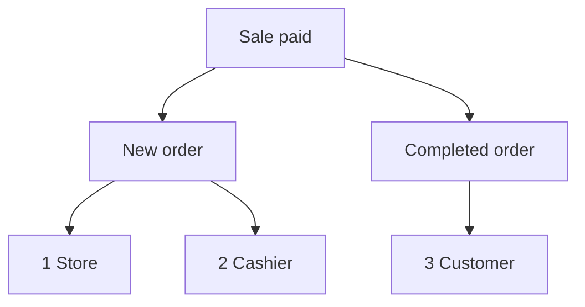

import Accordion from '@site/src/components/Accordion';
import AccordionItem from '@site/src/components/AccordionItem';
import LinkCards from '@site/src/components/LinkCards';
import LinkCard from '@site/src/components/LinkCard';

**Administration WP :** `WP Admin → POS → Settings → Checkout`.

WooCommerce envoie des e-mails concernant les commandes : un e-mail Nouvelle commande pour vous, un e-mail Commande terminée pour le client, etc. Pour les ventes effectuées dans le PDV, vous choisissez ici les e-mails à envoyer et leurs destinataires. Vos commandes en ligne conservent vos réglages habituels d’e-mails WooCommerce.

Accès direct : [E-mails administrateur](#admin-emails) · [E-mails client](#customer-emails) · [Envoyer un reçu manuellement](#send-receipt-manually) · [E-mails caissier](#cashier-emails) · [Cas courants](#common-scenarios) · [En cas de problème](#goes-wrong)

## Activer ou désactiver les e-mails {#switches}

:::note Pour les ventes du PDV
Pour les commandes du PDV, ces interrupteurs priment sur **Activer cette notification par e-mail** dans **WooCommerce > Réglages > E-mails**. Un e-mail désactivé dans WooCommerce peut tout de même être envoyé s’il est coché ici.
:::

1. Dans WP Admin, accédez à **PDV > Réglages > Caisse**.
2. Repérez les trois interrupteurs d’e-mails sous **Empêcher la survente** : **E-mails administrateur**, **E-mails client** et **E-mails caissier**. La liste **Passerelles de paiement** se trouve juste en dessous.
3. Activez un interrupteur : une case à cocher apparaît pour chaque e-mail du groupe. Décochez un e-mail pour désactiver uniquement celui-ci.
4. Désactivez un interrupteur : aucun e-mail du groupe n’est envoyé pour les ventes du PDV, quelles que soient les cases cochées.

Chaque modification est enregistrée immédiatement : l’écran affiche **Enregistrement**, puis **Enregistré**.

{/* reshoot: WP Admin > POS > Settings > Checkout with all three email switches on and their checkboxes showing; see reshoot.md */}

Destinataires de chaque interrupteur et état initial à l’installation :

- **E-mails administrateur** : activé à l’installation\
  Aux adresses du champ **Destinataire(s)** de l’e-mail concerné, dans **WooCommerce > Réglages > E-mails**
- **E-mails client** : activé à l’installation\
  À l’adresse e-mail de facturation de la commande
- **E-mails caissier** : désactivé à l’installation\
  À l’adresse e-mail du compte WordPress du caissier

E-mails envoyés pour une vente réglée en caisse, lorsque le réglage **Statut de la commande** du moyen de paiement est Terminée :

1. **Boutique** — les **Destinataire(s)** de **Nouvelle commande** dans WooCommerce, si **E-mails administrateur** est activé et **Nouvelle commande** est coché.
2. **Caissier** — l’adresse du caissier, si **E-mails caissier** est activé et **Nouvelle commande** est coché.
3. **Client** — l’adresse e-mail de facturation de la commande, si **E-mails client** est activé, **Commande terminée** est coché et la commande comporte une adresse e-mail de facturation.

## E-mails administrateur {#admin-emails}

Ces e-mails vous sont destinés, en tant que boutique. Tous sont cochés à l’installation.

Pour modifier les destinataires d’un e-mail administrateur, accédez à **WooCommerce > Réglages > E-mails**, ouvrez les réglages de cet e-mail et modifiez **Destinataire(s)**.

| E-mail | Envoyé lorsque |
|---|---|
| **Nouvelle commande** | Une commande du PDV passe au statut Terminée, En cours ou Suspendue |
| **Commande annulée** | Une commande En cours ou Suspendue est annulée |
| **Commande échouée** | Une commande En attente de paiement ou Suspendue échoue |

Lorsqu’une commande du PDV passe de **PDV - Ouverte** ou **PDV - Paiement partiel** au statut Terminée, En cours ou Suspendue, **Nouvelle commande** est envoyé s’il est coché sous **E-mails administrateur** ou **E-mails caissier** et que l’interrupteur correspondant est activé, même si **Nouvelle commande** est désactivé dans WooCommerce. Le statut attribué à chaque vente est celui que vous définissez dans **Statut de la commande** pour son moyen de paiement : consultez [Statut de la commande](./checkout.mdx#order-status).

Pourquoi WCPOS envoie lui-même Nouvelle commande pour les ventes du PDV

WooCommerce envoie **Nouvelle commande** uniquement lorsqu’une commande quitte l’état En attente de paiement, Échouée ou Annulée. Une commande du PDV reste quant à elle dans l’état **PDV - Ouverte** ou **PDV - Paiement partiel**, des états que WooCommerce ne connaît pas : WooCommerce n’enverrait donc pas cet e-mail lors du changement d’état suivant. WCPOS l’envoie à la place de WooCommerce, aux moments indiqués ci-dessus.

## E-mails client {#customer-emails}

Ces e-mails sont envoyés à l’adresse e-mail de facturation de la commande. Une commande sans adresse e-mail de facturation, par exemple une vente à un invité pour laquelle vous n’en avez pas saisi, ne reçoit aucun e-mail client. Tous les e-mails sont cochés à l’installation.

### Envoyer un reçu manuellement {#send-receipt-manually}

Le bouton **Envoyer le reçu par e-mail** sur l’écran de confirmation du paiement fonctionne indépendamment. Il envoie l’e-mail de facture de WooCommerce, que ces interrupteurs ne contrôlent pas : il fonctionne donc même si **E-mails client** est désactivé. Consultez [Envoyer le reçu par e-mail](../../receipts/at-checkout.mdx#email-receipt).

### E-mails envoyés automatiquement {#customer-emails-automatic}

| E-mail | Envoyé lorsque |
|---|---|
| **Commande suspendue** | Une commande passe au statut Suspendue depuis En attente de paiement, Échouée ou Annulée |
| **Commande en cours** | Une commande passe au statut En cours depuis En attente de paiement, Suspendue, Échouée ou Annulée |
| **Commande terminée** | Une commande passe au statut Terminée |
| **Commande remboursée** | Une commande est remboursée, en totalité ou en partie. Consultez [Remboursements](../../orders/refunds.mdx) |
| **Commande échouée** | Une commande échoue |

Une vente qui passe directement de **PDV - Ouverte** au statut En cours ou Suspendue, par exemple une vente en espèces, ne déclenche pas l’envoi de **Commande suspendue** ni de **Commande en cours** : WooCommerce ne les envoie que depuis les statuts indiqués. **Commande terminée**, **Commande remboursée** et **Commande échouée** ne dépendent pas du statut précédent et sont donc envoyés pour les ventes du PDV. Pour envoyer un e-mail au client lorsque la vente se termine au statut En cours ou Suspendue, utilisez [Envoyer le reçu par e-mail](#send-receipt-manually).

## E-mails caissier {#cashier-emails}

Cette option envoie l’e-mail **Nouvelle commande** au caissier qui a effectué la vente, à l’adresse e-mail de son compte WordPress. L’interrupteur est désactivé à l’installation ; activez-le et **Nouvelle commande** sera coché.

Le caissier reçoit l’e-mail aux mêmes moments que l’administrateur (consultez [E-mails administrateur](#admin-emails)). **E-mails administrateur** et **E-mails caissier** fonctionnent indépendamment : désactiver l’un ne change pas l’autre. Si l’adresse du caissier figure déjà parmi les destinataires administrateur, par exemple pour un propriétaire qui remplit les deux rôles, il reçoit un seul exemplaire, pas deux.

Les utilisateurs WordPress autorisés à se connecter au PDV en tant que caissiers sont définis dans [Accès des caissiers](./access.mdx).

## Cas courants {#common-scenarios}

<Accordion>
  <AccordionItem question="Éviter que la boîte de réception déborde les jours de forte activité">

Décochez **Nouvelle commande** sous **E-mails administrateur**. Laissez **Commande annulée** et **Commande échouée** cochés : ce sont les événements dont vous souhaitez être informé.

Pour suivre les encaissements, utilisez les [Rapports](../../reports/index.mdx) plutôt que de compter les e-mails Nouvelle commande.

  </AccordionItem>

  <AccordionItem question="Envoyer les e-mails Nouvelle commande au caissier en service plutôt qu’à l’administrateur">

Décochez **Nouvelle commande** sous **E-mails administrateur**, ou désactivez **E-mails administrateur**, puis activez **E-mails caissier**. Le caissier qui effectue chaque vente reçoit l’e-mail à sa propre adresse, sans encombrer la boîte de réception de l’administrateur.

Désactiver **E-mails administrateur** empêche également l’envoi de **Commande annulée** et **Commande échouée**. Il est donc généralement préférable de décocher uniquement **Nouvelle commande**.

  </AccordionItem>

  <AccordionItem question="Ne pas envoyer d’e-mails client pour les ventes en boutique">

Les stands de marché et les cafés souhaitent souvent éviter d’envoyer un e-mail à un client qui dispose déjà d’un reçu imprimé. Désactivez **E-mails client** : aucun e-mail Commande en cours, Commande terminée, Commande remboursée ni aucun autre e-mail client ne sera envoyé pour les ventes du PDV.

Vos commandes en ligne continuent d’envoyer leurs e-mails client comme d’habitude. Un client qui demande un reçu par e-mail peut toujours en obtenir un : appuyez sur **Envoyer le reçu par e-mail** sur l’écran de confirmation du paiement.

  </AccordionItem>

  <AccordionItem question="J’ai effectué une mise à niveau depuis une version antérieure à 1.8.9 et l’interrupteur unique « Activer les e-mails » a disparu">

La version 1.8.9 a remplacé l’interrupteur unique par les trois groupes présentés sur cette page. WCPOS lit votre ancien réglage : si les e-mails étaient désactivés, **E-mails administrateur** et **E-mails client** sont désactivés ; s’ils étaient activés, les deux sont activés avec tous les e-mails cochés. **E-mails caissier** est initialement désactivé dans les deux cas.

Vous n’avez rien à faire.

  </AccordionItem>
</Accordion>

## En cas de problème {#goes-wrong}

**L’administrateur ne reçoit pas l’e-mail Nouvelle commande.** Vérifiez que **E-mails administrateur** est activé et **Nouvelle commande** est coché. Vérifiez ensuite **Destinataire(s)** pour **Nouvelle commande** dans **WooCommerce > Réglages > E-mails**.

**Un client ne reçoit aucun e-mail.** Vérifiez que **E-mails client** est activé et que l’e-mail concerné est coché. Ouvrez ensuite la commande et vérifiez qu’elle comporte une adresse e-mail de facturation. Pour envoyer un reçu immédiatement, utilisez **Envoyer le reçu par e-mail**.

**Le caissier ne reçoit aucun e-mail.** Vérifiez que **E-mails caissier** est activé et **Nouvelle commande** est coché, et que le compte WordPress du caissier comporte une adresse e-mail. Si cette adresse figure aussi parmi les destinataires administrateur, il ne reçoit qu’un seul exemplaire.

**Un e-mail désactivé dans WooCommerce est toujours reçu pour les ventes du PDV.** Pour les commandes du PDV, ce sont les cases à cocher de cet écran qui déterminent l’envoi. Décochez également l’e-mail ici.

## Hooks pour les développeurs {#developer-hooks}

Cette section s’adresse aux développeurs qui ont besoin d’un contrôle plus poussé que ces interrupteurs. Les propriétaires de boutiques peuvent l’ignorer.

Quatre filtres WordPress et la définition des destinataires de Nouvelle commande

Avant WCPOS 2.0, ces filtres portaient le préfixe `woocommerce_pos_*` (par exemple `woocommerce_pos_admin_emails`). Ces noms fonctionnent toujours, mais sont obsolètes depuis la version 2.0 et seront supprimés au plus tôt dans la version 2.2. Consultez [Nommage des hooks](../../extensions/index.mdx#hook-naming).

**`wcpos_admin_emails`** : les ID des e-mails administrateur contrôlés par WCPOS. Par défaut : `cancelled_order`, `failed_order`.

**`wcpos_customer_emails`** : les ID des e-mails client contrôlés par WCPOS. Par défaut : `customer_failed_order`, `customer_on_hold_order`, `customer_processing_order`, `customer_completed_order`, `customer_refunded_order`.

**`wcpos_admin_email_enabled`** : détermine si un e-mail administrateur est envoyé pour une commande du PDV. Arguments : `$is_enabled`, `$email_id`, `$order`, `$email`.

**`wcpos_customer_email_enabled`** : détermine si un e-mail client est envoyé pour une commande du PDV. Mêmes arguments.

**Nouvelle commande** ne figure pas dans `wcpos_admin_emails`. WCPOS définit ses destinataires via le filtre `woocommerce_email_recipient_new_order` de WooCommerce : il retire les destinataires de la boutique lorsque l’administrateur ne souhaite pas le recevoir, et ajoute l’adresse du caissier lorsque celui-ci doit le recevoir. Le caissier est l’utilisateur WordPress enregistré dans la métadonnée `_pos_user` de la commande. Votre propre fonction de rappel sur ce filtre peut ajouter ou retirer des adresses, comme pour n’importe quel e-mail WooCommerce.

## Documentation associée {#related-documentation}

<LinkCards>
  <LinkCard title="Réglages de la caisse" to="/settings/checkout" description="Les passerelles de paiement et le statut de commande défini par chacune, sur le même écran." />
  <LinkCard title="Reçus à l’encaissement" to="/sell/print-email-receipts" description="Imprimez ou envoyez un reçu par e-mail depuis l’écran de confirmation du paiement." />
  <LinkCard title="Commandes" to="/manage-store/orders" description="Retrouvez les commandes du PDV concernées par ces e-mails." />
</LinkCards>
