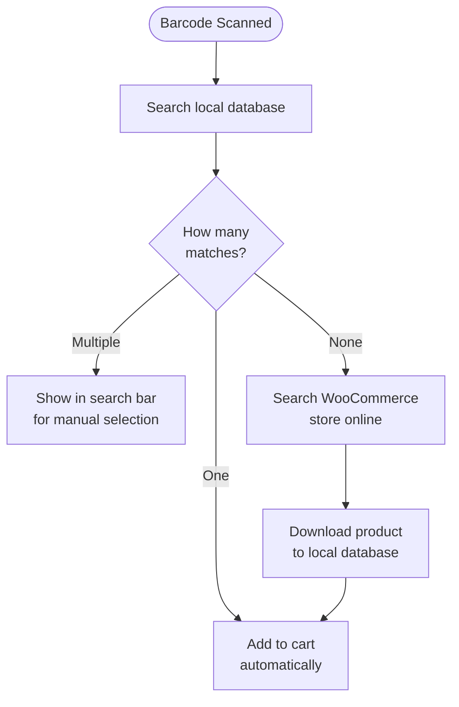

import Image from "@theme/IdealImage";
import Accordion from '@site/src/components/Accordion';
import AccordionItem from '@site/src/components/AccordionItem';

अधिकांश बारकोड स्कैनर आपके डिवाइस से जुड़े कीबोर्ड की तरह व्यवहार करते हैं।
जब आप एक बारकोड स्कैन करते हैं, तो WCPOS यह पहचानता है कि वर्ण सामान्य टाइपिंग की तुलना में तेज़ी से दर्ज किए गए थे।
यह इन "तेज़ कुंजी-दबावों" का उपयोग इनपुट को बारकोड स्कैन के रूप में पहचानने के लिए करता है।
यह लगभग हर स्कैनर के साथ बिना किसी सेटअप के काम करता है — लेकिन स्कैनर अन्य [कनेक्शन मोड](#connection-modes) भी समर्थित करते हैं जिनसे WCPOS सीधे जुड़ सकता है।

## बारकोड स्कैनिंग कॉन्फ़िगर करना {#configuring-barcode-scanning}

चूँकि एक बारकोड स्कैन बहुत तेज़ी से होता है, इसलिए POS एक बारकोड और हाथ से टाइप की गई किसी चीज़ के बीच अंतर बता सकता है।
POS सेटिंग्स में, आपको बारकोड पहचान कैसे कार्य करती है, इसे फ़ाइन-ट्यून करने के विकल्प मिलेंगे।

  <Image
    alt="POS सेटिंग्स में बारकोड स्कैनिंग सेटिंग्स"
    img="/img/barcode-scanning-settings.png"
    style={{ maxHeight: 500 }}
  />
  
POS सेटिंग्स में बारकोड स्कैनिंग सेटिंग्स

| सेटिंग | उद्देश्य | सामान्य मान |
|---|---|---|
| **औसत इनपुट समय** | बारकोड माने जाने के लिए इनपुट कितना तेज़ होना चाहिए | छोटा अंतराल — इतना तेज़ कि हाथ से टाइप करने पर बारकोड पहचान सक्रिय न हो |
| **न्यूनतम लंबाई** | बारकोड माने जाने के लिए वर्णों की लगातार स्ट्रिंग कितनी लंबी होनी चाहिए | अपने सबसे छोटे बारकोड के बराबर रखें (जैसे EAN-8 के लिए 8) |
| **प्रिफिक्स/सफिक्स हटाना** | स्कैनर द्वारा जोड़े गए अतिरिक्त वर्ण (प्रिफिक्स या सफिक्स) हटाता है, ताकि केवल मुख्य बारकोड बचे | खाली छोड़ें, जब तक आपका स्कैनर इन्हें जोड़ने के लिए कॉन्फ़िगर न हो |

## कनेक्शन मोड {#connection-modes}

सेटअप या समस्या निवारण में चरण-दर-चरण मार्गदर्शन के लिए [स्कैनर सेटअप विज़ार्ड](/1.x/hardware/scanners/setup-wizard) का उपयोग करें।

हर बारकोड स्कैनर कुछ उपलब्ध मोड में से किसी एक पर सेट होकर आता है। यही मोड तय करता है कि WCPOS उसके स्कैन कैसे प्राप्त कर सकता है:

| मोड | स्कैन कैसे प्राप्त होता है | सेटअप |
|---|---|---|
| **कीबोर्ड (HID)** — लगभग हर स्कैनर का फ़ैक्टरी डिफ़ॉल्ट | स्कैनर बारकोड को "टाइप" करता है; WCPOS तेज़ कीस्ट्रोक पहचानता है | कोई नहीं — पेयर करें या प्लग इन करें और स्कैन करें |
| **सीरियल (SPP / USB-COM)** | USB सीरियल या Bluetooth SPP के ज़रिए सीधा कनेक्शन | स्कैनर का मोड बदलें, फिर उसे बारकोड सेटिंग्स में कनेक्ट करें |
| **HID-POS** | USB स्कैनर के लिए सीधा कनेक्शन (WebHID के ज़रिए) | स्कैनर का मोड बदलें, फिर उसे बारकोड सेटिंग्स में कनेक्ट करें |
| **Bluetooth LE (वेंडर GATT)** | सीधा Bluetooth Low Energy कनेक्शन | स्कैनर पेयर करें, फिर उसके सेवा UUID से उसे बारकोड सेटिंग्स में जोड़ें |

कीबोर्ड मोड में किसी सेटअप की आवश्यकता नहीं होती और यह अधिकांश स्टोर के लिए उपयुक्त है। सीधा कनेक्शन तब उपयोगी है जब स्कैन कभी-कभी गलत वर्णों के साथ पहुँचते हों (कीबोर्ड लेआउट के अंतर से बड़े अक्षरों/चिह्नों की गड़बड़ी) या खोज बॉक्स पर फ़ोकस न होने से गलत जगह दर्ज हो जाते हों — सीधे जुड़ा स्कैनर हर स्कैन WCPOS तक पहुँचाता है, चाहे टाइपिंग की गति, कीबोर्ड लेआउट या फ़ोकस कुछ भी हो।

:::info कीबोर्ड मोड वाले स्कैनर को सीधे कनेक्ट नहीं किया जा सकता
आपका डिवाइस कीबोर्ड मोड वाले स्कैनर को बिल्कुल कीबोर्ड की तरह मानता है, और किसी ऐप को कीबोर्ड का नियंत्रण अपने हाथ में लेने की अनुमति नहीं होती।
यदि आप बारकोड सेटिंग्स में **Connect serial scanner** या **Connect HID scanner** दबाते हैं और स्कैनर सूची में नहीं दिखता, तो लगभग निश्चित है कि वह अब भी कीबोर्ड मोड में है।
:::

**मोड बदलने के लिए**, स्कैनर के मैनुअल में सेटअप बारकोड खोजें (*"SPP मोड"*, *"सीरियल मोड"* या *"HID-POS मोड"* देखें) और उसे स्कैन करें — स्कैनर अपने आप दोबारा कॉन्फ़िगर हो जाता है। Bluetooth स्कैनर के लिए, डिवाइस की Bluetooth सेटिंग्स में पुरानी पेयरिंग हटाएँ और मोड बदलने के बाद फिर से पेयर करें। मैनुअल का *"HID"* या *"कीबोर्ड"* बारकोड स्कैन करके कभी भी वापस कीबोर्ड मोड में जा सकते हैं।

डेस्कटॉप ऐप और Chrome-आधारित ब्राउज़र सीधे कनेक्शन का समर्थन करते हैं (ब्राउज़र के Web Serial और WebHID समर्थन के ज़रिए)। डेस्कटॉप ऐप अपने भीतर डिवाइस चयनकर्ता दिखाता है; Chrome अपना डिवाइस चयनकर्ता दिखाता है। iOS और Android पर कीबोर्ड मोड और कैमरा स्कैनिंग उपलब्ध हैं। इसके अलावा, Android हार्डवेयर स्कैनर के कीबोर्ड इनपुट को सीधे ग्रहण करता है।

## कैमरा स्कैनिंग {#camera-scanning}

हर प्लेटफ़ॉर्म — वेब, डेस्कटॉप, iOS और Android — डिवाइस के कैमरे से स्कैन कर सकता है, इसलिए शुरुआत करने के लिए अलग स्कैनर की ज़रूरत नहीं है। खोज बार में स्कैन आइकन से कैमरा खोलें; यह **फ़िल्टर के ठीक नीचे आकार बदलने योग्य पैनल** के रूप में दिखता है, जिससे स्कैन करते समय उत्पाद सूची दिखाई देती रहती है। कैमरे को बारकोड की ओर करें और WCPOS उसे हार्डवेयर स्कैन की तरह ही पढ़ेगा।

## बारकोड पहचाने जाने पर क्या होता है? {#what-happens-when-a-barcode-is-detected}

POS को बारकोड मिलने पर, वह मेल खाने वाला उत्पाद या उत्पाद भिन्नता ढूँढने के लिए अपने स्थानीय डेटाबेस में खोजता है।
इसके तीन संभावित परिणाम हैं:

स्कैन का स्थानीय मिलान न मिलने पर, WCPOS आपके ऑनलाइन स्टोर में खोजता है, मेल खाने वाला उत्पाद डाउनलोड करता है और **अपने आप कार्ट में जोड़ देता है** — इसलिए अनजान बारकोड से भी बिक्री पूरी हो जाती है, और अगली बार वही स्कैन तुरंत काम करता है।

:::tip कई मिलान आम तौर पर डेटा में समस्या दर्शाते हैं
यदि एक से अधिक उत्पादों का बारकोड एक ही है, तो POS तय नहीं कर सकता कि किसे जोड़ना है। इसलिए वह कोड खोज बार में डाल देता है, ताकि आप चुन सकें। आम तौर पर इसका मतलब है कि उत्पाद डेटा ठीक करने की ज़रूरत है — हर उत्पाद का बारकोड **विशिष्ट** होना चाहिए।
:::

## स्कैन की प्रतिक्रिया और व्यवहार {#scan-feedback-and-behaviour}

- **स्कैन की ध्वनियाँ** — WCPOS हर स्कैन पर ध्वनि बजा सकता है, जिससे कैशियर को स्क्रीन देखे बिना तुरंत पुष्टि मिल जाती है। ध्वनियाँ वैकल्पिक हैं और कई थीम उपलब्ध हैं; इन्हें [बारकोड सेटिंग्स](/1.x/settings/store/barcode) में चालू करें और थीम चुनें।
- **आदेश स्क्रीन पर** — स्कैन आदेश खोज फ़ील्ड में भेजे जाते हैं, ताकि बारकोड स्कैन करके मनचाहा आदेश या उत्पाद खोज सकें।
- **UPC-A बारकोड** — UPC-A स्कैन से पैकेज पर छपे अंक मिलते हैं, इसलिए POS जिस मान का मिलान करता है वह आपके उत्पाद डेटा में इस्तेमाल होने वाला मान ही होता है।

## उत्पाद समकालन को समझना {#understanding-product-synchronisation}

POS पृष्ठभूमि में आपका कैटलॉग छोटे बैच में डाउनलोड करता है, इसलिए पहले मिनट से ही हर उत्पाद डिवाइस पर मौजूद नहीं होता — यह कैसे काम करता है, जानने के लिए [उत्पाद समकालन](/1.x/products/sync) देखें।

### बारकोड स्कैनिंग के लिए यह क्यों ज़रूरी है {#why-it-matters-for-barcode-scanning}

जब आप ऐसा बारकोड स्कैन करते हैं जो अभी स्थानीय रूप से संग्रहीत नहीं है, तो POS आपके ऑनलाइन WooCommerce स्टोर में वह उत्पाद ढूँढकर डाउनलोड करता है — इसलिए अगली बार वही स्कैन तुरंत काम करता है। इसे तेज़ करने के लिए आपको कुछ करने की ज़रूरत नहीं है: पृष्ठभूमि में कैटलॉग का शुरुआती डाउनलोड बाकी इन्वेंटरी अपने आप भर देता है। प्रगति **स्टोर हेल्थ → डेटाबेस** में देख सकते हैं।

## सामान्य प्रश्न {#faq}

<Accordion>
  <AccordionItem question="बारकोड स्कैन करने पर मुझे 'स्थानीय स्तर पर 0 उत्पाद मिले' क्यों दिखता है?">

शुरू से ही सभी उत्पाद डिवाइस पर नहीं होते — उपयोग के पहले कुछ मिनटों में POS पृष्ठभूमि में आपका कैटलॉग डाउनलोड करता है।
यदि अभी स्कैन किया गया उत्पाद संग्रहीत नहीं है, तो स्कैन मिलने पर POS उसे ऑनलाइन खोजकर डाउनलोड करता है, ताकि अगली बार वह तुरंत मिल जाए।

  </AccordionItem>

  <AccordionItem question="क्या POS बारकोड बनाता और प्रिंट करता है?">

नहीं, अभी नहीं। हमारा POS मौजूदा बारकोड स्कैन करने और पढ़ने के लिए बनाया गया है; इसमें बारकोड बनाने या प्रिंट करने की सुविधा नहीं है।
यदि आपको अपने उत्पादों के लिए बारकोड बनाने हैं, तो बारकोड बनाने और प्रिंट करने वाले तृतीय-पक्ष WooCommerce प्लगइन इस्तेमाल कर सकते हैं। कुछ उदाहरण हैं:

- [EAN for WooCommerce](https://wordpress.org/plugins/ean-for-woocommerce/)
- [A4 Barcode Generator](https://wordpress.org/plugins/a4-barcode-generator/)

एक बार जब आप अपने उत्पादों के लिए बारकोड उत्पन्न कर लेते हैं, तो आप उन्हें रजिस्टर पर आसानी से स्कैन कर सकते हैं ताकि POS में चेकआउट प्रक्रिया को तेज़ किया जा सके।

  </AccordionItem>
</Accordion>
