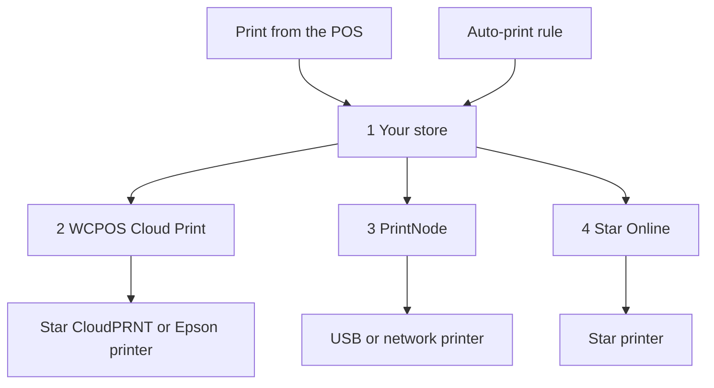

import LinkCards from '@site/src/components/LinkCards';
import LinkCard from '@site/src/components/LinkCard';

क्लाउड प्रिंटिंग में रसीदें इंटरनेट के ज़रिए प्रिंटर पर भेजी जाती हैं, इसलिए प्रिंटर का POS चलाने वाले डिवाइस से जुड़ा होना ज़रूरी नहीं है। इसका इस्तेमाल बिक्री टर्मिनल से अलग नेटवर्क पर मौजूद प्रिंटर के लिए, हर ऑर्डर अपने-आप प्रिंट करने वाले किचन प्रिंटर के लिए या हर ऑनलाइन बिक्री की पैकिंग पर्ची प्रिंट करने के लिए करें।

क्लाउड प्रिंटर को **WP Admin → POS → सेटिंग्स → क्लाउड प्रिंट** में एक बार सेट अप करें। इसके बाद वह हर डिवाइस की सूची में दिखता है और कैशियर POS से किसी भी अन्य प्रिंटर की तरह उस पर प्रिंट कर सकते हैं।

## POS से प्रिंट करें {#manual}

स्टोर ऑर्डर से क्लाउड प्रिंटर की रसीद बनाता है, इसलिए प्रिंट करने से पहले बिक्री का रिकॉर्ड स्टोर पर होना ज़रूरी है।

1. भुगतान पूरा होने वाली स्क्रीन पर या किसी ऑर्डर की **रसीद** विंडो में, **प्रिंटर** मेन्यू खोलें और क्लाउड प्रिंटर चुनें।
2. **रसीद प्रिंट करें** दबाएँ।
3. स्क्रीन पर **इस पर प्रिंट किया गया** और प्रिंटर का नाम दिखता है। इसका मतलब है कि स्टोर को प्रिंट कार्य मिल गया है; जाँचें कि रसीद निकली है या नहीं। अगर नहीं निकली, तो मैनेजर [प्रिंट कतार](#print-queue) में देख सकते हैं कि उस कार्य का क्या हुआ।

[रसीद प्रिंट करें](./at-checkout.mdx#print-receipt) देखें। किसी टेम्पलेट को हर बार क्लाउड प्रिंटर पर भेजने के लिए, **सेटिंग्स → प्रिंटिंग** में उस टेम्पलेट के लिए प्रिंटर चुनें: [प्रिंट रूटिंग](../hardware/printers/index.mdx#print-routing) देखें।

- **ऑर्डर स्टोर पर होना ज़रूरी है।** अगर स्टोर ने अभी तक बिक्री की पुष्टि नहीं की है, जैसे ऑफ़लाइन की गई बिक्री, तो POS यह संदेश दिखाता है: *यह प्रिंटर स्टोर की प्रति प्रिंट करता है, और स्टोर ने अभी तक इस बिक्री की पुष्टि नहीं की है। पुष्टि होने के बाद फिर से प्रिंट करें।* बिक्री टर्मिनल के ऑनलाइन होने और स्टोर से बिक्री की पुष्टि होने के बाद **रसीद प्रिंट करें** फिर से दबाएँ। बिक्री टर्मिनल ऑफ़लाइन होने पर क्लाउड प्रिंटर पर प्रिंट करना विफल होता है, भले ही ऑर्डर पुराना हो।
- क्लाउड प्रिंटर पर भेजी गई **सत्र रिपोर्ट और सत्र समापन रिपोर्ट** के लिए इसके बजाय सिस्टम का प्रिंट डायलॉग खुलता है।
- **Star या Epson क्लाउड प्रिंटर पर HTML टेम्पलेट** भेजने पर यह संदेश दिखता है: *यह क्लाउड प्रिंटर केवल थर्मल टेम्पलेट प्रिंट करता है, इसलिए कुछ भी प्रिंट नहीं होगा। कोई थर्मल टेम्पलेट चुनें।*

क्लाउड प्रिंटर हर डिवाइस पर **सेटिंग्स → प्रिंटिंग** में **प्रिंटर** के अंतर्गत अपने-आप दिखाई देते हैं। पंक्ति की दूसरी लाइन में प्रकार दिखता है, जैसे *Star CloudPRNT · WCPOS द्वारा प्रबंधित*। कैशियर उस पंक्ति पर **टेस्ट प्रिंट** या उसके **⋯** मेन्यू में **सेटअप रिपोर्ट कॉपी करें** दबा सकते हैं, लेकिन उसे संपादित या हटा नहीं सकते: यह **क्लाउड प्रिंट** स्क्रीन पर किया जाता है। [प्रिंटर सेटअप](../hardware/printers/index.mdx#printers-list) देखें।

## प्रिंटर का प्रकार चुनें {#providers}

:::note आगे के चरणों के लिए WP Admin चाहिए
प्रिंटर और नियम जोड़ने का काम स्टोर के मालिक या मैनेजर **WP Admin → POS → सेटिंग्स → क्लाउड प्रिंट** में करते हैं।
:::

**क्लाउड प्रिंट** स्क्रीन पर पूछा जाता है: **आप किस प्रकार का प्रिंटर कनेक्ट कर रहे हैं?** अपने प्रिंटर से मेल खाने वाला विकल्प चुनें।

- **Star CloudPRNT** — ऐसे Star प्रिंटर के लिए जिसमें CloudPRNT पहले से मौजूद है (mC-Print, TSP143IV…), जब आप बिना किसी अन्य खाते के मुफ़्त कनेक्शन चाहते हों। प्रिंटर आपके स्टोर से अपने प्रिंट कार्य प्राप्त करता है। *केवल थर्मल टेम्पलेट।*
- **Epson Server Direct Print** — Epson के "इंटेलिजेंट" TM प्रिंटर (TM-T88VI/VII, TM-m30III, TM-i सीरीज़) के लिए। प्रिंटर आपके स्टोर से अपने प्रिंट कार्य प्राप्त करता है। *केवल थर्मल टेम्पलेट।*
- **Star Online** — stario.online खाते से जुड़े Star प्रिंटर (mC-Print3, TSP143IV, mC-Label3) के लिए। आपका स्टोर प्रिंट कार्य Star Online को सौंपता है, जो उसे प्रिंटर तक पहुँचाता है। *केवल थर्मल टेम्पलेट।*
- **PrintNode** — सामान्य USB या नेटवर्क प्रिंटर के लिए, जब आप स्टोर के किसी कंप्यूटर पर छोटा-सा PrintNode ऐप चला सकते हों। आपका स्टोर प्रिंट कार्य PrintNode को सौंपता है, और उस कंप्यूटर पर मौजूद उसका ऐप उसे प्रिंट करता है। *कोई भी टेम्पलेट।*

Star या Epson क्लाउड प्रिंटर HTML टेम्पलेट प्रिंट नहीं कर सकता: रसीद को प्रिंटर के अपने कमांड में बदलना ज़रूरी है। HTML और पूरे पृष्ठ के टेम्पलेट के लिए PrintNode का इस्तेमाल करें। [थर्मल टेम्पलेट](./thermal-templates.mdx) देखें।

<details>
<summary>प्रिंट कार्य आपके प्रिंटर तक कैसे पहुँचते हैं</summary>



<div className="pinned-legend">

1. **आपका स्टोर** — ऑर्डर और टेम्पलेट से रसीद बनाता है और प्रिंट कार्य को [प्रिंट कतार](#print-queue) में रखता है। POS से किया गया प्रिंट और [ऑटो-प्रिंट नियम](#auto-print), दोनों यहीं से शुरू होते हैं।
2. **WCPOS Cloud Print** — [रिले](#relay)। Star CloudPRNT या Epson प्रिंटर आम तौर पर इसी के ज़रिए अपने प्रिंट कार्य प्राप्त करता है, इसलिए कार्य तब तक प्रतीक्षा करता है जब तक प्रिंटर अगली बार संपर्क नहीं करता।
3. **PrintNode** — आपका स्टोर प्रिंट कार्य PrintNode को सौंपता है और स्टोर के कंप्यूटर पर मौजूद PrintNode ऐप उसे प्रिंट करता है।
4. **Star Online** — आपका स्टोर प्रिंट कार्य Star Online को सौंपता है, जो उसे प्रिंटर तक पहुँचाता है।

</div>

</details>

## प्रिंटर जोड़ें {#setup}

1. **WP Admin → POS → सेटिंग्स → क्लाउड प्रिंट** पर जाएँ। **आपके क्लाउड प्रिंटर** के अंतर्गत **+ प्रिंटर जोड़ें** दबाएँ।
2. प्रकार चुनें।
3. **प्रिंटर का नाम** दर्ज करें, जैसे *किचन प्रिंटर*। WCPOS इसी नाम से प्रिंटर की **प्रिंटर ID** बनाता है। ID को बाद में बदला नहीं जा सकता; इसे बदलने के लिए प्रिंटर हटाकर फिर से जोड़ें।
4. अपने प्रिंटर के प्रकार के अनुसार चरण पूरे करें: [Star CloudPRNT या Epson](#setup-polling), [PrintNode](#setup-printnode) या [Star Online](#setup-star-online)।
5. प्रिंटर **आपके क्लाउड प्रिंटर** के अंतर्गत एक कार्ड के रूप में दिखता है। उस पर **टेस्ट प्रिंट** दबाएँ। [प्रिंटर कार्ड](#status) देखें।

### Star CloudPRNT या Epson Server Direct Print {#setup-polling}

ये प्रिंटर अपने प्रिंट कार्य ख़ुद प्राप्त करते हैं, इसलिए कोई खाता लिंक करने की ज़रूरत नहीं है। प्रिंटर ही आपके स्टोर से संपर्क करता है, इसलिए आपको पोर्ट खोलने, स्थिर IP सेट करने या फ़ायरवॉल बदलने की ज़रूरत नहीं होती। प्रिंटर के अगली बार संपर्क करने पर कार्य प्रिंट होता है। **+ प्रिंटर जोड़ें** के अंतिम चरण में प्रिंटर का **पोल URL** दिखता है, जिसमें एक गुप्त टोकन होता है।

<details>
<summary>Star CloudPRNT या Epson प्रिंटर कनेक्ट करें</summary>

1. **पोल URL** के पास **कॉपी करें** दबाएँ। पूरा पता **केवल एक बार** दिखाया जाता है। अगर आप इसे खो देते हैं, तो नया पता पाने के लिए प्रिंटर हटाकर फिर से जोड़ें: कार्ड पर **सेटअप और टोकन** में यह पता टोकन छिपाकर दिखाया जाता है।
2. प्रिंटर का अपना सेटिंग्स पृष्ठ खोलें और उसके सर्वर URL में पता पेस्ट करें: Star पर **CloudPRNT** सेटिंग्स में और Epson पर **Server Direct Print** सेटिंग्स में। पोलिंग चालू करें, सहेजें और प्रिंटर रीस्टार्ट करें।
3. प्रिंटर के पहली बार प्रिंट कार्य प्राप्त करने के लिए संपर्क करने पर कार्ड की स्थिति **प्रिंटर की प्रतीक्षा में** से **कनेक्ट है** हो जाती है।

पता आम तौर पर `https://cloudprint.wcpos.com` से शुरू होता है। यह [WCPOS Cloud Print रिले](#relay) है और आपको इसी का इस्तेमाल करना चाहिए। पते के नीचे **उन्नत: सीधे इस साइट से कनेक्ट करें (बिना रिले)** में इसके बजाय एक **सीधा URL** दिखता है; कुछ प्रिंटर सीधे साइट तक नहीं पहुँच पाते और **प्रिंटर की प्रतीक्षा में** बने रहते हैं।

Epson पर जब तक WCPOS इस तरीके से प्रिंट करता है, तब तक **Server Direct Print** चालू रखें। [Server Direct Print](../hardware/printers/server-direct-print.mdx) देखें।

</details>

### PrintNode {#setup-printnode}

PrintNode के लिए प्रिंटर के पास मौजूद कंप्यूटर पर उसका क्लाइंट चलना ज़रूरी है और आपके PrintNode खाते की API कुंजी चाहिए।

<details>
<summary>PrintNode प्रिंटर कनेक्ट करें</summary>

1. प्रिंटर के पास मौजूद कंप्यूटर पर PrintNode क्लाइंट इंस्टॉल करें और साइन इन करें। कुछ भी प्रिंट करने के लिए कंप्यूटर चालू और क्लाइंट चल रहा होना चाहिए।
2. अपने PrintNode खाते में API कुंजी बनाएँ।
3. **+ प्रिंटर जोड़ें** में **PrintNode** चुनें, **PrintNode API कुंजी** में कुंजी पेस्ट करें और **मेरे प्रिंटर प्राप्त करें** दबाएँ।
4. **प्रिंटर चुनें** के अंतर्गत क्लाइंट द्वारा दिखाया गया प्रिंटर चुनें और प्रक्रिया पूरी करें। अंतिम चरण में **PrintNode से लिंक है** दिखता है: कॉपी करने के लिए कोई पता या टोकन नहीं है।

</details>

लिंक होने के बाद प्रिंटर के कार्ड पर **प्रिंट प्रारूप** सेट करें:

- **PDF (अनुशंसित)** किसी भी टेम्पलेट, थर्मल या HTML, को PDF के रूप में प्रिंट करता है। जब तक इसे बदलने की कोई वजह न हो, यही विकल्प रखें।
- **ESC/POS RAW — केवल थर्मल टेम्पलेट** किसी थर्मल टेम्पलेट को PDF के बजाय रसीद प्रिंटर के कमांड के रूप में भेजता है। HTML टेम्पलेट फिर भी PDF के रूप में भेजे जाते हैं।

### Star Online {#setup-star-online}

Star Online के लिए प्रिंटर के समूह का पता और API कुंजी चाहिए; दोनों आपके stario.online खाते से मिलते हैं।

<details>
<summary>Star Online प्रिंटर कनेक्ट करें</summary>

1. stario.online में **डिवाइस समूह** खोलें और समूह का **CloudPRNT URL** कॉपी करें। यह `https://device.stario.online/cloudprnt/...` जैसा होता है, या EU में `https://eu-device.stario.online/cloudprnt/...` जैसा।
2. stario.online में **EnumDevices**, **ViewDevice**, **PrintToDevice** और **ViewDeviceGroups** अनुमतियों वाली API कुंजी बनाएँ। इन अनुमतियों के बिना कुंजी स्वीकार तो हो जाती है, लेकिन उससे डिवाइस सूचीबद्ध या प्रिंट नहीं किए जा सकते।
3. **+ प्रिंटर जोड़ें** में **Star Online** चुनें। **CloudPRNT URL** और **Star Online API कुंजी** पेस्ट करें, फिर **मेरे डिवाइस प्राप्त करें** दबाएँ।
4. **डिवाइस चुनें** के अंतर्गत प्रिंटर चुनें और प्रक्रिया पूरी करें। इसके बाद कार्ड पर उसका **डिवाइस**, **समूह** और **AccessIdentifier** दिखता है।

</details>

## प्रिंटर कार्ड {#status}

हर क्लाउड प्रिंटर का एक कार्ड **आपके क्लाउड प्रिंटर** के अंतर्गत होता है:

- **नाम** — प्रिंटर का नाम बदलने के लिए इस पर क्लिक करें। इसके नीचे प्रकार दिखता है।
- **स्थिति** — नीचे दी गई सूची देखें। यह हर 30 सेकंड में रीफ़्रेश होती है।
- **अंतिम संपर्क** — Star CloudPRNT या Epson प्रिंटर ने प्रिंट कार्य प्राप्त करने के लिए आख़िरी बार कब संपर्क किया था, या *कभी नहीं*।
- **प्रिंटर ID** — प्रिंटर जोड़ते समय तय हो जाती है।
- **प्रिंट प्रारूप** — केवल PrintNode: **PDF (अनुशंसित)** या **ESC/POS RAW — केवल थर्मल टेम्पलेट**। [PrintNode](#setup-printnode) देखें।
- **टेस्ट प्रिंट** — एक छोटा परीक्षण पृष्ठ भेजता है। संदेश में *… पर टेस्ट प्रिंट भेज दिया गया* या विफल होने का कारण दिखता है।
- **प्रिंटर क्रियाएँ** (**⋮**) — **सेटअप और टोकन** सेटअप का अंतिम चरण फिर से खोलता है; **प्रिंटर हटाएँ** से प्रिंटर को प्रिंट कार्य मिलना बंद हो जाता है। आप उसे बाद में फिर से जोड़ सकते हैं।

<details id="status-polling">
<summary>Star CloudPRNT और Epson Server Direct Print की स्थितियाँ</summary>

- **प्रिंटर की प्रतीक्षा में** — प्रिंटर ने अभी तक प्रिंट कार्य प्राप्त करने के लिए संपर्क नहीं किया है। प्रिंटर में पोल URL जाँचें: [प्रिंटर की प्रतीक्षा में अटका है](#trouble-polling) देखें।
- **कनेक्ट है** — प्रिंटर ने पिछले ढाई मिनट में प्रिंट कार्य प्राप्त करने के लिए संपर्क किया है।
- **ऑफ़लाइन** — प्रिंटर ने पहले प्रिंट कार्य प्राप्त करने के लिए संपर्क किया था, लेकिन हाल में नहीं किया है। जाँचें कि वह चालू और ऑनलाइन है।
- **अवरुद्ध** — रिले आपके स्टोर तक नहीं पहुँच पा रहा है। कार्ड पर कारण दिखता है: Cloudflare जैसी सुरक्षा सेवा या फ़ायरवॉल प्लगइन उसे रोक रहा है, या आपकी साइट ने जवाब में सर्वर त्रुटि भेजी है। [Star CloudPRNT या Epson की समस्याएँ](#trouble-polling) देखें।

</details>

<details id="status-services">
<summary>Star Online और PrintNode की स्थितियाँ</summary>

- **ऑनलाइन** — सेवा के अनुसार प्रिंटर उपलब्ध है।
- **ऑफ़लाइन** — सेवा के अनुसार प्रिंटर या PrintNode वाला कंप्यूटर उपलब्ध नहीं है। PrintNode के लिए जाँचें कि कंप्यूटर स्लीप मोड में नहीं है और क्लाइंट चल रहा है।
- **अज्ञात** — WCPOS सेवा से स्थिति प्राप्त नहीं कर पाया। [PrintNode](#setup-printnode) या [Star Online](#setup-star-online) में API कुंजी जाँचें।

</details>

## ऑर्डर अपने-आप प्रिंट करें {#auto-print}

ऑटो-प्रिंट नियम ऑर्डर प्रिंट करते हैं और किसी को कुछ दबाना नहीं पड़ता। ये वैकल्पिक हैं: नियम न होने पर क्लाउड प्रिंटर केवल तभी प्रिंट करते हैं जब कैशियर POS से प्रिंट करता है।

**ऑटो-प्रिंट नियम** के अंतर्गत **+ नियम जोड़ें** दबाएँ। हर नियम एक वाक्य के रूप में होता है और उसका हर रेखांकित हिस्सा एक मेन्यू है:

> **स्टोर में किए गए हर (POS) ऑर्डर** की **बनते ही**, **किचन टिकट** टेम्पलेट का इस्तेमाल करके **किचन प्रिंटर** पर अपने-आप **2 प्रतियाँ** प्रिंट करें।

- **कौन-से ऑर्डर** — **हर ऑर्डर**, **स्टोर में किया गया हर (POS) ऑर्डर** या **हर ऑनलाइन ऑर्डर**। WCPOS Pro में किसी एक स्टोर के **इस स्टोर के ऑर्डर** भी चुन सकते हैं: [हर स्टोर के लिए प्रिंटर](#per-store-printers) देखें।
- **प्रिंटर** — आपके क्लाउड प्रिंटर में से कोई एक।
- **टेम्पलेट** — केवल वही टेम्पलेट उपलब्ध होते हैं जिन्हें वह प्रिंटर प्रिंट कर सकता है। टेम्पलेट **POS › टेम्पलेट** से आते हैं।
- **प्रतियाँ** — 1 से 5।
- **कब** — **भुगतान होने के बाद** (डिफ़ॉल्ट) या **बनते ही**। POS ऑर्डर के लिए बनने का मतलब है कार्ट का पहली बार सहेजा जाना, इसलिए किचन टिकट भुगतान से पहले प्रिंट हो जाता है।

एक से ज़्यादा नियम एक ही ऑर्डर को प्रिंट कर सकते हैं, जैसे किचन टिकट और ग्राहक की रसीद। कोई नियम किसी दिए गए ऑर्डर को केवल एक बार प्रिंट करता है। रसीद स्टोर पर ऑर्डर और टेम्पलेट से बनती है, इसलिए कैशियर को कुछ नहीं करना पड़ता। अपने-आप होने वाले प्रिंट कभी भी नकदी दराज़ नहीं खोलते।

अगर आप किसी नियम का प्रिंटर बदलकर ऐसा प्रिंटर चुनते हैं जो उसका टेम्पलेट प्रिंट नहीं कर सकता, तो नियम उस पहले टेम्पलेट पर बदल जाता है जिसे नया प्रिंटर प्रिंट कर सकता है। इसलिए जाँच लें कि वही टेम्पलेट चुना गया है जो आप चाहते हैं। अगर प्रिंटर आपके किसी भी टेम्पलेट को प्रिंट नहीं कर सकता, तो टेम्पलेट खाली रहता है और जब तक आप कोई टेम्पलेट नहीं चुनते, नियम प्रिंट नहीं करता।

### हर स्टोर के लिए प्रिंटर (Pro) {#per-store-printers}

[WCPOS Pro](../getting-started/pro-license.mdx) और एक से ज़्यादा [स्टोर](../stores/index.mdx) होने पर, **कौन-से ऑर्डर** मेन्यू में हर स्टोर के लिए **इस स्टोर के ऑर्डर** विकल्प भी दिखता है। किसी स्टोर का नियम उस स्टोर के ऑर्डर प्रिंट करता है: उसके बिक्री टर्मिनलों पर लिए गए ऑर्डर और ऑर्डर की संपादन स्क्रीन पर उस स्टोर को सौंपे गए ऑर्डर। जब तक आप ऑनलाइन ऑर्डर किसी स्टोर को नहीं सौंपते, वे किसी भी स्टोर के नहीं होते, इसलिए उन्हें केवल सभी स्टोर पर लागू नियम ही प्रिंट करते हैं।

नियम एक साथ लागू होते हैं: किसी स्टोर का ऑर्डर उस स्टोर के नियमों **और** **हर ऑर्डर**, **स्टोर में किया गया हर (POS) ऑर्डर** या **हर ऑनलाइन ऑर्डर** वाले हर नियम के अनुसार प्रिंट होता है। एक स्थान के किचन टिकट दूसरे स्थान के प्रिंटर पर प्रिंट होने से रोकने के लिए, हर स्थान को उसका अपना स्टोर नियम दें और उस टिकट के लिए सभी स्टोर पर लागू नियम न जोड़ें।

## प्रिंट कतार {#print-queue}

नियमों के नीचे **प्रिंट कतार** में हर प्रिंट कार्य के लिए **ऑर्डर**, **प्रिंटर**, **टेम्पलेट**, **स्थिति**, **विवरण** और **बनाया गया** दिखते हैं। ऑर्डर संख्या उस ऑर्डर का लिंक होती है।

- स्थिति (**ध्यान देने की ज़रूरत है**, **सभी स्थितियाँ**, या **प्रतीक्षा में**, **प्रिंट हो रहा है**, **प्रिंट हो गया**, **विफल**, **रद्द** में से कोई एक) और प्रिंटर के अनुसार **फ़िल्टर करें**।
- प्रतीक्षारत कार्य के लिए **रद्द करें**, विफल कार्य के लिए **फिर से प्रयास करें** (यह नए कार्य के रूप में आता है, *#… के रूप में फिर से प्रयास किया गया*), या किसी कार्य के लिए **हटाएँ** चुनें। **चयनित रद्द करें** या **चयनित हटाएँ** के लिए कई पंक्तियों पर टिक लगाएँ।
- **विवरण** में कार्य के विफल होने का कारण दिखता है, जैसे *Star Online ने अनुरोध अस्वीकार कर दिया। जाँचें कि API कुंजी के पास आवश्यक अनुमतियाँ हैं।*

जब किसी Star CloudPRNT या Epson प्रिंटर की रसीदें प्रतीक्षा में हों और उसने 10 मिनट से प्रिंट कार्य प्राप्त करने के लिए संपर्क न किया हो, या कभी संपर्क ही न किया हो, तो चेतावनी में प्रिंटर का नाम, उसके आख़िरी संपर्क का समय और प्रतीक्षारत रसीदों की संख्या दिखाई जाती है, साथ ही **सभी रद्द करें** विकल्प मिलता है।

:::warning ऐसा प्रिंट कार्य जिसकी प्रिंटर ने कभी पुष्टि नहीं की
*प्रिंटर ने इस कार्य की कभी पुष्टि नहीं की* का मतलब है कि WCPOS यह नहीं बता सकता कि वह प्रिंट हुआ या नहीं। उसे अपने-आप दोबारा नहीं भेजा जाता, क्योंकि इससे वह दो बार प्रिंट हो सकता है। प्रिंटर जाँचें और कुछ भी न निकला हो, तभी **फिर से प्रयास करें** दबाएँ।
:::

<details>
<summary>प्रिंट कार्य कितने समय तक रखे जाते हैं और दोबारा प्रयास</summary>

प्रिंट हो चुके और रद्द किए गए कार्य 7 दिनों के बाद हटा दिए जाते हैं, और विफल कार्य 30 दिनों के बाद। डेवलपर `wcpos_print_job_retention_days` और `wcpos_print_job_failed_retention_days` फ़िल्टर से इसे बदल सकते हैं।

WCPOS द्वारा PrintNode या Star Online को सौंपे गए कार्य के लिए तीन प्रयास किए जाते हैं, पहले एक मिनट और फिर दो मिनट के अंतराल पर। अगर सेवा कुंजी या खाते को अस्वीकार करती है, तो कार्य तुरंत विफल हो जाता है और कारण **विवरण** में दिखता है।

</details>

## WCPOS Cloud Print रिले {#relay}

Star CloudPRNT या Epson प्रिंटर का पोल URL आपकी अपनी साइट के बजाय **cloudprint.wcpos.com** पर जाता है। यह **WCPOS Cloud Print** है, जिसे WCPOS आपके प्रिंटर और स्टोर के बीच मुफ़्त रिले के रूप में चलाता है।

आपको कुछ भी चालू करने की ज़रूरत नहीं है। प्रिंट कार्य प्रिंटर तक पहुँचते समय रिले से होकर जाते हैं, इसलिए कनेक्ट करने पर आपकी साइट का पता wcpos.com के साथ साझा होता है और ऑर्डर के विवरण वाली रसीदें भी इससे होकर जाती हैं। [गोपनीयता नीति](https://wcpos.com/privacy) देखें।

<details>
<summary>रिले कैसे काम करता है</summary>

रसीद प्रिंटर छोटे फ़र्मवेयर पर चलते हैं जिन्हें शायद ही कभी अपडेट किया जाता है। कई प्रिंटर आधुनिक होस्टिंग पर मौजूद स्टोर से सुरक्षित कनेक्शन नहीं बना पाते, या साइट के आगे लगी Cloudflare जैसी सेवा उन्हें रोक देती है। तब हर सेटिंग सही होने पर भी प्रिंटर **प्रिंटर की प्रतीक्षा में** बना रहता है। रिले प्रिंटर को ऐसा कनेक्शन देता है जिसे वह बना सके और उसके अनुरोध आपके स्टोर तक पहुँचाता है।

- पहली बार **क्लाउड प्रिंट** खोलने पर आपकी साइट अपने-आप रिले से जुड़ जाती है।
- रिले के लिए आपकी साइट का **HTTPS** पर होना ज़रूरी है। इसके बिना **क्लाउड प्रिंट** में इसकी सूचना दिखती है।
- अगर आपकी साइट रिले से कनेक्ट नहीं हो पाती, जैसे कोई स्थानीय परीक्षण साइट, तो पोल URL सीधे आपकी साइट पर जाता है।
- कार्ड पर **अवरुद्ध** का मतलब है कि रिले आपकी साइट तक पहुँचा, लेकिन उसे अनुमति नहीं मिली। कार्ड के निर्देश के अनुसार अपनी सुरक्षा सेवा में रिले को अनुमति दें। [Star CloudPRNT या Epson की समस्याएँ](#trouble-polling) देखें।

</details>

<details>
<summary>रिले बंद करें (डेवलपर के लिए)</summary>

Star CloudPRNT या Epson प्रिंटर के सेटअप के अंतिम चरण में **उन्नत: सीधे इस साइट से कनेक्ट करें (बिना रिले)** और उसका **सीधा URL** होता है। पूरी साइट के लिए रिले बंद करने हेतु:

```php
add_filter( 'wcpos_cloud_print_relay_enabled', '__return_false' );
```

WCPOS 2.0 से पहले यह फ़िल्टर `woocommerce_pos_cloud_print_relay_enabled` था। वह नाम अभी भी काम करता है, 2.0 से अप्रचलित घोषित है और 2.2 से पहले नहीं हटाया जाएगा। [हुक के नामकरण](../extensions/index.mdx#hook-naming) को देखें।

</details>

<details>
<summary>रसीद Star CloudPRNT प्रिंटर तक कैसे पहुँचती है</summary>

WCPOS प्रिंटर को पहले StarPRNT कमांड, फिर रसीद की PNG इमेज और फिर सादा टेक्स्ट उपलब्ध कराता है। प्रिंटर जिन प्रारूपों को पढ़ पाने की जानकारी देता है, उनमें से सबसे अच्छे प्रारूप का इस्तेमाल किया जाता है। पुराने Star मॉडल जो केवल Line Mode पढ़ते हैं (TSP650II, TSP700II, TSP800II), उन्हें लोगो केवल इमेज के ज़रिए मिलते हैं। इमेज के लिए आपके सर्वर पर GD और FreeType PHP एक्सटेंशन चाहिए। Epson प्रिंटर को ePOS-Print XML मिलता है; Star Online को Star Document Markup मिलता है।

</details>

## अगर कोई समस्या हो {#troubleshooting}

**POS ने क्लाउड प्रिंटर पर प्रिंट भेजा, लेकिन रसीद नहीं निकली।** POS को केवल इतना पता है कि स्टोर के पास प्रिंट कार्य है। [प्रिंट कतार](#print-queue) खोलें और ऑर्डर खोजें:

- **प्रतीक्षा में** — प्रिंटर ने अभी तक कार्य नहीं लिया है। उसके कार्ड पर प्रिंटर की स्थिति जाँचें: [Star CloudPRNT और Epson Server Direct Print की स्थितियाँ](#status-polling) या [Star Online और PrintNode की स्थितियाँ](#status-services)।
- **प्रिंट हो रहा है** — कार्य भेजा जा रहा है और प्रिंटर ने अभी तक प्रिंट होने की पुष्टि नहीं की है।
- **विफल** — **विवरण** में कारण दिखता है। समस्या ठीक करें, फिर **फिर से प्रयास करें** दबाएँ। अगर **विवरण** में *प्रिंटर ने इस कार्य की कभी पुष्टि नहीं की* दिखता है, तो हो सकता है कि वह प्रिंट हो गया हो: **फिर से प्रयास करें** दबाने से पहले प्रिंटर जाँचें।
- **प्रिंट हो गया** — प्रिंटर, PrintNode या Star Online ने कार्य ले लिया है। कागज़ जाँचें और यह भी देखें कि **प्रिंटर** कॉलम में उसी प्रिंटर का नाम है जिसके सामने आप खड़े हैं।

**मेरा टेम्पलेट उपलब्ध नहीं है।** Star CloudPRNT, Epson और Star Online प्रिंटर केवल [थर्मल टेम्पलेट](./thermal-templates.mdx) स्वीकार करते हैं। कोई थर्मल टेम्पलेट चुनें या PrintNode के ज़रिए प्रिंट करें।

### Star CloudPRNT या Epson की समस्याएँ {#trouble-polling}

**प्रिंटर की प्रतीक्षा में अटका है।** प्रिंटर आपके स्टोर तक कभी नहीं पहुँचा है। जाँचें कि प्रिंटर में पोल URL हूबहू मेल खाता है: एक भी गलत अक्षर होने पर हर अनुरोध अस्वीकार हो जाता है। अगर आपको संदेह है, तो नया URL पाने के लिए प्रिंटर हटाकर फिर से जोड़ें। सुनिश्चित करें कि प्रिंटर की **CloudPRNT** या **Server Direct Print** सेटिंग्स में पोलिंग चालू है, फिर उसे रीस्टार्ट करें। अगर आपने **सीधा URL** इस्तेमाल किया था, तो उसकी जगह `cloudprint.wcpos.com` वाला पता इस्तेमाल करें: [रिले इसी काम के लिए है](#relay)।

**अवरुद्ध।** कोई सुरक्षा सेवा या फ़ायरवॉल प्लगइन रिले को रोक रहा है, या आपकी साइट सर्वर त्रुटियाँ लौटा रही है। कार्ड के संदेश का पालन करें; सर्वर त्रुटि के लिए अपनी साइट की स्थिति और त्रुटि लॉग जाँचें।

**रिले उपलब्ध होने से पहले सेट अप किया गया था।** प्रिंटर में पहले से सहेजे गए पते काम करते रहते हैं। अगर वह प्रिंटर **प्रिंटर की प्रतीक्षा में** अटका है, तो उसे हटाकर फिर से जोड़ें, फिर प्रिंटर में नया `cloudprint.wcpos.com` वाला पता डालें।

### PrintNode की समस्याएँ {#trouble-printnode}

**मेरे प्रिंटर प्राप्त करें विफल होता है।** API कुंजी जाँचें और यह भी देखें कि कंप्यूटर पर PrintNode क्लाइंट चल रहा है।

**PrintNode का कार्य कभी प्रिंट नहीं होता।** क्लाइंट का चलना और ऑनलाइन होना ज़रूरी है: स्लीप मोड में मौजूद कंप्यूटर कुछ भी प्रिंट नहीं करता। जाँचें कि आपने क्लाइंट द्वारा दिखाया गया प्रिंटर चुना है और कुंजी रद्द नहीं की गई है।

### Star Online की समस्याएँ {#trouble-star-online}

**मेरे डिवाइस प्राप्त करें विफल होता है।** संदेश है: *आपके Star Online डिवाइस सूचीबद्ध नहीं किए जा सके। CloudPRNT URL और API कुंजी जाँचें।* जाँचें कि कुंजी पूरी कॉपी की गई है, रद्द नहीं की गई है और उसी stario.online खाते और क्षेत्र की है जिसका URL है। फिर जाँचें कि कुंजी के पास [Star Online](#setup-star-online) में दी गई अनुमतियाँ हैं। *इस Star Online समूह में कोई डिवाइस नहीं मिला* का मतलब है कि समूह में कोई डिवाइस नहीं है या URL किसी दूसरे समूह का है।

## संबंधित दस्तावेज़ {#related-documentation}

<LinkCards>
  <LinkCard to="/hardware/receipt-printers" title="प्रिंटर सेटअप" description="डिवाइस पर प्रिंटर जोड़ें और टेम्पलेट को प्रिंटर पर भेजने की व्यवस्था करें" />
  <LinkCard to="/sell/print-email-receipts" title="चेकआउट पर रसीदें" description="रसीद प्रिंट करें, ईमेल करें और दोबारा प्रिंट करें" />
  <LinkCard to="/settings/receipt-templates/thermal-templates" title="थर्मल टेम्पलेट" description="Star और Epson प्रिंटर के लिए रसीदें बनाएँ" />
</LinkCards>
