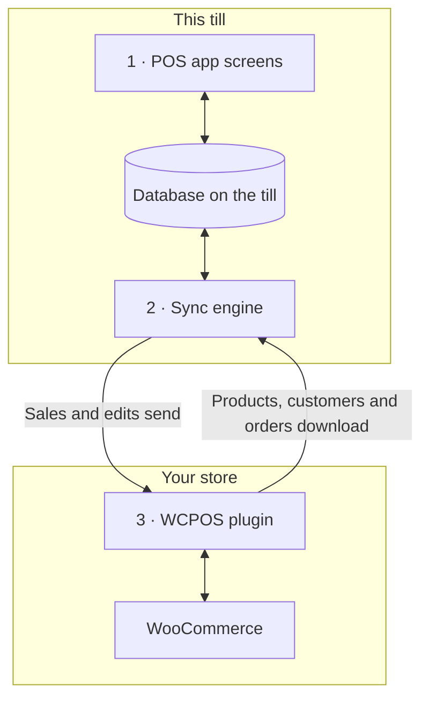

import LinkCards from '@site/src/components/LinkCards';
import LinkCard from '@site/src/components/LinkCard';
import JourneyShot from '@site/src/components/JourneyShot';
import manifest from '@site/static/img/2.x/reference/architecture/en/manifest.json';

WCPOS के दो हिस्से हैं: आपकी WordPress साइट पर एक प्लगइन और हर बिक्री टर्मिनल पर POS ऐप। टर्मिनल आपके स्टोर की अपनी कॉपी से बिक्री करता है और बैकग्राउंड में उसे WooCommerce के साथ sync रखता है। यह पेज डेवलपर और जानकारी चाहने वाले स्टोर मालिकों को बताता है कि आपका डेटा कहाँ रहता है और आपके सर्वर तक क्या पहुँचता है।

डिज़ाइन पढ़ने के बजाय कोई समस्या ठीक करना चाहते हैं?

- **ऐप अपडेट कर रहे हैं:** पहले [जाँचें कि टर्मिनल ने सब कुछ भेज दिया है](../getting-started/previous-versions.mdx#check-sync)। [अपडेट से पहले sync करें](#storage) देखें।
- **टर्मिनल पर कोई उत्पाद नहीं दिख रहा:** [जब कोई उत्पाद गायब हो या पुराना हो](../products/sync.mdx#goes-wrong) देखें।
- **कोई बिक्री आपके स्टोर तक नहीं पहुँची:** [भेजे जाने की प्रतीक्षा में बिक्री](../getting-started/offline.mdx#offline-writes) देखें।

## दो हिस्से {#two-part-system}

1. **POS ऐप** हर टर्मिनल पर चलता है: आपकी साइट के `/pos/` पते पर ब्राउज़र में (यह पता बदला जा सकता है), डेस्कटॉप ऐप में या iOS और Android ऐप में। हर विकल्प की ज़रूरतों के लिए [इंस्टॉलेशन](../getting-started/installation.mdx) देखें। हर स्क्रीन टर्मिनल के डेटाबेस में पढ़ती और लिखती है, इसलिए खोज करने या कोई आइटम जोड़ने पर आपके सर्वर की प्रतीक्षा नहीं करनी पड़ती।
2. ऐप के भीतर **sync इंजन** बदलावों को दोनों दिशाओं में भेजता है। यह आपके स्टोर के बदलाव डाउनलोड करता है और टर्मिनल पर हुए बदलाव भेजता है।
3. **WCPOS प्लगइन** आपकी WordPress साइट पर चलता है और टर्मिनल को WooCommerce से जोड़ता है। हर उत्पाद, ग्राहक और ऑर्डर का प्रामाणिक रिकॉर्ड WooCommerce में ही रहता है।

## टर्मिनल डिवाइस पर क्या रखता है {#local-database}

**स्वास्थ्य** → **डेटाबेस** में टर्मिनल पर मौजूद आपके स्टोर की कॉपी दिखती है: हर प्रकार के रिकॉर्ड की एक पंक्ति, जिसमें इस डिवाइस पर मौजूद संख्या (**डिवाइस पर**) और आपके स्टोर में मौजूद संख्या (**सर्वर पर**) होती है। हर पंक्ति के मेनू का काम [स्टोर का स्वास्थ्य](../support/store-health.mdx#coverage) में बताया गया है।

<JourneyShot manifest={manifest} device="tablet" step={1} offsets={[[186, 0], [186, 0], [186, 0], [186, 0], [186, 0], [186, 0], [186, 0], [186, 0]]} alt="स्वास्थ्य, डेटाबेस टैब: इस टर्मिनल के रिकॉर्ड की तालिका, उत्पादों से लेकर कर दरों तक, हर पंक्ति में डिवाइस पर संख्या, सर्वर पर संख्या, कवरेज और आकार">

1. **उत्पाद** — पहले POS के डिफ़ॉल्ट क्रम (नाम, A से Z) में 100 उत्पादों का बैच, फिर टर्मिनल खाली होने पर बाकी उत्पाद। [डाउनलोड और sync](../products/sync.mdx) देखें।
2. **वेरिएशन** — अपने उत्पादों के साथ डाउनलोड होते हैं।
3. **ऑर्डर** — खुले और हाल के ऑर्डर टर्मिनल पर रहते हैं। पुराने ऑर्डर किसी के खोलने पर डाउनलोड होते हैं।
4. **वापसी** — पिछले 92 दिनों की वापसी, साथ ही आपके खोले हुए किसी भी ऑर्डर की वापसी।
5. **ग्राहक** — टर्मिनल खाली होने पर थोड़े-थोड़े करके डाउनलोड होते हैं।
6. **श्रेणियाँ** — इनके नीचे **ब्रांड** और **टैग** होते हैं।
7. **कूपन** — Pro हो या न हो, टर्मिनल पर रहते हैं।
8. **कर दरें** — आपके स्टोर की कर दरें।

</JourneyShot>

किसी पंक्ति पर लाल **N अटके हुए** बैज का मतलब है कि उस प्रकार के रिकॉर्ड पर आपको ध्यान देना होगा। [ध्यान देने योग्य रिकॉर्ड](../support/store-health.mdx#stuck-records) देखें।

तालिका के ऊपर **भेजे जाने की प्रतीक्षा में बदलाव** की संख्या पर ध्यान दें: इस टर्मिनल पर हुई वे बिक्री और संपादन जो आपके स्टोर को अभी नहीं मिले हैं। स्टोर को मिलने तक वे डिवाइस पर रहते हैं। जिन खुले ऑर्डर को आपने sync नहीं किया है और किसी पैनल में सूचीबद्ध बदलाव इसमें नहीं गिने जाते, और वे भी आपके स्टोर तक नहीं पहुँचे हैं। [भेजे जाने की प्रतीक्षा में बिक्री](../getting-started/offline.mdx#offline-writes) देखें।

इस तालिका के बाहर रखे गए रिकॉर्ड

कुछ जानकारी इस तालिका के बाहर रहती है। ऐप शुरू होने पर हर बार भुगतान विधियाँ, कर वर्ग, शिपिंग विधियाँ और ऑर्डर स्थितियाँ आपके स्टोर से पढ़ी जाती हैं। टर्मिनल ऑफ़लाइन होने पर उपयोग के लिए पिछला उत्तर रखा जाता है। रजिस्टर सत्रों, समापन और नकदी की आवाजाही के अपने रिकॉर्ड होते हैं और उन्हें आपके स्टोर तक भेजने की अपनी कतार होती है।

### डेटाबेस कैसे रखा जाता है {#storage}

हर स्टोर के हर कैशियर की टर्मिनल पर अपनी कॉपी होती है। ब्राउज़र में एक साइट के लिए एक समय में एक ही टैब POS चलाता है। जब ऐप अपडेट से उस कॉपी को सहेजने का तरीका बदलता है, तो टर्मिनल उसे दोबारा डाउनलोड करता है।

:::warning अपडेट से पहले sync करें
पुरानी कॉपी में अब भी प्रतीक्षारत बिक्री और संपादन भेजे नहीं जाते। ऐप अपडेट करने से पहले **स्वास्थ्य** → **डेटाबेस** में जाँचें कि **भेजे जाने की प्रतीक्षा में बदलाव** की संख्या 0 है और आँकड़ों के नीचे कोई पैनल नहीं है। साथ ही हर खुले ऑर्डर को sync करें। [जाँचें कि टर्मिनल ने सब कुछ भेज दिया है](../getting-started/previous-versions.mdx#check-sync) देखें।
:::

डेवलपर के लिए विवरण: स्टोरेज इंजन, टैब और ऐप अपडेट

- **हर साइट, स्टोर और कैशियर के लिए अलग डेटाबेस।** एक टर्मिनल पर दो कैशियर या दो स्टोर में एक कैशियर कभी स्थानीय डेटा साझा नहीं करते।
- **हर प्लेटफ़ॉर्म पर SQLite।** ब्राउज़र में SQLite उसके निजी फ़ाइल स्टोरेज पर एक वर्कर में चलता है; iOS और Android ऐप में सिस्टम का SQLite इस्तेमाल होता है; डेस्कटॉप ऐप इसे अपनी मुख्य प्रक्रिया में SQLite में रखता है।
- **डिस्क पर सहेजा जाता है।** ब्राउज़र या ऐप बंद करने और डिवाइस रीस्टार्ट करने के बाद भी टर्मिनल की कॉपी बनी रहती है।
- **हर साइट के लिए एक सक्रिय टैब।** ब्राउज़र में एक साइट का POS एक टैब में चलता है। दूसरा टैब खोलने पर वह संचालन अपने हाथ में लेने का विकल्प देता है; पहला टैब रुक जाता है।
- **सूचियों की प्रोसेसिंग डेटाबेस में होती है।** जहाँ संभव हो, फ़िल्टरिंग, क्रमबद्ध करना और पेज बनाना डेटाबेस के भीतर होता है, इसलिए हज़ारों ऑर्डर की सूची से स्क्रीन को केवल वही पंक्तियाँ मिलती हैं जो उसे दिखानी हैं।
- **मौजूदा डेटाबेस का माइग्रेशन नहीं होता।** जब ऐप अपडेट डेटाबेस की संरचना बदलता है, तो ऐप नया डेटाबेस खोलकर आपके स्टोर से दोबारा डाउनलोड करता है। पुराने डेटाबेस में प्रतीक्षारत बदलाव भेजे नहीं जाते और खुले ऑर्डर नए डेटाबेस में नहीं आते: ऐप अपडेट करने से पहले टर्मिनल को sync करें।

## टर्मिनल और आपके स्टोर में तालमेल कैसे रहता है {#data-synchronization}

Sync इंजन समय-समय पर आपके पूरे स्टोर की नकल नहीं बनाता। यह टर्मिनल की स्क्रीन की ज़रूरतों के अनुसार काम करता है और आपके सर्वर से यथासंभव कम अनुरोध करता है।

- **बदलावों की जाँच।** टर्मिनल अपने [sync प्रीसेट](../support/store-health.mdx#sync-presets) (**किफ़ायती**, **संतुलित** या **रीयलटाइम**) के अनुसार तय अंतराल पर आपके स्टोर से पूछता है कि क्या बदला है। हर टर्मिनल का अपना प्रीसेट होता है: एक पर इसे बदलने से दूसरे नहीं बदलते।
- **स्क्रीन की ज़रूरत।** हर स्क्रीन इंजन को बताती है कि वह क्या दिखा रही है। रिकॉर्ड पहले से मौजूद होने पर इंजन टर्मिनल के डेटाबेस से उत्तर देता है; केवल रिकॉर्ड न होने पर ही आपके स्टोर से पूछता है।
- **बैकग्राउंड में।** पहले उत्पादों का शुरुआती बैच और खुले व हाल के ऑर्डर डाउनलोड होते हैं। टर्मिनल खाली होने पर बाकी उत्पाद और ग्राहक डाउनलोड होते हैं।
- **बदलाव भेजना।** हर बिक्री या संपादन पहले टर्मिनल पर सहेजा जाता है, फिर आपके स्टोर को भेजा जाता है। स्टोर द्वारा अस्वीकार किया गया बदलाव अपने-आप दोबारा नहीं भेजा जाता: वह **N बदलाव आपके सर्वर तक कभी नहीं पहुँचे** के अंतर्गत **फिर से भेजें** और **त्यागें** विकल्पों के साथ प्रतीक्षा करता है। [स्टोर का स्वास्थ्य](../support/store-health.mdx#refused-changes) देखें।

डेवलपर के लिए विवरण: बदलावों की फ़ीड, अनुरोध सीमाएँ और लेन

- कुछ नया न होने पर स्टोर बदलावों की जाँच का उत्तर `304 Not Modified` से देता है, जिसमें कोई बॉडी नहीं होती।
- लिखने के अनुरोध टर्मिनल की स्थायी कतार से होकर जाते हैं, जो उन्हें `wcpos/v2/push/{collection}` पर पोस्ट करती है।
- अनुरोध सीमाएँ, दोबारा प्रयास से पहले का अंतराल और मापे गए आँकड़े [Sync का प्रदर्शन](./sync-performance.mdx) में हैं। हर लेन का विवरण [Sync इंजन कैसे काम करता है](./sync-engine.mdx) में है।

## चेकआउट बिक्री कैसे दर्ज करता है {#checkout-architecture}

चेकआउट POS का हिस्सा है। हर बिक्री के लिए WooCommerce का ऑर्डर भुगतान पेज खोलने के बजाय, टर्मिनल हर भुगतान स्वयं लेता है और उसे एक WooCommerce ऑर्डर के अंतर्गत दर्ज करता है।

:::warning ऑफ़लाइन भुगतान के लिए बिक्री पहले से आपके स्टोर में होनी चाहिए
ऑफ़लाइन भुगतान केवल उस बिक्री पर लिया जा सकता है जो कनेक्शन टूटने से पहले आपके स्टोर तक पहुँच गई थी: उसका ऑर्डर नंबर [चेकआउट](../pos/checkout/index.mdx) में आइटमों के ऊपर दिखता है। कनेक्शन टूटने के बाद शुरू हुई बिक्री टर्मिनल पर प्रतीक्षा करती है और स्टोर से दोबारा संपर्क होने पर उसका भुगतान होता है। [ऑफ़लाइन भुगतान लें](../getting-started/offline.mdx#take-payment-offline) देखें।
:::

- **हर विधि के लिए एक टाइल।** POS के लिए चालू हर भुगतान विधि की टाइल टर्मिनल पर दिखती है। जिस विधि को वह चला नहीं सकता, वह कारण के साथ धूसर दिखती है, कभी छिपाई नहीं जाती। [जब किसी टाइल का उपयोग न हो सके](../payment/index.mdx#unavailable-tiles) देखें।
- **एक ऑर्डर, कई भुगतान।** कई विधियों से भुगतान की गई बिक्री एक ही WooCommerce ऑर्डर रहती है, जिसमें आइटम, कर, स्टॉक बदलाव और ऑर्डर नंबर का एक ही सेट होता है। इसलिए रिपोर्ट उसे एक बार गिनती है। वापसी सामान्य WooCommerce वापसी होती है, जो वापस किए जा रहे भुगतानों में बाँटी जाती है।
- **स्टोर निर्णय लेता है।** हर भुगतान के बाद आपका स्टोर बताता है कि कितना भुगतान हो चुका है और कितना बाकी है। टर्मिनल बिक्री को अपने आँकड़ों के बजाय स्टोर के आँकड़ों के आधार पर पूरा करता है।
- **दोबारा प्रयास करना सुरक्षित है।** हर भुगतान का एक ID होता है जिसे टर्मिनल बनाता है, इसलिए दो बार भेजा गया भुगतान एक ही बार दर्ज होता है।
- **ऑफ़लाइन।** आपके स्टोर में पहले से मौजूद बिक्री का नकद भुगतान कनेक्शन टूटने पर भी पूरा हो जाता है: भुगतान **बाद में निपटान होगा** के रूप में दर्ज होता है और कनेक्शन लौटने पर भेजा जाता है। [ऑफ़लाइन भुगतान लें](../getting-started/offline.mdx#take-payment-offline) देखें।

कैप्चर मोड और भुगतान रूट

`GET wcpos/v2/payment-methods` हर गेटवे का विवरण देता है: उसका `kind` (`cash`, `card`, `stored_value`, `bank_transfer` या `other`), वह पैसे कैसे लेता है (`capture`) और क्या अनुमति देता है (`capabilities`: आंशिक रकम, छुट्टे पैसे, वापसी, टिप, ऑफ़लाइन, निरस्तीकरण)। हर भुगतान ऑर्डर के `_wcpos_payments` मेटा में एक पंक्ति होता है और हर भुगतान के बाद स्टोर ऑर्डर के `paid` और `balance` के साथ उत्तर देता है।

हर विधि का `capture.mode` बताता है कि पैसे कौन लेता है। हर भुगतान कॉल उसके मोड के लिए पंजीकृत हैंडलर को जाती है।

| मोड | पैसे कैसे लिए जाते हैं | प्लगइन |
| --- | --- | --- |
| `manual` | कैशियर पैसे लेता है और दर्ज करता है। नकद, कार्ड, डिलीवरी पर नकद भुगतान, सीधे बैंक हस्तांतरण और चेक भुगतान के लिए डिफ़ॉल्ट। | निःशुल्क |
| `webview` | चेकआउट के **लेगेसी** टैब पर गेटवे का अपना भुगतान पेज। अन्य सभी गेटवे के लिए डिफ़ॉल्ट। [जब लेगेसी टैब का भुगतान पेज लोड न हो](../payment/index.mdx#legacy-notices) देखें। | निःशुल्क |
| `gateway` | गेटवे का अपना `process_payment()` टर्मिनल द्वारा एकत्र किए गए मानों के साथ चलता है। गेटवे फ़िल्टर के माध्यम से इसे अपनाता है। | निःशुल्क |
| `server` | आपका स्टोर कार्ड टर्मिनल के प्रदाता से भुगतान लेने को कहता है। | Pro |
| `device` | टर्मिनल प्रदाता के SDK से कार्ड रीडर चलाता है और प्रदाता भुगतान की पुष्टि करता है। | Pro |

भुगतान रूट ऑर्डर के WooCommerce ID के माध्यम से उससे जुड़े होते हैं:

- `POST wcpos/v2/orders/{id}/payments` भुगतान दर्ज करता है। भुगतान का ID दोबारा प्रयास को सुरक्षित बनाता है।
- `.../payments/{uuid}/intent`, `/capture`, `/void` और `/refund` (`POST`), तथा `/status` (`GET`), एक भुगतान पर काम करते हैं। हर कमांड का अपना कमांड ID होता है।
- `POST wcpos/v2/orders/{id}/close` ऑर्डर पूरा करता है।

हर कमांड में ऑर्डर का `revision` होता है; इसके बिना कमांड `428` के साथ अस्वीकार होता है।

केवल POS के लिए गेटवे बनाने की शुरुआत [गेटवे टेम्पलेट](./gateway-template.mdx) से करें।

## वेबसाइट के कुछ बदलाव टर्मिनल तक क्यों नहीं पहुँचते {#api-extensions}

टर्मिनल को उत्पाद, ग्राहक और ऑर्डर WCPOS प्लगइन से मिलते हैं, जो उन्हें WooCommerce से पढ़ता है। WooCommerce द्वारा ऐप को भेजे जाने वाले डेटा को बदलने वाले प्लगइन का असर टर्मिनल तक पहुँचता है। केवल वेबसाइट का रूप या ऑनलाइन चेकआउट बदलने वाले प्लगइन का असर नहीं पहुँचता। किसी प्लगइन की जाँच के लिए [WooCommerce REST API को समझें](./wc-rest-api.mdx) से शुरुआत करें।

डेवलपर के लिए विवरण: API संस्करण

टर्मिनल आपके स्टोर से केवल प्लगइन के REST रूट के माध्यम से बात करता है, जो आपकी साइट के भीतर WooCommerce से डेटा पढ़ते हैं। प्लगइन WooCommerce के अपने `wc/v3` के साथ दो नेमस्पेस पंजीकृत करता है।

- ऐप **`wcpos/v2`** का उपयोग करता है: रिकॉर्ड पढ़ना, बदलावों की फ़ीड, बदलावों की कतार, भुगतान, रजिस्टर और सत्र। इसके रीड रूट आपकी साइट के भीतर `wc/v3` को अनुरोध भेजते हैं, इसलिए WooCommerce के REST उत्तरों को बदलने वाला प्लगइन टर्मिनल पर दिखने वाला डेटा भी बदलता है।
- **`wcpos/v1`** अब भी पंजीकृत होता है। इसके डेटा रूट (उत्पाद, वेरिएशन, ऑर्डर, ग्राहक, कूपन, कर, श्रेणियाँ, टैग, ब्रांड) अब नहीं बदले जाते। इसके सेवा रूट (स्टोर, सेटिंग्स, रसीदें, टेम्पलेट, प्रिंट कार्य और बाकी) का कोड उनके `wcpos/v2` संस्करणों के समान है।

### ऐप अपडेट और अन्य sync टूल {#wcpos-v2-namespace}

ऐप और प्लगइन साथ अपडेट होते हैं: प्लगइन की ज़रूरत से पुराने ऐप वाला टर्मिनल ऐप अपडेट होने तक [SYNC341](../error-codes/SYNC341.mdx) दिखाता है। लाइन आइटमों पर POS मूल्य ऐसी जगह सहेजे जाते हैं जहाँ दूसरे sync टूल उन्हें पढ़ सकें; [POS मूल्य ओवरराइड कैसे सहेजे जाते हैं](./pos-discounts.mdx#how-pos-price-overrides-are-stored) देखें।

डेवलपर के लिए विवरण: अनुरोध, साइन-इन और ऑर्डर ID

- **POS अनुरोधों के लिए रूट लोड होते हैं।** प्लगइन अपने रूट केवल उनके लिए लक्षित अनुरोधों पर पंजीकृत करता है: कोई `wcpos/` रूट, `X-WCPOS` हेडर या `?wcpos=1`। आपकी साइट का बाकी REST ट्रैफ़िक इन्हें लोड नहीं करता।
- **ऐप और प्लगइन साथ चलते हैं।** ऐप के हर अनुरोध में `X-WCPOS-Protocol` होता है। नया प्रोटोकॉल चाहने वाला प्लगइन `wcpos_update_required` के साथ `426` का उत्तर देता है और ऐप अपडेट होने तक टर्मिनल [SYNC341](../error-codes/SYNC341.mdx) दिखाता है।
- **सार्वजनिक रूट।** `wcpos/v2/site`, `wcpos/v2/ping` और `wcpos/v2/echo` के लिए साइन-इन ज़रूरी नहीं है। किसी के साइन-इन करने से पहले ऐप इनसे आपकी साइट ढूँढता है और कनेक्शन जाँचता है। `/wp-json/` छिपाने या हेडर हटाने वाले होस्ट पर ऐप WordPress के `/?rest_route=` पते और अपने हेडर के क्वेरी-स्ट्रिंग रूपों (`?wcpos=1`, `wcpos_protocol`) का सहारा लेता है। किसी से भी उत्तर न मिलने पर टर्मिनल [AUTH431](../error-codes/AUTH431.mdx) दिखाता है।
- **साइन-इन।** ऐप आपकी साइट के `/wcpos-auth` पेज से साइन-इन करता है और उसे 30 मिनट तक मान्य JWT एक्सेस टोकन व 30 दिनों तक मान्य रिफ़्रेश टोकन मिलता है। `wcpos_jwt_access_token_expire` और `wcpos_jwt_refresh_token_expire` फ़िल्टर इन्हें बदलते हैं। कौन-सी भूमिका किस रूट तक पहुँच सकती है, यह [भूमिका के अनुसार एंडपॉइंट पहुँच](./role-endpoint-access.mdx) में बताया गया है।
- **ऑर्डर में UUID होता है।** टर्मिनल हर ऑर्डर के लिए UUID बनाता है, उसे `_woocommerce_pos_uuid` मेटा के रूप में भेजता है और आपका स्टोर उसे रखता है। ऑर्डर प्राप्त करते समय पहचान के लिए UUID का उपयोग होता है।
- **लाइन आइटमों पर POS मूल्य** इस तरह सहेजे जाते हैं कि दूसरे sync टूल उन्हें पढ़ सकें। [POS मूल्य ओवरराइड कैसे सहेजे जाते हैं](./pos-discounts.mdx#how-pos-price-overrides-are-stored) देखें।
- **स्टोर (Pro)।** कई स्टोर होने पर टर्मिनल `X-WCPOS-Store` हेडर में अपना स्टोर भेजता है और प्लगइन उसे WooCommerce को `store_id` के रूप में देता है। ऑर्डर का स्टोर उसके मेटा की `_pos_store` प्रविष्टि से मिलता है। स्टोर संपादित करने और ग्राहक डिस्प्ले पेयर करने के Pro रूट दोनों नेमस्पेस में पंजीकृत होते हैं।

:::info WCPOS Pro के साथ
Pro में कार्ड रीडर, स्टोर संपादन और ग्राहक डिस्प्ले पेयर करने की सुविधा जुड़ती है। कई स्टोर होने पर टर्मिनल पर हर स्टोर के अपने मूल्य होते हैं। [स्टोर सेट अप करना](../stores/setup.mdx) देखें।
:::

## डिज़ाइन के लाभ और उनकी कीमत {#architecture-pros-and-cons}

- **तुरंत खोज और कार्ट।** दोनों टर्मिनल का अपना डेटाबेस पढ़ते हैं।
  - **कीमत:** टर्मिनल की कॉपी को आपके स्टोर के साथ sync रखना पड़ता है। Sync इंजन का पूरा काम यही है।
- **कनेक्शन टूटने पर भी बिक्री।** बिक्री और संपादन टर्मिनल पर प्रतीक्षा करते हैं और कनेक्शन लौटने पर भेजे जाते हैं। स्टोर में पहले से मौजूद बिक्री का नकद भुगतान तब भी पूरा होता है।
  - **कीमत:** कनेक्शन टूटने के बाद शुरू हुई बिक्री का भुगतान स्टोर से दोबारा संपर्क होने पर ही होता है। [ऑफ़लाइन भुगतान लें](../getting-started/offline.mdx#take-payment-offline) देखें।
- **टर्मिनल के लिए बने ऐप।** डेस्कटॉप, iOS और Android ऐप, किसी फ़्रेम के भीतर वेब पेज नहीं।
  - **कीमत:** POS आपके स्टोर को केवल REST API के माध्यम से देखता है। WordPress थीम और हुक उसका रूप नहीं बदल सकते। केवल वेब चेकआउट या आपकी थीम बदलने वाले प्लगइन का असर टर्मिनल तक नहीं पहुँचता। [कुछ प्लगइन POS में काम क्यों नहीं करते?](./wc-rest-api.mdx#why-dont-some-plugins-work-in-the-pos) देखें

## संबंधित दस्तावेज़ {#related-documentation}

<LinkCards>
  <LinkCard title="Sync इंजन कैसे काम करता है" to="/developers/sync-engine" description="लेन, बदलावों की फ़ीड और बदलावों की कतार का विस्तृत विवरण।" />
  <LinkCard title="स्टोर का स्वास्थ्य" to="/troubleshooting/store-health" description="टर्मिनल का डेटाबेस, sync प्रीसेट और भेजे जाने की प्रतीक्षा में बदलाव देखें।" />
  <LinkCard title="WooCommerce REST API को समझें" to="/developers/woocommerce-rest-api" description="REST API क्या है और कुछ प्लगइन का असर POS तक क्यों नहीं पहुँचता।" />
</LinkCards>
