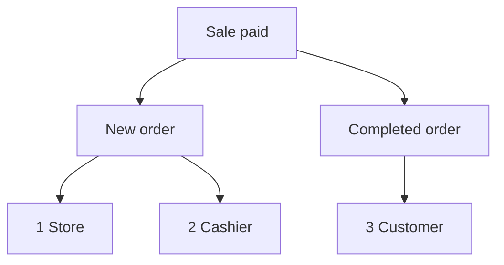

import Accordion from '@site/src/components/Accordion';
import AccordionItem from '@site/src/components/AccordionItem';
import LinkCards from '@site/src/components/LinkCards';
import LinkCard from '@site/src/components/LinkCard';

**WP एडमिन:** `WP Admin → POS → Settings → Checkout`।

WooCommerce ऑर्डर के बारे में ईमेल भेजता है: आपको नए ऑर्डर का ईमेल, ग्राहक को पूरे हुए ऑर्डर का ईमेल, आदि। POS में हुई बिक्री के लिए आप यहाँ चुनते हैं कि इनमें से कौन-से ईमेल भेजे जाएँ और किसे मिलें। आपके ऑनलाइन ऑर्डर के लिए WooCommerce की सामान्य ईमेल सेटिंग्स लागू रहती हैं।

सीधे जाएँ: [एडमिन ईमेल](#admin-emails) · [ग्राहक ईमेल](#customer-emails) · [मैन्युअल रूप से रसीद भेजें](#send-receipt-manually) · [कैशियर ईमेल](#cashier-emails) · [आम स्थितियाँ](#common-scenarios) · [अगर कोई समस्या हो](#goes-wrong)

## ईमेल चालू या बंद करें {#switches}

:::note POS बिक्री के लिए
POS ऑर्डर के लिए ये स्विच **WooCommerce > सेटिंग्स > ईमेल** में मौजूद **यह ईमेल सूचना सक्षम करें** सेटिंग को ओवरराइड करते हैं। WooCommerce में बंद किया गया ईमेल भी भेजा जा सकता है, अगर वह यहाँ चुना हुआ है।
:::

1. WP Admin में **POS > सेटिंग्स > चेकआउट** पर जाएँ।
2. **स्टॉक से अधिक बिक्री रोकें** के नीचे तीन ईमेल स्विच खोजें: **एडमिन ईमेल**, **ग्राहक ईमेल** और **कैशियर ईमेल**। इनके नीचे **गेटवे** की सूची है।
3. स्विच चालू करने पर उस समूह के हर ईमेल के लिए एक चेकबॉक्स दिखता है। केवल किसी एक ईमेल को रोकने के लिए उसका चयन हटाएँ।
4. स्विच बंद करने पर POS बिक्री के लिए उस समूह का कोई भी ईमेल नहीं भेजा जाता, चाहे चेकबॉक्स में कुछ भी चुना हो।

हर बदलाव करते ही सहेज लिया जाता है: स्क्रीन पर पहले **सहेजा जा रहा है**, फिर **सहेजा गया** दिखता है।

{/* reshoot: WP Admin > POS > Settings > Checkout with all three email switches on and their checkboxes showing; see reshoot.md */}

हर स्विच किसे ईमेल भेजता है और इंस्टॉल करते समय उसकी शुरुआती स्थिति क्या होती है:

- **एडमिन ईमेल**: इंस्टॉल करते समय चालू\
  **WooCommerce > सेटिंग्स > ईमेल** में उस ईमेल के **प्राप्तकर्ता** फ़ील्ड में दिए गए पतों पर
- **ग्राहक ईमेल**: इंस्टॉल करते समय चालू\
  ऑर्डर के बिलिंग ईमेल पर
- **कैशियर ईमेल**: इंस्टॉल करते समय बंद\
  कैशियर के WordPress खाते में दिए गए ईमेल पते पर

काउंटर पर भुगतान की गई बिक्री के लिए ये ईमेल भेजे जाते हैं, जब उसकी भुगतान विधि की **ऑर्डर स्थिति** पूर्ण हो:

1. **स्टोर** — WooCommerce में **नया ऑर्डर** के **प्राप्तकर्ता** को, अगर **एडमिन ईमेल** चालू है और **नया ऑर्डर** चुना हुआ है।
2. **कैशियर** — कैशियर के अपने पते पर, अगर **कैशियर ईमेल** चालू है और **नया ऑर्डर** चुना हुआ है।
3. **ग्राहक** — ऑर्डर के बिलिंग ईमेल पर, अगर **ग्राहक ईमेल** चालू है, **पूर्ण ऑर्डर** चुना हुआ है और ऑर्डर में बिलिंग ईमेल है।

## एडमिन ईमेल {#admin-emails}

ये आपको, यानी स्टोर को भेजे जाते हैं। इंस्टॉल करते समय हर ईमेल चुना हुआ होता है।

एडमिन ईमेल किसे मिले, यह बदलने के लिए **WooCommerce > सेटिंग्स > ईमेल** पर जाएँ, उस ईमेल की सेटिंग्स खोलें और **प्राप्तकर्ता** संपादित करें।

| ईमेल | कब भेजा जाता है |
|---|---|
| **नया ऑर्डर** | जब POS ऑर्डर की स्थिति पूर्ण, प्रक्रियाधीन या होल्ड पर हो जाती है |
| **रद्द ऑर्डर** | जब प्रक्रियाधीन या होल्ड पर मौजूद ऑर्डर रद्द होता है |
| **विफल ऑर्डर** | जब भुगतान लंबित या होल्ड पर मौजूद ऑर्डर विफल होता है |

जब किसी POS ऑर्डर की स्थिति **POS - खुला** या **POS - आंशिक भुगतान** से बदलकर पूर्ण, प्रक्रियाधीन या होल्ड पर होती है, तो **नया ऑर्डर** ईमेल भेजा जाता है, बशर्ते वह **एडमिन ईमेल** या **कैशियर ईमेल** के अंतर्गत चुना हुआ हो और वह स्विच चालू हो। ऐसा तब भी होता है जब WooCommerce में **नया ऑर्डर** बंद हो। हर बिक्री के बाद लागू होने वाली स्थिति वही **ऑर्डर स्थिति** है जो आप उसकी भुगतान विधि के लिए सेट करते हैं: [ऑर्डर स्थिति](./checkout.mdx#order-status) देखें।

WCPOS POS बिक्री के लिए नया ऑर्डर ईमेल खुद क्यों भेजता है

WooCommerce **नया ऑर्डर** ईमेल केवल तब भेजता है जब ऑर्डर भुगतान लंबित, विफल या रद्द स्थिति से आगे बढ़ता है। इसके बजाय POS ऑर्डर **POS - खुला** या **POS - आंशिक भुगतान** में रहता है। WooCommerce इन स्थितियों को नहीं पहचानता, इसलिए ऑर्डर के आगे बढ़ने पर वह ईमेल नहीं भेजेगा। ऊपर बताए गए समय पर WCPOS, WooCommerce की जगह यह ईमेल भेजता है।

## ग्राहक ईमेल {#customer-emails}

ये ऑर्डर के बिलिंग ईमेल पर भेजे जाते हैं। जिस ऑर्डर में बिलिंग ईमेल नहीं है, जैसे किसी अतिथि की बिक्री जिसमें आपने ईमेल दर्ज नहीं किया, उसके लिए ग्राहक ईमेल नहीं भेजा जाता। इंस्टॉल करते समय हर ईमेल चुना हुआ होता है।

### मैन्युअल रूप से रसीद भेजें {#send-receipt-manually}

भुगतान पूरा होने वाली स्क्रीन पर **ईमेल से रसीद भेजें** विकल्प अलग है। यह WooCommerce का इनवॉइस ईमेल भेजता है, जिसे ये स्विच नियंत्रित नहीं करते। इसलिए **ग्राहक ईमेल** बंद होने पर भी यह काम करता है। [रसीद ईमेल करें](../../receipts/at-checkout.mdx#email-receipt) देखें।

### अपने-आप भेजे जाने वाले ईमेल {#customer-emails-automatic}

| ईमेल | कब भेजा जाता है |
|---|---|
| **ऑर्डर होल्ड पर** | जब ऑर्डर की स्थिति भुगतान लंबित, विफल या रद्द से बदलकर होल्ड पर हो जाती है |
| **प्रक्रियाधीन ऑर्डर** | जब ऑर्डर की स्थिति भुगतान लंबित, होल्ड पर, विफल या रद्द से बदलकर प्रक्रियाधीन हो जाती है |
| **पूर्ण ऑर्डर** | जब ऑर्डर की स्थिति पूर्ण हो जाती है |
| **रिफ़ंड किया गया ऑर्डर** | जब ऑर्डर की पूरी या आंशिक राशि वापस की जाती है। [रिफ़ंड](../../orders/refunds.mdx) देखें |
| **विफल ऑर्डर** | जब ऑर्डर विफल होता है |

जिस बिक्री की स्थिति सीधे **POS - खुला** से बदलकर प्रक्रियाधीन या होल्ड पर होती है, जैसे नकद बिक्री, उसके लिए **ऑर्डर होल्ड पर** या **प्रक्रियाधीन ऑर्डर** ईमेल नहीं भेजा जाता: WooCommerce इन्हें केवल सूची में दी गई पिछली स्थितियों से बदलाव होने पर भेजता है। **पूर्ण ऑर्डर**, **रिफ़ंड किया गया ऑर्डर** और **विफल ऑर्डर** पिछली स्थिति पर निर्भर नहीं करते, इसलिए ये POS बिक्री के लिए भेजे जाते हैं। प्रक्रियाधीन या होल्ड पर समाप्त होने वाली बिक्री के लिए ग्राहक को ईमेल भेजने हेतु [ईमेल से रसीद भेजें](#send-receipt-manually) का उपयोग करें।

## कैशियर ईमेल {#cashier-emails}

यह बिक्री करने वाले कैशियर को उसके WordPress खाते में दिए गए ईमेल पते पर **नया ऑर्डर** ईमेल भेजता है। इंस्टॉल करते समय स्विच बंद होता है; इसे चालू करने पर **नया ऑर्डर** चुना हुआ होता है।

कैशियर को ईमेल उन्हीं मौकों पर मिलता है जब एडमिन को मिलता है ([एडमिन ईमेल](#admin-emails) देखें)। **एडमिन ईमेल** और **कैशियर ईमेल** स्वतंत्र रूप से काम करते हैं: एक को बंद करने से दूसरे पर असर नहीं पड़ता। अगर कैशियर का पता पहले से एडमिन प्राप्तकर्ताओं में शामिल है, जैसे कोई मालिक जो दोनों भूमिकाएँ निभाता हो, तो उसे एक ही प्रति मिलती है, दो नहीं।

कौन-से WordPress उपयोगकर्ता कैशियर के रूप में POS में साइन इन कर सकते हैं, यह [कैशियर की पहुँच](./access.mdx) में सेट किया जाता है।

## आम स्थितियाँ {#common-scenarios}

<Accordion>
  <AccordionItem question="व्यस्त दिनों में इनबॉक्स में ईमेल की भरमार रोकें">

**एडमिन ईमेल** के अंतर्गत **नया ऑर्डर** का चयन हटाएँ। **रद्द ऑर्डर** और **विफल ऑर्डर** चुने रहने दें: इनके बारे में आपको सूचना मिलनी चाहिए।

बिक्री से हुई आय पर नज़र रखने के लिए नया ऑर्डर ईमेल गिनने के बजाय [रिपोर्ट](../../reports/index.mdx) का उपयोग करें।

  </AccordionItem>

  <AccordionItem question="नया ऑर्डर ईमेल एडमिन के बजाय ड्यूटी पर मौजूद कैशियर को भेजें">

**एडमिन ईमेल** के अंतर्गत **नया ऑर्डर** का चयन हटाएँ, या **एडमिन ईमेल** बंद करें, और **कैशियर ईमेल** चालू करें। हर बिक्री करने वाले कैशियर को उसके अपने पते पर ईमेल मिलता है और एडमिन के इनबॉक्स में ये ईमेल नहीं आते।

**एडमिन ईमेल** बंद करने से **रद्द ऑर्डर** और **विफल ऑर्डर** भी बंद हो जाते हैं, इसलिए आम तौर पर केवल **नया ऑर्डर** का चयन हटाना बेहतर है।

  </AccordionItem>

  <AccordionItem question="स्टोर में हुई बिक्री के लिए ग्राहक ईमेल बंद रखें">

बाज़ार के स्टॉल और कैफ़े अक्सर ऐसे ग्राहक को ईमेल नहीं भेजना चाहते जिसके पास पहले से छपी हुई रसीद हो। **ग्राहक ईमेल** बंद करें, और POS बिक्री के लिए प्रक्रियाधीन, पूर्ण, रिफ़ंड या कोई अन्य ग्राहक ईमेल नहीं भेजा जाएगा।

आपके ऑनलाइन ऑर्डर के ग्राहक ईमेल सामान्य रूप से भेजे जाते रहेंगे। ईमेल से रसीद माँगने वाले ग्राहक को अब भी रसीद मिल सकती है: भुगतान पूरा होने वाली स्क्रीन पर **ईमेल से रसीद भेजें** दबाएँ।

  </AccordionItem>

  <AccordionItem question="मैंने 1.8.9 से पुराने संस्करण से अपग्रेड किया और एकमात्र 'ईमेल सक्षम करें' स्विच गायब है">

संस्करण 1.8.9 में एक चालू/बंद स्विच की जगह इस पृष्ठ पर दिए गए तीन समूह आ गए। WCPOS आपकी पुरानी सेटिंग पढ़ता है: अगर ईमेल बंद थे, तो **एडमिन ईमेल** और **ग्राहक ईमेल** बंद रहते हैं; अगर चालू थे, तो दोनों चालू रहते हैं और हर ईमेल चुना हुआ होता है। दोनों ही मामलों में **कैशियर ईमेल** शुरुआत में बंद रहता है।

आपको कुछ भी करने की ज़रूरत नहीं है।

  </AccordionItem>
</Accordion>

## अगर कोई समस्या हो {#goes-wrong}

**एडमिन को नया ऑर्डर ईमेल नहीं मिलता।** जाँचें कि **एडमिन ईमेल** चालू है और **नया ऑर्डर** चुना हुआ है। फिर **WooCommerce > सेटिंग्स > ईमेल** में **नया ऑर्डर** के **प्राप्तकर्ता** जाँचें।

**ग्राहक को ईमेल नहीं मिलता।** जाँचें कि **ग्राहक ईमेल** चालू है और वह ईमेल चुना हुआ है। फिर ऑर्डर खोलकर जाँचें कि उसमें बिलिंग ईमेल है। अभी रसीद भेजने के लिए **ईमेल से रसीद भेजें** का उपयोग करें।

**कैशियर को ईमेल नहीं मिलता।** जाँचें कि **कैशियर ईमेल** चालू है, **नया ऑर्डर** चुना हुआ है और कैशियर के WordPress खाते में ईमेल पता है। अगर वह पता एडमिन प्राप्तकर्ता भी है, तो उसे केवल एक प्रति मिलती है।

**WooCommerce में बंद किया गया ईमेल अब भी POS बिक्री के लिए आता है।** POS ऑर्डर के लिए यहाँ के चेकबॉक्स तय करते हैं कि ईमेल भेजा जाएगा या नहीं। यहाँ भी उस ईमेल का चयन हटाएँ।

## डेवलपर हुक {#developer-hooks}

यह उन डेवलपर के लिए है जिन्हें इन स्विचों से आगे नियंत्रण चाहिए। स्टोर मालिक इसे छोड़ सकते हैं।

चार WordPress फ़िल्टर और नया ऑर्डर के प्राप्तकर्ता कैसे सेट किए जाते हैं

WCPOS 2.0 से पहले इन फ़िल्टर के नाम `woocommerce_pos_*` थे (उदाहरण के लिए `woocommerce_pos_admin_emails`)। वे नाम अब भी काम करते हैं, लेकिन 2.0 से अप्रचलित हैं और उन्हें 2.2 से पहले नहीं हटाया जाएगा। [हुक के नाम](../../extensions/index.mdx#hook-naming) देखें।

**`wcpos_admin_emails`**: WCPOS द्वारा नियंत्रित एडमिन ईमेल की IDs। डिफ़ॉल्ट: `cancelled_order`, `failed_order`।

**`wcpos_customer_emails`**: WCPOS द्वारा नियंत्रित ग्राहक ईमेल की IDs। डिफ़ॉल्ट: `customer_failed_order`, `customer_on_hold_order`, `customer_processing_order`, `customer_completed_order`, `customer_refunded_order`।

**`wcpos_admin_email_enabled`**: किसी एक POS ऑर्डर के लिए कोई एक एडमिन ईमेल भेजा जाए या नहीं। आर्ग्युमेंट: `$is_enabled`, `$email_id`, `$order`, `$email`।

**`wcpos_customer_email_enabled`**: किसी एक POS ऑर्डर के लिए कोई एक ग्राहक ईमेल भेजा जाए या नहीं। वही आर्ग्युमेंट।

**नया ऑर्डर** `wcpos_admin_emails` में शामिल नहीं है। WCPOS WooCommerce के `woocommerce_email_recipient_new_order` फ़िल्टर के ज़रिए इसके प्राप्तकर्ता सेट करता है: जब एडमिन यह ईमेल नहीं चाहता, तो यह स्टोर के प्राप्तकर्ताओं को हटा देता है, और जब कैशियर इसे चाहता है, तो कैशियर का पता जोड़ देता है। कैशियर वह WordPress उपयोगकर्ता है जो ऑर्डर के `_pos_user` मेटा में सहेजा गया है। इस फ़िल्टर पर आपका अपना कॉलबैक किसी भी WooCommerce ईमेल की तरह पते जोड़ या हटा सकता है।

## संबंधित दस्तावेज़ {#related-documentation}

<LinkCards>
  <LinkCard title="चेकआउट सेटिंग्स" to="/settings/checkout" description="उसी स्क्रीन पर गेटवे और हर गेटवे द्वारा सेट की जाने वाली ऑर्डर स्थिति।" />
  <LinkCard title="चेकआउट पर रसीदें" to="/sell/print-email-receipts" description="भुगतान पूरा होने वाली स्क्रीन से रसीद प्रिंट करें या ईमेल करें।" />
  <LinkCard title="ऑर्डर" to="/manage-store/orders" description="वे POS ऑर्डर खोजें जिनके बारे में ये ईमेल हैं।" />
</LinkCards>
