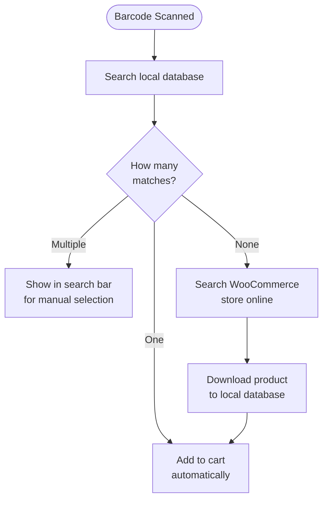

import Image from "@theme/IdealImage";
import Accordion from '@site/src/components/Accordion';
import AccordionItem from '@site/src/components/AccordionItem';

La maggior parte degli scanner di codici a barre si comporta come una tastiera collegata al tuo dispositivo.
Quando scansioni un codice a barre, WCPOS rileva che i caratteri sono stati inseriti più velocemente della digitazione normale.
Usa queste "pressioni rapide dei tasti" per identificare l'input come una scansione di un codice a barre.
Questo funziona da subito con quasi tutti gli scanner — ma gli scanner supportano anche altre [modalità di connessione](#connection-modes) a cui WCPOS può collegarsi direttamente.

## Configurazione della scansione dei codici a barre {#configuring-barcode-scanning}

Poiché la scansione di un codice a barre avviene molto rapidamente, il POS può distinguere tra un codice a barre e qualcosa digitato a mano.
Nelle impostazioni del POS troverai opzioni per mettere a punto il funzionamento del rilevamento dei codici a barre.

  <Image
    alt="Impostazioni di scansione dei codici a barre nelle Impostazioni del POS"
    img="/img/barcode-scanning-settings.png"
    style={{ maxHeight: 500 }}
  />
  
Impostazioni di scansione dei codici a barre nelle impostazioni del POS

| Impostazione | Scopo | Valore tipico |
|---|---|---|
| **Tempo medio di input** | Quanto deve essere rapido l'inserimento per essere riconosciuto come codice a barre | Un intervallo breve, abbastanza da escludere la digitazione manuale |
| **Lunghezza minima** | Quanto deve essere lunga la sequenza continua di caratteri per essere trattata come codice a barre | Imposta la lunghezza del codice a barre più corto che usi (ad es. 8 per EAN-8) |
| **Rimozione prefisso/suffisso** | Rimuove i caratteri aggiuntivi inseriti dallo scanner (un prefisso o un suffisso), lasciando solo il codice a barre principale | Lascia vuoto, a meno che lo scanner non sia configurato per aggiungerli |

## Modalità di connessione {#connection-modes}

Per seguire un percorso guidato di configurazione o risoluzione dei problemi, usa la [Configurazione guidata dello scanner](/1.x/hardware/scanners/setup-wizard).

Ogni scanner di codici a barre viene fornito con una delle modalità disponibili, che determina come WCPOS può ricevere le scansioni:

| Modalità | Come vengono ricevute le scansioni | Configurazione |
|---|---|---|
| **Tastiera (HID)** — l'impostazione di fabbrica di quasi tutti gli scanner | Lo scanner digita il codice a barre; WCPOS riconosce le pressioni rapide dei tasti | Nessuna — associa o collega lo scanner e scansiona |
| **Seriale (SPP / USB-COM)** | Una connessione diretta tramite seriale USB o Bluetooth SPP | Cambia la modalità dello scanner, poi collegalo nelle impostazioni Codici a barre |
| **HID-POS** | Una connessione diretta per gli scanner USB (tramite WebHID) | Cambia la modalità dello scanner, poi collegalo nelle impostazioni Codici a barre |
| **Bluetooth LE (GATT del produttore)** | Una connessione diretta Bluetooth Low Energy | Associa lo scanner, poi aggiungilo nelle impostazioni Codici a barre tramite il suo UUID di servizio |

La modalità tastiera non richiede configurazione ed è adatta alla maggior parte dei negozi. Una connessione diretta è utile se le scansioni a volte arrivano alterate (maiuscole o simboli errati a causa di differenze nel layout della tastiera) o finiscono nel posto sbagliato quando la casella di ricerca non è attiva: uno scanner collegato direttamente invia ogni scansione a WCPOS, indipendentemente dalla velocità di digitazione, dal layout della tastiera o dal campo attivo.

:::info Uno scanner in modalità tastiera non può essere collegato direttamente
Il dispositivo tratta uno scanner in modalità tastiera esattamente come una tastiera, e nessuna app può assumere il controllo di una tastiera.
Se premi **Collega scanner seriale** o **Collega scanner HID** nelle impostazioni Codici a barre e lo scanner non compare nell'elenco, quasi certamente è ancora in modalità tastiera.
:::

**Per cambiare modalità**, trova il codice a barre di configurazione nel manuale dello scanner (cerca *"modalità SPP"*, *"modalità seriale"* o *"modalità HID-POS"*) e scansionalo: lo scanner si riconfigura da solo. Per gli scanner Bluetooth, elimina la vecchia associazione nelle impostazioni Bluetooth del dispositivo e ripeti l'associazione dopo il cambio di modalità. Puoi tornare alla modalità precedente in qualsiasi momento scansionando il codice a barre *"HID"* o *"tastiera"* del manuale.

Le connessioni dirette sono supportate nell'app Desktop e nei browser basati su Chrome (tramite il supporto Web Serial e WebHID del browser). L'app Desktop mostra un selettore di dispositivi al suo interno; Chrome mostra il proprio selettore. Su iOS e Android sono supportate la modalità tastiera e la scansione con fotocamera; Android intercetta inoltre direttamente l'input dei tasti degli scanner hardware.

## Scansione con fotocamera {#camera-scanning}

Ogni piattaforma — web, desktop, iOS e Android — consente di scansionare con la fotocamera del dispositivo, quindi non serve uno scanner dedicato per iniziare. Apri la fotocamera dall'icona di scansione nella barra di ricerca: appare come un **pannello ridimensionabile direttamente sotto i filtri**, così l'elenco dei prodotti resta visibile durante la scansione. Punta la fotocamera verso un codice a barre e WCPOS lo legge esattamente come farebbe con uno scanner hardware.

## Cosa succede quando viene rilevato un codice a barre? {#what-happens-when-a-barcode-is-detected}

Quando il POS rileva un codice a barre, cerca nel database locale un prodotto o una variante di prodotto corrispondente.
Ci sono tre possibili risultati:

Quando una scansione non trova corrispondenze locali, WCPOS cerca nel negozio online, scarica il prodotto corrispondente e **lo aggiunge automaticamente al carrello**: così puoi completare la vendita anche con un codice a barre sconosciuto, e la stessa scansione sarà istantanea la volta successiva.

:::tip Più corrispondenze indicano solitamente un problema nei dati
Se più prodotti condividono lo stesso codice a barre, il POS non può sapere quale aggiungere e inserisce il codice nella barra di ricerca per consentirti di scegliere. Di solito questo indica che i dati dei prodotti devono essere sistemati: ogni prodotto dovrebbe avere un codice a barre **univoco**.
:::

## Feedback e comportamento della scansione {#scan-feedback-and-behaviour}

- **Suoni di scansione** — WCPOS può riprodurre un suono a ogni scansione, così i cassieri ricevono una conferma immediata senza guardare lo schermo. I suoni sono facoltativi e puoi scegliere tra diversi temi; attivali e scegli un tema nelle [Impostazioni dei codici a barre](/1.x/settings/store/barcode).
- **Nella schermata Ordini** — le scansioni vengono indirizzate al campo di ricerca degli Ordini, così puoi scansionare un codice a barre per trovare l'ordine o il prodotto che cerchi.
- **Codici a barre UPC-A** — una scansione UPC-A restituisce le cifre stampate sulla confezione, quindi il valore confrontato dal POS è quello usato nei dati dei prodotti.

## Comprendere la sincronizzazione dei prodotti {#understanding-product-synchronisation}

Il POS scarica il catalogo in piccoli lotti in background, quindi non tutti i prodotti sono presenti sul dispositivo fin dal primo minuto. Consulta [Sincronizzazione dei prodotti](/1.x/products/sync) per scoprire come funziona.

### Perché è importante per la scansione dei codici a barre {#why-it-matters-for-barcode-scanning}

Quando scansioni un codice a barre non ancora memorizzato localmente, il POS si collega al tuo negozio WooCommerce online, trova il prodotto e lo scarica: la stessa scansione sarà quindi istantanea la volta successiva. Non devi fare nulla per velocizzare il processo: il precaricamento del catalogo in background scarica autonomamente il resto dell'inventario e puoi controllarne l'avanzamento in **Stato del negozio → Database**.

## Domande frequenti {#faq}

<Accordion>
  <AccordionItem question="Perché compare '0 prodotti trovati localmente' quando scansiono un codice a barre?">

Non tutti i prodotti sono presenti sul dispositivo fin dall'inizio: il POS precarica il catalogo in background nei primi minuti di utilizzo.
Se il prodotto appena scansionato non è ancora memorizzato, la scansione fa sì che il POS lo cerchi online e lo scarichi, così la scansione sarà istantanea la volta successiva.

  </AccordionItem>

  <AccordionItem question="Il POS genera e stampa codici a barre?">

No, al momento no. Il nostro POS è progettato per scansionare e leggere codici a barre esistenti, ma non include funzionalità per crearli o stamparli.
Se devi generare codici a barre per i tuoi prodotti, puoi usare plugin WooCommerce di terze parti specializzati nella creazione e stampa di codici a barre. Alcuni esempi:

- [EAN for WooCommerce](https://wordpress.org/plugins/ean-for-woocommerce/)
- [A4 Barcode Generator](https://wordpress.org/plugins/a4-barcode-generator/)

Una volta generati i codici a barre per i tuoi prodotti, puoi scansionarli facilmente alla cassa per velocizzare il processo di checkout nel POS.

  </AccordionItem>
</Accordion>
