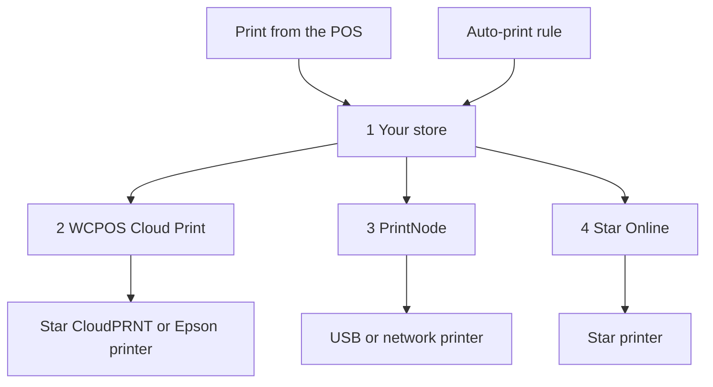

import LinkCards from '@site/src/components/LinkCards';
import LinkCard from '@site/src/components/LinkCard';

La stampa cloud invia le ricevute a una stampante tramite Internet, quindi la stampante non deve essere collegata al dispositivo su cui è in esecuzione il POS. Usala per una stampante su una rete diversa da quella della cassa, per una stampante in cucina che stampa autonomamente ogni ordine o per stampare una distinta di imballaggio per ogni vendita online.

Configuri una stampante cloud una sola volta, in **WP Admin → POS → Impostazioni → Stampa cloud**. Da quel momento compare su tutti i dispositivi e i cassieri possono usarla dal POS come qualsiasi altra stampante.

## Stampare dal POS {#manual}

Il sito del negozio genera la ricevuta per la stampante cloud a partire dall'ordine, quindi deve aver ricevuto la vendita prima che tu possa stampare.

1. Nella schermata di pagamento completato o nella finestra **Ricevuta** di un ordine, apri il menu **Stampante** e scegli la stampante cloud.
2. Premi **Stampa ricevuta**.
3. La schermata mostra **Stampato su** e il nome della stampante. Significa che il sito del negozio ha ricevuto il lavoro di stampa; verifica che la ricevuta sia uscita. In caso contrario, un responsabile può controllare cosa è successo nella [coda di stampa](#print-queue).

Vedi [Stampare la ricevuta](./at-checkout.mdx#print-receipt). Per inviare sempre un template a una stampante cloud, scegli la stampante per quel template in **Impostazioni → Stampa**: vedi [Instradamento della stampa](../hardware/printers/index.mdx#print-routing).

- **L'ordine deve essere presente sul sito del negozio.** Se il sito non ha ancora confermato la vendita, ad esempio perché è stata registrata offline, il POS mostra *Questa stampante stampa la copia del negozio e il negozio non ha ancora confermato questa vendita. Stampa di nuovo dopo la conferma.* Premi di nuovo **Stampa ricevuta** quando la cassa è online e il sito del negozio ha confermato la vendita. Mentre la cassa è offline, la stampa su una stampante cloud non riesce, anche per un ordine precedente.
- **I report di sessione e le chiusure** inviati a una stampante cloud aprono invece la finestra di stampa del sistema.
- **Un template HTML su una stampante cloud Star o Epson** mostra *Questa stampante cloud stampa solo template termici, quindi non verrà stampato nulla. Scegli un template termico.*

Le stampanti cloud compaiono automaticamente in **Impostazioni → Stampa** su ogni dispositivo, sotto **Stampanti**. La seconda riga indica il tipo, ad esempio *Star CloudPRNT · gestita da WCPOS*. Un cassiere può premere **Stampa di prova** sulla riga o **Copia report di configurazione** nel menu **⋯**, ma non può modificarla né eliminarla: queste operazioni si eseguono nella schermata **Stampa cloud**. Vedi [Configurazione della stampante](../hardware/printers/index.mdx#printers-list).

## Scegliere un tipo di stampante {#providers}

:::note Da qui in poi serve l'accesso a WP Admin
L'aggiunta di stampanti e regole spetta al titolare o al responsabile del negozio, in **WP Admin → POS → Impostazioni → Stampa cloud**.
:::

La schermata **Stampa cloud** chiede **Che tipo di stampante stai collegando?** Scegli il tipo corrispondente alla tua stampante.

- **Star CloudPRNT** — per una stampante Star con CloudPRNT integrato (mC-Print, TSP143IV…), se vuoi una connessione gratuita senza un altro account. La stampante recupera i lavori di stampa dal sito del negozio. *Solo template termici.*
- **Epson Server Direct Print** — per una stampante Epson TM «intelligente» (TM-T88VI/VII, TM-m30III, serie TM-i). La stampante recupera i lavori di stampa dal sito del negozio. *Solo template termici.*
- **Star Online** — per una stampante Star collegata a un account stario.online (mC-Print3, TSP143IV, mC-Label3). Il sito del negozio affida il lavoro di stampa a Star Online, che lo consegna alla stampante. *Solo template termici.*
- **PrintNode** — per una normale stampante USB o di rete, se puoi eseguire la piccola app PrintNode su un computer in negozio. Il sito del negozio affida il lavoro di stampa a PrintNode e l'app su quel computer lo stampa. *Qualsiasi template.*

Una stampante cloud Star o Epson non può stampare un template HTML: la ricevuta deve essere convertita nei comandi della stampante. Per i template HTML e a pagina intera, usa PrintNode. Vedi [Template termici](./thermal-templates.mdx).

<details>
<summary>Come i lavori di stampa raggiungono la stampante</summary>



<div className="pinned-legend">

1. **Il sito del negozio** — genera la ricevuta dall'ordine e dal template e conserva il lavoro nella [coda di stampa](#print-queue). Sia una stampa dal POS sia una [regola di stampa automatica](#auto-print) partono da qui.
2. **WCPOS Cloud Print** — il [relay](#relay). Una stampante Star CloudPRNT o Epson normalmente recupera i lavori di stampa tramite questo servizio, quindi un lavoro resta in attesa fino al contatto successivo della stampante.
3. **PrintNode** — il sito del negozio affida il lavoro di stampa a PrintNode e l'app PrintNode su un computer in negozio lo stampa.
4. **Star Online** — il sito del negozio affida il lavoro di stampa a Star Online, che lo consegna alla stampante.

</div>

</details>

## Aggiungere una stampante {#setup}

1. Vai in **WP Admin → POS → Impostazioni → Stampa cloud**. Sotto **Le tue stampanti cloud**, premi **+ Aggiungi una stampante**.
2. Scegli il tipo.
3. Inserisci un **Nome stampante**, ad esempio *Stampante cucina*. WCPOS genera l'**ID stampante** a partire dal nome. L'ID non può essere modificato in seguito; per cambiarlo, rimuovi la stampante e aggiungila di nuovo.
4. Completa i passaggi per il tipo scelto: [Star CloudPRNT o Epson](#setup-polling), [PrintNode](#setup-printnode) o [Star Online](#setup-star-online).
5. La stampante compare in una scheda sotto **Le tue stampanti cloud**. Premi **Stampa di prova** nella scheda. Vedi [La scheda della stampante](#status).

### Star CloudPRNT o Epson Server Direct Print {#setup-polling}

Queste stampanti recuperano autonomamente i lavori di stampa, quindi non c'è alcun account da collegare. Poiché è la stampante a contattare il sito del negozio, non devi aprire porte, impostare un IP statico o modificare il firewall. Il lavoro viene stampato al contatto successivo della stampante. L'ultimo passaggio di **+ Aggiungi una stampante** mostra l'**URL di polling** della stampante, che contiene un token segreto.

<details>
<summary>Collegare una stampante Star CloudPRNT o Epson</summary>

1. Premi **Copia** accanto all'**URL di polling**. L'indirizzo completo viene mostrato **una sola volta**. Se lo perdi, rimuovi la stampante e aggiungila di nuovo per ottenerne uno nuovo: **Configurazione e token** nella scheda lo mostra con il token nascosto.
2. Apri la pagina delle impostazioni della stampante e incolla l'indirizzo nel campo URL del server: nelle impostazioni **CloudPRNT** su una Star, nelle impostazioni **Server Direct Print** su una Epson. Attiva il polling, salva e riavvia la stampante.
3. Tornando alla scheda, lo stato passa da **In attesa della stampante** a **Connessa** quando la stampante effettua il primo recupero.

L'indirizzo normalmente inizia con `https://cloudprint.wcpos.com`. È il [relay WCPOS Cloud Print](#relay) ed è quello da usare. **Avanzate: connetti direttamente a questo sito (senza relay)** sotto l'indirizzo mostra invece un **URL diretto**; alcune stampanti non riescono a raggiungere direttamente un sito e restano nello stato **In attesa della stampante**.

Su una Epson, lascia **Server Direct Print** attivo per tutto il tempo in cui WCPOS stampa in questo modo. Vedi [Server Direct Print](../hardware/printers/server-direct-print.mdx).

</details>

### PrintNode {#setup-printnode}

PrintNode richiede che il suo client sia in esecuzione su un computer vicino alla stampante e una chiave API del tuo account PrintNode.

<details>
<summary>Collegare una stampante PrintNode</summary>

1. Su un computer vicino alla stampante, installa il client PrintNode e accedi. Per stampare, il computer deve essere acceso e il client in esecuzione.
2. Nel tuo account PrintNode, crea una chiave API.
3. In **+ Aggiungi una stampante**, scegli **PrintNode**, incolla la chiave in **Chiave API PrintNode** e premi **Recupera le mie stampanti**.
4. Sotto **Scegli una stampante**, seleziona quella indicata dal client e completa la procedura. L'ultimo passaggio mostra **Collegata a PrintNode**: non ci sono indirizzi o token da copiare.

</details>

Una volta collegata, imposta il **Formato di stampa** nella scheda della stampante:

- **PDF (consigliato)** stampa qualsiasi template, termico o HTML, come PDF. Mantieni questa impostazione, a meno che tu non abbia un motivo per cambiarla.
- **ESC/POS RAW — solo template termici** invia un template termico sotto forma di comandi per la stampante di ricevute anziché come PDF. I template HTML vengono comunque inviati come PDF.

### Star Online {#setup-star-online}

Star Online richiede l'indirizzo del gruppo della stampante e una chiave API, entrambi disponibili nel tuo account stario.online.

<details>
<summary>Collegare una stampante Star Online</summary>

1. In stario.online, apri **Gruppi di dispositivi** e copia l'**URL CloudPRNT** del gruppo. È simile a `https://device.stario.online/cloudprnt/...` oppure, nell'UE, a `https://eu-device.stario.online/cloudprnt/...`.
2. In stario.online, crea una chiave API con le autorizzazioni **EnumDevices**, **ViewDevice**, **PrintToDevice** e **ViewDeviceGroups**. Una chiave priva di queste autorizzazioni viene accettata, ma non consente di elencare i dispositivi né di stampare.
3. In **+ Aggiungi una stampante**, scegli **Star Online**. Incolla l'**URL CloudPRNT** e la **Chiave API Star Online**, poi premi **Recupera i miei dispositivi**.
4. Sotto **Scegli un dispositivo**, seleziona la stampante e completa la procedura. La scheda mostra quindi **Dispositivo**, **Gruppo** e **AccessIdentifier**.

</details>

## La scheda della stampante {#status}

Ogni stampante cloud ha una scheda sotto **Le tue stampanti cloud**:

- **Il nome** — fai clic per rinominare la stampante. Il tipo è indicato sotto il nome.
- **Lo stato** — vedi l'elenco qui sotto. Si aggiorna ogni 30 secondi.
- **Ultimo contatto** — quando una stampante Star CloudPRNT o Epson ha effettuato l'ultimo recupero, oppure *mai*.
- **ID stampante** — fissato al momento dell'aggiunta della stampante.
- **Formato di stampa** — solo per PrintNode: **PDF (consigliato)** o **ESC/POS RAW — solo template termici**. Vedi [PrintNode](#setup-printnode).
- **Stampa di prova** — invia una breve pagina di prova. Un messaggio mostra *Stampa di prova inviata a …* oppure il motivo dell'errore.
- **Azioni stampante** (**⋮**) — **Configurazione e token** riapre l'ultimo passaggio della configurazione; **Rimuovi stampante** impedisce alla stampante di ricevere lavori di stampa. Puoi aggiungerla di nuovo in seguito.

<details id="status-polling">
<summary>Stati di Star CloudPRNT ed Epson Server Direct Print</summary>

- **In attesa della stampante** — la stampante non ha ancora effettuato alcun recupero. Controlla l'URL di polling nella stampante: vedi [Bloccata su In attesa della stampante](#trouble-polling).
- **Connessa** — la stampante ha effettuato un recupero negli ultimi due minuti e mezzo.
- **Offline** — la stampante ha già effettuato recuperi, ma non di recente. Verifica che sia accesa e online.
- **Bloccata** — il relay non riesce a raggiungere il sito del negozio. La scheda indica il motivo: un servizio di sicurezza come Cloudflare o un plugin firewall lo blocca, oppure il sito ha risposto con un errore del server. Vedi [Problemi con Star CloudPRNT o Epson](#trouble-polling).

</details>

<details id="status-services">
<summary>Stati di Star Online e PrintNode</summary>

- **Online** — il servizio indica che la stampante è disponibile.
- **Offline** — il servizio indica che la stampante o il computer con PrintNode non è disponibile. Per PrintNode, verifica che il computer non sia in sospensione e che il client sia in esecuzione.
- **Sconosciuto** — WCPOS non è riuscito a ottenere lo stato dal servizio. Controlla la chiave API in [PrintNode](#setup-printnode) o [Star Online](#setup-star-online).

</details>

## Stampare gli ordini automaticamente {#auto-print}

Le regole di stampa automatica stampano gli ordini senza che nessuno debba premere nulla. Sono facoltative: senza regole, le stampanti cloud stampano solo quando un cassiere avvia la stampa dal POS.

Sotto **Regole di stampa automatica**, premi **+ Aggiungi regola**. Ogni regola si legge come una frase e ogni parte sottolineata è un menu:

> Stampa automaticamente **ogni ordine in negozio (POS)** su **Stampante cucina** usando il template **Comanda cucina**, **2 copie**, **appena viene creato**.

- **Quali ordini** — **ogni ordine**, **ogni ordine in negozio (POS)** o **ogni ordine online**. Con WCPOS Pro, anche **ordini per** un singolo negozio: vedi [Stampanti per negozio](#per-store-printers).
- **Stampante** — una delle tue stampanti cloud.
- **Template** — vengono proposti solo i template che la stampante può stampare. I template provengono da **POS › Template**.
- **Copie** — da 1 a 5.
- **Quando** — **dopo il pagamento** (impostazione predefinita) oppure **appena viene creato**. Per un ordine POS, la creazione coincide con il primo salvataggio del carrello, quindi la comanda per la cucina viene stampata prima del pagamento.

Più regole possono stampare lo stesso ordine, ad esempio una comanda per la cucina e una ricevuta per il cliente. Una regola stampa un determinato ordine una sola volta. La ricevuta viene generata sul sito del negozio a partire dall'ordine e dal template, quindi il cassiere non deve fare nulla. Le stampe automatiche non aprono mai il cassetto portadenaro.

Se cambi la stampante di una regola scegliendone una che non può stampare il template previsto, la regola passa al primo template che la stampante può stampare: verifica quindi che sia quello desiderato. Se la stampante non può stampare nessuno dei tuoi template, il campo del template resta vuoto e la regola non stampa finché non ne scegli uno.

### Stampanti per negozio (Pro) {#per-store-printers}

Con [WCPOS Pro](../getting-started/pro-license.mdx) e più di un [negozio](../stores/index.mdx), il menu **Quali ordini** elenca anche **ordini per** ciascun negozio. Una regola per un negozio stampa gli ordini che appartengono a quel negozio: quelli registrati dalle sue casse e qualsiasi ordine che gli assegni nella schermata di modifica dell'ordine. Gli ordini online non appartengono a nessun negozio finché non ne assegni uno, quindi vengono stampati solo dalle regole valide per tutti i negozi.

Le regole si sommano: un ordine di un negozio viene stampato dalle regole di quel negozio **e** da tutte le regole per **ogni ordine**, **ogni ordine in negozio (POS)** o **ogni ordine online**. Per evitare che le comande di un punto vendita finiscano sulla stampante di un altro, assegna a ciascun punto vendita una regola specifica per il negozio e non aggiungere una regola valida per tutti i negozi per quella comanda.

## La coda di stampa {#print-queue}

Sotto le regole, la **Coda di stampa** elenca tutti i lavori: **Ordine**, **Stampante**, **Template**, **Stato**, **Dettaglio** e **Creato**. Il numero dell'ordine è un link all'ordine.

- Usa **Filtra** per filtrare per stato (**Richiede attenzione**, **Tutti gli stati** oppure uno tra **In attesa**, **In stampa**, **Stampato**, **Fallito**, **Annullato**) e per stampante.
- Usa **Annulla** per un lavoro in attesa, **Riprova** per uno fallito (ricompare come nuovo lavoro, *Riprovato come #…*) oppure **Elimina** per eliminare un lavoro. Seleziona più righe per usare **Annulla selezionati** o **Elimina selezionati**.
- **Dettaglio** indica perché un lavoro è fallito, ad esempio *Star Online ha rifiutato la richiesta. Verifica che la chiave API abbia le autorizzazioni necessarie.*

Quando una stampante Star CloudPRNT o Epson ha ricevute in attesa e non ha effettuato recuperi da 10 minuti, o non ne ha mai effettuati, un avviso indica il nome della stampante, l'ultimo recupero e quante ricevute sono in attesa, e offre l'opzione **Annulla tutto**.

:::warning Un lavoro mai confermato dalla stampante
*La stampante non ha mai confermato questo lavoro* significa che WCPOS non può sapere se sia stato stampato. Non viene reinviato automaticamente, perché potrebbe essere stampato due volte. Controlla la stampante e premi **Riprova** solo se non è uscito nulla.
:::

<details>
<summary>Conservazione dei lavori di stampa e nuovi tentativi</summary>

I lavori stampati e annullati vengono eliminati dopo 7 giorni, quelli falliti dopo 30. Uno sviluppatore può modificare questi intervalli con i filtri `wcpos_print_job_retention_days` e `wcpos_print_job_failed_retention_days`.

Per un lavoro che WCPOS affida a PrintNode o Star Online vengono effettuati tre tentativi, a distanza prima di uno e poi di due minuti. Se il servizio rifiuta una chiave o un account, il lavoro fallisce subito e il motivo compare in **Dettaglio**.

</details>

## WCPOS Cloud Print, il relay {#relay}

L'URL di polling di una stampante Star CloudPRNT o Epson punta a **cloudprint.wcpos.com**, non al tuo sito. È **WCPOS Cloud Print**, un relay gratuito gestito da WCPOS che fa da tramite tra le stampanti e il sito del negozio.

Non c'è nulla da attivare. I lavori di stampa passano attraverso il relay prima di raggiungere la stampante: il collegamento condivide quindi l'indirizzo del tuo sito con wcpos.com e le ricevute, che includono i dettagli dell'ordine, transitano attraverso il servizio. Vedi l'[informativa sulla privacy](https://wcpos.com/privacy).

<details>
<summary>Come funziona il relay</summary>

Le stampanti di ricevute eseguono firmware essenziali che vengono aggiornati raramente. Molte non riescono a stabilire una connessione sicura con un negozio su un hosting moderno oppure vengono respinte da un servizio come Cloudflare che protegge il sito. La stampante resta quindi nello stato **In attesa della stampante** anche se tutte le impostazioni sono corrette. Il relay offre alla stampante una connessione che è in grado di stabilire e inoltra le sue richieste al sito del negozio.

- Il tuo sito si connette automaticamente al relay la prima volta che apri **Stampa cloud**.
- Il relay richiede che il sito utilizzi **HTTPS**. In caso contrario, **Stampa cloud** lo segnala.
- Se il sito non riesce a connettersi al relay, ad esempio se è un sito di prova locale, l'URL di polling punta direttamente al sito.
- Lo stato **Bloccata** su una scheda significa che il relay ha raggiunto il sito ma è stato respinto. Consenti l'accesso al relay nel servizio di sicurezza, come indicato nella scheda. Vedi [Problemi con Star CloudPRNT o Epson](#trouble-polling).

</details>

<details>
<summary>Disattivare il relay (sviluppatori)</summary>

L'ultimo passaggio della configurazione di una stampante Star CloudPRNT o Epson include **Avanzate: connetti direttamente a questo sito (senza relay)** con il relativo **URL diretto**. Per disattivare il relay per l'intero sito:

```php
add_filter( 'wcpos_cloud_print_relay_enabled', '__return_false' );
```

Prima di WCPOS 2.0 questo filtro si chiamava `woocommerce_pos_cloud_print_relay_enabled`. Quel nome funziona ancora, è deprecato dalla versione 2.0 e verrà rimosso non prima della versione 2.2. Vedi [Nomi degli hook](../extensions/index.mdx#hook-naming).

</details>

<details>
<summary>Come una ricevuta raggiunge una stampante Star CloudPRNT</summary>

WCPOS propone alla stampante prima i comandi StarPRNT, poi un'immagine PNG della ricevuta e infine testo semplice, e usa il formato migliore tra quelli che la stampante dichiara di poter leggere. I modelli Star meno recenti che leggono solo Line Mode (TSP650II, TSP700II, TSP800II) ricevono i loghi solo tramite l'immagine. Per l'immagine servono le estensioni PHP GD e FreeType sul server. Le stampanti Epson ricevono ePOS-Print XML; Star Online riceve Star Document Markup.

</details>

## Se qualcosa non funziona {#troubleshooting}

**Il POS ha stampato su una stampante cloud, ma non è uscita nessuna ricevuta.** Il POS sa soltanto che il sito del negozio ha ricevuto il lavoro. Apri la [coda di stampa](#print-queue) e trova l'ordine:

- **In attesa** — la stampante non ha ancora prelevato il lavoro. Controlla lo stato della stampante nella sua scheda: [Stati di Star CloudPRNT ed Epson Server Direct Print](#status-polling) o [Stati di Star Online e PrintNode](#status-services).
- **In stampa** — il lavoro è in corso di invio e la stampante non ha ancora confermato di averlo stampato.
- **Fallito** — **Dettaglio** indica il motivo. Risolvi il problema, poi premi **Riprova**. Se **Dettaglio** mostra *La stampante non ha mai confermato questo lavoro*, potrebbe averlo stampato: controlla la stampante prima di premere **Riprova**.
- **Stampato** — la stampante, PrintNode o Star Online ha ricevuto il lavoro. Controlla la carta e verifica che la colonna **Stampante** indichi la stampante davanti a te.

**Il mio template non viene proposto.** Le stampanti Star CloudPRNT, Epson e Star Online accettano solo [template termici](./thermal-templates.mdx). Scegline uno oppure stampa tramite PrintNode.

### Problemi con Star CloudPRNT o Epson {#trouble-polling}

**Bloccata su In attesa della stampante.** La stampante non ha mai raggiunto il sito del negozio. Verifica che l'URL di polling nella stampante corrisponda esattamente: basta un carattere errato per far respingere ogni richiesta di recupero. Se hai dubbi, rimuovi la stampante e aggiungila di nuovo per ottenere un nuovo URL. Assicurati che il polling sia attivo nelle impostazioni **CloudPRNT** o **Server Direct Print** della stampante, poi riavviala. Se hai usato l'**URL diretto**, passa all'indirizzo `cloudprint.wcpos.com`: [il relay serve proprio a questo](#relay).

**Bloccata.** Un servizio di sicurezza o un plugin firewall respinge il relay, oppure il sito restituisce errori del server. Segui il messaggio sulla scheda; in caso di errore del server, controlla lo stato di salute del sito e i log degli errori.

**Configurata prima che esistesse il relay.** Gli indirizzi già salvati in una stampante continuano a funzionare. Se la stampante resta nello stato **In attesa della stampante**, rimuovila e aggiungila di nuovo, poi inserisci nella stampante il nuovo indirizzo `cloudprint.wcpos.com`.

### Problemi con PrintNode {#trouble-printnode}

**Recupera le mie stampanti non riesce.** Controlla la chiave API e verifica che il client PrintNode sia in esecuzione sul computer.

**Un lavoro PrintNode non viene mai stampato.** Il client deve essere in esecuzione e online: un computer in sospensione non stampa nulla. Verifica di aver scelto la stampante indicata dal client e che la chiave non sia stata revocata.

### Problemi con Star Online {#trouble-star-online}

**Recupera i miei dispositivi non riesce.** Il messaggio è *Impossibile elencare i tuoi dispositivi Star Online. Controlla l'URL CloudPRNT e la chiave API.* Verifica che la chiave sia stata copiata per intero, non sia stata revocata e appartenga allo stesso account stario.online e alla stessa regione dell'URL. Poi verifica che la chiave abbia le autorizzazioni indicate in [Star Online](#setup-star-online). *Nessun dispositivo trovato in questo gruppo Star Online* significa che il gruppo non contiene dispositivi oppure che l'URL appartiene a un altro gruppo.

## Documentazione correlata {#related-documentation}

<LinkCards>
  <LinkCard to="/hardware/receipt-printers" title="Configurazione della stampante" description="Aggiungi una stampante sul dispositivo e associa i template alle stampanti" />
  <LinkCard to="/sell/print-email-receipts" title="Ricevute alla cassa" description="Stampa, invia per email e ristampa la ricevuta" />
  <LinkCard to="/settings/receipt-templates/thermal-templates" title="Template termici" description="Crea ricevute per stampanti Star ed Epson" />
</LinkCards>
