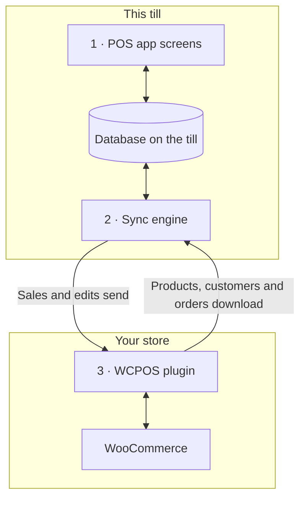

import LinkCards from '@site/src/components/LinkCards';
import LinkCard from '@site/src/components/LinkCard';
import JourneyShot from '@site/src/components/JourneyShot';
import manifest from '@site/static/img/2.x/reference/architecture/en/manifest.json';

WCPOS è composto da due parti: un plugin sul tuo sito WordPress e l'app POS su ogni cassa. La cassa effettua le vendite usando una propria copia dei dati del negozio e la mantiene sincronizzata con WooCommerce in background. Questa pagina spiega dove risiedono i dati e quali raggiungono il server, per gli sviluppatori e i negozianti che vogliono saperne di più.

Cerchi la soluzione a un problema invece di una descrizione dell'architettura?

- **Aggiornamento dell'app:** prima [verifica che la cassa abbia inviato tutto](../getting-started/previous-versions.mdx#check-sync). Vedi [Sincronizza prima di aggiornare](#storage).
- **Un prodotto manca sulla cassa:** vedi [Quando un prodotto manca o non è aggiornato](../products/sync.mdx#goes-wrong).
- **Una vendita non ha raggiunto il negozio:** vedi [Vendite in attesa di invio](../getting-started/offline.mdx#offline-writes).

## Le due parti {#two-part-system}

1. **L'app POS** viene eseguita su ogni cassa: nel browser all'indirizzo `/pos/` del tuo sito (l'indirizzo può essere modificato), nell'app desktop o nelle app iOS e Android. Vedi [Installazione](../getting-started/installation.mdx) per i requisiti di ciascuna. Ogni schermata legge e scrive in un database sulla cassa, quindi una ricerca o l'aggiunta di un articolo non deve mai attendere il server.
2. **Il motore di sincronizzazione** nell'app trasferisce le modifiche in entrambe le direzioni. Scarica le modifiche del negozio e invia quelle effettuate sulla cassa.
3. **Il plugin WCPOS** viene eseguito sul tuo sito WordPress e collega la cassa a WooCommerce. WooCommerce rimane la fonte autorevole per ogni prodotto, cliente e ordine.

## Cosa conserva la cassa sul dispositivo {#local-database}

**Stato di salute** → **Database** mostra la copia dei dati del negozio presente sulla cassa: una riga per ogni tipo di record, con il numero di record sul dispositivo (**Sul dispositivo**) e nel negozio (**Sul server**). Le funzioni del menu di ogni riga sono descritte in [Stato di salute del negozio](../support/store-health.mdx#coverage).

<JourneyShot manifest={manifest} device="tablet" step={1} offsets={[[186, 0], [186, 0], [186, 0], [186, 0], [186, 0], [186, 0], [186, 0], [186, 0]]} alt="Stato di salute, scheda Database: la tabella dei record su questa cassa, da Prodotti ad Aliquote fiscali, ciascuno con il conteggio sul dispositivo, il conteggio sul server, la copertura e le dimensioni">

1. **Prodotti** — un primo gruppo di 100 nell'ordinamento predefinito del POS (nome, dalla A alla Z), poi i restanti quando la cassa è inattiva. Vedi [Download e sincronizzazione](../products/sync.mdx).
2. **Variazioni** — vengono scaricate insieme ai rispettivi prodotti.
3. **Ordini** — gli ordini aperti e recenti rimangono sulla cassa. Quelli più vecchi vengono scaricati quando qualcuno li apre.
4. **Rimborsi** — i rimborsi degli ultimi 92 giorni, più quelli relativi agli ordini che hai aperto.
5. **Clienti** — vengono scaricati un po' alla volta quando la cassa è inattiva.
6. **Categorie** — con **Marchi** e **Tag** subito sotto.
7. **Coupon** — presenti sulla cassa con o senza Pro.
8. **Aliquote fiscali** — le aliquote fiscali del negozio.

</JourneyShot>

Un badge rosso **N bloccati** su una riga indica che alcuni record di quel tipo richiedono il tuo intervento. Vedi [Record che richiedono attenzione](../support/store-health.mdx#stuck-records).

Sopra la tabella, il dato da tenere d'occhio è **modifiche in attesa di invio**: vendite e modifiche effettuate su questa cassa che il negozio non ha ancora ricevuto. Rimangono sul dispositivo fino alla ricezione. Gli ordini aperti che non hai sincronizzato e le modifiche elencate in un pannello non sono conteggiati e non hanno ancora raggiunto il negozio. Vedi [Vendite in attesa di invio](../getting-started/offline.mdx#offline-writes).

Record conservati al di fuori di questa tabella

Alcuni dati risiedono al di fuori di questa tabella. Metodi di pagamento, classi fiscali, metodi di spedizione e stati degli ordini vengono letti dal negozio a ogni avvio dell'app; l'ultima risposta viene conservata per quando la cassa è offline. Sessioni di cassa, chiusure e movimenti di contante hanno record propri e una propria coda di invio al negozio.

### Come viene conservato il database {#storage}

Ogni cassiere di ogni negozio ha una propria copia sulla cassa e, nel browser, una sola scheda alla volta esegue il POS per un sito. Quando un aggiornamento dell'app cambia il modo in cui la copia viene memorizzata, la cassa la scarica di nuovo.

:::warning Sincronizza prima di aggiornare
Le vendite e le modifiche ancora in attesa nella vecchia copia non vengono inviate. Prima di aggiornare l'app, verifica in **Stato di salute** → **Database** che **modifiche in attesa di invio** indichi 0 e che non ci siano pannelli sotto i dati, poi sincronizza ogni ordine aperto. Vedi [Verifica che una cassa abbia inviato tutto](../getting-started/previous-versions.mdx#check-sync).
:::

Dettagli per sviluppatori: motore di archiviazione, schede e aggiornamenti dell'app

- **Un database per sito, negozio e cassiere.** Due cassieri su una cassa, o un cassiere in due negozi, non condividono mai i dati locali.
- **SQLite su ogni piattaforma.** Nel browser, SQLite usa lo spazio di archiviazione privato dei file del browser ed è eseguito in un unico worker; nelle app iOS e Android viene usato SQLite di sistema; l'app desktop conserva i dati in SQLite nel processo principale dell'app.
- **Conservato su disco.** La copia della cassa rimane disponibile dopo la chiusura del browser o dell'app e il riavvio del dispositivo.
- **Una scheda attiva per sito.** Nel browser, una scheda esegue il POS per un sito. Se ne apri una seconda, questa propone di subentrare; la prima si arresta.
- **Gli elenchi vengono elaborati nel database.** Filtri, ordinamento e paginazione vengono eseguiti nel database quando possibile, così un elenco di migliaia di ordini passa alla schermata solo le righe da mostrare.
- **Nessuna migrazione sul posto.** Quando un aggiornamento dell'app cambia la struttura del database, l'app apre un database nuovo e scarica di nuovo i dati dal negozio. Le modifiche ancora in attesa nel vecchio database non vengono inviate e gli ordini aperti non vengono trasferiti: sincronizza la cassa prima di aggiornare l'app.

## Come la cassa e il negozio rimangono sincronizzati {#data-synchronization}

Il motore di sincronizzazione non replica l'intero negozio a intervalli fissi. Si basa sulle esigenze delle schermate della cassa e riduce al minimo le richieste al server.

- **Verifica delle modifiche.** La cassa chiede al negozio cosa è cambiato con la frequenza indicata dal suo [profilo di sincronizzazione](../support/store-health.mdx#sync-presets) (**Eco**, **Bilanciato** o **Tempo reale**). Ogni cassa conserva il proprio profilo: cambiarlo su una cassa non modifica le altre.
- **Le esigenze della schermata.** Ogni schermata comunica al motore cosa sta mostrando. Il motore risponde usando il database della cassa quando contiene già i record e interroga il negozio solo quando mancano.
- **In background.** Il primo gruppo di prodotti e gli ordini aperti e recenti vengono scaricati per primi. Gli altri prodotti e clienti seguono quando la cassa è inattiva.
- **Invio delle modifiche.** Ogni vendita o modifica viene prima salvata sulla cassa, poi inviata al negozio. Una modifica rifiutata dal negozio non viene mai ritentata automaticamente: rimane sotto **N modifiche non hanno mai raggiunto il server**, con **Invia di nuovo** e **Scarta**. Vedi [Stato di salute del negozio](../support/store-health.mdx#refused-changes).

Dettagli per sviluppatori: flusso delle modifiche, limiti delle richieste e corsie

- Un negozio senza novità risponde alla verifica delle modifiche con `304 Not Modified` e senza corpo della risposta.
- Le scritture passano attraverso una coda persistente sulla cassa, che le invia tramite POST a `wcpos/v2/push/{collection}`.
- I limiti delle richieste, gli intervalli progressivi tra i tentativi e i dati misurati sono descritti in [Prestazioni della sincronizzazione](./sync-performance.mdx). Tutte le corsie sono descritte in [Come funziona il motore di sincronizzazione](./sync-engine.mdx).

## Come la procedura di pagamento registra una vendita {#checkout-architecture}

La procedura di pagamento fa parte del POS. La cassa gestisce direttamente ogni pagamento e lo registra su un unico ordine WooCommerce, invece di aprire la pagina di pagamento dell'ordine di WooCommerce per ogni vendita.

:::warning Per pagare offline serve una vendita già presente nel negozio
È possibile incassare un pagamento offline solo per una vendita che ha raggiunto il negozio prima dell'interruzione della connessione: il numero d'ordine appare sopra gli articoli in [Cassa](../pos/checkout/index.mdx). Una vendita iniziata dopo l'interruzione rimane in attesa sulla cassa e viene pagata quando il negozio torna raggiungibile. Vedi [Incassare un pagamento offline](../getting-started/offline.mdx#take-payment-offline).
:::

- **Un riquadro per ogni metodo.** La cassa mostra un riquadro per ogni metodo di pagamento attivato per il POS. Un metodo che non può gestire appare disattivato con il motivo, senza mai essere nascosto. Vedi [Quando un riquadro non può essere usato](../payment/index.mdx#unavailable-tiles).
- **Un ordine, più pagamenti.** Una vendita con pagamento suddiviso rimane un unico ordine WooCommerce, con un solo insieme di articoli, imposte, variazioni di magazzino e un solo numero d'ordine, così i report la conteggiano una volta sola. Un rimborso è un normale rimborso WooCommerce, ripartito tra i pagamenti da rimborsare.
- **Decide il negozio.** Dopo ogni pagamento, il negozio risponde indicando quanto è stato pagato e quanto resta da pagare; la cassa completa la vendita in base ai dati del negozio, non ai propri.
- **Tentativi ripetuti sicuri.** Ogni pagamento ha un ID creato dalla cassa, quindi un pagamento inviato due volte viene registrato una sola volta.
- **Offline.** Per una vendita già presente nel negozio, il pagamento in Contanti viene completato anche se la connessione si interrompe: il pagamento viene registrato come **Regolato in seguito** e inviato al ripristino della connessione. Vedi [Incassare un pagamento offline](../getting-started/offline.mdx#take-payment-offline).

Modalità di acquisizione e route dei pagamenti

`GET wcpos/v2/payment-methods` descrive ogni gateway di pagamento: il suo `kind` (`cash`, `card`, `stored_value`, `bank_transfer` o `other`), come incassa il denaro (`capture`) e cosa consente (`capabilities`: importi parziali, resto, rimborsi, mance, offline, annullamento). Ogni pagamento è una riga nei metadati `_wcpos_payments` dell'ordine e, dopo ogni pagamento, il negozio risponde con `paid` e `balance` dell'ordine.

Il valore `capture.mode` di ciascun metodo indica chi incassa il denaro. Ogni chiamata di pagamento viene inviata al gestore registrato per la relativa modalità.

| Modalità | Come viene incassato il denaro | Plugin |
| --- | --- | --- |
| `manual` | Il cassiere lo incassa e lo registra. È la modalità predefinita per Contanti, Carta, Pagamento alla consegna, Bonifico bancario diretto e Pagamenti con assegno. | Gratuito |
| `webview` | La pagina di pagamento del gateway di pagamento, nella scheda **Legacy** della procedura di pagamento. È la modalità predefinita per tutti gli altri gateway di pagamento. Vedi [Quando la pagina di pagamento della scheda Legacy non si carica](../payment/index.mdx#legacy-notices). | Gratuito |
| `gateway` | Il metodo `process_payment()` del gateway di pagamento viene eseguito con i valori raccolti dalla cassa. Un gateway di pagamento aderisce tramite un filtro. | Gratuito |
| `server` | Il negozio chiede al fornitore del terminale per carte di incassare il pagamento. | Pro |
| `device` | La cassa controlla il lettore di carte tramite l'SDK del fornitore e il fornitore conferma il pagamento. | Pro |

Le route dei pagamenti sono associate all'ordine tramite il suo ID WooCommerce:

- `POST wcpos/v2/orders/{id}/payments` registra un pagamento. L'ID del pagamento rende sicuro ripetere il tentativo.
- `.../payments/{uuid}/intent`, `/capture`, `/void` e `/refund` (`POST`), e `/status` (`GET`), agiscono su un singolo pagamento. Ogni comando include il proprio ID di comando.
- `POST wcpos/v2/orders/{id}/close` completa l'ordine.

Ogni comando include la `revision` dell'ordine; un comando che ne è privo viene rifiutato con `428`.

Per creare un gateway di pagamento dedicato al POS, parti dal [Template per gateway di pagamento](./gateway-template.mdx).

## Perché alcune modifiche al sito non raggiungono la cassa {#api-extensions}

La cassa riceve prodotti, clienti e ordini dal plugin WCPOS, che li legge da WooCommerce. Un plugin che modifica i dati inviati da WooCommerce alle app ha effetto sulla cassa. Un plugin che modifica solo l'aspetto del sito o solo la procedura di pagamento online non ne ha. Per verificare un plugin, parti da [Comprendere la REST API di WooCommerce](./wc-rest-api.mdx).

Dettagli per sviluppatori: versioni delle API

La cassa comunica con il negozio solo attraverso le route REST del plugin, che leggono i dati da WooCommerce all'interno del sito. Il plugin registra due namespace accanto al namespace `wc/v3` di WooCommerce.

- **`wcpos/v2`** è quello usato dall'app: lettura dei record, flusso delle modifiche, coda delle modifiche, pagamenti, registratori di cassa e sessioni. Le sue route di lettura inoltrano le richieste a `wc/v3` all'interno del sito, quindi un plugin che modifica le risposte REST di WooCommerce modifica ciò che vede la cassa.
- **`wcpos/v1`** viene ancora registrato. Le sue route dei dati (prodotti, variazioni, ordini, clienti, coupon, imposte, categorie, tag, marchi) sono congelate. Le sue route di servizio (negozi, impostazioni, ricevute, template, processi di stampa e altro) usano lo stesso codice delle versioni `wcpos/v2`.

### Aggiornamenti dell'app e altri strumenti di sincronizzazione {#wcpos-v2-namespace}

L'app e il plugin vengono aggiornati insieme: una cassa con un'app più vecchia di quella richiesta dal plugin mostra [SYNC341](../error-codes/SYNC341.mdx) finché l'app non viene aggiornata. I prezzi POS delle righe d'ordine vengono memorizzati dove altri strumenti di sincronizzazione possono leggerli; vedi [Come vengono memorizzate le sostituzioni dei prezzi POS](./pos-discounts.mdx#how-pos-price-overrides-are-stored).

Dettagli per sviluppatori: richieste, accesso e ID degli ordini

- **Le route vengono caricate per le richieste POS.** Il plugin registra le proprie route solo per le richieste a esse destinate: una route `wcpos/`, un header `X-WCPOS` o `?wcpos=1`. Il restante traffico REST del sito non le carica.
- **L'app e il plugin avanzano insieme.** Ogni richiesta dell'app include `X-WCPOS-Protocol`. Un plugin che richiede un protocollo più recente risponde `426` con `wcpos_update_required` e la cassa mostra [SYNC341](../error-codes/SYNC341.mdx) finché l'app non viene aggiornata.
- **Route pubbliche.** `wcpos/v2/site`, `wcpos/v2/ping` e `wcpos/v2/echo` non richiedono l'accesso. L'app le usa per trovare il sito e verificare la connessione prima che qualcuno acceda. Sugli hosting che nascondono `/wp-json/` o rimuovono gli header, l'app usa come alternativa l'indirizzo `/?rest_route=` di WordPress e le forme degli header nei parametri della query (`?wcpos=1`, `wcpos_protocol`). Se nessuna alternativa risponde, la cassa mostra [AUTH431](../error-codes/AUTH431.mdx).
- **Accesso.** L'app effettua l'accesso tramite la pagina `/wcpos-auth` del sito e riceve un token di accesso JWT valido per 30 minuti e un token di rinnovo valido per 30 giorni. I filtri `wcpos_jwt_access_token_expire` e `wcpos_jwt_refresh_token_expire` ne modificano la durata. Per sapere quali ruoli possono accedere alle varie route, vedi [Accesso agli endpoint per ruolo](./role-endpoint-access.mdx).
- **Gli ordini includono un UUID.** La cassa crea un UUID per ogni ordine, lo invia come metadato `_woocommerce_pos_uuid` e il negozio lo conserva. Il recupero degli ordini usa l'UUID come chiave.
- **I prezzi POS delle righe d'ordine** vengono memorizzati in modo che altri strumenti di sincronizzazione possano leggerli. Vedi [Come vengono memorizzate le sostituzioni dei prezzi POS](./pos-discounts.mdx#how-pos-price-overrides-are-stored).
- **Negozi (Pro).** Con più negozi, la cassa invia il proprio negozio nell'header `X-WCPOS-Store` e il plugin lo passa a WooCommerce come `store_id`. Il negozio di un ordine proviene dalla voce `_pos_store` nei suoi metadati. Le route di Pro per modificare i negozi e associare un display cliente vengono registrate in entrambi i namespace.

:::info Con WCPOS Pro
Pro aggiunge i lettori di carte, la modifica dei negozi e l'associazione di un display cliente. Con più negozi, ogni negozio ha i propri prezzi sulla cassa. Vedi [Configurazione dei negozi](../stores/setup.mdx).
:::

## Vantaggi e costi dell'architettura {#architecture-pros-and-cons}

- **Ricerca e carrello istantanei.** Entrambi leggono il database della cassa.
  - **Il costo:** la copia sulla cassa deve rimanere sincronizzata con il negozio. Questo è l'intero compito del motore di sincronizzazione.
- **Vendite anche senza connessione.** Vendite e modifiche rimangono in attesa sulla cassa e vengono inviate al ripristino della connessione. Il pagamento in Contanti viene comunque completato per una vendita già presente nel negozio.
  - **Il costo:** una vendita iniziata dopo l'interruzione della connessione viene pagata solo quando il negozio torna raggiungibile. Vedi [Incassare un pagamento offline](../getting-started/offline.mdx#take-payment-offline).
- **App progettate per una cassa.** App desktop, iOS e Android, non una pagina web in un riquadro.
  - **Il costo:** il POS vede il negozio solo attraverso la REST API. Temi e hook di WordPress non possono modificarne l'aspetto e un plugin che modifica solo la procedura di pagamento web o il tema non ha effetto sulla cassa. Vedi [Perché alcuni plugin non funzionano nel POS?](./wc-rest-api.mdx#why-dont-some-plugins-work-in-the-pos)

## Documentazione correlata {#related-documentation}

<LinkCards>
  <LinkCard title="Come funziona il motore di sincronizzazione" to="/developers/sync-engine" description="Corsie, flusso delle modifiche e coda delle modifiche, in dettaglio." />
  <LinkCard title="Stato di salute del negozio" to="/troubleshooting/store-health" description="Consulta il database della cassa, i profili di sincronizzazione e le modifiche in attesa di invio." />
  <LinkCard title="Comprendere la REST API di WooCommerce" to="/developers/woocommerce-rest-api" description="Cos'è la REST API e perché alcuni plugin non hanno effetto sul POS." />
</LinkCards>
