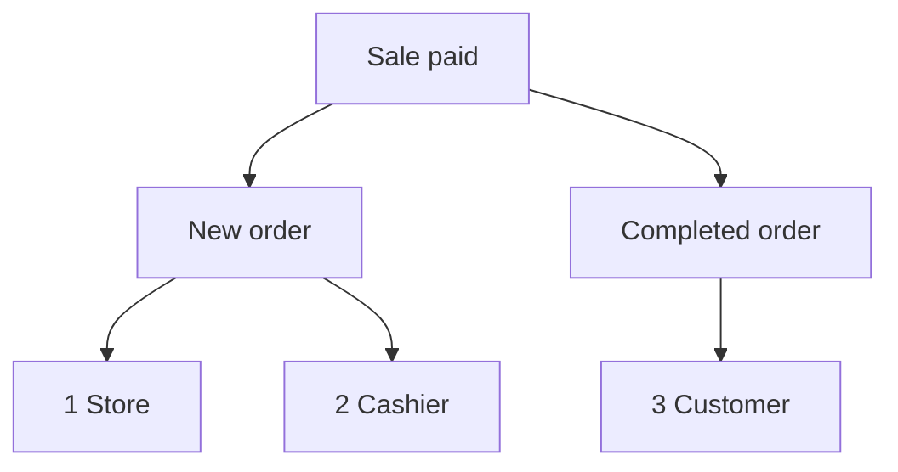

import Accordion from '@site/src/components/Accordion';
import AccordionItem from '@site/src/components/AccordionItem';
import LinkCards from '@site/src/components/LinkCards';
import LinkCard from '@site/src/components/LinkCard';

**WP admin:** `WP Admin → POS → Settings → Checkout`.

WooCommerce invia email relative agli ordini: un'email Nuovo ordine a te, un'email Ordine completato al cliente e così via. Per le vendite effettuate nel POS, qui scegli quali email inviare e a chi. Gli ordini online mantengono le normali impostazioni email di WooCommerce.

Vai direttamente a: [Email amministratore](#admin-emails) · [Email cliente](#customer-emails) · [Inviare una ricevuta manualmente](#send-receipt-manually) · [Email cassiere](#cashier-emails) · [Scenari comuni](#common-scenarios) · [Se qualcosa non funziona](#goes-wrong)

## Attivare o disattivare le email {#switches}

:::note Per le vendite POS
Per gli ordini POS, questi interruttori prevalgono su **Abilita questa notifica email** in **WooCommerce > Impostazioni > Email**. Un'email disattivata in WooCommerce può comunque essere inviata se la relativa casella è selezionata qui.
:::

1. In WP Admin, vai su **POS > Impostazioni > Cassa**.
2. Trova i tre interruttori delle email sotto **Impedisci vendite oltre la disponibilità**: **Email amministratore**, **Email cliente** ed **Email cassiere**. L'elenco **Gateway di pagamento** si trova subito sotto.
3. Attiva un interruttore per visualizzare una casella per ogni email del gruppo. Deseleziona un'email per bloccare solo quella.
4. Disattiva un interruttore per impedire l'invio di tutte le email del gruppo per le vendite POS, indipendentemente dalle caselle selezionate.

Ogni modifica viene salvata immediatamente: sullo schermo compare **Salvataggio in corso**, poi **Salvato**.

{/* reshoot: WP Admin > POS > Settings > Checkout with all three email switches on and their checkboxes showing; see reshoot.md */}

A chi invia le email ciascun interruttore e qual è il suo stato all'installazione:

- **Email amministratore**: attivo all'installazione\
  Agli indirizzi indicati in **Destinatario/i** per quell'email, in **WooCommerce > Impostazioni > Email**
- **Email cliente**: attivo all'installazione\
  All'indirizzo email di fatturazione dell'ordine
- **Email cassiere**: disattivato all'installazione\
  All'indirizzo email dell'account WordPress del cassiere

Quali email vengono inviate per una vendita pagata alla cassa, quando lo **Stato dell'ordine** del metodo di pagamento è Completato:

1. **Negozio** — ai **Destinatario/i** di **Nuovo ordine** in WooCommerce, se **Email amministratore** è attivo e **Nuovo ordine** è selezionato.
2. **Cassiere** — all'indirizzo del cassiere, se **Email cassiere** è attivo e **Nuovo ordine** è selezionato.
3. **Cliente** — all'indirizzo email di fatturazione dell'ordine, se **Email cliente** è attivo, **Ordine completato** è selezionato e l'ordine ha un indirizzo email di fatturazione.

## Email amministratore {#admin-emails}

Queste email vengono inviate a te, in qualità di negozio. All'installazione, tutte le email sono selezionate.

Per cambiare chi riceve un'email amministratore, vai su **WooCommerce > Impostazioni > Email**, apri le impostazioni di quell'email e modifica **Destinatario/i**.

| Email | Quando viene inviata |
|---|---|
| **Nuovo ordine** | Un ordine POS passa a Completato, In lavorazione o In sospeso |
| **Ordine annullato** | Un ordine In lavorazione o In sospeso viene annullato |
| **Ordine fallito** | Un ordine In attesa di pagamento o In sospeso fallisce |

Quando un ordine POS passa da **POS - Aperto** o **POS - Pagamento parziale** a Completato, In lavorazione o In sospeso, viene inviata l'email **Nuovo ordine** se è selezionata in **Email amministratore** o **Email cassiere** e il relativo interruttore è attivo, anche se **Nuovo ordine** è disattivato in WooCommerce. Lo stato a cui passa ogni vendita è lo **Stato dell'ordine** impostato per il metodo di pagamento: vedi [Stato dell'ordine](./checkout.mdx#order-status).

Perché WCPOS invia direttamente Nuovo ordine per le vendite POS

WooCommerce invia **Nuovo ordine** solo quando un ordine lascia lo stato In attesa di pagamento, Fallito o Annullato. Un ordine POS, invece, rimane in **POS - Aperto** o **POS - Pagamento parziale**, stati che WooCommerce non riconosce; per questo WooCommerce non invierebbe l'email al successivo cambio di stato. WCPOS la invia al posto di WooCommerce nelle circostanze indicate sopra.

## Email cliente {#customer-emails}

Queste email vengono inviate all'indirizzo email di fatturazione dell'ordine. Un ordine senza indirizzo email di fatturazione, ad esempio una vendita a un ospite per cui non ne hai inserito uno, non riceve email cliente. All'installazione, tutte le email sono selezionate.

### Inviare una ricevuta manualmente {#send-receipt-manually}

**Invia ricevuta via email** nella schermata di pagamento completato funziona separatamente. Invia l'email di fattura di WooCommerce, che non è controllata da questi interruttori, quindi funziona anche con **Email cliente** disattivato. Vedi [Inviare la ricevuta via email](../../receipts/at-checkout.mdx#email-receipt).

### Email inviate automaticamente {#customer-emails-automatic}

| Email | Quando viene inviata |
|---|---|
| **Ordine in sospeso** | Un ordine passa a In sospeso da In attesa di pagamento, Fallito o Annullato |
| **Ordine in lavorazione** | Un ordine passa a In lavorazione da In attesa di pagamento, In sospeso, Fallito o Annullato |
| **Ordine completato** | Un ordine passa a Completato |
| **Ordine rimborsato** | Un ordine viene rimborsato, interamente o parzialmente. Vedi [Rimborsi](../../orders/refunds.mdx) |
| **Ordine fallito** | Un ordine fallisce |

Una vendita che passa direttamente da **POS - Aperto** a In lavorazione o In sospeso, ad esempio una vendita in contanti, non invia **Ordine in sospeso** né **Ordine in lavorazione**: WooCommerce invia queste email solo a partire dagli stati elencati. **Ordine completato**, **Ordine rimborsato** e **Ordine fallito** non dipendono dallo stato precedente, quindi vengono inviati per le vendite POS. Per inviare al cliente un'email per una vendita che termina in In lavorazione o In sospeso, usa [Invia ricevuta via email](#send-receipt-manually).

## Email cassiere {#cashier-emails}

Questa opzione invia l'email **Nuovo ordine** al cassiere che ha effettuato la vendita, all'indirizzo email del suo account WordPress. L'interruttore è disattivato all'installazione; quando lo attivi, **Nuovo ordine** risulta selezionato.

Il cassiere riceve l'email nelle stesse circostanze dell'amministratore (vedi [Email amministratore](#admin-emails)). **Email amministratore** ed **Email cassiere** funzionano in modo indipendente: disattivare uno non modifica l'altro. Se l'indirizzo del cassiere è già tra i destinatari delle email amministratore, ad esempio nel caso di un titolare che ricopre entrambi i ruoli, riceve una sola copia anziché due.

Gli utenti WordPress che possono accedere al POS come cassieri si impostano in [Accesso cassieri](./access.mdx).

## Scenari comuni {#common-scenarios}

<Accordion>
  <AccordionItem question="Evitare che la posta in arrivo si riempia nei giorni di maggiore affluenza">

Deseleziona **Nuovo ordine** in **Email amministratore**. Mantieni selezionati **Ordine annullato** e **Ordine fallito**: sono quelli di cui è utile ricevere notifica.

Per monitorare gli incassi, usa i [Report](../../reports/index.mdx) anziché contare le email Nuovo ordine.

  </AccordionItem>

  <AccordionItem question="Inviare le email Nuovo ordine al cassiere di turno anziché all'amministratore">

Deseleziona **Nuovo ordine** in **Email amministratore**, oppure disattiva **Email amministratore**, e attiva **Email cassiere**. Il cassiere che effettua ogni vendita riceve l'email al proprio indirizzo, senza riempire la posta in arrivo dell'amministratore.

Disattivando **Email amministratore** blocchi anche **Ordine annullato** e **Ordine fallito**, quindi di solito è preferibile deselezionare solo **Nuovo ordine**.

  </AccordionItem>

  <AccordionItem question="Nessuna email cliente per le vendite in negozio">

Bancarelle e bar spesso preferiscono non inviare email a un cliente che ha già una ricevuta stampata. Disattiva **Email cliente** per impedire l'invio di email per ordini In lavorazione, Completato, Rimborsato o di qualsiasi altra email cliente per le vendite POS.

Gli ordini online continuano a inviare normalmente le email ai clienti. Un cliente che chiede una ricevuta via email può comunque riceverla: premi **Invia ricevuta via email** nella schermata di pagamento completato.

  </AccordionItem>

  <AccordionItem question="Ho aggiornato da una versione precedente alla 1.8.9 e l'unico interruttore 'Abilita email' è scomparso">

La versione 1.8.9 ha sostituito l'unico interruttore di attivazione con i tre gruppi di questa pagina. WCPOS legge la vecchia impostazione: se le email erano disattivate, **Email amministratore** ed **Email cliente** sono disattivati; se erano attivate, entrambi sono attivi con tutte le email selezionate. **Email cassiere** parte disattivato in entrambi i casi.

Non devi fare nulla.

  </AccordionItem>
</Accordion>

## Se qualcosa non funziona {#goes-wrong}

**L'amministratore non riceve l'email Nuovo ordine.** Controlla che **Email amministratore** sia attivo e **Nuovo ordine** sia selezionato. Poi controlla **Destinatario/i** per **Nuovo ordine** in **WooCommerce > Impostazioni > Email**.

**Un cliente non riceve email.** Controlla che **Email cliente** sia attivo e che l'email in questione sia selezionata. Poi apri l'ordine e verifica che abbia un indirizzo email di fatturazione. Per inviare subito una ricevuta, usa **Invia ricevuta via email**.

**Il cassiere non riceve email.** Controlla che **Email cassiere** sia attivo, che **Nuovo ordine** sia selezionato e che l'account WordPress del cassiere abbia un indirizzo email. Se quell'indirizzo è anche tra i destinatari delle email amministratore, riceve una sola copia.

**Un'email disattivata in WooCommerce continua ad arrivare per le vendite POS.** Per gli ordini POS contano le caselle selezionate qui. Deseleziona l'email anche qui.

## Hook per sviluppatori {#developer-hooks}

Per gli sviluppatori che hanno bisogno di un controllo maggiore rispetto a questi interruttori. I titolari dei negozi possono saltare questa sezione.

Quattro filtri WordPress e come vengono impostati i destinatari di Nuovo ordine

Prima di WCPOS 2.0 questi filtri si chiamavano `woocommerce_pos_*` (ad esempio `woocommerce_pos_admin_emails`). Questi nomi funzionano ancora, ma sono deprecati dalla versione 2.0 e verranno rimossi non prima della 2.2. Vedi [Nomi degli hook](../../extensions/index.mdx#hook-naming).

**`wcpos_admin_emails`**: gli ID delle email amministratore controllate da WCPOS. Valori predefiniti: `cancelled_order`, `failed_order`.

**`wcpos_customer_emails`**: gli ID delle email cliente controllate da WCPOS. Valori predefiniti: `customer_failed_order`, `customer_on_hold_order`, `customer_processing_order`, `customer_completed_order`, `customer_refunded_order`.

**`wcpos_admin_email_enabled`**: determina se inviare una specifica email amministratore per un determinato ordine POS. Argomenti: `$is_enabled`, `$email_id`, `$order`, `$email`.

**`wcpos_customer_email_enabled`**: determina se inviare una specifica email cliente per un determinato ordine POS. Gli argomenti sono gli stessi.

**Nuovo ordine** non è incluso in `wcpos_admin_emails`. WCPOS ne imposta i destinatari tramite il filtro `woocommerce_email_recipient_new_order` di WooCommerce: rimuove i destinatari del negozio quando l'amministratore non vuole riceverlo e aggiunge l'indirizzo del cassiere quando è previsto l'invio al cassiere. Il cassiere è l'utente WordPress salvato nel metadato `_pos_user` dell'ordine. Una tua callback su quel filtro può aggiungere o rimuovere indirizzi come per qualsiasi email di WooCommerce.

## Documentazione correlata {#related-documentation}

<LinkCards>
  <LinkCard title="Impostazioni della cassa" to="/settings/checkout" description="I gateway di pagamento e lo stato dell'ordine impostato da ciascuno, nella stessa schermata." />
  <LinkCard title="Ricevute alla cassa" to="/sell/print-email-receipts" description="Stampa o invia una ricevuta via email dalla schermata di pagamento completato." />
  <LinkCard title="Ordini" to="/manage-store/orders" description="Trova gli ordini POS a cui si riferiscono queste email." />
</LinkCards>
