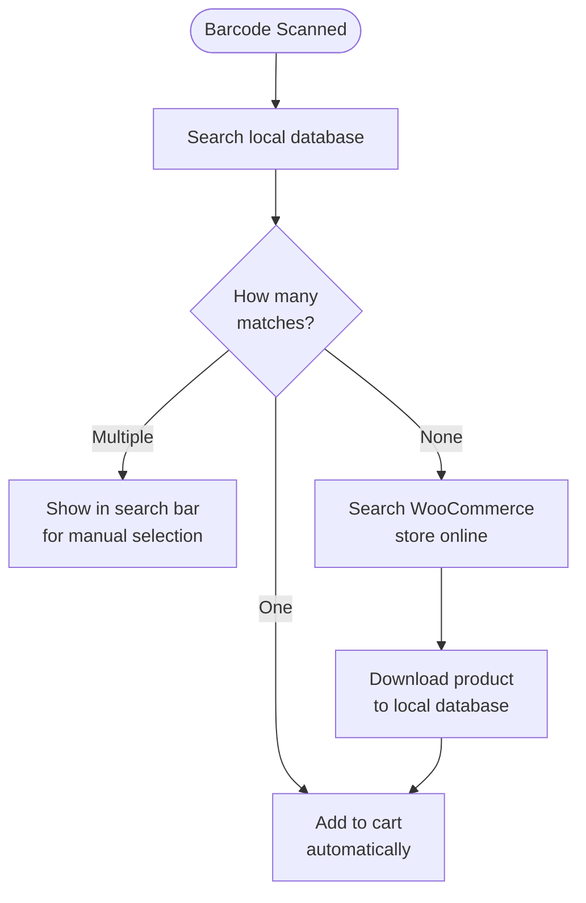

import Image from "@theme/IdealImage";
import Accordion from '@site/src/components/Accordion';
import AccordionItem from '@site/src/components/AccordionItem';

ほとんどのバーコードスキャナーは、デバイスに接続されたキーボードのように動作します。
バーコードをスキャンすると、WCPOS は文字が通常の入力よりも速く入力されたことを検出します。
この「高速なキー入力」を使用して、入力をバーコードスキャンとして識別します。
この方式はほぼすべてのスキャナーで設定なしに動作しますが、スキャナーには WCPOS が直接接続できる他の[接続モード](#connection-modes)もあります。

## バーコードスキャンの設定 {#configuring-barcode-scanning}

バーコードのスキャンは非常に高速に行われるため、POS はバーコードと手入力の違いを見分けられます。
POS の設定には、バーコード検出の動作を微調整するオプションがあります。

  <Image
    alt="POS 設定内のバーコードスキャン設定"
    img="/img/barcode-scanning-settings.png"
    style={{ maxHeight: 500 }}
  />
  
POS 設定内のバーコードスキャン設定

| 設定 | 目的 | 一般的な値 |
|---|---|---|
| **平均入力時間** | バーコードと判定するために必要な入力速度 | 手入力では反応しない程度の短い間隔 |
| **最小長** | バーコードとして扱う連続した文字列の最小文字数 | 使用する最短のバーコードに合わせる（例：EAN-8 なら 8） |
| **プレフィックス／サフィックスの除去** | スキャナーが付加する余分な文字（プレフィックスまたはサフィックス）を除去し、バーコード本体だけを残す | スキャナーで付加する設定にしている場合以外は空欄にする |

## 接続モード {#connection-modes}

設定やトラブルシューティングを手順に沿って進めるには、[スキャナーセットアップウィザード](/1.x/hardware/scanners/setup-wizard)を使用してください。

バーコードスキャナーはいくつかあるモードのいずれかに設定されて出荷されます。モードによって、WCPOS がスキャンを受け取る方法が決まります。

| モード | 受信方法 | 設定 |
|---|---|---|
| **キーボード（HID）** — ほぼすべてのスキャナーの工場出荷時の設定 | スキャナーがバーコードを「入力」し、WCPOS が高速なキー入力を認識 | 不要 — ペアリングまたは接続してスキャンするだけ |
| **シリアル（SPP / USB-COM）** | USB シリアルまたは Bluetooth SPP 経由の直接接続 | スキャナーのモードを切り替え、バーコード設定で接続 |
| **HID-POS** | USB スキャナーの直接接続（WebHID 経由） | スキャナーのモードを切り替え、バーコード設定で接続 |
| **Bluetooth LE（ベンダー GATT）** | Bluetooth Low Energy による直接接続 | スキャナーをペアリングし、サービス UUID を指定してバーコード設定で追加 |

キーボードモードは設定不要で、ほとんどの店舗に適しています。スキャンした文字が化ける場合（キーボード配列の違いによる大文字や記号の取り違えなど）や、検索ボックスにフォーカスがないと別の場所に入力される場合は、直接接続が有効です。直接接続したスキャナーは、入力速度、キーボード配列、フォーカスに関係なく、すべてのスキャンを WCPOS に直接送信します。

:::info キーボードモードのスキャナーは直接接続できません
デバイスはキーボードモードのスキャナーを通常のキーボードと同じように扱います。アプリがキーボードを専有することは許可されていません。
バーコード設定で **シリアルスキャナーを接続** または **HID スキャナーを接続** を押してもスキャナーが一覧に表示されない場合は、ほぼ確実にキーボードモードのままになっています。
:::

**モードを切り替えるには**、スキャナーのマニュアルで設定用のバーコードを探し（*「SPP モード」*、*「シリアルモード」*、*「HID-POS モード」* を参照）、スキャンします。これでスキャナーの設定が切り替わります。Bluetooth スキャナーの場合は、モード切り替え後にデバイスの Bluetooth 設定で古いペアリングを削除し、再度ペアリングしてください。マニュアルの *「HID」* または *「キーボード」* のバーコードをスキャンすれば、いつでも元に戻せます。

直接接続はデスクトップアプリと Chrome ベースのブラウザーで利用できます（ブラウザーの Web Serial と WebHID を使用します）。デスクトップアプリではアプリ内に、Chrome ではブラウザー独自のデバイス選択画面が表示されます。iOS と Android ではキーボードモードとカメラスキャンを利用でき、Android ではハードウェアスキャナーのキー入力を直接受け取る機能もあります。

## カメラスキャン {#camera-scanning}

ウェブ、デスクトップ、iOS、Android のすべてのプラットフォームでデバイスのカメラを使ってスキャンできるため、専用のスキャナーがなくても利用を開始できます。検索バーのスキャンアイコンからカメラを開くと、**フィルターのすぐ下にサイズ変更可能なパネル** として表示され、商品一覧を見ながらスキャンできます。カメラをバーコードに向けると、WCPOS はハードウェアスキャナーと同様に読み取ります。

## バーコードが検出されたときの動作 {#what-happens-when-a-barcode-is-detected}

POS はバーコードを検出すると、ローカルデータベースから一致する商品または商品バリエーションを検索します。
結果に応じて、次の三つの動作に分かれます。

ローカルに一致する商品が見つからない場合、WCPOS はオンラインの WooCommerce ショップを検索し、一致する商品をダウンロードして **自動的にカートに追加します**。そのため、初めてスキャンするバーコードでも販売を完了でき、次回からは同じスキャンが即座に処理されます。

:::tip 複数の商品が一致する場合は、通常、データに問題があります
複数の商品に同じバーコードが設定されていると、POS はどの商品を追加するか判断できません。そのため、バーコードを検索バーに入力し、商品を選択できるようにします。このような場合は、通常、商品データの整理が必要です。各商品には **一意の** バーコードを設定してください。
:::

## スキャンのフィードバックと動作 {#scan-feedback-and-behaviour}

- **スキャン音** — WCPOS はスキャンごとに音を鳴らせるため、レジ係は画面を見ずにすぐ確認できます。スキャン音は任意で有効にでき、テーマも選べます。[バーコード設定](/1.x/settings/store/barcode)で有効にし、テーマを選択してください。
- **注文画面では** — スキャン結果が注文の検索フィールドに送られるため、バーコードをスキャンして目的の注文や商品を探せます。
- **UPC-A バーコード** — UPC-A のスキャンではパッケージに印刷された数字が読み取られるため、POS が照合する値は商品データで使用している値と一致します。

## 商品同期について {#understanding-product-synchronisation}

POS はカタログを小さなバッチに分けてバックグラウンドでダウンロードするため、利用開始直後からすべての商品がデバイスに保存されているとは限りません。仕組みについては[商品同期](/1.x/products/sync)を参照してください。

### バーコードスキャンにとって重要な理由 {#why-it-matters-for-barcode-scanning}

まだローカルに保存されていないバーコードをスキャンすると、POS はオンラインで WooCommerce ショップにアクセスし、該当する商品を検索してダウンロードします。次回からは同じスキャンが即座に処理されます。この処理を速めるための操作は不要です。バックグラウンドのカタログ初期取り込みが残りの商品を自動的に取り込みます。進捗は **ストアの健全性 → データベース** で確認できます。

## よくある質問 {#faq}

<Accordion>
  <AccordionItem question="バーコードをスキャンすると「ローカルに商品が 0 件見つかりました」と表示されるのはなぜですか？">

最初からすべての商品がデバイスに保存されているわけではありません。POS は利用開始からの数分間に、バックグラウンドでカタログの初期取り込みを行います。
スキャンした商品がまだ保存されていない場合、POS はスキャンをきっかけにオンラインで検索してダウンロードするため、次回からは即座に処理されます。

  </AccordionItem>

  <AccordionItem question="POS でバーコードを生成・印刷できますか？">

いいえ、現時点ではできません。WCPOS は既存のバーコードをスキャンして読み取るように設計されており、バーコードを作成・印刷する機能はありません。
商品用のバーコードを生成する必要がある場合は、バーコードの作成・印刷に特化したサードパーティの WooCommerce プラグインを利用できます。次のようなプラグインがあります。

- [EAN for WooCommerce](https://wordpress.org/plugins/ean-for-woocommerce/)
- [A4 Barcode Generator](https://wordpress.org/plugins/a4-barcode-generator/)

商品用のバーコードを生成したら、レジで簡単にスキャンして、POS での会計プロセスを高速化できます。

  </AccordionItem>
</Accordion>
