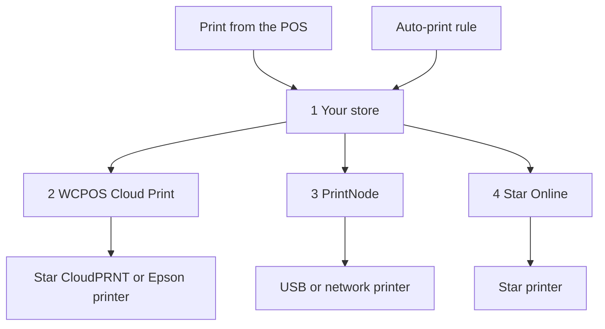

import LinkCards from '@site/src/components/LinkCards';
import LinkCard from '@site/src/components/LinkCard';

クラウド印刷はインターネット経由でレシートをプリンターに送信するため、POSを実行する端末にプリンターを接続する必要がありません。レジとは別のネットワークにあるプリンターでの印刷、注文ごとに自動印刷するキッチンプリンター、オンライン販売ごとの納品書の印刷に利用できます。

クラウドプリンターは、**WP Admin → POS → 設定 → クラウド印刷**で一度設定するだけです。その後はすべての端末に表示され、レジ係は他のプリンターと同じようにPOSから印刷できます。

## POSから印刷する {#manual}

クラウドプリンター用のレシートはショップ側で注文から作成されるため、印刷する前に売上がショップに保存されている必要があります。

1. 支払い完了画面、または注文の**レシート**ウィンドウで、**プリンター**メニューを開き、クラウドプリンターを選びます。
2. **レシートを印刷**を押します。
3. 画面に**印刷先**とプリンター名が表示されます。これはショップがジョブを受け取ったことを意味します。レシートが出力されたことを確認してください。出力されない場合、管理者は[印刷キュー](#print-queue)でジョブの状況を確認できます。

[レシートを印刷する](./at-checkout.mdx#print-receipt)を参照してください。特定のテンプレートを毎回クラウドプリンターに送るには、**設定 → 印刷**でそのテンプレートのプリンターを選択します。[印刷先の振り分け](../hardware/printers/index.mdx#print-routing)を参照してください。

- **注文がショップに保存されている必要があります。** オフラインで受けた注文など、ショップがまだ売上を確認していない場合、POSに*このプリンターはショップ側のデータを印刷しますが、この売上はまだショップで確認されていません。確認後にもう一度印刷してください。*と表示されます。レジがオンラインになり、ショップが売上を確認したら、**レシートを印刷**をもう一度押してください。レジがオフラインの間は、過去の注文でもクラウドプリンターへの印刷は失敗します。
- **セッションレポートと締め処理のレポート**をクラウドプリンターに送信すると、代わりにシステムの印刷ダイアログが開きます。
- **StarまたはEpsonのクラウドプリンターでHTMLテンプレートを使用する場合**、*このクラウドプリンターはサーマルテンプレートのみ印刷できるため、何も印刷されません。サーマルテンプレートを選択してください。*と表示されます。

クラウドプリンターは、すべての端末の**設定 → 印刷**の**プリンター**欄に自動で表示されます。各行の2行目には、*Star CloudPRNT · WCPOSで管理*などの種類が表示されます。レジ係はその行の**テスト印刷**や、**⋯**メニューの**設定レポートをコピー**を押せますが、編集や削除はできません。編集や削除は**クラウド印刷**画面で行います。[プリンターの設定](../hardware/printers/index.mdx#printers-list)を参照してください。

## プリンターの種類を選ぶ {#providers}

:::note ここからはWP Adminが必要です
プリンターやルールの追加は、店舗のオーナーまたは管理者が**WP Admin → POS → 設定 → クラウド印刷**で行います。
:::

**クラウド印刷**画面に**接続するプリンターの種類は何ですか？** と表示されます。お使いのプリンターに合うものを選んでください。

- **Star CloudPRNT** — CloudPRNTを内蔵したStarプリンター（mC-Print、TSP143IV…）向けです。別のアカウントを作らず、無料で接続したい場合に適しています。プリンターがショップからジョブを取得します。*サーマルテンプレートのみ対応。*
- **Epson Server Direct Print** — Epsonの「インテリジェント」TMプリンター（TM-T88VI/VII、TM-m30III、TM-iシリーズ）向けです。プリンターがショップからジョブを取得します。*サーマルテンプレートのみ対応。*
- **Star Online** — stario.onlineアカウントに紐づけられたStarプリンター（mC-Print3、TSP143IV、mC-Label3）向けです。ショップがStar Onlineにジョブを渡し、Star Onlineが配信します。*サーマルテンプレートのみ対応。*
- **PrintNode** — 店舗のコンピューターで軽量なPrintNodeアプリを実行できる場合に、一般的なUSBプリンターやネットワークプリンターで利用できます。ショップがPrintNodeにジョブを渡し、そのコンピューター上のアプリが印刷します。*すべてのテンプレートに対応。*

StarまたはEpsonのクラウドプリンターではHTMLテンプレートを印刷できません。レシートをプリンター固有のコマンドに変換する必要があるためです。HTMLテンプレートやページ全体を使うテンプレートにはPrintNodeを使用してください。[サーマルテンプレート](./thermal-templates.mdx)を参照してください。

<details>
<summary>ジョブがプリンターに届くまで</summary>



<div className="pinned-legend">

1. **ショップ** — 注文とテンプレートからレシートを作成し、ジョブを[印刷キュー](#print-queue)に保持します。POSからの印刷も[自動印刷ルール](#auto-print)も、ここから始まります。
2. **WCPOS Cloud Print** — [中継サービス](#relay)です。Star CloudPRNTまたはEpsonのプリンターは通常、このサービスを通じてジョブを取得するため、プリンターが次に問い合わせるまでジョブは待機します。
3. **PrintNode** — ショップがPrintNodeにジョブを渡し、店舗のコンピューター上のPrintNodeアプリが印刷します。
4. **Star Online** — ショップがStar Onlineにジョブを渡し、Star Onlineがプリンターに配信します。

</div>

</details>

## プリンターを追加する {#setup}

1. **WP Admin → POS → 設定 → クラウド印刷**を開きます。**クラウドプリンター一覧**で **+ プリンターを追加**を押します。
2. 種類を選びます。
3. **プリンター名**を入力します（例：*キッチンプリンター*）。WCPOSはこの名前から**プリンターID**を生成します。IDは後から変更できません。変更するにはプリンターを削除し、追加し直してください。
4. 種類に応じた手順を完了します：[Star CloudPRNTまたはEpson](#setup-polling)、[PrintNode](#setup-printnode)、[Star Online](#setup-star-online)。
5. プリンターが**クラウドプリンター一覧**にカードとして表示されます。カードの**テスト印刷**を押します。[プリンターのカード](#status)を参照してください。

### Star CloudPRNTまたはEpson Server Direct Print {#setup-polling}

これらのプリンターは自らジョブを取得するため、アカウントの連携は不要です。プリンター側からショップに接続するので、ポートの開放、固定IPの設定、ファイアウォールの変更は必要ありません。プリンターが次に問い合わせたときにジョブが印刷されます。**+ プリンターを追加**の最後の手順で、秘密トークンを含むプリンターの**ポーリングURL**が表示されます。

<details>
<summary>Star CloudPRNTまたはEpsonのプリンターを接続する</summary>

1. **ポーリングURL**の横にある**コピー**を押します。アドレス全体が表示されるのは**一度だけ**です。紛失した場合は、プリンターを削除して追加し直し、新しいアドレスを取得してください。カードの**設定とトークン**では、トークンが非表示になります。
2. プリンター自体の設定ページを開き、サーバーURL欄にアドレスを貼り付けます。Starでは**CloudPRNT**設定、Epsonでは**Server Direct Print**設定にあります。ポーリングを有効にして保存し、プリンターを再起動します。
3. カードに戻ると、プリンターが初めて取得を行った時点で、状態が**プリンターを待機中**から**接続済み**に変わります。

アドレスは通常、`https://cloudprint.wcpos.com`で始まります。これは[WCPOS Cloud Printの中継サービス](#relay)のアドレスで、通常はこちらを使用します。アドレスの下にある**詳細設定：このサイトに直接接続（中継なし）**を開くと、代わりに**直接接続URL**が表示されます。サイトに直接接続できないプリンターでは、**プリンターを待機中**のままになることがあります。

Epsonでは、WCPOSからこの方法で印刷している間、**Server Direct Print**を有効のままにしてください。[Server Direct Print](../hardware/printers/server-direct-print.mdx)を参照してください。

</details>

### PrintNode {#setup-printnode}

PrintNodeを使うには、プリンターの近くのコンピューターでクライアントを実行し、PrintNodeアカウントからAPIキーを取得する必要があります。

<details>
<summary>PrintNodeプリンターを接続する</summary>

1. プリンターの近くのコンピューターにPrintNodeクライアントをインストールし、サインインします。印刷するには、コンピューターの電源が入り、クライアントが実行されている必要があります。
2. PrintNodeアカウントでAPIキーを作成します。
3. **+ プリンターを追加**で**PrintNode**を選び、**PrintNode APIキー**にキーを貼り付けて、**プリンターを取得**を押します。
4. **プリンターを選択**でクライアントが報告するプリンターを選び、設定を完了します。最後の手順に**PrintNodeに連携済み**と表示されます。コピーするアドレスやトークンはありません。

</details>

連携後、プリンターのカードで**印刷形式**を設定します。

- **PDF（推奨）** は、サーマル、HTMLを問わず、すべてのテンプレートをPDFとして印刷します。変更する理由がなければ、この設定のままにしてください。
- **ESC/POS RAW — サーマルテンプレートのみ**は、サーマルテンプレートをPDFではなくレシートプリンター用のコマンドとして送信します。HTMLテンプレートは引き続きPDFとして送信されます。

### Star Online {#setup-star-online}

Star Onlineを使うには、stario.onlineアカウントからプリンターのグループアドレスとAPIキーを取得する必要があります。

<details>
<summary>Star Onlineプリンターを接続する</summary>

1. stario.onlineで**デバイスグループ**を開き、グループの**CloudPRNT URL**をコピーします。URLは`https://device.stario.online/cloudprnt/...`のような形式で、EUでは`https://eu-device.stario.online/cloudprnt/...`です。
2. stario.onlineで、**EnumDevices**、**ViewDevice**、**PrintToDevice**、**ViewDeviceGroups**の権限を持つAPIキーを作成します。これらの権限がないキーでも受け付けられますが、一覧の取得や印刷はできません。
3. **+ プリンターを追加**で**Star Online**を選びます。**CloudPRNT URL**と**Star Online APIキー**を貼り付け、**デバイスを取得**を押します。
4. **デバイスを選択**でプリンターを選び、設定を完了します。カードに**デバイス**、**グループ**、**AccessIdentifier**が表示されます。

</details>

## プリンターのカード {#status}

各クラウドプリンターは、**クラウドプリンター一覧**にカードとして表示されます。

- **名前** — クリックするとプリンター名を変更できます。その下に種類が表示されます。
- **状態** — 下記の一覧を参照してください。30秒ごとに更新されます。
- **最終チェックイン** — Star CloudPRNTまたはEpsonのプリンターが最後に取得を行った時刻、または*未実行*が表示されます。
- **プリンターID** — プリンターを追加したときに確定します。
- **印刷形式** — PrintNodeのみ：**PDF（推奨）**または**ESC/POS RAW — サーマルテンプレートのみ**。[PrintNode](#setup-printnode)を参照してください。
- **テスト印刷** — 短いテストページを送信します。*…にテスト印刷を送信しました*というメッセージ、または失敗の理由が表示されます。
- **プリンターの操作**（**⋮**）— **設定とトークン**で最後の設定手順を再度開きます。**プリンターを削除**でプリンターへのジョブの配信を停止します。後から再度追加できます。

<details id="status-polling">
<summary>Star CloudPRNTとEpson Server Direct Printの状態</summary>

- **プリンターを待機中** — プリンターはまだ取得を行っていません。プリンターに設定したポーリングURLを確認してください。[「プリンターを待機中」のままになる](#trouble-polling)を参照してください。
- **接続済み** — プリンターが過去二分半以内に取得を行いました。
- **オフライン** — プリンターは以前に取得を行っていますが、最近は行っていません。電源が入り、オンラインになっていることを確認してください。
- **ブロック中** — 中継サービスがショップにアクセスできません。理由はカードに表示されます。Cloudflareなどのセキュリティサービスやファイアウォールプラグインによるブロック、またはサイトからのサーバーエラー応答が原因です。[Star CloudPRNTまたはEpsonの問題](#trouble-polling)を参照してください。

</details>

<details id="status-services">
<summary>Star OnlineとPrintNodeの状態</summary>

- **オンライン** — サービスがプリンターを利用可能と報告しています。
- **オフライン** — サービスがプリンター、またはPrintNodeを実行するコンピューターを利用できないと報告しています。PrintNodeの場合、コンピューターがスリープしておらず、クライアントが実行されていることを確認してください。
- **不明** — WCPOSがサービスから状態を取得できませんでした。[PrintNode](#setup-printnode)または[Star Online](#setup-star-online)でAPIキーを確認してください。

</details>

## 注文を自動印刷する {#auto-print}

自動印刷ルールを使うと、誰も操作しなくても注文が印刷されます。設定は任意です。ルールがない場合、クラウドプリンターはレジ係がPOSから印刷したときだけ印刷します。

**自動印刷ルール**で **+ ルールを追加**を押します。各ルールは文章の形で表示され、下線のある部分がそれぞれメニューになっています。

> **店頭（POS）でのすべての注文**を、**作成後すぐに**、**キッチン伝票**テンプレートで**キッチンプリンター**に**2部**自動印刷します。

- **対象の注文** — **すべての注文**、**店頭（POS）でのすべての注文**、または**すべてのオンライン注文**。WCPOS Proでは、特定の店舗の**店舗別の注文**も選択できます。[店舗別プリンター](#per-store-printers)を参照してください。
- **プリンター** — 登録済みのクラウドプリンターのいずれかを選びます。
- **テンプレート** — そのプリンターで印刷できるテンプレートのみが表示されます。テンプレートは**POS › テンプレート**から取得されます。
- **部数** — 1～5部。
- **タイミング** — **支払い完了後**（デフォルト）、または**作成後すぐに**。POSの注文では、作成とはカートが最初に保存された時点を指すため、キッチン伝票は支払い前に印刷されます。

キッチン伝票と顧客用レシートなど、複数のルールで同じ注文を印刷できます。各ルールが同じ注文を印刷するのは一度だけです。レシートはショップ側で注文とテンプレートから作成されるため、レジ係の操作は不要です。自動印刷でキャッシュドロワーが開くことはありません。

ルールのプリンターを、そのテンプレートに対応していないものに変更すると、そのプリンターで印刷できる最初のテンプレートに切り替わります。意図したテンプレートになっているか確認してください。印刷できるテンプレートが一つもない場合、テンプレート欄は空になり、選択するまでルールは印刷を行いません。

### 店舗別プリンター（Pro） {#per-store-printers}

[WCPOS Pro](../getting-started/pro-license.mdx)を使用し、複数の[店舗](../stores/index.mdx)がある場合、**対象の注文**メニューに各店舗の**店舗別の注文**も表示されます。店舗別ルールは、その店舗に属する注文を印刷します。対象は、その店舗のレジで受けた注文と、注文の編集画面でその店舗に割り当てた注文です。オンライン注文は、店舗を割り当てない限りどの店舗にも属さないため、全店舗対象のルールでのみ印刷されます。

ルールは重複して適用されます。ある店舗の注文は、その店舗のルールに**加えて**、**すべての注文**、**店頭（POS）でのすべての注文**、**すべてのオンライン注文**を対象とする各ルールでも印刷されます。ある拠点のキッチン伝票が別の拠点のプリンターに出ないようにするには、拠点ごとに店舗別ルールを設定し、その伝票に全店舗対象のルールを追加しないでください。

## 印刷キュー {#print-queue}

ルールの下にある**印刷キュー**には、すべてのジョブが**注文**、**プリンター**、**テンプレート**、**状態**、**詳細**、**作成日時**とともに表示されます。注文番号は注文へのリンクになっています。

- 状態（**要確認**、**すべての状態**、または**待機中**、**印刷中**、**印刷済み**、**失敗**、**キャンセル済み**のいずれか）とプリンターで**絞り込み**できます。
- 待機中のジョブは**キャンセル**、失敗したジョブは**再試行**（新しいジョブとして追加され、*#…として再試行済み*と表示）、ジョブの削除は**削除**で行います。複数の行にチェックを入れると、**選択項目をキャンセル**または**選択項目を削除**を実行できます。
- **詳細**には、*Star Onlineがリクエストを拒否しました。APIキーに必要な権限があることを確認してください。*など、ジョブが失敗した理由が表示されます。

Star CloudPRNTまたはEpsonのプリンターに印刷待ちのレシートがあり、10分間取得が行われていない場合、または一度も取得されていない場合は、警告が表示されます。警告にはプリンター名、最後の取得時刻、待機中のレシート数と、**すべてキャンセル**が表示されます。

:::warning プリンターから確認が返らなかったジョブ
*プリンターからこのジョブの確認が返されませんでした*は、印刷されたかどうかをWCPOSが判断できないことを意味します。二重印刷を避けるため、自動では再送信されません。プリンターを確認し、何も出力されていない場合に限り**再試行**を押してください。
:::

<details>
<summary>ジョブの保持期間と再試行</summary>

印刷済みとキャンセル済みのジョブは7日後、失敗したジョブは30日後に削除されます。開発者は`wcpos_print_job_retention_days`および`wcpos_print_job_failed_retention_days`フィルターで変更できます。

WCPOSからPrintNodeまたはStar Onlineに渡すジョブは、最初は一分後、次は二分後に再試行され、合計三回試行されます。サービスがキーまたはアカウントを拒否した場合は即座に失敗となり、**詳細**に理由が表示されます。

</details>

## 中継サービスWCPOS Cloud Print {#relay}

Star CloudPRNTまたはEpsonのプリンターのポーリングURLは、ご自身のサイトではなく**cloudprint.wcpos.com**を指します。これは、プリンターとショップの間をつなぐ、WCPOSが運営する無料の中継サービス**WCPOS Cloud Print**です。

有効にする操作は不要です。ジョブはプリンターに届くまでに中継サービスを通るため、接続するとサイトのアドレスがwcpos.comと共有され、注文の詳細を含むレシートがこのサービスを経由します。[プライバシーポリシー](https://wcpos.com/privacy)を参照してください。

<details>
<summary>中継サービスの仕組み</summary>

レシートプリンターは小規模なファームウェアで動作しており、更新されることはまれです。多くの機種は、最新のホスティング環境にあるショップに安全に接続できなかったり、サイトの手前にあるCloudflareなどのサービスに拒否されたりします。その場合、設定がすべて正しくても**プリンターを待機中**のままになります。中継サービスはプリンターが利用できる接続先を提供し、そのリクエストをショップに転送します。

- 初めて**クラウド印刷**を開くと、サイトが自動的に中継サービスに接続します。
- 中継サービスを利用するには、サイトが**HTTPS**に対応している必要があります。対応していない場合は、**クラウド印刷**にその旨が表示されます。
- ローカルのテストサイトなど、中継サービスに接続できないサイトでは、ポーリングURLがサイトを直接指します。
- カードの**ブロック中**は、中継サービスがサイトにアクセスしたものの拒否されたことを意味します。カードの案内に従い、セキュリティサービスで中継サービスからのアクセスを許可してください。[Star CloudPRNTまたはEpsonの問題](#trouble-polling)を参照してください。

</details>

<details>
<summary>中継サービスを無効にする（開発者向け）</summary>

Star CloudPRNTまたはEpsonのプリンターの最後の設定手順には、**詳細設定：このサイトに直接接続（中継なし）**と**直接接続URL**があります。サイト全体で中継サービスを無効にするには、次のようにします。

```php
add_filter( 'wcpos_cloud_print_relay_enabled', '__return_false' );
```

WCPOS 2.0より前では、このフィルターは`woocommerce_pos_cloud_print_relay_enabled`でした。この名前は引き続き動作しますが、2.0から非推奨となっており、早ければ2.2で削除されます。[フックの命名](../extensions/index.mdx#hook-naming)を参照してください。

</details>

<details>
<summary>レシートがStar CloudPRNTプリンターに届く仕組み</summary>

WCPOSは、StarPRNTコマンド、レシートのPNG画像、プレーンテキストの順にプリンターに提示し、プリンターが読み取り可能と報告した中で最適な形式を使用します。Line Modeのみを読み取れる旧型のStar機種（TSP650II、TSP700II、TSP800II）では、ロゴは画像経由でのみ印刷できます。画像を使用するには、サーバーにGDおよびFreeTypeのPHP拡張が必要です。EpsonプリンターにはePOS-Print XML、Star OnlineにはStar Document Markupが送信されます。

</details>

## 問題が発生した場合 {#troubleshooting}

**POSからクラウドプリンターに印刷したのに、レシートが出ません。** POSが把握しているのは、ショップがジョブを受け取ったことだけです。[印刷キュー](#print-queue)を開き、該当する注文を探してください。

- **待機中** — プリンターがまだジョブを受け取っていません。カードでプリンターの状態を確認してください：[Star CloudPRNTとEpson Server Direct Printの状態](#status-polling)、または[Star OnlineとPrintNodeの状態](#status-services)。
- **印刷中** — ジョブは送信中で、プリンターから印刷完了の応答はまだありません。
- **失敗** — **詳細**に理由が表示されます。原因を解消してから**再試行**を押してください。**詳細**に*プリンターからこのジョブの確認が返されませんでした*と表示されている場合は、すでに印刷されている可能性があります。**再試行**を押す前にプリンターを確認してください。
- **印刷済み** — プリンター、PrintNode、またはStar Onlineがジョブを受け取りました。用紙を確認し、**プリンター**列に目の前のプリンターの名前が表示されていることを確認してください。

**テンプレートが選択肢に表示されません。** Star CloudPRNT、Epson、Star Onlineのプリンターは[サーマルテンプレート](./thermal-templates.mdx)のみに対応しています。サーマルテンプレートを選ぶか、PrintNode経由で印刷してください。

### Star CloudPRNTまたはEpsonの問題 {#trouble-polling}

**「プリンターを待機中」のままになります。** プリンターがショップに一度もアクセスできていません。プリンターに設定したポーリングURLが完全に一致しているか確認してください。一文字でも間違っていると、取得は毎回拒否されます。不確かな場合は、プリンターを削除して追加し直し、新しいURLを取得してください。プリンターの**CloudPRNT**または**Server Direct Print**設定でポーリングが有効になっていることを確認し、再起動します。**直接接続URL**を使用した場合は、`cloudprint.wcpos.com`のアドレスに切り替えてください。[このような問題を解決するのが中継サービスです](#relay)。

**ブロック中。** セキュリティサービスやファイアウォールプラグインが中継サービスを拒否しているか、サイトがサーバーエラーを返しています。カードのメッセージに従ってください。サーバーエラーの場合は、サイトヘルスとエラーログを確認してください。

**中継サービスの導入前に設定しました。** プリンターに保存済みのアドレスは引き続き利用できます。そのプリンターが**プリンターを待機中**のままになる場合は、削除して追加し直し、新しい`cloudprint.wcpos.com`のアドレスをプリンターに設定してください。

### PrintNodeの問題 {#trouble-printnode}

**プリンターを取得できません。** APIキーと、コンピューター上でPrintNodeクライアントが実行されていることを確認してください。

**PrintNodeのジョブが印刷されません。** クライアントが実行中かつオンラインである必要があります。コンピューターがスリープしていると印刷されません。クライアントが報告するプリンターを選択していることと、キーが失効していないことを確認してください。

### Star Onlineの問題 {#trouble-star-online}

**デバイスを取得できません。** *Star Onlineのデバイス一覧を取得できませんでした。CloudPRNT URLとAPIキーを確認してください。*というメッセージが表示されます。キー全体をコピーしたこと、キーが失効していないこと、URLと同じstario.onlineアカウントおよびリージョンに属するキーであることを確認してください。次に、[Star Online](#setup-star-online)に記載された権限がキーにあるか確認します。*このStar Onlineグループにデバイスが見つかりません*は、グループにデバイスがないか、URLが別のグループのものであることを意味します。

## 関連ドキュメント {#related-documentation}

<LinkCards>
  <LinkCard to="/hardware/receipt-printers" title="プリンターの設定" description="端末にプリンターを追加し、テンプレートごとの印刷先を設定する" />
  <LinkCard to="/sell/print-email-receipts" title="チェックアウト時のレシート" description="レシートの印刷、メール送信、再印刷" />
  <LinkCard to="/settings/receipt-templates/thermal-templates" title="サーマルテンプレート" description="StarとEpsonのプリンター用のレシートを作成する" />
</LinkCards>
