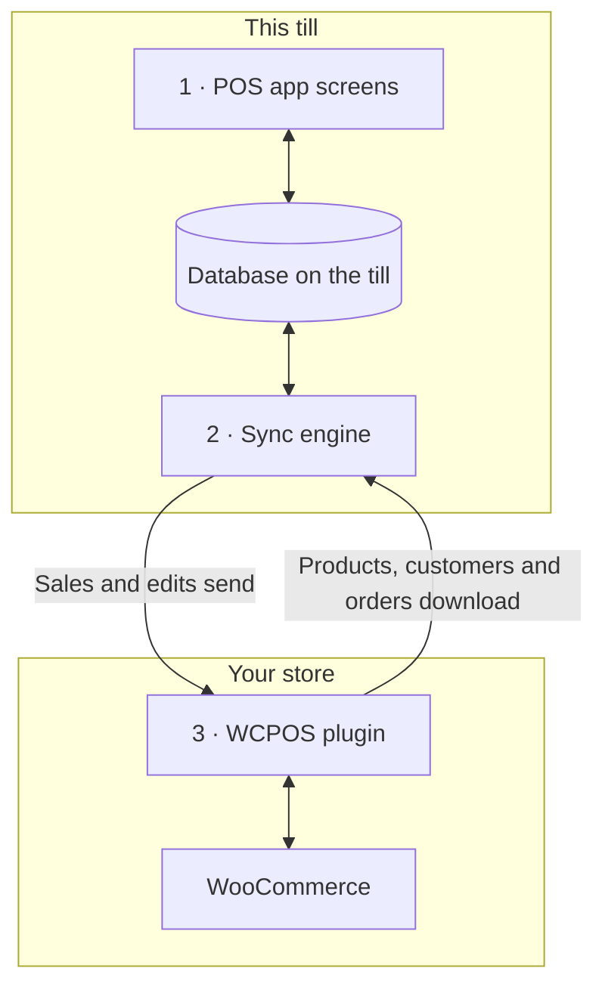

import LinkCards from '@site/src/components/LinkCards';
import LinkCard from '@site/src/components/LinkCard';
import JourneyShot from '@site/src/components/JourneyShot';
import manifest from '@site/static/img/2.x/reference/architecture/en/manifest.json';

WCPOSは、WordPressサイト上のプラグインと各レジのPOSアプリという2つの部分で構成されています。レジは店舗データのコピーを使って販売を行い、バックグラウンドでWooCommerceと同期します。このページでは、開発者や仕組みを知りたい店舗オーナーに向けて、データの保存場所とサーバーに送信される内容を説明します。

設計の説明ではなく、問題の解決方法をお探しですか？

- **アプリを更新する場合：** まず[レジがすべて送信済みであることを確認](../getting-started/previous-versions.mdx#check-sync)してください。[更新前の同期](#storage)を参照してください。
- **レジに商品が表示されない場合：** [商品が見つからない、または情報が古い場合](../products/sync.mdx#goes-wrong)を参照してください。
- **売上が店舗に届かない場合：** [送信待ちの売上](../getting-started/offline.mdx#offline-writes)を参照してください。

## 2つの構成要素 {#two-part-system}

1. **POSアプリ**は各レジで動作します。サイトの`/pos/`をブラウザーで開くか（アドレスは変更可能）、デスクトップアプリ、iOSアプリ、Androidアプリを使用します。それぞれの要件は[インストール](../getting-started/installation.mdx)を参照してください。どの画面もレジ上のデータベースを読み書きするため、検索や商品の追加でサーバーの応答を待つ必要はありません。
2. アプリ内の**同期エンジン**は、変更を双方向に反映します。店舗側の変更を取得し、レジ側の変更を送信します。
3. **WCPOSプラグイン**はWordPressサイト上で動作し、レジとWooCommerceを接続します。すべての商品、顧客、注文の正本は常にWooCommerceにあります。

## レジが端末に保存するデータ {#local-database}

**ヘルス** → **データベース**には、レジが保持する店舗データのコピーが表示されます。レコードの種類ごとに1行で、この端末の件数（**端末上**）と店舗側の件数（**サーバー上**）を確認できます。各行のメニューの機能は[店舗のヘルス](../support/store-health.mdx#coverage)を参照してください。

<JourneyShot manifest={manifest} device="tablet" step={1} offsets={[[186, 0], [186, 0], [186, 0], [186, 0], [186, 0], [186, 0], [186, 0], [186, 0]]} alt="ヘルスのデータベースタブ：このレジのレコード一覧。商品から税率まで、端末上の件数、サーバー上の件数、取得率、サイズを種類ごとに表示">

1. **商品** — 最初にPOSの既定の並び順（名前のAからZ順）で100件を取得し、残りはレジが空いている間に取得します。[ダウンロードと同期](../products/sync.mdx)を参照してください。
2. **バリエーション** — 対応する商品と一緒にダウンロードします。
3. **注文** — 未完了の注文と最近の注文をレジに保持します。古い注文は、誰かが開いたときにダウンロードします。
4. **払い戻し** — 過去92日間の払い戻しと、開いた注文に紐づく払い戻しを保持します。
5. **顧客** — レジが空いている間に少しずつダウンロードします。
6. **カテゴリー** — その下に**ブランド**と**タグ**が並びます。
7. **クーポン** — Proの有無にかかわらず、レジに保持します。
8. **税率** — 店舗の税率です。

</JourneyShot>

行に赤い **N件が停滞**バッジがある場合、その種類のレコードに対応が必要です。[対応が必要なレコード](../support/store-health.mdx#stuck-records)を参照してください。

表の上で注目する数値は**送信待ちの変更**です。このレジで発生した売上や編集のうち、店舗がまだ受信していないものを表します。店舗が受信するまで、これらは端末に残ります。未同期の未完了注文やパネル内に表示される変更はこの数値に含まれず、それらも店舗には届いていません。[送信待ちの売上](../getting-started/offline.mdx#offline-writes)を参照してください。

この表の外に保存されるレコード

この表に含まれないデータもあります。支払い方法、税クラス、配送方法、注文ステータスはアプリの起動ごとに店舗から読み込み、オフライン時に使えるよう最後の応答を保持します。レジセッション、締め処理、現金の入出金には、それぞれ専用のレコードと店舗への送信キューがあります。

### データベースの保持方法 {#storage}

各店舗のレジ係ごとに、レジ上に専用のコピーを保持します。ブラウザーでは、同じサイトのPOSを同時に実行できるのは1つのタブだけです。アプリの更新で保存方法が変わると、レジはデータを再ダウンロードします。

:::warning 更新前に同期してください
古いコピーに残っている送信待ちの売上や編集は送信されません。アプリを更新する前に、**ヘルス** → **データベース**で**送信待ちの変更**が0で、数値の下にパネルが表示されていないことを確認し、未完了の注文をすべて同期してください。[レジがすべて送信済みであることを確認する](../getting-started/previous-versions.mdx#check-sync)を参照してください。
:::

開発者向けの詳細：ストレージエンジン、タブ、アプリの更新

- **サイト・店舗・レジ係ごとに専用のデータベース。** 同じレジを使う2人のレジ係や、2店舗で働く1人のレジ係の間で、ローカルデータが共有されることはありません。
- **すべてのプラットフォームでSQLiteを使用。** ブラウザーでは、専用のファイルストレージ上でSQLiteを1つのワーカー内で実行します。iOSとAndroidアプリではシステムのSQLiteを使用し、デスクトップアプリではメインプロセス内のSQLiteに保存します。
- **ディスクに保存。** ブラウザーやアプリを閉じたり端末を再起動したりしても、レジのコピーは保持されます。
- **サイトごとに動作するタブは1つ。** ブラウザーでは、サイトのPOSを1つのタブで実行します。2つ目のタブを開くと引き継ぐかどうかを確認でき、引き継ぐと最初のタブは停止します。
- **一覧の処理はデータベース内で実行。** 絞り込み、並べ替え、ページ分割は可能な限りデータベース内で処理するため、数千件の注文があっても、画面には表示する行だけを渡します。
- **既存データベースは移行しません。** アプリの更新でデータベース構造が変わると、新しいデータベースを開き、店舗から再ダウンロードします。古いデータベースに残る送信待ちの変更は送信されず、未完了の注文も引き継がれません。アプリを更新する前にレジを同期してください。

## レジと店舗の同期方法 {#data-synchronization}

同期エンジンは、店舗全体を定期的に複製する仕組みではありません。レジの画面で必要なデータを基準に動作し、サーバーへのリクエストを最小限に抑えます。

- **変更の確認。** レジは[同期プリセット](../support/store-health.mdx#sync-presets)（**エコ**、**バランス**、**リアルタイム**）で決められた頻度で、店舗に変更を問い合わせます。プリセットはレジごとに保持されるため、1台で変更しても他のレジには影響しません。
- **画面に必要なデータ。** 各画面は表示内容をエンジンに伝えます。必要なレコードがレジのデータベースにあればそこから取得し、なければ店舗に問い合わせます。
- **バックグラウンドでの取得。** 最初の商品群と未完了・最近の注文を先にダウンロードします。残りの商品と顧客は、レジが空いている間に取得します。
- **変更の送信。** 売上や編集はまずレジに保存し、その後店舗に送信します。店舗に拒否された変更は自動では再試行しません。**N件の変更がサーバーに届きませんでした**の下で待機し、**再送信**と**破棄**を選べます。[店舗のヘルス](../support/store-health.mdx#refused-changes)を参照してください。

開発者向けの詳細：変更フィード、リクエスト上限、レーン

- 新しい変更がない場合、店舗は変更の問い合わせに本文なしの`304 Not Modified`で応答します。
- 書き込みはレジ上の永続キューを経由し、`wcpos/v2/push/{collection}`に送信されます。
- リクエスト上限、バックオフ、測定値は[同期のパフォーマンス](./sync-performance.mdx)を参照してください。各レーンの詳細は[同期エンジンの仕組み](./sync-engine.mdx)にあります。

## 会計時の売上の記録方法 {#checkout-architecture}

会計機能はPOSの一部です。販売のたびにWooCommerceの注文支払いページを開くのではなく、レジ自体が各支払いを受け付け、1件のWooCommerce注文に記録します。

:::warning オフラインでの支払いには店舗に届いている売上が必要です
オフラインで支払いを受け付けられるのは、接続が切れる前に店舗に届いた売上だけです。その注文番号は[会計](../pos/checkout/index.mdx)画面の商品一覧の上に表示されます。接続が切れた後に開始した売上はレジで待機し、店舗への接続が戻ってから支払いを受け付けます。[オフラインで支払いを受け付ける](../getting-started/offline.mdx#take-payment-offline)を参照してください。
:::

- **支払い方法ごとにタイルを表示。** レジには、POSで有効な支払い方法ごとのタイルが表示されます。利用できない方法も非表示にはならず、理由とともにグレー表示されます。[タイルを利用できない場合](../payment/index.mdx#unavailable-tiles)を参照してください。
- **1つの注文に複数の支払い。** 支払いを分割してもWooCommerceの注文は1件のままです。商品、税金、在庫の変更、注文番号が1組にまとまるため、レポートでも1回だけ計上されます。払い戻しは通常のWooCommerceの払い戻しとして処理され、返金対象の各支払いに配分されます。
- **店舗側が確定。** 支払いのたびに店舗が支払済み額と残額を返し、レジは自身の数値ではなく店舗側の数値に基づいて売上を完了します。
- **安全に再試行。** 各支払いにはレジが生成するIDがあるため、同じ支払いを2回送信しても記録は1回だけです。
- **オフライン。** 店舗に届いている売上であれば、接続が切れても現金での会計を完了できます。支払いは**後で精算**として記録され、接続が戻ると送信されます。[オフラインで支払いを受け付ける](../getting-started/offline.mdx#take-payment-offline)を参照してください。

決済モードと支払いルート

`GET wcpos/v2/payment-methods`は、各ゲートウェイの`kind`（`cash`、`card`、`stored_value`、`bank_transfer`、`other`）、代金の受け取り方(`capture`)、対応機能（`capabilities`：一部金額の支払い、お釣り、払い戻し、チップ、オフライン、取り消し）を返します。各支払いは注文の`_wcpos_payments`メタデータに1行として保存され、支払いのたびに店舗が注文の`paid`と`balance`を返します。

各支払い方法の`capture.mode`は、誰が代金を受け取るかを示します。支払いの呼び出しは、そのモードに登録されたハンドラーに送られます。

| モード | 代金の受け取り方 | プラグイン |
| --- | --- | --- |
| `manual` | レジ係が代金を受け取り、記録します。現金、カード、代金引換、銀行振込、小切手払いの既定のモードです。 | 無料版 |
| `webview` | 会計画面の**レガシー**タブに表示する、ゲートウェイ独自の支払いページです。その他すべてのゲートウェイの既定のモードです。[レガシータブの支払いページが読み込まれない場合](../payment/index.mdx#legacy-notices)を参照してください。 | 無料版 |
| `gateway` | レジで収集した値を使い、ゲートウェイの`process_payment()`を実行します。ゲートウェイはフィルターを通じてこのモードを有効にします。 | 無料版 |
| `server` | 店舗がカード端末のプロバイダーに決済を依頼します。 | Pro |
| `device` | レジがプロバイダーのSDKを使ってカードリーダーを操作し、プロバイダーが支払いを確定します。 | Pro |

支払いルートは、WooCommerce IDで指定する注文に属します。

- `POST wcpos/v2/orders/{id}/payments`は支払いを記録します。支払いのIDにより、安全に再試行できます。
- `.../payments/{uuid}/intent`、`/capture`、`/void`、`/refund`(`POST`)と`/status`(`GET`)は、1件の支払いを対象に操作します。各コマンドには固有のコマンドIDが付いています。
- `POST wcpos/v2/orders/{id}/close`は注文を完了します。

すべてのコマンドに注文の`revision`を付けます。これがないコマンドは`428`で拒否されます。

POS専用のゲートウェイを作成する場合は、[ゲートウェイテンプレート](./gateway-template.mdx)から始めてください。

## ウェブサイトの変更がレジに反映されないことがある理由 {#api-extensions}

レジはWCPOSプラグインから商品、顧客、注文を取得し、プラグインはWooCommerceからそれらを読み取ります。WooCommerceがアプリに送るデータを変更するプラグインは、レジにも影響します。ウェブサイトの見た目だけ、またはオンラインの会計だけを変更するプラグインは影響しません。プラグインの動作を確認する際は、まず[WooCommerce REST APIを理解する](./wc-rest-api.mdx)を参照してください。

開発者向けの詳細：APIバージョン

レジと店舗の通信は、プラグインのRESTルートだけを経由します。これらのルートはサイト内のWooCommerceからデータを読み取ります。プラグインはWooCommerceの`wc/v3`に加えて、2つの名前空間を登録します。

- **`wcpos/v2`** はアプリが使用する名前空間です。レコードの読み取り、変更フィード、変更キュー、支払い、レジ、セッションを扱います。読み取りルートはサイト内の`wc/v3`に転送するため、WooCommerceのREST応答を変更するプラグインは、レジが受け取るデータも変更します。
- **`wcpos/v1`** も引き続き登録されます。データルート（商品、バリエーション、注文、顧客、クーポン、税金、カテゴリー、タグ、ブランド）は凍結されています。サービスルート（店舗、設定、レシート、テンプレート、印刷ジョブなど）は、`wcpos/v2`版と同じコードを使います。

### アプリの更新と他の同期ツール {#wcpos-v2-namespace}

アプリとプラグインは一緒に更新します。プラグインの要件より古いアプリを使うレジには、アプリを更新するまで[SYNC341](../error-codes/SYNC341.mdx)が表示されます。注文明細のPOS価格は、他の同期ツールでも読み取れる場所に保存されます。[POS価格の上書きの保存方法](./pos-discounts.mdx#how-pos-price-overrides-are-stored)を参照してください。

開発者向けの詳細：リクエスト、サインイン、注文ID

- **POS向けリクエストでルートを読み込み。** プラグインがルートを登録するのは、`wcpos/`ルート、`X-WCPOS`ヘッダー、または`?wcpos=1`を含む対象リクエストだけです。サイトの他のREST通信では読み込みません。
- **アプリとプラグインは連動。** アプリの各リクエストには`X-WCPOS-Protocol`が付いています。より新しいプロトコルを必要とするプラグインは`wcpos_update_required`を含む`426`を返し、アプリを更新するまでレジに[SYNC341](../error-codes/SYNC341.mdx)が表示されます。
- **公開ルート。** `wcpos/v2/site`、`wcpos/v2/ping`、`wcpos/v2/echo`はサインイン不要です。アプリはこれらを使い、サインイン前にサイトを検出して接続をテストします。`/wp-json/`を隠したりヘッダーを削除したりするホストでは、WordPressの`/?rest_route=`アドレスと、ヘッダーをクエリ文字列にした形式（`?wcpos=1`、`wcpos_protocol`）に切り替えます。どちらも応答しない場合、レジに[AUTH431](../error-codes/AUTH431.mdx)が表示されます。
- **サインイン。** アプリはサイトの`/wcpos-auth`ページからサインインし、有効期間30分のJWTアクセストークンと、有効期間30日のリフレッシュトークンを受け取ります。有効期間は`wcpos_jwt_access_token_expire`と`wcpos_jwt_refresh_token_expire`フィルターで変更できます。権限グループごとにアクセスできるルートは[権限グループ別のエンドポイントアクセス](./role-endpoint-access.mdx)を参照してください。
- **注文にはUUIDを付与。** レジは注文ごとにUUIDを生成し、`_woocommerce_pos_uuid`メタデータとして送信して、店舗が保持します。注文の取得ではUUIDをキーにします。
- **注文明細のPOS価格**は、他の同期ツールでも読み取れるように保存されます。[POS価格の上書きの保存方法](./pos-discounts.mdx#how-pos-price-overrides-are-stored)を参照してください。
- **店舗（Pro）。** 複数店舗がある場合、レジは`X-WCPOS-Store`ヘッダーで自分の店舗を送信し、プラグインが`store_id`としてWooCommerceに渡します。注文の店舗は、メタデータの`_pos_store`項目から取得します。Proの店舗編集とカスタマーディスプレイのペアリング用ルートは、両方の名前空間に登録されます。

:::info WCPOS Proの場合
Proではカードリーダー、店舗の編集、カスタマーディスプレイのペアリングが追加されます。複数店舗がある場合、レジには店舗ごとの価格が適用されます。[店舗の設定](../stores/setup.mdx)を参照してください。
:::

## 設計の利点と制約 {#architecture-pros-and-cons}

- **検索とカートが即座に応答。** どちらもレジ自身のデータベースを読み取ります。
  - **制約：** レジのコピーを店舗と同期し続ける必要があります。それを担うのが同期エンジンです。
- **接続が切れても販売を継続。** 売上や編集はレジで待機し、接続が戻ると送信されます。店舗に届いている売上は、現金での会計を引き続き完了できます。
  - **制約：** 接続が切れた後に開始した売上は、店舗への接続が戻ってから支払いを受け付けます。[オフラインで支払いを受け付ける](../getting-started/offline.mdx#take-payment-offline)を参照してください。
- **レジ専用に作られたアプリ。** フレーム内のウェブページではなく、デスクトップ、iOS、Android向けのアプリです。
  - **制約：** POSはREST APIを通じてのみ店舗のデータにアクセスします。WordPressのテーマやフックで見た目を変更することはできません。ウェブの会計画面やテーマだけを変更するプラグインは、レジには影響しません。[一部のプラグインがPOSで動作しないのはなぜですか？](./wc-rest-api.mdx#why-dont-some-plugins-work-in-the-pos)を参照してください。

## 関連ドキュメント {#related-documentation}

<LinkCards>
  <LinkCard title="同期エンジンの仕組み" to="/developers/sync-engine" description="レーン、変更フィード、変更キューの詳細。" />
  <LinkCard title="店舗のヘルス" to="/troubleshooting/store-health" description="レジのデータベース、同期プリセット、送信待ちの変更を確認します。" />
  <LinkCard title="WooCommerce REST APIを理解する" to="/developers/woocommerce-rest-api" description="REST APIの概要と、一部のプラグインがPOSに反映されない理由。" />
</LinkCards>
