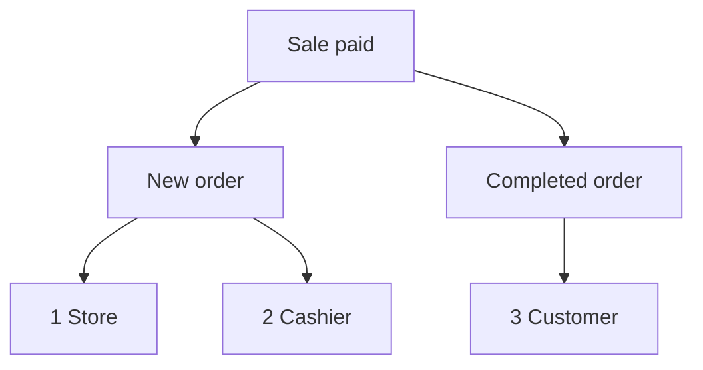

import Accordion from '@site/src/components/Accordion';
import AccordionItem from '@site/src/components/AccordionItem';
import LinkCards from '@site/src/components/LinkCards';
import LinkCard from '@site/src/components/LinkCard';

**WP管理画面：** `WP Admin → POS → Settings → Checkout`。

WooCommerceは、店舗宛ての新規注文メールや顧客宛ての注文完了メールなど、注文に関するメールを送信します。POSでの販売については、どのメールを誰に送信するかをここで選択します。オンライン注文には、通常のWooCommerceのメール設定が引き続き適用されます。

各項目へ移動：[管理者メール](#admin-emails) · [顧客メール](#customer-emails) · [レシートを手動で送信する](#send-receipt-manually) · [レジ係メール](#cashier-emails) · [よくある利用例](#common-scenarios) · [問題が起きた場合](#goes-wrong)

## メールを有効または無効にする {#switches}

:::note POSでの販売に適用
POS注文では、これらのスイッチが **WooCommerce > 設定 > メール** の **このメール通知を有効化** より優先されます。WooCommerceで無効になっているメールでも、ここでチェックが入っていれば送信されます。
:::

1. WP Adminで **POS > 設定 > レジ** に移動します。
2. **在庫超過販売を防止** の下にある三つのメールスイッチ、**管理者メール**、**顧客メール**、**レジ係メール** を確認します。その下に **決済ゲートウェイ** の一覧があります。
3. スイッチをオンにすると、そのグループのメールごとにチェックボックスが表示されます。特定のメールだけを停止するには、そのチェックを外します。
4. スイッチをオフにすると、チェックボックスの状態にかかわらず、そのグループのメールはPOSでの販売時に一切送信されません。

変更はその都度保存されます。画面には **保存中**、続いて **保存済み** と表示されます。

{/* reshoot: WP Admin > POS > Settings > Checkout with all three email switches on and their checkboxes showing; see reshoot.md */}

各スイッチの送信先と、インストール時の初期状態は次のとおりです。

- **管理者メール**：インストール時はオン\
  **WooCommerce > 設定 > メール** の各メールの **受信者** に設定されたアドレスに送信
- **顧客メール**：インストール時はオン\
  注文の請求先メールアドレスに送信
- **レジ係メール**：インストール時はオフ\
  レジ係のWordPressアカウントのメールアドレスに送信

支払い方法の **注文ステータス** が「完了」の場合、レジで一件の販売の支払いを受けると、次の宛先にメールが送信されます。

1. **店舗** — **管理者メール** がオンで **新規注文** にチェックが入っている場合、WooCommerceの **新規注文** の **受信者** に送信されます。
2. **レジ係** — **レジ係メール** がオンで **新規注文** にチェックが入っている場合、レジ係本人のアドレスに送信されます。
3. **顧客** — **顧客メール** がオンで **注文完了** にチェックが入っており、注文に請求先メールアドレスがある場合、そのアドレスに送信されます。

## 管理者メール {#admin-emails}

店舗の管理者に送信されるメールです。インストール時はすべてのメールにチェックが入っています。

管理者メールの受信者を変更するには、**WooCommerce > 設定 > メール** で該当するメールの設定を開き、**受信者** を編集します。

| メール | 送信されるタイミング |
|---|---|
| **新規注文** | POS注文が「完了」「処理中」「保留中」のいずれかに変わったとき |
| **キャンセルされた注文** | 「処理中」または「保留中」の注文がキャンセルされたとき |
| **失敗した注文** | 「支払い待ち」または「保留中」の注文が失敗したとき |

POS注文が **POS - 未完了** または **POS - 一部支払い** から「完了」「処理中」「保留中」のいずれかに変わると、**管理者メール** または **レジ係メール** がオンで、その中の **新規注文** にチェックが入っていれば、**新規注文** メールが送信されます。WooCommerceで **新規注文** が無効になっていても送信されます。販売後に移行するステータスは、支払い方法ごとに設定した **注文ステータス** です。[注文ステータス](./checkout.mdx#order-status)をご覧ください。

POSでの販売時にWCPOS自体が新規注文メールを送信する理由

WooCommerceが **新規注文** メールを送信するのは、注文が「支払い待ち」「失敗」「キャンセル」から別のステータスに変わる場合だけです。一方、POS注文はWooCommerceが認識しない **POS - 未完了** または **POS - 一部支払い** の状態で待機するため、そこから移行してもWooCommerceはメールを送信しません。そこで、上記のタイミングでWCPOSがWooCommerceに代わって送信します。

## 顧客メール {#customer-emails}

注文の請求先メールアドレスに送信されるメールです。メールアドレスを入力しなかったゲストへの販売など、請求先メールアドレスがない注文には顧客メールは送信されません。インストール時はすべてのメールにチェックが入っています。

### レシートを手動で送信する {#send-receipt-manually}

支払い完了画面の **レシートをメールで送信** は別の機能です。これらのスイッチの対象外であるWooCommerceの請求書メールを送信するため、**顧客メール** がオフでも使用できます。[レシートをメールで送信する](../../receipts/at-checkout.mdx#email-receipt)をご覧ください。

### 自動送信されるメール {#customer-emails-automatic}

| メール | 送信されるタイミング |
|---|---|
| **保留中の注文** | 注文が「支払い待ち」「失敗」「キャンセル」から「保留中」に変わったとき |
| **処理中の注文** | 注文が「支払い待ち」「保留中」「失敗」「キャンセル」から「処理中」に変わったとき |
| **注文完了** | 注文が「完了」に変わったとき |
| **払い戻し済みの注文** | 注文の全額または一部が払い戻されたとき。[払い戻し](../../orders/refunds.mdx)をご覧ください |
| **失敗した注文** | 注文が失敗したとき |

現金販売などで **POS - 未完了** から直接「処理中」または「保留中」に変わった場合、**保留中の注文** や **処理中の注文** のメールは送信されません。WooCommerceは、表に記載したステータスから移行した場合にのみこれらを送信します。**注文完了**、**払い戻し済みの注文**、**失敗した注文** は移行前のステータスに依存しないため、POSでの販売でも送信されます。「処理中」または「保留中」で終わる販売で顧客にメールを送るには、[レシートをメールで送信](#send-receipt-manually)を使用してください。

## レジ係メール {#cashier-emails}

販売を担当したレジ係のWordPressアカウントに登録されているメールアドレスに、**新規注文** メールを送信します。インストール時はスイッチがオフです。オンにすると **新規注文** にチェックが入ります。

レジ係へのメールは管理者と同じタイミングで送信されます（[管理者メール](#admin-emails)を参照）。**管理者メール** と **レジ係メール** は独立しており、一方をオフにしても他方には影響しません。オーナーがレジ係も兼ねている場合など、レジ係のアドレスが管理者の受信者にも含まれる場合、二通ではなく一通だけ届きます。

どのWordPressユーザーがレジ係としてPOSにサインインできるかは、[レジ係のアクセス](./access.mdx)で設定します。

## よくある利用例 {#common-scenarios}

<Accordion>
  <AccordionItem question="忙しい日に受信トレイがメールであふれないようにする">

**管理者メール** の **新規注文** のチェックを外します。確認が必要な **キャンセルされた注文** と **失敗した注文** のチェックは残してください。

売上の把握には、新規注文メールを数える代わりに[レポート](../../reports/index.mdx)を使用してください。

  </AccordionItem>

  <AccordionItem question="新規注文メールを管理者ではなく担当のレジ係に送る">

**管理者メール** の **新規注文** のチェックを外すか、**管理者メール** をオフにして、**レジ係メール** をオンにします。各販売を担当したレジ係のアドレスにメールが届き、管理者の受信トレイには届かなくなります。

**管理者メール** をオフにすると **キャンセルされた注文** と **失敗した注文** も停止するため、通常は **新規注文** のチェックだけを外すことをおすすめします。

  </AccordionItem>

  <AccordionItem question="店頭販売で顧客メールを送信しない">

露店やカフェでは、印刷したレシートを渡した顧客にメールを送る必要がないこともあります。**顧客メール** をオフにすると、POSでの販売時に処理中、完了、払い戻しなどの顧客メールが一切送信されなくなります。

オンライン注文の顧客メールは通常どおり送信されます。メールでのレシートを希望する顧客には引き続き送信できます。支払い完了画面で **レシートをメールで送信** を押してください。

  </AccordionItem>

  <AccordionItem question="1.8.9より前のバージョンから更新したら「メールを有効化」スイッチがなくなった">

バージョン1.8.9では、単一のオン・オフスイッチが、このページにある三つのグループに置き換わりました。WCPOSは以前の設定を引き継ぎます。メールがオフだった場合は **管理者メール** と **顧客メール** がオフになり、オンだった場合は両方がオンで、すべてのメールにチェックが入ります。**レジ係メール** はどちらの場合もオフで始まります。

操作は必要ありません。

  </AccordionItem>
</Accordion>

## 問題が起きた場合 {#goes-wrong}

**管理者に新規注文メールが届かない。** **管理者メール** がオンで、**新規注文** にチェックが入っていることを確認してください。次に、**WooCommerce > 設定 > メール** で **新規注文** の **受信者** を確認してください。

**顧客にメールが届かない。** **顧客メール** がオンで、該当するメールにチェックが入っていることを確認してください。次に注文を開き、請求先メールアドレスがあることを確認してください。すぐにレシートを送信するには、**レシートをメールで送信** を使用します。

**レジ係にメールが届かない。** **レジ係メール** がオンで、**新規注文** にチェックが入っており、レジ係のWordPressアカウントにメールアドレスがあることを確認してください。そのアドレスが管理者の受信者にも含まれる場合、届くメールは一通だけです。

**WooCommerceで無効にしたメールがPOSでの販売時に届く。** POS注文では、ここのチェックボックスの設定が適用されます。ここでも該当するメールのチェックを外してください。

## 開発者向けフック {#developer-hooks}

これらのスイッチ以上の制御が必要な開発者向けの情報です。店舗オーナーは読み飛ばして構いません。

四つのWordPressフィルターと新規注文メールの受信者の設定方法

WCPOS 2.0より前は、これらのフィルター名は `woocommerce_pos_*`（例：`woocommerce_pos_admin_emails`）でした。これらの名前は引き続き使用できますが、2.0以降は非推奨で、早ければ2.2で削除されます。[フックの命名](../../extensions/index.mdx#hook-naming)をご覧ください。

**`wcpos_admin_emails`**：WCPOSが制御する管理者メールのID。デフォルト：`cancelled_order`、`failed_order`。

**`wcpos_customer_emails`**：WCPOSが制御する顧客メールのID。デフォルト：`customer_failed_order`、`customer_on_hold_order`、`customer_processing_order`、`customer_completed_order`、`customer_refunded_order`。

**`wcpos_admin_email_enabled`**：あるPOS注文に対して、ある管理者メールを送信するかどうか。引数：`$is_enabled`、`$email_id`、`$order`、`$email`。

**`wcpos_customer_email_enabled`**：あるPOS注文に対して、ある顧客メールを送信するかどうか。引数は同じです。

**新規注文** は `wcpos_admin_emails` に含まれません。WCPOSはWooCommerceの `woocommerce_email_recipient_new_order` フィルターで受信者を設定します。管理者が受信を希望しない場合は店舗の受信者を除外し、レジ係が受信を希望する場合はレジ係のアドレスを追加します。レジ係は、注文の `_pos_user` メタに保存されたWordPressユーザーです。このフィルターに独自のコールバックを設定すれば、他のWooCommerceメールと同様にアドレスを追加・削除できます。

## 関連ドキュメント {#related-documentation}

<LinkCards>
  <LinkCard title="レジ設定" to="/settings/checkout" description="同じ画面で設定する決済ゲートウェイと、それぞれが設定する注文ステータス。" />
  <LinkCard title="会計時のレシート" to="/sell/print-email-receipts" description="支払い完了画面からレシートを印刷またはメール送信します。" />
  <LinkCard title="注文" to="/manage-store/orders" description="これらのメールに対応するPOS注文を探します。" />
</LinkCards>
