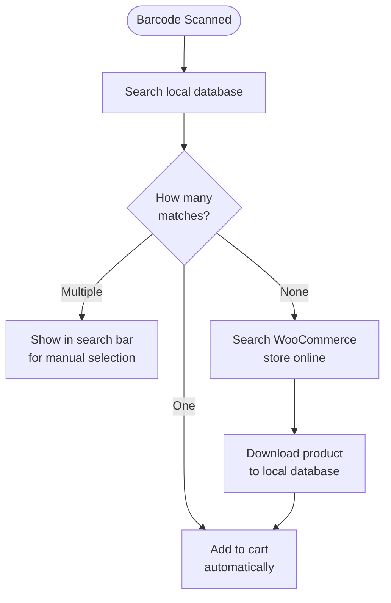

import Image from "@theme/IdealImage";
import Accordion from '@site/src/components/Accordion';
import AccordionItem from '@site/src/components/AccordionItem';

대부분의 바코드 스캐너는 기기에 연결된 키보드처럼 동작합니다.
바코드를 스캔하면 WCPOS가 일반 타이핑보다 빠르게 입력된 문자를 감지합니다.
이러한 "빠른 키 입력"을 통해 해당 입력이 바코드 스캔임을 식별합니다.
이 방식은 거의 모든 스캐너에서 별도 설정 없이 작동합니다 — 다만 스캐너는 WCPOS가 직접 연결할 수 있는 다른 [연결 모드](#connection-modes)도 지원합니다.

## 바코드 스캔 구성 {#configuring-barcode-scanning}

바코드 스캔은 매우 빠르게 이루어지므로, POS는 바코드와 손으로 입력한 내용을 구분할 수 있습니다.
POS 설정에서 바코드 감지 방식을 세부 조정할 수 있는 옵션을 확인할 수 있습니다.

  <Image
    alt="POS 설정의 바코드 스캔 설정"
    img="/img/barcode-scanning-settings.png"
    style={{ maxHeight: 500 }}
  />
  
POS 설정의 바코드 스캔 설정

| 설정 | 용도 | 일반적인 값 |
|---|---|---|
| **평균 입력 시간** | 바코드로 인식할 입력 속도 기준 | 수동 입력이 바코드로 인식되지 않을 만큼 짧은 간격 |
| **최소 길이** | 바코드로 처리할 연속 문자열의 최소 길이 | 사용하는 가장 짧은 바코드에 맞게 설정(예: EAN-8의 경우 8) |
| **접두사/접미사 제거** | 스캐너가 추가하는 문자(접두사 또는 접미사)를 제거하여 바코드 본문만 남김 | 스캐너가 접두사나 접미사를 추가하도록 설정되어 있지 않다면 비워 두세요 |

## 연결 모드 {#connection-modes}

설정이나 문제 해결을 단계별로 진행하려면 [스캐너 설정 마법사](/1.x/hardware/scanners/setup-wizard)를 사용하세요.

바코드 스캐너는 몇 가지 모드 중 하나로 출고되며, 이 모드에 따라 WCPOS가 스캔 결과를 받는 방식이 결정됩니다:

| 모드 | 전달 방식 | 설정 |
|---|---|---|
| **키보드(HID)** — 거의 모든 스캐너의 공장 기본값 | 스캐너가 바코드를 입력하면 WCPOS가 빠른 키 입력을 인식합니다 | 필요 없음 — 페어링하거나 연결한 후 스캔하세요 |
| **시리얼(SPP / USB-COM)** | USB 시리얼 또는 Bluetooth SPP를 통한 직접 연결 | 스캐너 모드를 전환한 후 바코드 설정에서 연결하세요 |
| **HID-POS** | USB 스캐너의 직접 연결(WebHID 사용) | 스캐너 모드를 전환한 후 바코드 설정에서 연결하세요 |
| **Bluetooth LE(공급업체 GATT)** | Bluetooth Low Energy 직접 연결 | 스캐너를 페어링한 후 바코드 설정에서 서비스 UUID로 추가하세요 |

키보드 모드는 별도 설정이 필요 없으며 대부분의 매장에 적합합니다. 키보드 레이아웃 차이로 대문자나 기호가 뒤섞여 스캔 결과가 잘못 전달되거나, 검색창에 포커스가 없을 때 다른 곳에 입력된다면 직접 연결이 유용합니다. 직접 연결된 스캐너는 입력 속도, 키보드 레이아웃, 포커스와 관계없이 모든 스캔 결과를 WCPOS로 바로 전달합니다.

:::info 키보드 모드의 스캐너는 직접 연결할 수 없습니다
기기는 키보드 모드의 스캐너를 키보드와 동일하게 취급하며, 어떤 앱도 키보드를 독점적으로 제어할 수 없습니다.
바코드 설정에서 **시리얼 스캐너 연결** 또는 **HID 스캐너 연결**을 눌렀는데 목록에 스캐너가 나타나지 않는다면, 스캐너가 아직 키보드 모드일 가능성이 매우 높습니다.
:::

**모드를 전환하려면** 스캐너 설명서에서 설정용 바코드(*"SPP 모드"*, *"시리얼 모드"* 또는 *"HID-POS 모드"*)를 찾아 스캔하세요. 스캐너 설정이 자동으로 변경됩니다. Bluetooth 스캐너는 기기의 Bluetooth 설정에서 기존 페어링을 해제하고 모드 전환 후 다시 페어링하세요. 설명서의 *"HID"* 또는 *"키보드"* 바코드를 스캔하면 언제든지 원래 모드로 돌아갈 수 있습니다.

직접 연결은 데스크톱 앱과 Chrome 기반 브라우저에서 지원됩니다(브라우저의 Web Serial 및 WebHID 지원 사용). 데스크톱 앱에서는 앱 내부에 기기 선택 창이 표시되며, Chrome에서는 브라우저 자체의 기기 선택 창이 표시됩니다. iOS와 Android에서는 키보드 모드와 카메라 스캔을 사용할 수 있습니다. Android는 하드웨어 스캐너의 키 입력을 직접 받아 처리하는 기능도 지원합니다.

## 카메라 스캔 {#camera-scanning}

웹, 데스크톱, iOS, Android의 모든 플랫폼에서 기기 카메라로 스캔할 수 있으므로 전용 스캐너 없이도 시작할 수 있습니다. 검색창의 스캔 아이콘으로 카메라를 여세요. 카메라는 **필터 바로 아래에 크기를 조절할 수 있는 패널**로 표시되어 스캔하는 동안에도 상품 목록을 볼 수 있습니다. 카메라를 바코드에 향하면 WCPOS가 하드웨어 스캔과 동일한 방식으로 바코드를 읽습니다.

## 바코드가 감지되면 어떻게 되나요? {#what-happens-when-a-barcode-is-detected}

POS는 바코드를 감지하면 로컬 데이터베이스에서 일치하는 상품 또는 상품 변형을 찾습니다.
결과는 다음 세 가지로 나뉩니다:

스캔 시 로컬에 일치하는 상품이 없으면 WCPOS가 온라인 상점에서 해당 상품을 찾아 다운로드하고 **자동으로 장바구니에 추가**합니다. 따라서 처음 스캔하는 바코드로도 판매를 완료할 수 있으며, 다음에 같은 바코드를 스캔하면 즉시 처리됩니다.

:::tip 일치하는 상품이 여러 개라면 대개 데이터 문제입니다
여러 상품에 같은 바코드가 있으면 POS는 어떤 상품을 추가해야 할지 판단할 수 없으므로 검색창에 코드를 넣어 직접 선택할 수 있도록 합니다. 이런 경우 대개 상품 데이터를 정리해야 합니다. 각 상품에는 **고유한** 바코드가 있어야 합니다.
:::

## 스캔 피드백과 동작 {#scan-feedback-and-behaviour}

- **스캔 소리** — WCPOS는 스캔할 때마다 소리를 재생하여 캐셔가 화면을 보지 않고도 즉시 확인할 수 있도록 합니다. 소리는 선택 사항이며 여러 테마 중에서 고를 수 있습니다. [바코드 설정](/1.x/settings/store/barcode)에서 소리를 켜고 테마를 선택하세요.
- **주문 화면에서** — 스캔 결과가 주문 검색 필드로 전달되므로 바코드를 스캔하여 원하는 주문이나 상품을 찾을 수 있습니다.
- **UPC-A 바코드** — UPC-A 스캔은 포장에 인쇄된 숫자로 해석되므로 POS가 대조하는 값과 상품 데이터에 사용된 값이 일치합니다.

## 상품 동기화 이해하기 {#understanding-product-synchronisation}

POS는 백그라운드에서 카탈로그를 조금씩 나누어 다운로드하므로 처음부터 모든 상품이 기기에 저장되어 있지는 않습니다. 작동 방식은 [상품 동기화](/1.x/products/sync)를 참조하세요.

### 바코드 스캔에 중요한 이유 {#why-it-matters-for-barcode-scanning}

아직 로컬에 저장되지 않은 바코드를 스캔하면 POS가 WooCommerce 상점에 온라인으로 접속하여 해당 상품을 찾아 다운로드합니다. 따라서 다음에 같은 바코드를 스캔하면 즉시 처리됩니다. 이 과정을 빠르게 하려고 별도로 조치할 필요는 없습니다. 백그라운드의 초기 카탈로그 다운로드가 나머지 상품을 자동으로 채우며, **매장 상태 → 데이터베이스**에서 진행 상황을 확인할 수 있습니다.

## 자주 묻는 질문 {#faq}

<Accordion>
  <AccordionItem question="바코드를 스캔할 때 '로컬에서 0개의 상품을 찾음'이라고 표시되는 이유는 무엇인가요?">

처음부터 모든 상품이 기기에 저장되어 있지는 않습니다. POS는 사용을 시작한 후 몇 분 동안 백그라운드에서 카탈로그를 채웁니다.
방금 스캔한 상품이 아직 저장되어 있지 않다면 POS가 온라인에서 조회하여 다운로드하므로 다음에 스캔할 때는 즉시 처리됩니다.

  </AccordionItem>

  <AccordionItem question="POS에서 바코드를 생성하고 인쇄할 수 있나요?">

아니요, 현재는 지원하지 않습니다. POS는 기존 바코드를 스캔하고 읽도록 설계되었으며, 바코드를 생성하거나 인쇄하는 기능은 포함되어 있지 않습니다.
상품의 바코드를 생성해야 한다면 바코드 생성과 인쇄를 전문으로 하는 타사 WooCommerce 플러그인을 사용할 수 있습니다. 예를 들면 다음과 같습니다:

- [EAN for WooCommerce](https://wordpress.org/plugins/ean-for-woocommerce/)
- [A4 Barcode Generator](https://wordpress.org/plugins/a4-barcode-generator/)

상품 바코드를 생성한 후에는 계산대에서 간편하게 스캔하여 POS의 결제 과정을 빠르게 진행할 수 있습니다.

  </AccordionItem>
</Accordion>
