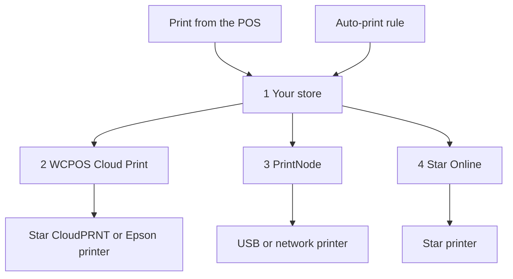

import LinkCards from '@site/src/components/LinkCards';
import LinkCard from '@site/src/components/LinkCard';

클라우드 인쇄는 인터넷을 통해 프린터로 영수증을 보내므로 POS를 실행하는 기기에 프린터를 연결할 필요가 없습니다. 계산대와 다른 네트워크에 있는 프린터, 모든 주문을 자동으로 인쇄하는 주방 프린터, 온라인 판매 건마다 인쇄하는 포장 명세서에 활용하세요.

**WP Admin → POS → 설정 → 클라우드 인쇄**에서 클라우드 프린터를 한 번만 설정하면 됩니다. 이후에는 모든 기기에 해당 프린터가 표시되며, 캐셔는 다른 프린터와 마찬가지로 POS에서 인쇄할 수 있습니다.

## POS에서 인쇄하기 {#manual}

매장 사이트에서 주문을 바탕으로 클라우드 프린터용 영수증을 생성하므로, 인쇄하기 전에 판매 내역이 매장 사이트에 있어야 합니다.

1. 결제 완료 화면이나 주문의 **영수증** 창에서 **프린터** 메뉴를 열고 클라우드 프린터를 선택하세요.
2. **영수증 인쇄**를 누르세요.
3. 화면에 **인쇄 대상**과 프린터 이름이 표시됩니다. 이는 매장 사이트에서 작업을 받았다는 뜻이므로 영수증이 실제로 출력되었는지 확인하세요. 출력되지 않았다면 관리자가 [인쇄 대기열](#print-queue)에서 작업에 어떤 일이 있었는지 확인할 수 있습니다.

[영수증 인쇄하기](./at-checkout.mdx#print-receipt)를 참고하세요. 특정 템플릿을 항상 클라우드 프린터로 보내려면 **설정 → 인쇄**에서 해당 템플릿에 사용할 프린터를 선택하세요. [인쇄 라우팅](../hardware/printers/index.mdx#print-routing)을 참고하세요.

- **주문이 매장 사이트에 있어야 합니다.** 오프라인에서 접수한 주문처럼 매장 사이트가 아직 판매를 확인하지 못했다면 POS에 *이 프린터는 매장 사이트 보관용 사본을 인쇄합니다. 매장 사이트가 아직 이 판매를 확인하지 않았습니다. 확인된 후 다시 인쇄하세요.*라고 표시됩니다. 계산대가 온라인 상태가 되고 매장 사이트가 판매를 확인하면 **영수증 인쇄**를 다시 누르세요. 계산대가 오프라인 상태이면 이전 주문이라도 클라우드 프린터로 인쇄할 수 없습니다.
- 클라우드 프린터로 **세션 보고서 및 마감 내역**을 보내면 시스템 인쇄 대화 상자가 대신 열립니다.
- **Star 또는 Epson 클라우드 프린터에 HTML 템플릿을 보내면** *이 클라우드 프린터는 감열식 템플릿만 인쇄하므로 아무것도 인쇄되지 않습니다. 감열식 템플릿을 선택하세요.*라고 표시됩니다.

모든 기기의 **설정 → 인쇄**에서 **프린터** 아래에 클라우드 프린터가 자동으로 표시됩니다. 행의 두 번째 줄에는 *Star CloudPRNT · WCPOS에서 관리*와 같이 유형이 표시됩니다. 캐셔는 해당 행의 **테스트 인쇄**나 **⋯** 메뉴의 **설정 보고서 복사**를 누를 수 있지만, 편집하거나 삭제할 수는 없습니다. 편집과 삭제는 **클라우드 인쇄** 화면에서 합니다. [프린터 설정](../hardware/printers/index.mdx#printers-list)을 참고하세요.

## 프린터 유형 선택하기 {#providers}

:::note 여기서부터는 WP Admin이 필요합니다
프린터와 규칙 추가는 매장 소유자나 관리자가 **WP Admin → POS → 설정 → 클라우드 인쇄**에서 수행합니다.
:::

**클라우드 인쇄** 화면에 **어떤 종류의 프린터를 연결하시나요?** 라는 질문이 표시됩니다. 프린터에 맞는 유형을 선택하세요.

- **Star CloudPRNT** — CloudPRNT가 내장된 Star 프린터(mC-Print, TSP143IV…)를 별도 계정 없이 무료로 연결할 때 사용합니다. 프린터가 매장 사이트에서 작업을 가져옵니다. *감열식 템플릿만 지원합니다.*
- **Epson Server Direct Print** — Epson intelligent TM 프린터(TM-T88VI/VII, TM-m30III, TM-i 시리즈)에 사용합니다. 프린터가 매장 사이트에서 작업을 가져옵니다. *감열식 템플릿만 지원합니다.*
- **Star Online** — stario.online 계정에 연결된 Star 프린터(mC-Print3, TSP143IV, mC-Label3)에 사용합니다. 매장 사이트가 Star Online에 작업을 넘기면 Star Online이 전달합니다. *감열식 템플릿만 지원합니다.*
- **PrintNode** — 매장 컴퓨터에서 소형 PrintNode 앱을 실행할 수 있을 때 일반 USB 또는 네트워크 프린터에 사용합니다. 매장 사이트가 PrintNode에 작업을 넘기면 해당 컴퓨터의 앱이 인쇄합니다. *모든 템플릿을 지원합니다.*

Star 또는 Epson 클라우드 프린터는 HTML 템플릿을 인쇄할 수 없습니다. 영수증을 프린터 전용 명령으로 변환해야 하기 때문입니다. HTML 및 전체 페이지 템플릿에는 PrintNode를 사용하세요. [감열식 템플릿](./thermal-templates.mdx)을 참고하세요.

<details>
<summary>작업이 프린터에 전달되는 과정</summary>



<div className="pinned-legend">

1. **매장 사이트** — 주문과 템플릿을 바탕으로 영수증을 생성하고 [인쇄 대기열](#print-queue)에 작업을 보관합니다. POS에서의 인쇄와 [자동 인쇄 규칙](#auto-print) 모두 여기서 시작합니다.
2. **WCPOS Cloud Print** — [중계 서비스](#relay)입니다. Star CloudPRNT 또는 Epson 프린터는 일반적으로 이 서비스를 통해 작업을 가져오므로, 프린터가 다음에 접속할 때까지 작업이 대기합니다.
3. **PrintNode** — 매장 사이트가 PrintNode에 작업을 넘기면 매장 컴퓨터의 PrintNode 앱이 인쇄합니다.
4. **Star Online** — 매장 사이트가 Star Online에 작업을 넘기면 Star Online이 프린터로 전달합니다.

</div>

</details>

## 프린터 추가하기 {#setup}

1. **WP Admin → POS → 설정 → 클라우드 인쇄**로 이동하세요. **내 클라우드 프린터**에서 **+ 프린터 추가**를 누르세요.
2. 유형을 선택하세요.
3. *주방 프린터*와 같이 **프린터 이름**을 입력하세요. WCPOS는 이름을 바탕으로 프린터의 **프린터 ID**를 생성합니다. ID는 나중에 변경할 수 없습니다. 변경하려면 프린터를 삭제하고 다시 추가하세요.
4. 선택한 유형에 맞는 단계를 완료하세요. [Star CloudPRNT 또는 Epson](#setup-polling), [PrintNode](#setup-printnode), [Star Online](#setup-star-online)을 참고하세요.
5. 프린터가 **내 클라우드 프린터** 아래에 카드로 표시됩니다. 카드의 **테스트 인쇄**를 누르세요. [프린터 카드](#status)를 참고하세요.

### Star CloudPRNT 또는 Epson Server Direct Print {#setup-polling}

이 프린터들은 작업을 직접 가져오므로 연결할 계정이 없습니다. 프린터가 매장 사이트에 접속하는 방식이므로 포트를 열거나 고정 IP를 설정하거나 방화벽을 변경할 필요가 없습니다. 작업은 프린터가 다음에 접속할 때 인쇄됩니다. **+ 프린터 추가**의 마지막 단계에 비밀 토큰이 포함된 프린터의 **폴링 URL**이 표시됩니다.

<details>
<summary>Star CloudPRNT 또는 Epson 프린터 연결하기</summary>

1. **폴링 URL** 옆의 **복사**를 누르세요. 전체 주소는 **한 번만** 표시됩니다. 주소를 잃어버리면 프린터를 삭제하고 다시 추가하여 새 주소를 받으세요. 카드의 **설정 및 토큰**에서는 토큰이 숨겨진 상태로 표시됩니다.
2. 프린터 자체 설정 페이지를 열고 서버 URL에 주소를 붙여넣으세요. Star는 **CloudPRNT** 설정, Epson은 **Server Direct Print** 설정에 입력합니다. 폴링을 켜고 저장한 뒤 프린터를 다시 시작하세요.
3. 카드로 돌아오면 프린터가 처음으로 작업을 가져올 때 상태가 **프린터 대기 중**에서 **연결됨**으로 바뀝니다.

주소는 일반적으로 `https://cloudprint.wcpos.com`으로 시작합니다. 이 주소는 [WCPOS Cloud Print 중계 서비스](#relay)의 주소이며, 사용해야 하는 주소입니다. 주소 아래의 **고급: 이 사이트에 직접 연결(중계 없음)** 에는 대신 **직접 연결 URL**이 표시됩니다. 일부 프린터는 사이트에 직접 접속하지 못해 **프린터 대기 중** 상태로 남습니다.

Epson에서는 WCPOS가 이 방식으로 인쇄하는 동안 **Server Direct Print**를 켜 두세요. [Server Direct Print](../hardware/printers/server-direct-print.mdx)를 참고하세요.

</details>

### PrintNode {#setup-printnode}

PrintNode를 사용하려면 프린터 옆 컴퓨터에서 클라이언트를 실행해야 하며, PrintNode 계정의 API 키가 필요합니다.

<details>
<summary>PrintNode 프린터 연결하기</summary>

1. 프린터 옆 컴퓨터에 PrintNode 클라이언트를 설치하고 로그인하세요. 인쇄하려면 컴퓨터가 켜져 있고 클라이언트가 실행 중이어야 합니다.
2. PrintNode 계정에서 API 키를 생성하세요.
3. **+ 프린터 추가**에서 **PrintNode**를 선택하고 **PrintNode API 키**에 키를 붙여넣은 다음 **내 프린터 가져오기**를 누르세요.
4. **프린터 선택**에서 클라이언트가 보고한 프린터를 선택하고 완료하세요. 마지막 단계에 **PrintNode에 연결됨**이 표시되며, 복사할 주소나 토큰은 없습니다.

</details>

연결되면 프린터 카드에서 **인쇄 형식**을 설정하세요.

- **PDF(권장)** 는 감열식과 HTML을 포함한 모든 템플릿을 PDF로 인쇄합니다. 변경할 이유가 없다면 이 설정을 유지하세요.
- **ESC/POS RAW — 감열식 템플릿만**은 감열식 템플릿을 PDF 대신 영수증 프린터 명령으로 보냅니다. HTML 템플릿은 여전히 PDF로 전송됩니다.

### Star Online {#setup-star-online}

Star Online에는 프린터의 그룹 주소와 API 키가 필요하며, 둘 다 stario.online 계정에서 가져옵니다.

<details>
<summary>Star Online 프린터 연결하기</summary>

1. stario.online에서 **기기 그룹**을 열고 그룹의 **CloudPRNT URL**을 복사하세요. 주소 형식은 `https://device.stario.online/cloudprnt/...`이며, EU에서는 `https://eu-device.stario.online/cloudprnt/...`입니다.
2. stario.online에서 **EnumDevices**, **ViewDevice**, **PrintToDevice**, **ViewDeviceGroups** 권한이 있는 API 키를 생성하세요. 이 권한이 없는 키도 등록은 되지만 목록 조회나 인쇄는 할 수 없습니다.
3. **+ 프린터 추가**에서 **Star Online**을 선택하세요. **CloudPRNT URL**과 **Star Online API 키**를 붙여넣은 다음 **내 기기 가져오기**를 누르세요.
4. **기기 선택**에서 프린터를 선택하고 완료하세요. 그러면 카드에 **기기**, **그룹**, **AccessIdentifier**가 표시됩니다.

</details>

## 프린터 카드 {#status}

각 클라우드 프린터는 **내 클라우드 프린터** 아래에 카드로 표시됩니다.

- **이름** — 클릭하여 프린터 이름을 변경하세요. 이름 아래에 유형이 표시됩니다.
- **상태** — 아래 목록을 참고하세요. 30초마다 갱신됩니다.
- **마지막 접속** — Star CloudPRNT 또는 Epson 프린터가 마지막으로 작업을 가져온 시각이며, 한 번도 가져오지 않았다면 *없음*으로 표시됩니다.
- **프린터 ID** — 프린터를 추가할 때 정해지며 변경할 수 없습니다.
- **인쇄 형식** — PrintNode 전용으로, **PDF(권장)** 또는 **ESC/POS RAW — 감열식 템플릿만**을 선택합니다. [PrintNode](#setup-printnode)를 참고하세요.
- **테스트 인쇄** — 짧은 테스트 페이지를 보냅니다. *…에 테스트 인쇄를 보냈습니다*라는 메시지나 실패 이유가 표시됩니다.
- **프린터 작업**(**⋮**) — **설정 및 토큰**은 마지막 설정 단계를 다시 열고, **프린터 삭제**는 프린터가 작업을 더 이상 받지 못하게 합니다. 나중에 다시 추가할 수 있습니다.

<details id="status-polling">
<summary>Star CloudPRNT 및 Epson Server Direct Print 상태</summary>

- **프린터 대기 중** — 프린터가 아직 작업을 가져온 적이 없습니다. 프린터의 폴링 URL을 확인하세요. [프린터 대기 중 상태가 계속되는 경우](#trouble-polling)를 참고하세요.
- **연결됨** — 최근 2분 30초 이내에 프린터가 작업을 가져왔습니다.
- **오프라인** — 프린터가 이전에는 작업을 가져왔지만 최근에는 가져오지 않았습니다. 전원이 켜져 있고 온라인 상태인지 확인하세요.
- **차단됨** — 중계 서비스가 매장 사이트에 접속할 수 없습니다. Cloudflare 같은 보안 서비스나 방화벽 플러그인이 차단했거나 사이트에서 서버 오류로 응답한 경우로, 이유가 카드에 표시됩니다. [Star CloudPRNT 또는 Epson 문제](#trouble-polling)를 참고하세요.

</details>

<details id="status-services">
<summary>Star Online 및 PrintNode 상태</summary>

- **온라인** — 서비스에서 프린터를 사용할 수 있다고 보고했습니다.
- **오프라인** — 서비스에서 프린터 또는 PrintNode 컴퓨터를 사용할 수 없다고 보고했습니다. PrintNode의 경우 컴퓨터가 절전 상태가 아니고 클라이언트가 실행 중인지 확인하세요.
- **알 수 없음** — WCPOS가 서비스에서 상태를 가져오지 못했습니다. [PrintNode](#setup-printnode) 또는 [Star Online](#setup-star-online)의 API 키를 확인하세요.

</details>

## 주문 자동 인쇄하기 {#auto-print}

자동 인쇄 규칙은 아무도 버튼을 누르지 않아도 주문을 인쇄합니다. 규칙은 선택 사항입니다. 규칙이 없으면 캐셔가 POS에서 인쇄할 때만 클라우드 프린터가 인쇄합니다.

**자동 인쇄 규칙**에서 **+ 규칙 추가**를 누르세요. 각 규칙은 문장 형태이며, 밑줄이 있는 각 부분은 메뉴입니다.

> **모든 매장(POS) 주문**을 **생성 즉시** **주방 주문서** 템플릿으로 **주방 프린터**에 **2부** 자동 인쇄합니다.

- **대상 주문** — **모든 주문**, **모든 매장(POS) 주문**, **모든 온라인 주문** 중에서 선택합니다. WCPOS Pro에서는 특정 매장의 **주문**도 선택할 수 있습니다. [매장별 프린터](#per-store-printers)를 참고하세요.
- **프린터** — 등록한 클라우드 프린터 중 하나입니다.
- **템플릿** — 해당 프린터에서 인쇄할 수 있는 템플릿만 표시됩니다. 템플릿은 **POS › 템플릿**에서 가져옵니다.
- **인쇄 매수** — 1~5부입니다.
- **인쇄 시점** — **결제 완료 시**(기본값) 또는 **생성 즉시**를 선택합니다. POS 주문에서 생성 시점은 장바구니가 처음 저장되는 순간이므로 주방 주문서가 결제 전에 인쇄됩니다.

주방 주문서와 고객 영수증처럼 여러 규칙으로 같은 주문을 인쇄할 수 있습니다. 각 규칙은 동일한 주문을 한 번만 인쇄합니다. 매장 사이트에서 주문과 템플릿으로 영수증을 생성하므로 캐셔가 할 일은 없습니다. 자동 인쇄는 금전함을 열지 않습니다.

규칙의 프린터를 해당 템플릿을 인쇄할 수 없는 프린터로 변경하면, 규칙은 그 프린터가 인쇄할 수 있는 첫 번째 템플릿으로 전환됩니다. 원하는 템플릿인지 확인하세요. 프린터가 등록된 템플릿을 하나도 인쇄할 수 없다면 템플릿이 비워지며, 템플릿을 선택할 때까지 규칙은 인쇄하지 않습니다.

### 매장별 프린터(Pro) {#per-store-printers}

[WCPOS Pro](../getting-started/pro-license.mdx)를 사용하고 [매장](../stores/index.mdx)이 여러 곳이면 **대상 주문** 메뉴에 각 매장의 **주문**도 표시됩니다. 매장 규칙은 해당 매장의 계산대에서 접수한 주문과 주문 편집 화면에서 해당 매장에 배정한 주문을 인쇄합니다. 온라인 주문은 매장을 배정하지 않으면 어느 매장에도 속하지 않으므로 모든 매장을 대상으로 하는 규칙에서만 인쇄됩니다.

규칙은 누적 적용됩니다. 특정 매장의 주문은 해당 매장의 규칙에 따라 인쇄되며, **동시에** **모든 주문**, **모든 매장(POS) 주문**, **모든 온라인 주문**에 대한 모든 규칙에서도 인쇄됩니다. 한 지점의 주방 주문서가 다른 지점의 프린터에서 출력되지 않도록 하려면 지점마다 별도의 매장 규칙을 만들고, 해당 주문서에 모든 매장 대상 규칙을 추가하지 마세요.

## 인쇄 대기열 {#print-queue}

규칙 아래의 **인쇄 대기열**에는 모든 작업이 **주문**, **프린터**, **템플릿**, **상태**, **상세 정보**, **생성일** 항목으로 표시됩니다. 주문 번호를 누르면 해당 주문으로 이동합니다.

- 상태(**확인 필요**, **모든 상태**, 또는 **대기 중**, **인쇄 중**, **인쇄됨**, **실패**, **취소됨** 중 하나)와 프린터별로 **필터**를 적용하세요.
- 대기 중인 작업을 **취소**하거나 실패한 작업을 **재시도**하거나(새 작업으로 등록되며 *#…로 재시도됨*으로 표시됩니다) 작업을 **삭제**하세요. 여러 행을 선택하여 **선택 항목 취소** 또는 **선택 항목 삭제**를 사용할 수도 있습니다.
- **상세 정보**에는 *Star Online이 요청을 거부했습니다. API 키에 필요한 권한이 있는지 확인하세요.*와 같이 작업 실패 이유가 표시됩니다.

Star CloudPRNT 또는 Epson 프린터에 대기 중인 영수증이 있는데 10분 동안 작업을 가져오지 않았거나 한 번도 가져온 적이 없으면 경고가 표시됩니다. 경고에는 프린터 이름, 마지막으로 작업을 가져온 시각, 대기 중인 영수증 수와 함께 **모두 취소**가 표시됩니다.

:::warning 프린터가 확인 응답을 보내지 않은 작업
*프린터가 이 작업에 확인 응답을 보내지 않았습니다*는 WCPOS가 인쇄 여부를 알 수 없다는 뜻입니다. 중복 인쇄될 수 있으므로 작업을 자동으로 다시 보내지 않습니다. 프린터를 확인하고 아무것도 출력되지 않은 경우에만 **재시도**를 누르세요.
:::

<details>
<summary>작업 보관 기간과 재시도</summary>

인쇄되거나 취소된 작업은 7일 후, 실패한 작업은 30일 후 삭제됩니다. 개발자는 `wcpos_print_job_retention_days` 및 `wcpos_print_job_failed_retention_days` 필터로 이 기간을 변경할 수 있습니다.

WCPOS가 PrintNode 또는 Star Online에 전달하는 작업은 총 3회 시도되며, 첫 번째 재시도는 1분 후, 다음 재시도는 그로부터 2분 후에 이루어집니다. 서비스가 키나 계정을 거부하면 즉시 실패하고 **상세 정보**에 이유가 표시됩니다.

</details>

## 중계 서비스 WCPOS Cloud Print {#relay}

Star CloudPRNT 또는 Epson 프린터의 폴링 URL은 자체 사이트가 아닌 **cloudprint.wcpos.com**을 가리킵니다. 이 주소는 WCPOS가 프린터와 매장 사이트 사이에서 운영하는 무료 중계 서비스인 **WCPOS Cloud Print**의 주소입니다.

별도로 켤 기능은 없습니다. 작업은 중계 서비스를 거쳐 프린터로 전달되므로, 연결하면 사이트 주소가 wcpos.com과 공유되고 주문 세부 정보가 포함된 영수증도 이 서비스를 통과합니다. [개인정보 처리방침](https://wcpos.com/privacy)을 참고하세요.

<details>
<summary>중계 서비스 작동 방식</summary>

영수증 프린터는 업데이트가 드문 소규모 펌웨어를 사용합니다. 많은 프린터가 최신 호스팅 환경의 매장 사이트에 보안 연결을 맺지 못하거나 사이트 앞단의 Cloudflare 같은 서비스에 의해 접속을 거부당합니다. 그러면 모든 설정이 올바르더라도 **프린터 대기 중** 상태에 머무릅니다. 중계 서비스는 프린터가 사용할 수 있는 연결을 제공하고 요청을 매장 사이트로 전달합니다.

- **클라우드 인쇄**를 처음 열면 사이트가 중계 서비스에 자동으로 연결됩니다.
- 중계 서비스를 사용하려면 사이트가 **HTTPS**를 사용해야 합니다. 그렇지 않으면 **클라우드 인쇄**에 안내가 표시됩니다.
- 로컬 테스트 사이트처럼 중계 서비스에 연결할 수 없는 사이트에서는 폴링 URL이 사이트를 직접 가리킵니다.
- 카드의 **차단됨**은 중계 서비스가 사이트에 접속했지만 거부되었다는 뜻입니다. 카드 안내에 따라 보안 서비스에서 중계 서비스를 허용하세요. [Star CloudPRNT 또는 Epson 문제](#trouble-polling)를 참고하세요.

</details>

<details>
<summary>중계 서비스 끄기(개발자용)</summary>

Star CloudPRNT 또는 Epson 프린터 설정의 마지막 단계에는 **직접 연결 URL**이 포함된 **고급: 이 사이트에 직접 연결(중계 없음)** 이 있습니다. 사이트 전체에서 중계 서비스를 끄려면 다음과 같이 설정하세요.

```php
add_filter( 'wcpos_cloud_print_relay_enabled', '__return_false' );
```

WCPOS 2.0 이전에는 이 필터가 `woocommerce_pos_cloud_print_relay_enabled`였습니다. 이 이름은 아직 작동하지만 2.0부터 사용 중단 대상으로 지정되었으며, 빨라도 2.2에 제거됩니다. [훅 이름 지정](../extensions/index.mdx#hook-naming)을 참고하세요.

</details>

<details>
<summary>영수증이 Star CloudPRNT 프린터에 전달되는 과정</summary>

WCPOS는 StarPRNT 명령, 영수증 PNG 이미지, 일반 텍스트 순으로 프린터에 제시하고, 프린터가 읽을 수 있다고 응답한 형식 중 가장 적합한 것을 사용합니다. Line Mode만 읽을 수 있는 구형 Star 모델(TSP650II, TSP700II, TSP800II)은 이미지를 통해서만 로고를 받을 수 있습니다. 이미지를 사용하려면 서버에 GD 및 FreeType PHP 확장이 필요합니다. Epson 프린터에는 ePOS-Print XML을, Star Online에는 Star Document Markup을 보냅니다.

</details>

## 문제가 발생한 경우 {#troubleshooting}

**POS에서 클라우드 프린터로 인쇄했지만 영수증이 나오지 않습니다.** POS는 매장 사이트가 작업을 받았다는 사실만 알 수 있습니다. [인쇄 대기열](#print-queue)을 열고 주문을 찾으세요.

- **대기 중** — 프린터가 아직 작업을 가져가지 않았습니다. 카드에서 프린터 상태를 확인하세요. [Star CloudPRNT 및 Epson Server Direct Print 상태](#status-polling) 또는 [Star Online 및 PrintNode 상태](#status-services)를 참고하세요.
- **인쇄 중** — 작업이 전달 중이며, 프린터가 아직 인쇄 완료를 알리지 않았습니다.
- **실패** — **상세 정보**에 이유가 표시됩니다. 문제를 해결한 다음 **재시도**를 누르세요. **상세 정보**에 *프린터가 이 작업에 확인 응답을 보내지 않았습니다*라고 표시되면 이미 인쇄되었을 수 있으므로 **재시도**를 누르기 전에 프린터를 확인하세요.
- **인쇄됨** — 프린터, PrintNode 또는 Star Online이 작업을 받았습니다. 용지를 확인하고 **프린터** 열의 이름이 지금 확인 중인 프린터와 일치하는지 확인하세요.

**내 템플릿이 표시되지 않습니다.** Star CloudPRNT, Epson, Star Online 프린터는 [감열식 템플릿](./thermal-templates.mdx)만 지원합니다. 감열식 템플릿을 선택하거나 PrintNode를 통해 인쇄하세요.

### Star CloudPRNT 또는 Epson 문제 {#trouble-polling}

**프린터 대기 중 상태가 계속됩니다.** 프린터가 매장 사이트에 한 번도 접속하지 못했습니다. 프린터에 입력한 폴링 URL이 정확히 일치하는지 확인하세요. 한 글자만 틀려도 모든 작업 가져오기 요청이 거부됩니다. 확실하지 않으면 프린터를 삭제한 후 다시 추가하여 새 주소를 받으세요. 프린터의 **CloudPRNT** 또는 **Server Direct Print** 설정에서 폴링이 켜져 있는지 확인한 다음 프린터를 다시 시작하세요. **직접 연결 URL**을 사용했다면 `cloudprint.wcpos.com` 주소로 전환하세요. [이런 문제를 해결하기 위한 것이 중계 서비스입니다](#relay).

**차단됨.** 보안 서비스나 방화벽 플러그인이 중계 서비스를 거부하거나 사이트에서 서버 오류를 반환하고 있습니다. 카드의 안내를 따르세요. 서버 오류라면 사이트 상태와 오류 로그를 확인하세요.

**중계 서비스가 도입되기 전에 설정했습니다.** 프린터에 이미 저장된 주소는 계속 작동합니다. 해당 프린터가 **프린터 대기 중** 상태에 머물면 삭제한 후 다시 추가하고, 새 `cloudprint.wcpos.com` 주소를 프린터에 입력하세요.

### PrintNode 문제 {#trouble-printnode}

**내 프린터 가져오기가 실패합니다.** API 키를 확인하고 컴퓨터에서 PrintNode 클라이언트가 실행 중인지 확인하세요.

**PrintNode 작업이 전혀 인쇄되지 않습니다.** 클라이언트가 실행 중이고 온라인 상태여야 합니다. 컴퓨터가 절전 상태이면 아무것도 인쇄되지 않습니다. 클라이언트가 보고한 프린터를 선택했는지, 키가 폐기되지 않았는지 확인하세요.

### Star Online 문제 {#trouble-star-online}

**내 기기 가져오기가 실패합니다.** *Star Online 기기 목록을 가져오지 못했습니다. CloudPRNT URL과 API 키를 확인하세요.*라는 메시지가 표시됩니다. 키를 빠짐없이 복사했는지, 폐기되지 않았는지, URL과 동일한 stario.online 계정 및 지역에 속하는지 확인하세요. 그런 다음 [Star Online](#setup-star-online)에 나열된 권한이 키에 있는지 확인하세요. *이 Star Online 그룹에서 기기를 찾을 수 없습니다*는 그룹에 기기가 없거나 URL이 다른 그룹의 주소라는 뜻입니다.

## 관련 문서 {#related-documentation}

<LinkCards>
  <LinkCard to="/hardware/receipt-printers" title="프린터 설정" description="기기에 프린터를 추가하고 템플릿을 인쇄할 프린터 지정하기" />
  <LinkCard to="/sell/print-email-receipts" title="결제 시 영수증" description="영수증 인쇄, 이메일 전송 및 재인쇄하기" />
  <LinkCard to="/settings/receipt-templates/thermal-templates" title="감열식 템플릿" description="Star 및 Epson 프린터용 영수증 만들기" />
</LinkCards>
