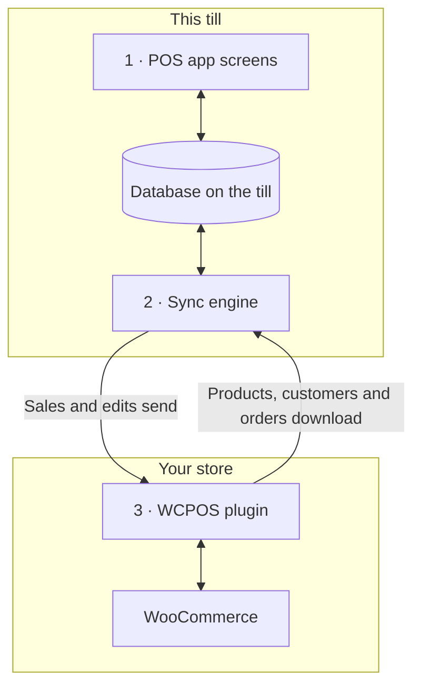

import LinkCards from '@site/src/components/LinkCards';
import LinkCard from '@site/src/components/LinkCard';
import JourneyShot from '@site/src/components/JourneyShot';
import manifest from '@site/static/img/2.x/reference/architecture/en/manifest.json';

WCPOS는 WordPress 사이트의 플러그인과 각 계산대의 POS 앱, 두 부분으로 구성됩니다. 계산대는 자체적으로 보관하는 쇼핑몰 데이터 사본으로 판매를 처리하고, 백그라운드에서 이 사본을 WooCommerce와 동기화합니다. 이 페이지에서는 데이터가 어디에 저장되고 무엇이 서버로 전송되는지 궁금한 개발자와 쇼핑몰 운영자를 위해 그 구조를 설명합니다.

설계 설명보다 문제 해결이 필요하신가요?

- **앱을 업데이트할 때:** 먼저 [계산대가 모든 데이터를 전송했는지 확인하세요](../getting-started/previous-versions.mdx#check-sync). [업데이트 전 동기화](#storage)를 참고하세요.
- **계산대에 상품이 없을 때:** [상품이 없거나 최신 정보가 아닐 때](../products/sync.mdx#goes-wrong)를 참고하세요.
- **판매 내역이 쇼핑몰에 도착하지 않았을 때:** [전송 대기 중인 판매 내역](../getting-started/offline.mdx#offline-writes)을 참고하세요.

## 두 가지 구성 요소 {#two-part-system}

1. **POS 앱**은 각 계산대에서 실행됩니다. 브라우저로 사이트의 `/pos/`에 접속하거나(주소는 변경 가능), 데스크톱 앱 또는 iOS 및 Android 앱을 사용합니다. 각 앱의 요구 사항은 [설치](../getting-started/installation.mdx)를 참고하세요. 모든 화면이 계산대의 데이터베이스를 읽고 쓰므로 검색하거나 항목을 추가할 때 서버 응답을 기다리지 않습니다.
2. 앱 내부의 **동기화 엔진**은 변경 사항을 양방향으로 전달합니다. 쇼핑몰에서 바뀐 내용을 가져오고 계산대에서 바꾼 내용을 전송합니다.
3. **WCPOS 플러그인**은 WordPress 사이트에서 실행되어 계산대를 WooCommerce에 연결합니다. 모든 상품, 고객, 주문의 기준 데이터는 항상 WooCommerce에 있습니다.

## 계산대가 기기에 보관하는 데이터 {#local-database}

**상태** → **데이터베이스**에는 계산대에 저장된 쇼핑몰 데이터 사본이 표시됩니다. 레코드 종류별로 한 행씩 표시되며, 이 기기에 있는 수(**기기 내**)와 쇼핑몰에 있는 수(**서버 내**)를 보여 줍니다. 각 행 메뉴의 기능은 [매장 상태](../support/store-health.mdx#coverage)를 참고하세요.

<JourneyShot manifest={manifest} device="tablet" step={1} offsets={[[186, 0], [186, 0], [186, 0], [186, 0], [186, 0], [186, 0], [186, 0], [186, 0]]} alt="상태의 데이터베이스 탭: 상품부터 세율까지 이 계산대의 레코드를 나열하고, 각 레코드의 기기 내 수, 서버 내 수, 다운로드 비율과 크기를 표시하는 표">

1. **상품** — POS의 기본 정렬 순서(이름, A부터 Z까지)로 처음 100개를 다운로드한 뒤, 계산대가 한가할 때 나머지를 다운로드합니다. [다운로드 및 동기화](../products/sync.mdx)를 참고하세요.
2. **변형** — 해당 상품과 함께 다운로드합니다.
3. **주문** — 진행 중인 주문과 최근 주문은 계산대에 보관합니다. 이전 주문은 누군가 열 때 다운로드합니다.
4. **환불** — 최근 92일간의 환불과 열어 본 주문의 모든 환불을 보관합니다.
5. **고객** — 계산대가 한가할 때 조금씩 다운로드합니다.
6. **카테고리** — 그 아래에 **브랜드**와 **태그**가 있습니다.
7. **쿠폰** — Pro 사용 여부와 관계없이 계산대에 보관합니다.
8. **세율** — 쇼핑몰의 세율입니다.

</JourneyShot>

행에 빨간색 **N개 처리 중단** 배지가 있으면 해당 종류의 레코드에 조치가 필요하다는 뜻입니다. [조치가 필요한 레코드](../support/store-health.mdx#stuck-records)를 참고하세요.

표 위에서 확인해야 할 수치는 **전송 대기 중인 변경 사항**입니다. 이 계산대에서 발생한 판매 및 수정 사항 중 쇼핑몰이 아직 받지 못한 항목을 뜻합니다. 쇼핑몰이 받을 때까지 기기에 보관됩니다. 아직 동기화하지 않은 진행 중인 주문과 패널에 나열된 변경 사항은 이 수에 포함되지 않으며, 이들 역시 쇼핑몰에 도착하지 않은 상태입니다. [전송 대기 중인 판매 내역](../getting-started/offline.mdx#offline-writes)을 참고하세요.

이 표 외부에 보관하는 레코드

일부 데이터는 이 표 외부에 보관합니다. 결제 수단, 세금 클래스, 배송 방법, 주문 상태는 앱을 시작할 때마다 쇼핑몰에서 읽어 오며, 계산대가 오프라인일 때를 위해 마지막 응답을 보관합니다. 계산대 세션, 마감, 현금 입출금은 별도의 레코드와 쇼핑몰 전송용 대기열을 사용합니다.

### 데이터베이스 보관 방식 {#storage}

각 매장의 캐셔마다 계산대에 별도의 사본을 보관하며, 브라우저에서는 사이트당 한 번에 하나의 탭에서 POS를 실행합니다. 앱 업데이트로 사본의 저장 방식이 바뀌면 계산대가 데이터를 다시 다운로드합니다.

:::warning 업데이트 전 동기화
이전 사본에 대기 중인 판매 및 수정 사항은 전송되지 않습니다. 앱을 업데이트하기 전에 **상태** → **데이터베이스**에서 **전송 대기 중인 변경 사항**이 0이고 수치 아래에 패널이 없는지 확인하고, 진행 중인 주문을 각각 동기화하세요. [계산대가 모든 데이터를 전송했는지 확인](../getting-started/previous-versions.mdx#check-sync)을 참고하세요.
:::

개발자용 상세 정보: 저장 엔진, 탭, 앱 업데이트

- **사이트, 매장, 캐셔별로 별도의 데이터베이스를 사용합니다.** 한 계산대의 캐셔 두 명이나 두 매장에서 일하는 한 캐셔가 로컬 데이터를 공유하는 일은 없습니다.
- **모든 플랫폼에서 SQLite를 사용합니다.** 브라우저에서는 하나의 워커에서 브라우저 전용 파일 저장소를 기반으로 SQLite를 실행합니다. iOS 및 Android 앱에서는 시스템의 SQLite를 사용하고, 데스크톱 앱에서는 앱의 메인 프로세스에서 SQLite에 데이터를 보관합니다.
- **디스크에 보관합니다.** 브라우저나 앱을 닫고 기기를 다시 시작해도 계산대의 사본은 유지됩니다.
- **사이트당 하나의 탭만 활성화됩니다.** 브라우저에서는 한 탭이 사이트의 POS를 실행합니다. 두 번째 탭을 열면 제어권을 가져올지 묻고, 가져오면 첫 번째 탭은 중지됩니다.
- **목록 처리는 데이터베이스에서 수행합니다.** 필터링, 정렬, 페이지 나누기는 가능한 한 데이터베이스 내부에서 실행하므로, 수천 개의 주문 목록에서도 화면에는 표시할 행만 전달합니다.
- **기존 데이터베이스를 직접 마이그레이션하지 않습니다.** 앱 업데이트로 데이터베이스 구조가 바뀌면 앱은 새 데이터베이스를 열고 쇼핑몰에서 데이터를 다시 다운로드합니다. 이전 데이터베이스에 대기 중인 변경 사항은 전송되지 않고 진행 중인 주문도 옮겨지지 않습니다. 앱을 업데이트하기 전에 계산대를 동기화하세요.

## 계산대와 쇼핑몰의 동기화 방식 {#data-synchronization}

동기화 엔진은 일정 간격으로 쇼핑몰 전체를 복제하지 않습니다. 계산대 화면에 필요한 데이터를 기준으로 작동하며 서버 요청을 최대한 줄입니다.

- **변경 사항 확인.** 계산대는 [동기화 사전 설정](../support/store-health.mdx#sync-presets)(**절약**, **균형**, **실시간**)에 지정된 주기로 쇼핑몰에 변경 사항을 확인합니다. 사전 설정은 계산대마다 별도로 유지되므로 한 계산대에서 바꿔도 다른 계산대에는 영향을 주지 않습니다.
- **화면에 필요한 데이터.** 각 화면은 표시 중인 내용을 엔진에 알립니다. 엔진은 필요한 레코드가 계산대 데이터베이스에 있으면 그 데이터로 응답하고, 없을 때만 쇼핑몰에 요청합니다.
- **백그라운드 처리.** 첫 번째 상품 묶음과 진행 중인 주문 및 최근 주문을 먼저 다운로드합니다. 나머지 상품과 고객은 계산대가 한가할 때 이어서 다운로드합니다.
- **변경 사항 전송.** 모든 판매 및 수정 사항은 먼저 계산대에 저장한 뒤 쇼핑몰로 전송합니다. 쇼핑몰이 거부한 변경 사항은 자동으로 재시도하지 않습니다. **서버에 도착하지 않은 변경 사항 N개** 아래에서 대기하며, **다시 보내기**와 **삭제**를 선택할 수 있습니다. [매장 상태](../support/store-health.mdx#refused-changes)를 참고하세요.

개발자용 상세 정보: 변경 피드, 요청 한도, 처리 경로

- 새로운 내용이 없는 쇼핑몰은 변경 사항 확인 요청에 본문 없이 `304 Not Modified`로 응답합니다.
- 쓰기 작업은 계산대의 영속 대기열을 거치며, 이 대기열이 `wcpos/v2/push/{collection}`로 작업을 전송합니다.
- 요청 한도, 재시도 간격 조정, 측정 수치는 [동기화 성능](./sync-performance.mdx)을 참고하세요. 모든 처리 경로는 [동기화 엔진의 작동 방식](./sync-engine.mdx)에 나와 있습니다.

## 결제 시 판매를 기록하는 방식 {#checkout-architecture}

결제 기능은 POS에 포함되어 있습니다. 계산대는 판매할 때마다 WooCommerce의 주문 결제 페이지를 여는 대신, 각 결제를 직접 처리하고 하나의 WooCommerce 주문에 기록합니다.

:::warning 오프라인 결제는 쇼핑몰에 이미 전송된 판매에만 가능합니다
연결이 끊어지기 전에 쇼핑몰에 도착한 판매에 대해서만 오프라인으로 결제를 받을 수 있습니다. 해당 주문 번호는 [결제](../pos/checkout/index.mdx) 화면의 항목 위에 표시됩니다. 연결이 끊어진 뒤 시작한 판매는 계산대에서 대기하다가 쇼핑몰에 다시 연결되면 결제합니다. [오프라인으로 결제 받기](../getting-started/offline.mdx#take-payment-offline)를 참고하세요.
:::

- **결제 수단별 타일.** 계산대는 POS에서 활성화한 각 결제 수단을 타일로 표시합니다. 처리할 수 없는 수단은 숨기지 않고 이유와 함께 회색으로 표시합니다. [타일을 사용할 수 없을 때](../payment/index.mdx#unavailable-tiles)를 참고하세요.
- **하나의 주문에 여러 결제.** 분할 결제한 판매도 하나의 WooCommerce 주문으로 유지됩니다. 항목, 세금, 재고 변경과 주문 번호가 모두 한 세트이므로 보고서에서 한 번만 집계됩니다. 환불은 일반 WooCommerce 환불로 처리되며, 환불 대상 결제들에 나누어 배분됩니다.
- **쇼핑몰이 판단합니다.** 각 결제 후 쇼핑몰은 결제된 금액과 남은 금액을 응답합니다. 계산대는 자체 수치가 아닌 쇼핑몰의 수치를 기준으로 판매를 완료합니다.
- **안전한 재시도.** 각 결제에는 계산대가 생성한 ID가 있어, 같은 결제를 두 번 전송해도 한 번만 기록됩니다.
- **오프라인.** 쇼핑몰에 이미 전송된 판매는 연결이 끊어져도 현금 결제를 완료할 수 있습니다. 결제는 **나중에 정산**으로 기록되고 연결이 복구되면 전송됩니다. [오프라인으로 결제 받기](../getting-started/offline.mdx#take-payment-offline)를 참고하세요.

결제 처리 모드와 결제 라우트

`GET wcpos/v2/payment-methods`는 각 결제 게이트웨이의 `kind`(`cash`, `card`, `stored_value`, `bank_transfer` 또는 `other`), 결제 금액을 받는 방식(`capture`), 지원하는 기능(`capabilities`: 부분 결제, 거스름돈, 환불, 팁, 오프라인, 승인 취소)을 설명합니다. 각 결제는 주문의 `_wcpos_payments` 메타에 하나의 행으로 저장되며, 결제할 때마다 매장은 주문의 `paid`와 `balance`를 응답으로 반환합니다.

각 수단의 `capture.mode`는 누가 금액을 받는지를 나타냅니다. 모든 결제 호출은 해당 모드에 등록된 핸들러로 전달됩니다.

| 모드 | 금액을 받는 방식 | 플러그인 |
| --- | --- | --- |
| `manual` | 캐셔가 금액을 받고 기록합니다. 현금, 카드, 대금 상환, 직접 은행 송금, 수표 결제의 기본값입니다. | 무료 |
| `webview` | 결제 화면의 **레거시** 탭에 있는 결제 게이트웨이 자체 결제 페이지를 사용합니다. 그 밖의 모든 결제 게이트웨이의 기본값입니다. [레거시 탭의 결제 페이지가 로드되지 않을 때](../payment/index.mdx#legacy-notices)를 참고하세요. | 무료 |
| `gateway` | 계산대가 수집한 값으로 결제 게이트웨이 자체의 `process_payment()`를 실행합니다. 결제 게이트웨이는 필터를 통해 이 모드를 사용하도록 설정합니다. | 무료 |
| `server` | 쇼핑몰이 카드 단말기 제공업체에 결제 처리를 요청합니다. | Pro |
| `device` | 계산대가 제공업체의 SDK로 카드 리더기를 제어하고, 제공업체가 결제를 확인합니다. | Pro |

결제 라우트는 주문의 WooCommerce ID를 기준으로 주문에 속합니다.

- `POST wcpos/v2/orders/{id}/payments`는 결제를 기록합니다. 결제 ID 덕분에 안전하게 재시도할 수 있습니다.
- `.../payments/{uuid}/intent`, `/capture`, `/void`, `/refund`(`POST`) 및 `/status`(`GET`)는 하나의 결제에 작업을 수행합니다. 각 명령에는 고유한 명령 ID가 포함됩니다.
- `POST wcpos/v2/orders/{id}/close`는 주문을 완료합니다.

모든 명령에는 주문의 `revision`이 포함되며, 없으면 `428`로 거부됩니다.

POS 전용 결제 게이트웨이를 만들려면 [결제 게이트웨이 템플릿](./gateway-template.mdx)에서 시작하세요.

## 일부 웹사이트 변경 사항이 계산대에 반영되지 않는 이유 {#api-extensions}

계산대는 WooCommerce에서 데이터를 읽는 WCPOS 플러그인을 통해 상품, 고객, 주문을 가져옵니다. WooCommerce가 앱에 보내는 데이터를 바꾸는 플러그인은 계산대에도 영향을 줍니다. 웹사이트의 외형만 바꾸거나 온라인 결제만 바꾸는 플러그인은 영향을 주지 않습니다. 플러그인을 확인하려면 [WooCommerce REST API 이해하기](./wc-rest-api.mdx)부터 참고하세요.

개발자용 상세 정보: API 버전

계산대는 사이트 내부에서 WooCommerce 데이터를 읽는 플러그인의 REST 라우트를 통해서만 쇼핑몰과 통신합니다. 플러그인은 WooCommerce 자체의 `wc/v3`와 함께 두 개의 네임스페이스를 등록합니다.

- 앱은 **`wcpos/v2`** 를 사용합니다. 레코드 읽기, 변경 피드, 변경 사항 대기열, 결제, 계산대, 세션이 여기에 포함됩니다. 읽기 라우트는 사이트 내부의 `wc/v3`로 전달되므로, WooCommerce REST 응답을 바꾸는 플러그인은 계산대에 표시되는 데이터도 바꿉니다.
- **`wcpos/v1`** 도 계속 등록됩니다. 데이터 라우트(상품, 변형, 주문, 고객, 쿠폰, 세금, 카테고리, 태그, 브랜드)는 더 이상 변경하지 않습니다. 서비스 라우트(매장, 설정, 영수증, 템플릿, 인쇄 작업 등)는 `wcpos/v2` 버전과 동일한 코드를 사용합니다.

### 앱 업데이트와 다른 동기화 도구 {#wcpos-v2-namespace}

앱과 플러그인은 함께 업데이트합니다. 계산대의 앱 버전이 플러그인에서 요구하는 버전보다 오래된 경우, 앱을 업데이트할 때까지 [SYNC341](../error-codes/SYNC341.mdx)이 표시됩니다. 주문 항목의 POS 가격은 다른 동기화 도구에서도 읽을 수 있는 위치에 저장됩니다. [POS 가격 재정의 저장 방식](./pos-discounts.mdx#how-pos-price-overrides-are-stored)을 참고하세요.

개발자용 상세 정보: 요청, 로그인, 주문 ID

- **POS 요청에만 라우트를 로드합니다.** 플러그인은 `wcpos/` 라우트, `X-WCPOS` 헤더 또는 `?wcpos=1`을 사용하는 요청처럼 해당 라우트를 대상으로 하는 요청에만 라우트를 등록합니다. 사이트의 나머지 REST 트래픽에는 로드하지 않습니다.
- **앱과 플러그인은 함께 버전을 맞춥니다.** 모든 앱 요청에는 `X-WCPOS-Protocol`이 포함됩니다. 더 최신 프로토콜이 필요한 플러그인은 `wcpos_update_required`와 함께 `426`으로 응답하고, 계산대는 앱이 업데이트될 때까지 [SYNC341](../error-codes/SYNC341.mdx)을 표시합니다.
- **공개 라우트.** `wcpos/v2/site`, `wcpos/v2/ping`, `wcpos/v2/echo`는 로그인이 필요하지 않습니다. 앱은 로그인 전에 이 라우트로 사이트를 찾고 연결을 테스트합니다. `/wp-json/`을 숨기거나 헤더를 제거하는 호스트에서는 WordPress의 `/?rest_route=` 주소와 헤더의 쿼리 문자열 형태(`?wcpos=1`, `wcpos_protocol`)를 대신 사용합니다. 어느 쪽도 응답하지 않으면 계산대에 [AUTH431](../error-codes/AUTH431.mdx)이 표시됩니다.
- **로그인.** 앱은 사이트의 `/wcpos-auth` 페이지를 통해 로그인하고, 유효 기간이 30분인 JWT 액세스 토큰과 30일인 갱신 토큰을 받습니다. `wcpos_jwt_access_token_expire` 및 `wcpos_jwt_refresh_token_expire` 필터로 이 기간을 바꿀 수 있습니다. 역할별로 접근할 수 있는 라우트는 [역할별 엔드포인트 접근](./role-endpoint-access.mdx)을 참고하세요.
- **주문에는 UUID가 포함됩니다.** 계산대는 주문마다 UUID를 생성해 `_woocommerce_pos_uuid` 메타로 보내고, 쇼핑몰은 이를 보관합니다. 주문을 가져올 때 UUID를 키로 사용합니다.
- **주문 항목의 POS 가격**은 다른 동기화 도구에서도 읽을 수 있도록 저장됩니다. [POS 가격 재정의 저장 방식](./pos-discounts.mdx#how-pos-price-overrides-are-stored)을 참고하세요.
- **매장(Pro).** 매장이 여러 곳이면 계산대가 `X-WCPOS-Store` 헤더로 해당 매장을 전송하고 플러그인이 이를 `store_id`로 WooCommerce에 전달합니다. 주문의 매장은 해당 주문 메타의 `_pos_store` 항목에서 가져옵니다. Pro의 매장 편집 및 고객 디스플레이 연결 라우트는 두 네임스페이스 모두에 등록됩니다.

:::info WCPOS Pro 사용 시
Pro는 카드 리더기, 매장 편집, 고객 디스플레이 연결 기능을 추가합니다. 매장이 여러 곳이면 계산대에서 매장별 가격을 사용합니다. [매장 설정](../stores/setup.mdx)을 참고하세요.
:::

## 설계의 장점과 제약 {#architecture-pros-and-cons}

- **즉각적인 검색과 장바구니.** 둘 다 계산대 자체의 데이터베이스를 읽습니다.
  - **제약:** 계산대의 사본을 쇼핑몰과 계속 동기화해야 합니다. 이것이 동기화 엔진의 역할입니다.
- **연결이 끊어져도 판매를 계속합니다.** 판매 및 수정 사항은 계산대에서 대기하다가 연결이 복구되면 전송됩니다. 쇼핑몰에 이미 전송된 판매는 현금 결제도 완료할 수 있습니다.
  - **제약:** 연결이 끊어진 뒤 시작한 판매는 쇼핑몰에 다시 연결된 후에만 결제할 수 있습니다. [오프라인으로 결제 받기](../getting-started/offline.mdx#take-payment-offline)를 참고하세요.
- **계산대용으로 제작한 앱.** 프레임 안에 웹페이지를 띄우는 방식이 아닌 데스크톱, iOS, Android 앱입니다.
  - **제약:** POS는 REST API를 통해서만 쇼핑몰 데이터에 접근합니다. WordPress 테마와 훅으로 POS의 스타일을 바꿀 수 없으며, 웹 결제나 테마만 바꾸는 플러그인은 계산대에 영향을 주지 않습니다. [일부 플러그인이 POS에서 작동하지 않는 이유는 무엇인가요?](./wc-rest-api.mdx#why-dont-some-plugins-work-in-the-pos)를 참고하세요.

## 관련 문서 {#related-documentation}

<LinkCards>
  <LinkCard title="동기화 엔진의 작동 방식" to="/developers/sync-engine" description="처리 경로, 변경 피드, 변경 사항 대기열을 자세히 설명합니다." />
  <LinkCard title="매장 상태" to="/troubleshooting/store-health" description="계산대의 데이터베이스, 동기화 사전 설정, 전송 대기 중인 변경 사항을 확인합니다." />
  <LinkCard title="WooCommerce REST API 이해하기" to="/developers/woocommerce-rest-api" description="REST API란 무엇이며 일부 플러그인이 POS에 영향을 주지 않는 이유를 설명합니다." />
</LinkCards>
