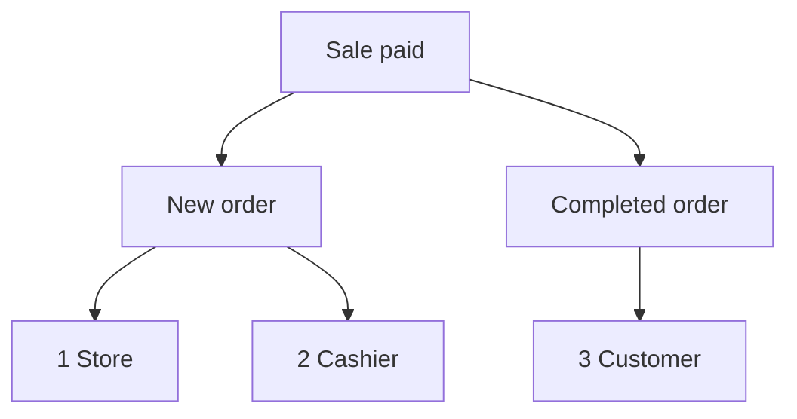

import Accordion from '@site/src/components/Accordion';
import AccordionItem from '@site/src/components/AccordionItem';
import LinkCards from '@site/src/components/LinkCards';
import LinkCard from '@site/src/components/LinkCard';

**WP 관리자:** `WP Admin → POS → Settings → Checkout`.

WooCommerce는 관리자에게 새 주문 이메일을, 고객에게 주문 완료 이메일을 보내는 등 주문 관련 이메일을 발송합니다. POS에서 이루어진 판매의 경우, 여기에서 어떤 이메일을 누구에게 보낼지 선택합니다. 온라인 주문에는 기존 WooCommerce 이메일 설정이 그대로 적용됩니다.

바로 가기: [관리자 이메일](#admin-emails) · [고객 이메일](#customer-emails) · [영수증 수동 발송](#send-receipt-manually) · [캐셔 이메일](#cashier-emails) · [일반적인 사용 사례](#common-scenarios) · [문제 해결](#goes-wrong)

## 이메일 켜기 또는 끄기 {#switches}

:::note POS 판매에 적용
POS 주문에서는 이 스위치들이 **WooCommerce > 설정 > 이메일**의 **이 이메일 알림 활성화** 설정보다 우선합니다. WooCommerce에서 끈 이메일도 여기에서 선택되어 있으면 발송될 수 있습니다.
:::

1. WP Admin에서 **POS > 설정 > 결제**로 이동하세요.
2. **초과 판매 방지** 아래에서 **관리자 이메일**, **고객 이메일**, **캐셔 이메일** 스위치를 찾으세요. 그 아래에는 **결제 게이트웨이** 목록이 있습니다.
3. 스위치를 켜면 해당 그룹의 이메일마다 체크박스가 나타납니다. 특정 이메일만 중지하려면 해당 이메일의 선택을 해제하세요.
4. 스위치를 끄면 체크박스 선택 여부와 관계없이 해당 그룹의 이메일이 POS 판매에 대해 발송되지 않습니다.

변경 사항은 즉시 저장되며, 화면에 **저장 중**이 표시된 다음 **저장됨**이 표시됩니다.

{/* reshoot: WP Admin > POS > Settings > Checkout with all three email switches on and their checkboxes showing; see reshoot.md */}

각 스위치의 이메일 수신자와 설치 시 초기 상태는 다음과 같습니다.

- **관리자 이메일**: 설치 시 켜짐\
  **WooCommerce > 설정 > 이메일**에서 해당 이메일의 **수신자**에 지정된 주소로 발송
- **고객 이메일**: 설치 시 켜짐\
  주문의 청구 이메일 주소로 발송
- **캐셔 이메일**: 설치 시 꺼짐\
  캐셔의 WordPress 계정에 등록된 이메일 주소로 발송

결제 수단의 **주문 상태**가 완료로 설정된 경우, 계산대에서 결제를 마친 판매 건에 대해 다음 이메일이 발송됩니다.

1. **매장** — **관리자 이메일**이 켜져 있고 **새 주문**이 선택되어 있으면 WooCommerce의 **새 주문**에 지정된 **수신자**에게 발송됩니다.
2. **캐셔** — **캐셔 이메일**이 켜져 있고 **새 주문**이 선택되어 있으면 캐셔 본인의 주소로 발송됩니다.
3. **고객** — **고객 이메일**이 켜져 있고 **주문 완료**가 선택되어 있으며 주문에 청구 이메일 주소가 있으면 해당 주소로 발송됩니다.

## 관리자 이메일 {#admin-emails}

매장 관리자인 여러분에게 발송되는 이메일입니다. 설치 시 모든 이메일이 선택되어 있습니다.

관리자 이메일의 수신자를 변경하려면 **WooCommerce > 설정 > 이메일**로 이동해 해당 이메일의 설정을 열고 **수신자**를 수정하세요.

| 이메일 | 발송 시점 |
|---|---|
| **새 주문** | POS 주문이 완료, 처리 중 또는 보류 중 상태로 변경될 때 |
| **취소된 주문** | 처리 중 또는 보류 중인 주문이 취소될 때 |
| **실패한 주문** | 결제 대기 중 또는 보류 중인 주문이 실패할 때 |

POS 주문이 **POS - 열림** 또는 **POS - 부분 결제**에서 완료, 처리 중 또는 보류 중으로 변경될 때, **관리자 이메일** 또는 **캐셔 이메일** 아래에서 **새 주문**이 선택되어 있고 해당 스위치가 켜져 있으면 이메일이 발송됩니다. WooCommerce에서 **새 주문**을 꺼 두었어도 발송됩니다. 판매 후 적용되는 상태는 해당 결제 수단에 설정한 **주문 상태**입니다. [주문 상태](./checkout.mdx#order-status)를 참조하세요.

WCPOS가 POS 판매의 새 주문 이메일을 직접 발송하는 이유

WooCommerce는 주문이 결제 대기 중, 실패 또는 취소됨 상태에서 다른 상태로 변경될 때만 **새 주문** 이메일을 발송합니다. 반면 POS 주문은 WooCommerce가 인식하지 못하는 **POS - 열림** 또는 **POS - 부분 결제** 상태로 대기하므로, 이후 상태가 변경되어도 WooCommerce는 이메일을 발송하지 않습니다. WCPOS는 위에 설명한 시점에 WooCommerce를 대신해 발송합니다.

## 고객 이메일 {#customer-emails}

주문의 청구 이메일 주소로 발송됩니다. 이메일 주소를 입력하지 않은 비회원 판매처럼 청구 이메일 주소가 없는 주문에는 고객 이메일이 발송되지 않습니다. 설치 시 모든 이메일이 선택되어 있습니다.

### 영수증 수동 발송 {#send-receipt-manually}

결제 완료 화면의 **이메일로 영수증 보내기**는 별도 기능입니다. 이 스위치들의 영향을 받지 않는 WooCommerce 청구서 이메일을 발송하므로, **고객 이메일**이 꺼져 있어도 사용할 수 있습니다. [이메일로 영수증 보내기](../../receipts/at-checkout.mdx#email-receipt)를 참조하세요.

### 자동으로 발송되는 이메일 {#customer-emails-automatic}

| 이메일 | 발송 시점 |
|---|---|
| **보류 중인 주문** | 주문이 결제 대기 중, 실패 또는 취소됨에서 보류 중으로 변경될 때 |
| **처리 중인 주문** | 주문이 결제 대기 중, 보류 중, 실패 또는 취소됨에서 처리 중으로 변경될 때 |
| **주문 완료** | 주문이 완료 상태로 변경될 때 |
| **환불된 주문** | 주문이 전액 또는 부분 환불될 때. [환불](../../orders/refunds.mdx) 참조 |
| **실패한 주문** | 주문이 실패할 때 |

현금 판매처럼 **POS - 열림**에서 곧바로 처리 중 또는 보류 중으로 변경되는 판매에는 **보류 중인 주문**이나 **처리 중인 주문** 이메일이 발송되지 않습니다. WooCommerce는 표에 나열된 상태에서 변경될 때만 이 이메일을 발송합니다. **주문 완료**, **환불된 주문**, **실패한 주문**은 이전 상태와 관계없이 발송되므로 POS 판매에도 발송됩니다. 처리 중 또는 보류 중 상태로 끝난 판매에 대해 고객에게 이메일을 보내려면 [이메일로 영수증 보내기](#send-receipt-manually)를 사용하세요.

## 캐셔 이메일 {#cashier-emails}

판매를 담당한 캐셔의 WordPress 계정에 등록된 이메일 주소로 **새 주문** 이메일을 발송합니다. 설치 시 스위치는 꺼져 있으며, 켜면 **새 주문**이 선택됩니다.

캐셔는 관리자와 같은 시점에 이메일을 받습니다([관리자 이메일](#admin-emails) 참조). **관리자 이메일**과 **캐셔 이메일**은 독립적으로 작동하므로 하나를 꺼도 다른 하나에는 영향을 주지 않습니다. 매장 소유자가 캐셔를 겸하는 경우처럼 캐셔의 주소가 이미 관리자 수신자에 포함되어 있으면 두 통이 아닌 한 통만 받습니다.

캐셔로 POS에 로그인할 수 있는 WordPress 사용자는 [캐셔 접근 권한](./access.mdx)에서 설정합니다.

## 일반적인 사용 사례 {#common-scenarios}

<Accordion>
  <AccordionItem question="바쁜 날 받은편지함에 이메일이 쌓이지 않게 하기">

**관리자 이메일**에서 **새 주문**의 선택을 해제하세요. **취소된 주문**과 **실패한 주문**은 알아두어야 하는 알림이므로 선택을 유지하세요.

매출을 확인하려면 새 주문 이메일을 세는 대신 [보고서](../../reports/index.mdx)를 사용하세요.

  </AccordionItem>

  <AccordionItem question="관리자 대신 근무 중인 캐셔에게 새 주문 이메일 보내기">

**관리자 이메일**에서 **새 주문**의 선택을 해제하거나 **관리자 이메일**을 끈 다음, **캐셔 이메일**을 켜세요. 각 판매를 담당한 캐셔가 본인의 주소로 이메일을 받고, 관리자 받은편지함에는 도착하지 않습니다.

**관리자 이메일**을 끄면 **취소된 주문**과 **실패한 주문**도 중지되므로, 대개 **새 주문**만 선택 해제하는 편이 좋습니다.

  </AccordionItem>

  <AccordionItem question="매장 판매에 대한 고객 이메일 끄기">

시장 노점이나 카페에서는 이미 종이 영수증을 받은 고객에게 이메일을 보내지 않으려는 경우가 많습니다. **고객 이메일**을 끄면 POS 판매에 대해 처리 중, 완료, 환불 등 모든 고객 이메일이 발송되지 않습니다.

온라인 주문의 고객 이메일은 평소처럼 발송됩니다. 이메일 영수증을 요청하는 고객에게는 계속 보낼 수 있습니다. 결제 완료 화면에서 **이메일로 영수증 보내기**를 누르세요.

  </AccordionItem>

  <AccordionItem question="1.8.9 이전 버전에서 업그레이드했는데 기존의 단일 '이메일 활성화' 스위치가 사라졌습니다">

1.8.9 버전에서는 단일 켜기/끄기 스위치가 이 페이지의 세 그룹으로 바뀌었습니다. WCPOS는 이전 설정을 읽습니다. 이메일이 꺼져 있었다면 **관리자 이메일**과 **고객 이메일**이 꺼지고, 켜져 있었다면 둘 다 켜지며 모든 이메일이 선택됩니다. **캐셔 이메일**은 어느 경우든 꺼진 상태로 시작합니다.

별도로 할 일은 없습니다.

  </AccordionItem>
</Accordion>

## 문제 해결 {#goes-wrong}

**관리자에게 새 주문 이메일이 오지 않습니다.** **관리자 이메일**이 켜져 있고 **새 주문**이 선택되어 있는지 확인하세요. 그런 다음 **WooCommerce > 설정 > 이메일**에서 **새 주문**의 **수신자**를 확인하세요.

**고객에게 이메일이 오지 않습니다.** **고객 이메일**이 켜져 있고 해당 이메일이 선택되어 있는지 확인하세요. 그런 다음 주문을 열어 청구 이메일 주소가 있는지 확인하세요. 지금 영수증을 보내려면 **이메일로 영수증 보내기**를 사용하세요.

**캐셔에게 이메일이 오지 않습니다.** **캐셔 이메일**이 켜져 있고 **새 주문**이 선택되어 있으며 캐셔의 WordPress 계정에 이메일 주소가 있는지 확인하세요. 해당 주소가 관리자 수신자에도 포함되어 있다면 한 통만 받습니다.

**WooCommerce에서 끈 이메일이 POS 판매 시 계속 도착합니다.** POS 주문에는 이곳의 체크박스 설정이 적용됩니다. 여기에서도 해당 이메일의 선택을 해제하세요.

## 개발자 훅 {#developer-hooks}

이 스위치들로 제공되는 범위를 넘어 제어해야 하는 개발자를 위한 내용입니다. 매장 소유자는 건너뛰어도 됩니다.

WordPress 필터 네 가지와 새 주문 수신자 설정 방식

WCPOS 2.0 이전에는 이 필터의 이름이 `woocommerce_pos_*` 형식이었습니다(예: `woocommerce_pos_admin_emails`). 이 이름들은 아직 작동하지만 2.0부터 사용 중단 예정이며, 빨라도 2.2에서 제거됩니다. [훅 이름 규칙](../../extensions/index.mdx#hook-naming)을 참조하세요.

**`wcpos_admin_emails`**: WCPOS가 제어하는 관리자 이메일 ID입니다. 기본값: `cancelled_order`, `failed_order`.

**`wcpos_customer_emails`**: WCPOS가 제어하는 고객 이메일 ID입니다. 기본값: `customer_failed_order`, `customer_on_hold_order`, `customer_processing_order`, `customer_completed_order`, `customer_refunded_order`.

**`wcpos_admin_email_enabled`**: 특정 POS 주문에 특정 관리자 이메일을 발송할지 여부입니다. 인수: `$is_enabled`, `$email_id`, `$order`, `$email`.

**`wcpos_customer_email_enabled`**: 특정 POS 주문에 특정 고객 이메일을 발송할지 여부입니다. 인수는 위와 같습니다.

**새 주문**은 `wcpos_admin_emails`에 포함되지 않습니다. WCPOS는 WooCommerce의 `woocommerce_email_recipient_new_order` 필터를 통해 수신자를 설정합니다. 관리자 수신이 꺼져 있으면 매장 수신자를 제거하고, 캐셔 수신이 켜져 있으면 캐셔의 주소를 추가합니다. 캐셔는 주문의 `_pos_user` 메타에 저장된 WordPress 사용자입니다. 이 필터에 직접 콜백을 등록하면 다른 WooCommerce 이메일과 같은 방식으로 주소를 추가하거나 제거할 수 있습니다.

## 관련 문서 {#related-documentation}

<LinkCards>
  <LinkCard title="결제 설정" to="/settings/checkout" description="같은 화면에 있는 결제 게이트웨이와 각 게이트웨이가 설정하는 주문 상태입니다." />
  <LinkCard title="결제 시 영수증" to="/sell/print-email-receipts" description="결제 완료 화면에서 영수증을 인쇄하거나 이메일로 보내세요." />
  <LinkCard title="주문" to="/manage-store/orders" description="이 이메일과 관련된 POS 주문을 찾으세요." />
</LinkCards>
