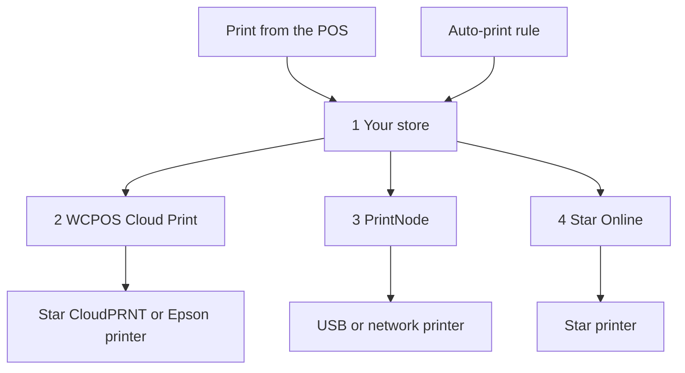

import LinkCards from '@site/src/components/LinkCards';
import LinkCard from '@site/src/components/LinkCard';

Bij afdrukken via de cloud worden bonnen via internet naar een printer gestuurd. De printer hoeft dus niet aangesloten te zijn op het apparaat waarop de POS draait. Gebruik dit voor een printer op een ander netwerk dan de kassa, een keukenprinter die elke bestelling automatisch afdrukt of een pakbon voor elke online verkoop.

Je stelt een cloudprinter eenmalig in via **WP Admin → POS → Instellingen → Afdrukken via de cloud**. Daarna wordt de printer op elk apparaat weergegeven en kunnen kassamedewerkers er vanuit de POS op afdrukken, net als op elke andere printer.

## Afdrukken vanuit de POS {#manual}

De webwinkel maakt de bon voor een cloudprinter op basis van de bestelling. De verkoop moet dus in de webwinkel staan voordat je afdrukt.

1. Open op het scherm na betaling of in het venster **Bon** van een bestelling het menu **Printer** en kies de cloudprinter.
2. Druk op **Bon afdrukken**.
3. Op het scherm verschijnt **Afgedrukt op** met de naam van de printer. Dit betekent dat de webwinkel de afdruktaak heeft ontvangen. Controleer of de bon uit de printer is gekomen. Zo niet, dan kan een beheerder in de [afdrukwachtrij](#print-queue) zien wat ermee is gebeurd.

Zie [De bon afdrukken](./at-checkout.mdx#print-receipt). Wil je een sjabloon altijd naar een cloudprinter sturen, kies dan de printer voor dat sjabloon onder **Instellingen → Afdrukken**: zie [Afdrukroutering](../hardware/printers/index.mdx#print-routing).

- **De bestelling moet in de webwinkel staan.** Als de webwinkel de verkoop nog niet heeft bevestigd, bijvoorbeeld bij een offline verkoop, toont de POS de melding *Deze printer drukt de kopie van de webwinkel af en de webwinkel heeft deze verkoop nog niet bevestigd. Druk opnieuw af zodra dat is gebeurd.* Druk opnieuw op **Bon afdrukken** zodra de kassa online is en de webwinkel de verkoop heeft bevestigd. Zolang de kassa offline is, mislukt afdrukken op een cloudprinter, ook voor een eerdere bestelling.
- **Sessierapporten en afsluitingen** die je naar een cloudprinter stuurt, openen in plaats daarvan het afdrukvenster van het systeem.
- **Een HTML-sjabloon op een Star- of Epson-cloudprinter** geeft de melding *Deze cloudprinter drukt alleen thermische sjablonen af, dus er wordt niets afgedrukt. Kies een thermisch sjabloon.*

Cloudprinters verschijnen automatisch op elk apparaat onder **Instellingen → Afdrukken**, bij **Printers**. Op de tweede regel staat het type, bijvoorbeeld *Star CloudPRNT · beheerd door WCPOS*. Een kassamedewerker kan op die regel op **Testafdruk** drukken of in het menu **⋯** op **Configuratierapport kopiëren**, maar kan de printer niet bewerken of verwijderen. Dat doe je op het scherm **Afdrukken via de cloud**. Zie [Printer instellen](../hardware/printers/index.mdx#printers-list).

## Een printertype kiezen {#providers}

:::note Vanaf hier heb je WP Admin nodig
Printers en regels toevoegen doet de winkeleigenaar of beheerder via **WP Admin → POS → Instellingen → Afdrukken via de cloud**.
:::

Op het scherm **Afdrukken via de cloud** staat de vraag **Welk type printer sluit je aan?** Kies het type dat bij je printer past.

- **Star CloudPRNT** — voor een Star-printer met ingebouwde CloudPRNT (mC-Print, TSP143IV…), als je een gratis verbinding wilt zonder extra account. De printer haalt de afdruktaken op bij je webwinkel. *Alleen thermische sjablonen.*
- **Epson Server Direct Print** — voor een ‘intelligente’ Epson TM-printer (TM-T88VI/VII, TM-m30III, TM-i-serie). De printer haalt de afdruktaken op bij je webwinkel. *Alleen thermische sjablonen.*
- **Star Online** — voor een Star-printer die is gekoppeld aan een stario.online-account (mC-Print3, TSP143IV, mC-Label3). Je webwinkel geeft de afdruktaak door aan Star Online, dat deze aflevert. *Alleen thermische sjablonen.*
- **PrintNode** — voor een gewone USB- of netwerkprinter, als je de kleine PrintNode-app op een computer in de winkel kunt laten draaien. Je webwinkel geeft de afdruktaak door aan PrintNode en de app op die computer drukt deze af. *Elk sjabloon.*

Een Star- of Epson-cloudprinter kan geen HTML-sjabloon afdrukken: de bon moet worden omgezet naar de eigen opdrachten van de printer. Gebruik PrintNode voor HTML-sjablonen en sjablonen voor een volledige pagina. Zie [Thermische sjablonen](./thermal-templates.mdx).

<details>
<summary>Hoe afdruktaken je printer bereiken</summary>



<div className="pinned-legend">

1. **Je webwinkel** — maakt de bon op basis van de bestelling en het sjabloon en bewaart de afdruktaak in de [afdrukwachtrij](#print-queue). Zowel een afdruk vanuit de POS als een [regel voor automatisch afdrukken](#auto-print) begint hier.
2. **WCPOS Cloud Print** — de [relay](#relay). Een Star CloudPRNT- of Epson-printer haalt zijn afdruktaken normaal gesproken via deze relay op. Een afdruktaak wacht dus tot de printer zich opnieuw meldt.
3. **PrintNode** — je webwinkel geeft de afdruktaak door aan PrintNode en de PrintNode-app op een computer in de winkel drukt deze af.
4. **Star Online** — je webwinkel geeft de afdruktaak door aan Star Online, dat deze bij de printer aflevert.

</div>

</details>

## Een printer toevoegen {#setup}

1. Ga naar **WP Admin → POS → Instellingen → Afdrukken via de cloud**. Druk onder **Je cloudprinters** op **+ Printer toevoegen**.
2. Kies het type.
3. Voer een **Printernaam** in, bijvoorbeeld *Keukenprinter*. WCPOS maakt de **Printer-ID** op basis van de naam. Je kunt de ID later niet wijzigen. Wil je dat toch, verwijder de printer dan en voeg deze opnieuw toe.
4. Voltooi de stappen voor jouw type: [Star CloudPRNT of Epson](#setup-polling), [PrintNode](#setup-printnode) of [Star Online](#setup-star-online).
5. De printer verschijnt als kaart onder **Je cloudprinters**. Druk daarop op **Testafdruk**. Zie [De printerkaart](#status).

### Star CloudPRNT of Epson Server Direct Print {#setup-polling}

Deze printers halen zelf hun afdruktaken op, dus je hoeft geen account te koppelen. Omdat de printer contact opneemt met je webwinkel, hoef je geen poort te openen, geen statisch IP in te stellen en je firewall niet aan te passen. Een afdruktaak wordt afgedrukt zodra de printer zich weer meldt. De laatste stap van **+ Printer toevoegen** toont de **Polling-URL** van de printer, met daarin een geheim token.

<details>
<summary>Een Star CloudPRNT- of Epson-printer verbinden</summary>

1. Druk naast de **Polling-URL** op **Kopiëren**. Het volledige adres wordt **maar één keer** getoond. Als je het kwijtraakt, verwijder de printer dan en voeg deze opnieuw toe om een nieuw adres te krijgen: **Configuratie en token** op de kaart toont het adres met het token verborgen.
2. Open de instellingenpagina van de printer zelf en plak het adres in het veld voor de server-URL: onder **CloudPRNT** op een Star-printer of **Server Direct Print** op een Epson-printer. Schakel polling in, sla de instellingen op en start de printer opnieuw op.
3. Op de kaart verandert de status van **Wachten op printer** naar **Verbonden** zodra de printer voor het eerst afdruktaken ophaalt.

Het adres begint normaal gesproken met `https://cloudprint.wcpos.com`. Dat is de [WCPOS Cloud Print-relay](#relay) en dat is het juiste adres. Onder het adres toont **Geavanceerd: rechtstreeks verbinding maken met deze site (zonder relay)** als alternatief een **Directe URL**. Sommige printers kunnen een site niet rechtstreeks bereiken en blijven op **Wachten op printer** staan.

Laat op een Epson-printer **Server Direct Print** ingeschakeld zolang WCPOS op deze manier op de printer afdrukt. Zie [Server Direct Print](../hardware/printers/server-direct-print.mdx).

</details>

### PrintNode {#setup-printnode}

Voor PrintNode moet de client op een computer naast de printer draaien en heb je een API-sleutel uit je PrintNode-account nodig.

<details>
<summary>Een PrintNode-printer verbinden</summary>

1. Installeer de PrintNode-client op een computer naast de printer en meld je aan. De computer moet aanstaan en de client moet draaien om te kunnen afdrukken.
2. Maak in je PrintNode-account een API-sleutel aan.
3. Kies bij **+ Printer toevoegen** voor **PrintNode**, plak de sleutel in **PrintNode API-sleutel** en druk op **Mijn printers ophalen**.
4. Kies onder **Een printer kiezen** de printer die de client meldt en rond de configuratie af. De laatste stap toont **Gekoppeld aan PrintNode**: je hoeft geen adres of token te kopiëren.

</details>

Stel na het koppelen het **Afdrukformaat** in op de printerkaart:

- **PDF (aanbevolen)** drukt elk sjabloon, thermisch of HTML, af als PDF. Laat deze instelling staan, tenzij je een reden hebt om deze te wijzigen.
- **ESC/POS RAW — alleen thermische sjablonen** verstuurt een thermisch sjabloon als opdrachten voor een bonprinter in plaats van als PDF. HTML-sjablonen worden nog steeds als PDF verstuurd.

### Star Online {#setup-star-online}

Voor Star Online heb je het groepsadres van de printer en een API-sleutel nodig, beide uit je stario.online-account.

<details>
<summary>Een Star Online-printer verbinden</summary>

1. Open in stario.online **Apparaatgroepen** en kopieer de **CloudPRNT URL** van de groep. Deze ziet eruit als `https://device.stario.online/cloudprnt/...`, of `https://eu-device.stario.online/cloudprnt/...` in de EU.
2. Maak in stario.online een API-sleutel aan met de rechten **EnumDevices**, **ViewDevice**, **PrintToDevice** en **ViewDeviceGroups**. Een sleutel zonder deze rechten wordt geaccepteerd, maar kan geen apparaten ophalen of afdrukken.
3. Kies bij **+ Printer toevoegen** voor **Star Online**. Plak de **CloudPRNT URL** en de **Star Online API-sleutel** en druk vervolgens op **Mijn apparaten ophalen**.
4. Selecteer onder **Een apparaat kiezen** de printer en rond de configuratie af. De kaart toont vervolgens het **Apparaat**, de **Groep** en de **AccessIdentifier**.

</details>

## De printerkaart {#status}

Elke cloudprinter heeft een kaart onder **Je cloudprinters**:

- **De naam** — klik erop om de printer een andere naam te geven. Het type staat eronder.
- **De status** — zie de lijst hieronder. Deze wordt elke 30 seconden vernieuwd.
- **Laatst gemeld** — wanneer een Star CloudPRNT- of Epson-printer voor het laatst afdruktaken heeft opgehaald, of *nooit*.
- **Printer-ID** — vastgelegd toen je de printer toevoegde.
- **Afdrukformaat** — alleen voor PrintNode: **PDF (aanbevolen)** of **ESC/POS RAW — alleen thermische sjablonen**. Zie [PrintNode](#setup-printnode).
- **Testafdruk** — verstuurt een korte testpagina. Een melding zegt *Testafdruk verstuurd naar …* of geeft aan waarom het is mislukt.
- **Printeracties** (**⋮**) — **Configuratie en token** opent de laatste configuratiestap opnieuw; **Printer verwijderen** zorgt dat de printer geen afdruktaken meer ontvangt. Je kunt de printer later opnieuw toevoegen.

<details id="status-polling">
<summary>Statussen voor Star CloudPRNT en Epson Server Direct Print</summary>

- **Wachten op printer** — de printer heeft nog geen afdruktaken opgehaald. Controleer de polling-URL in de printer: zie [Blijft op Wachten op printer staan](#trouble-polling).
- **Verbonden** — de printer heeft in de afgelopen tweeënhalve minuut afdruktaken opgehaald.
- **Offline** — de printer heeft eerder afdruktaken opgehaald, maar niet onlangs. Controleer of de printer aanstaat en online is.
- **Geblokkeerd** — de relay kan je webwinkel niet bereiken. De kaart geeft aan waarom: een beveiligingsdienst zoals Cloudflare of een firewallplugin blokkeert de verbinding, of je site heeft een serverfout teruggestuurd. Zie [Problemen met Star CloudPRNT of Epson](#trouble-polling).

</details>

<details id="status-services">
<summary>Statussen voor Star Online en PrintNode</summary>

- **Online** — de dienst meldt dat de printer beschikbaar is.
- **Offline** — de dienst meldt dat de printer of de PrintNode-computer niet beschikbaar is. Controleer bij PrintNode of de computer niet in de slaapstand staat en of de client draait.
- **Onbekend** — WCPOS kon geen status bij de dienst ophalen. Controleer de API-sleutel bij [PrintNode](#setup-printnode) of [Star Online](#setup-star-online).

</details>

## Bestellingen automatisch afdrukken {#auto-print}

Regels voor automatisch afdrukken drukken bestellingen af zonder dat iemand op een knop hoeft te drukken. Ze zijn optioneel: zonder regels drukken cloudprinters alleen af wanneer een kassamedewerker vanuit de POS afdrukt.

Druk onder **Regels voor automatisch afdrukken** op **+ Regel toevoegen**. Elke regel leest als een zin en elk onderstreept deel is een menu:

> Druk **elke bestelling in de winkel (POS)** automatisch af op **Keukenprinter** met het sjabloon **Keukenbon**, **2 exemplaren**, **zodra de bestelling is aangemaakt**.

- **Welke bestellingen** — **elke bestelling**, **elke bestelling in de winkel (POS)** of **elke online bestelling**. Met WCPOS Pro ook **bestellingen voor** één winkel: zie [Printers per winkel](#per-store-printers).
- **Printer** — een van je cloudprinters.
- **Sjabloon** — alleen sjablonen die de printer kan afdrukken worden aangeboden. Sjablonen komen uit **POS › Sjablonen**.
- **Exemplaren** — 1 tot 5.
- **Wanneer** — **zodra de bestelling is betaald** (de standaardinstelling) of **zodra de bestelling is aangemaakt**. Bij een POS-bestelling betekent ‘aangemaakt’ het moment waarop de winkelwagen voor het eerst wordt opgeslagen. Een keukenbon wordt dus vóór de betaling afgedrukt.

Meerdere regels kunnen dezelfde bestelling afdrukken, bijvoorbeeld een keukenbon en een klantbon. Een regel drukt een bepaalde bestelling maar één keer af. De bon wordt in de webwinkel gemaakt op basis van de bestelling en het sjabloon, dus de kassamedewerker hoeft niets te doen. Bij automatisch afdrukken gaat de kassalade nooit open.

Als je de printer van een regel wijzigt naar een printer die het bijbehorende sjabloon niet kan afdrukken, schakelt de regel over naar het eerste sjabloon dat die printer wel kan afdrukken. Controleer dus of dit het gewenste sjabloon is. Als de printer geen van je sjablonen kan afdrukken, blijft het sjabloon leeg en drukt de regel niets af totdat je er een kiest.

### Printers per winkel (Pro) {#per-store-printers}

Met [WCPOS Pro](../getting-started/pro-license.mdx) en meerdere [winkels](../stores/index.mdx) bevat het menu **Welke bestellingen** ook **bestellingen voor** elke winkel. Een winkelregel drukt de bestellingen af die bij die winkel horen: bestellingen die via de kassa’s van de winkel zijn geplaatst en bestellingen die je op het bewerkscherm van de bestelling aan de winkel toewijst. Online bestellingen horen bij geen enkele winkel, tenzij je er een toewijst. Daarom worden ze alleen afgedrukt door regels voor alle winkels.

Regels werken naast elkaar: een bestelling voor een winkel wordt afgedrukt volgens de regels van die winkel **en** volgens elke regel voor **elke bestelling**, **elke bestelling in de winkel (POS)** of **elke online bestelling**. Om te voorkomen dat keukenbonnen van de ene locatie op de printer van een andere locatie terechtkomen, geef je elke locatie een eigen winkelregel en voeg je voor die bon geen regel voor alle winkels toe.

## De afdrukwachtrij {#print-queue}

Onder de regels toont de **Afdrukwachtrij** elke afdruktaak: **Bestelling**, **Printer**, **Sjabloon**, **Status**, **Details** en **Aangemaakt**. Het bestelnummer is een link naar de bestelling.

- **Filter** op status (**Aandacht nodig**, **Alle statussen** of een van de statussen **Wachten**, **Bezig met afdrukken**, **Afgedrukt**, **Mislukt**, **Geannuleerd**) en op printer.
- Gebruik **Annuleren** voor een wachtende afdruktaak, **Opnieuw proberen** voor een mislukte taak (deze komt terug als een nieuwe taak, *Opnieuw geprobeerd als #…*) of **Verwijderen** om een taak te verwijderen. Vink meerdere rijen aan voor **Selectie annuleren** of **Selectie verwijderen**.
- **Details** geeft aan waarom een afdruktaak is mislukt, bijvoorbeeld *Star Online heeft het verzoek geweigerd. Controleer of de API-sleutel de vereiste rechten heeft.*

Als er bonnen klaarstaan voor een Star CloudPRNT- of Epson-printer en deze al 10 minuten geen afdruktaken heeft opgehaald, of dat nog nooit heeft gedaan, verschijnt er een waarschuwing. Deze noemt de printer, geeft aan wanneer deze voor het laatst taken heeft opgehaald en hoeveel bonnen er wachten, en biedt de optie **Alles annuleren**.

:::warning Een afdruktaak die de printer nooit heeft bevestigd
*De printer heeft deze afdruktaak nooit bevestigd* betekent dat WCPOS niet kan vaststellen of deze is afgedrukt. De taak wordt niet automatisch opnieuw verstuurd, omdat deze dan mogelijk dubbel wordt afgedrukt. Controleer de printer en druk alleen op **Opnieuw proberen** als er niets uit is gekomen.
:::

<details>
<summary>Bewaartermijnen en nieuwe pogingen voor afdruktaken</summary>

Afgedrukte en geannuleerde taken worden na 7 dagen verwijderd, mislukte taken na 30 dagen. Een ontwikkelaar kan dit wijzigen met de filters `wcpos_print_job_retention_days` en `wcpos_print_job_failed_retention_days`.

Voor een afdruktaak die WCPOS aan PrintNode of Star Online doorgeeft, worden drie pogingen gedaan, met eerst één en daarna twee minuten ertussen. Als de dienst een sleutel of account weigert, mislukt de taak meteen. De reden staat onder **Details**.

</details>

## WCPOS Cloud Print, de relay {#relay}

De polling-URL van een Star CloudPRNT- of Epson-printer verwijst naar **cloudprint.wcpos.com**, niet naar je eigen site. Dat is **WCPOS Cloud Print**, een gratis relay die WCPOS beheert en die als tussenstation dient tussen je printers en je webwinkel.

Je hoeft niets in te schakelen. Afdruktaken gaan via de relay naar de printer. Door verbinding te maken, deel je dus het adres van je site met wcpos.com en worden bonnen, inclusief bestelgegevens, via deze dienst verstuurd. Zie het [privacybeleid](https://wcpos.com/privacy).

<details>
<summary>Hoe de relay werkt</summary>

Bonprinters draaien op beperkte firmware die zelden wordt bijgewerkt. Veel printers kunnen geen beveiligde verbinding maken met een webwinkel op moderne hosting of worden geweigerd door een dienst zoals Cloudflare die de site beschermt. De printer blijft dan op **Wachten op printer** staan, ook al zijn alle instellingen juist. De relay biedt de printer een verbinding die wel werkt en stuurt de verzoeken door naar je webwinkel.

- Je site maakt automatisch verbinding met de relay zodra je **Afdrukken via de cloud** voor het eerst opent.
- De relay vereist dat je site **HTTPS** gebruikt. Zo niet, dan meldt **Afdrukken via de cloud** dit.
- Als je site geen verbinding kan maken met de relay, bijvoorbeeld bij een lokale testsite, verwijst de polling-URL rechtstreeks naar je site.
- **Geblokkeerd** op een kaart betekent dat de relay je site heeft bereikt, maar is geweigerd. Sta de relay toe in je beveiligingsdienst, zoals de kaart aangeeft. Zie [Problemen met Star CloudPRNT of Epson](#trouble-polling).

</details>

<details>
<summary>De relay uitschakelen (ontwikkelaars)</summary>

De laatste configuratiestap voor een Star CloudPRNT- of Epson-printer bevat **Geavanceerd: rechtstreeks verbinding maken met deze site (zonder relay)** met de bijbehorende **Directe URL**. Zo schakel je de relay voor de hele site uit:

```php
add_filter( 'wcpos_cloud_print_relay_enabled', '__return_false' );
```

Vóór WCPOS 2.0 heette dit filter `woocommerce_pos_cloud_print_relay_enabled`. Die naam werkt nog steeds, is sinds 2.0 verouderd en wordt op zijn vroegst in 2.2 verwijderd. Zie [Naamgeving van hooks](../extensions/index.mdx#hook-naming).

</details>

<details>
<summary>Hoe een bon een Star CloudPRNT-printer bereikt</summary>

WCPOS biedt de printer eerst StarPRNT-opdrachten aan, daarna een PNG-afbeelding van de bon en vervolgens platte tekst. Het gebruikt de beste optie die de printer naar eigen zeggen kan lezen. Oudere Star-modellen die alleen Line Mode lezen (TSP650II, TSP700II, TSP800II) ontvangen logo’s alleen via de afbeelding. Voor de afbeelding zijn de PHP-extensies GD en FreeType op je server nodig. Epson-printers ontvangen ePOS-Print XML; Star Online ontvangt Star Document Markup.

</details>

## Als er iets misgaat {#troubleshooting}

**De POS heeft naar een cloudprinter afgedrukt, maar er kwam geen bon uit.** De POS weet alleen dat de webwinkel de afdruktaak heeft ontvangen. Open de [afdrukwachtrij](#print-queue) en zoek de bestelling:

- **Wachten** — de printer heeft de taak nog niet opgehaald. Controleer de printerstatus op de kaart: [Statussen voor Star CloudPRNT en Epson Server Direct Print](#status-polling) of [Statussen voor Star Online en PrintNode](#status-services).
- **Bezig met afdrukken** — de afdruktaak is onderweg en de printer heeft nog niet gemeld dat deze is afgedrukt.
- **Mislukt** — **Details** geeft aan waarom. Los het probleem op en druk vervolgens op **Opnieuw proberen**. Als bij **Details** de melding *De printer heeft deze afdruktaak nooit bevestigd* staat, is de taak mogelijk wel afgedrukt. Controleer de printer voordat je op **Opnieuw proberen** drukt.
- **Afgedrukt** — de printer, PrintNode of Star Online heeft de afdruktaak aangenomen. Controleer het papier en kijk of de kolom **Printer** de printer noemt waar je bij staat.

**Mijn sjabloon wordt niet aangeboden.** Star CloudPRNT-, Epson- en Star Online-printers accepteren alleen [thermische sjablonen](./thermal-templates.mdx). Kies er een of druk af via PrintNode.

### Problemen met Star CloudPRNT of Epson {#trouble-polling}

**Blijft op Wachten op printer staan.** De printer heeft je webwinkel nog nooit bereikt. Controleer of de polling-URL in de printer exact overeenkomt: één verkeerd teken zorgt ervoor dat elk verzoek wordt geweigerd. Als je twijfelt, verwijder de printer dan en voeg deze opnieuw toe voor een nieuwe URL. Zorg dat polling is ingeschakeld in de instellingen voor **CloudPRNT** of **Server Direct Print** van de printer en start de printer opnieuw op. Heb je de **Directe URL** gebruikt, schakel dan over naar het adres op `cloudprint.wcpos.com`: [daar is de relay voor](#relay).

**Geblokkeerd.** Een beveiligingsdienst of firewallplugin weigert de relay, of je site geeft serverfouten terug. Volg de melding op de kaart. Controleer bij een serverfout de sitestatus en de foutenlogboeken van je site.

**Ingesteld voordat de relay bestond.** Adressen die al in een printer zijn opgeslagen, blijven werken. Blijft die printer op **Wachten op printer** staan, verwijder deze dan en voeg deze opnieuw toe. Voer daarna het nieuwe adres op `cloudprint.wcpos.com` in de printer in.

### Problemen met PrintNode {#trouble-printnode}

**Mijn printers ophalen mislukt.** Controleer de API-sleutel en of de PrintNode-client op de computer draait.

**Een PrintNode-afdruktaak wordt nooit afgedrukt.** De client moet draaien en online zijn: een computer in de slaapstand drukt niets af. Controleer of je de printer hebt gekozen die de client meldt en of de sleutel niet is ingetrokken.

### Problemen met Star Online {#trouble-star-online}

**Mijn apparaten ophalen mislukt.** De melding is *Je Star Online-apparaten konden niet worden opgehaald. Controleer de CloudPRNT URL en de API-sleutel.* Controleer of de sleutel volledig is gekopieerd, niet is ingetrokken en bij hetzelfde stario.online-account en dezelfde regio hoort als de URL. Controleer vervolgens of de sleutel de rechten heeft die bij [Star Online](#setup-star-online) worden genoemd. *Geen apparaten gevonden in deze Star Online-groep* betekent dat de groep geen apparaat bevat of dat de URL bij een andere groep hoort.

## Gerelateerde documentatie {#related-documentation}

<LinkCards>
  <LinkCard to="/hardware/receipt-printers" title="Printer instellen" description="Voeg een printer toe op het apparaat en wijs sjablonen aan printers toe" />
  <LinkCard to="/sell/print-email-receipts" title="Bonnen bij het afrekenen" description="Druk de bon af, e-mail deze of druk deze opnieuw af" />
  <LinkCard to="/settings/receipt-templates/thermal-templates" title="Thermische sjablonen" description="Maak bonnen voor Star- en Epson-printers" />
</LinkCards>
