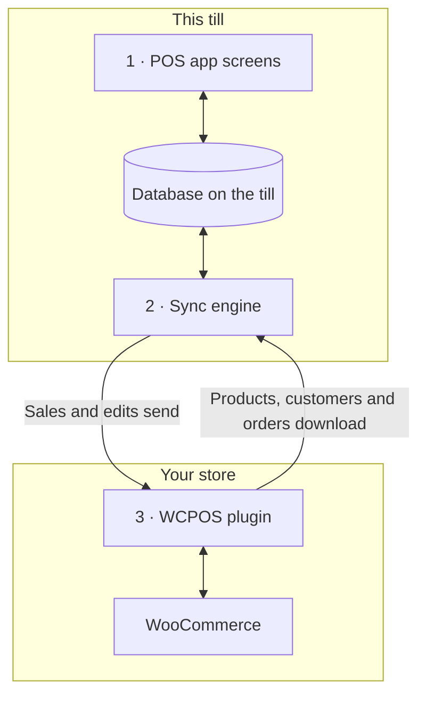

import LinkCards from '@site/src/components/LinkCards';
import LinkCard from '@site/src/components/LinkCard';
import JourneyShot from '@site/src/components/JourneyShot';
import manifest from '@site/static/img/2.x/reference/architecture/en/manifest.json';

WCPOS bestaat uit twee delen: een plugin op je WordPress-site en de POS-app op elke kassa. De kassa verkoopt vanuit een eigen kopie van je winkelgegevens en houdt die op de achtergrond gesynchroniseerd met WooCommerce. Deze pagina laat zien waar je gegevens staan en wat je server bereikt, voor ontwikkelaars en winkeleigenaren die daar meer over willen weten.

Wil je iets oplossen in plaats van over het ontwerp te lezen?

- **De app bijwerken:** [controleer eerst of de kassa alles heeft verzonden](../getting-started/previous-versions.mdx#check-sync). Zie [Synchroniseren vóór het bijwerken](#storage).
- **Een product ontbreekt op de kassa:** zie [Wanneer een product ontbreekt of verouderd is](../products/sync.mdx#goes-wrong).
- **Een verkoop heeft je winkel niet bereikt:** zie [Verkopen die wachten op verzending](../getting-started/offline.mdx#offline-writes).

## De twee delen {#two-part-system}

1. **De POS-app** draait op elke kassa: in een browser op `/pos/` op je site (het adres kan worden gewijzigd), in de desktopapp of in de iOS- en Android-apps. Zie [Installatie](../getting-started/installation.mdx) voor de vereisten per app. Elk scherm leest en schrijft in een database op de kassa, zodat een zoekopdracht of het toevoegen van een artikel nooit op je server hoeft te wachten.
2. **De synchronisatie-engine** in de app verwerkt wijzigingen in beide richtingen. Hij haalt op wat in je winkel is gewijzigd en verzendt wat op de kassa is gewijzigd.
3. **De WCPOS-plugin** draait op je WordPress-site en verbindt de kassa met WooCommerce. WooCommerce blijft de leidende bron voor elk product, elke klant en elke bestelling.

## Wat de kassa op het apparaat bewaart {#local-database}

**Status** → **Database** toont de kopie van je winkelgegevens op de kassa: één rij per soort record, met het aantal op dit apparaat (**Op apparaat**) en het aantal in je winkel (**Op server**). Wat het menu van elke rij doet, lees je bij [Winkelstatus](../support/store-health.mdx#coverage).

<JourneyShot manifest={manifest} device="tablet" step={1} offsets={[[186, 0], [186, 0], [186, 0], [186, 0], [186, 0], [186, 0], [186, 0], [186, 0]]} alt="Status, tabblad Database: de tabel met records op deze kassa, van Producten tot Belastingtarieven, elk met het aantal op het apparaat, het aantal op de server, de dekking en de grootte">

1. **Producten** — eerst een groep van 100 in de standaardsortering van de POS (naam, A tot Z), daarna de rest wanneer de kassa niet druk is. Zie [Downloaden en synchroniseren](../products/sync.mdx).
2. **Variaties** — worden samen met hun producten gedownload.
3. **Bestellingen** — openstaande en recente bestellingen blijven op de kassa. Oudere worden gedownload wanneer iemand ze opent.
4. **Terugbetalingen** — terugbetalingen van de afgelopen 92 dagen, plus elke terugbetaling bij een bestelling die je hebt geopend.
5. **Klanten** — worden in kleine groepen gedownload wanneer de kassa niet druk is.
6. **Categorieën** — met **Merken** en **Tags** eronder.
7. **Coupons** — op de kassa, met of zonder Pro.
8. **Belastingtarieven** — de belastingtarieven van je winkel.

</JourneyShot>

Een rode badge **N vastgelopen** op een rij betekent dat records van die soort je aandacht nodig hebben. Zie [Records die aandacht nodig hebben](../support/store-health.mdx#stuck-records).

Boven de tabel is **wijzigingen die wachten op verzending** het getal om in de gaten te houden: verkopen en wijzigingen op deze kassa die je winkel nog niet heeft ontvangen. Ze blijven op het apparaat totdat dat wel zo is. Openstaande bestellingen die je nog niet hebt gesynchroniseerd en wijzigingen die in een paneel staan, tellen niet mee en hebben je winkel ook nog niet bereikt. Zie [Verkopen die wachten op verzending](../getting-started/offline.mdx#offline-writes).

Records die buiten deze tabel worden bewaard

Een aantal gegevens staat buiten deze tabel. Betaalmethoden, belastingklassen, verzendmethoden en bestelstatussen worden bij elke start van de app uit je winkel gelezen. Het laatste antwoord wordt bewaard voor wanneer de kassa offline is. Kassasessies, afsluitingen en kasmutaties hebben hun eigen records en hun eigen wachtrij voor verzending naar je winkel.

### Hoe de database wordt bewaard {#storage}

Elke kassamedewerker in elke winkel heeft een eigen kopie op de kassa. In een browser draait de POS voor een site op één tabblad tegelijk. Als een app-update de manier verandert waarop die kopie wordt opgeslagen, downloadt de kassa deze opnieuw.

:::warning Synchroniseren vóór het bijwerken
Verkopen en wijzigingen die nog in de oude kopie wachten, worden niet verzonden. Controleer voordat je de app bijwerkt bij **Status** → **Database** of **wijzigingen die wachten op verzending** op 0 staat, zonder paneel onder de getallen, en synchroniseer elke openstaande bestelling. Zie [Controleren of een kassa alles heeft verzonden](../getting-started/previous-versions.mdx#check-sync).
:::

Details voor ontwikkelaars: opslag-engine, tabbladen en app-updates

- **Eén database per site, winkel en kassamedewerker.** Twee kassamedewerkers op één kassa, of één kassamedewerker in twee winkels, delen nooit lokale gegevens.
- **SQLite op elk platform.** In de browser draait SQLite op de privébestandsopslag van de browser, in één worker; in de iOS- en Android-apps wordt SQLite van het systeem gebruikt; de desktopapp bewaart de gegevens in SQLite in het hoofdproces van de app.
- **Opgeslagen op schijf.** De kopie op de kassa blijft behouden wanneer je de browser of de app sluit en het apparaat opnieuw opstart.
- **Eén actief tabblad per site.** In een browser draait de POS voor een site op één tabblad. Open je een tweede tabblad, dan biedt dat aan het over te nemen; het eerste tabblad stopt.
- **Lijsten worden in de database verwerkt.** Filteren, sorteren en pagineren gebeuren waar mogelijk in de database, zodat een lijst met duizenden bestellingen alleen de rijen aan het scherm doorgeeft die het weergeeft.
- **Geen migratie van de bestaande database.** Als een app-update de database-indeling verandert, opent de app een nieuwe database en downloadt hij de gegevens opnieuw uit je winkel. Wijzigingen die nog in de oude database wachten, worden niet verzonden en openstaande bestellingen worden niet overgezet: synchroniseer de kassa voordat je de app bijwerkt.

## Hoe de kassa en je winkel gesynchroniseerd blijven {#data-synchronization}

De synchronisatie-engine kopieert niet op vaste tijdstippen je hele winkel. Hij werkt op basis van wat de schermen van de kassa nodig hebben en doet zo min mogelijk verzoeken aan je server.

- **Controleren op wijzigingen.** De kassa vraagt je winkel wat er is veranderd, zo vaak als het [synchronisatieprofiel](../support/store-health.mdx#sync-presets) aangeeft (**Eco**, **Gebalanceerd** of **Realtime**). Elke kassa bewaart een eigen profiel: als je het op één kassa wijzigt, veranderen de andere niet mee.
- **Wat het scherm nodig heeft.** Elk scherm vertelt de engine wat het weergeeft. De engine gebruikt de database op de kassa als de records daar al aanwezig zijn en vraagt ze alleen anders op bij je winkel.
- **Op de achtergrond.** De eerste groep producten en de openstaande en recente bestellingen worden als eerste gedownload. De overige producten en klanten volgen wanneer de kassa niet druk is.
- **Wijzigingen verzenden.** Elke verkoop of wijziging wordt eerst op de kassa opgeslagen en daarna naar je winkel verzonden. Een wijziging die je winkel weigert, wordt nooit vanzelf opnieuw geprobeerd: die wacht onder **N wijzigingen hebben je server nooit bereikt**, met **Opnieuw verzenden** en **Verwerpen**. Zie [Winkelstatus](../support/store-health.mdx#refused-changes).

Details voor ontwikkelaars: wijzigingenfeed, verzoeklimieten en verwerkingsbanen

- Een winkel zonder nieuwe gegevens beantwoordt de controle op wijzigingen met `304 Not Modified` en zonder inhoud.
- Schrijfbewerkingen gaan door een blijvend opgeslagen wachtrij op de kassa, die ze naar `wcpos/v2/push/{collection}` post.
- De verzoeklimieten, wachttijden bij herhaalde pogingen en meetresultaten vind je bij [Synchronisatieprestaties](./sync-performance.mdx). Elke verwerkingsbaan wordt beschreven bij [Hoe de synchronisatie-engine werkt](./sync-engine.mdx).

## Hoe het afrekenen een verkoop vastlegt {#checkout-architecture}

Het afrekenen maakt deel uit van de POS. De kassa neemt elke betaling zelf aan en legt deze vast bij één WooCommerce-bestelling, in plaats van voor elke verkoop de betaalpagina voor bestellingen van WooCommerce te openen.

:::warning Offline betalen vereist een verkoop die je winkel al heeft
Een betaling kan alleen offline worden aangenomen voor een verkoop die je winkel bereikte voordat de verbinding wegviel: het bestelnummer staat boven de artikelen bij [Afrekenen](../pos/checkout/index.mdx). Een verkoop die is gestart nadat de verbinding wegviel, wacht op de kassa en wordt betaald zodra de winkel weer bereikbaar is. Zie [Een betaling offline aannemen](../getting-started/offline.mdx#take-payment-offline).
:::

- **Een tegel voor elke methode.** De kassa toont een tegel voor elke betaalmethode die voor de POS is ingeschakeld. Een methode die niet kan worden aangestuurd, wordt grijs weergegeven met de reden erbij en wordt nooit verborgen. Zie [Wanneer een tegel niet kan worden gebruikt](../payment/index.mdx#unavailable-tiles).
- **Eén bestelling, meerdere betalingen.** Een gesplitste verkoop blijft één WooCommerce-bestelling, met één set artikelen, belastingen en voorraadwijzigingen en één bestelnummer, zodat rapporten deze maar één keer tellen. Een terugbetaling is een normale WooCommerce-terugbetaling, verdeeld over de betalingen die worden terugbetaald.
- **De winkel bepaalt.** Na elke betaling geeft je winkel terug wat er is betaald en wat er nog openstaat. De kassa rondt de verkoop af op basis van de bedragen van je winkel, niet van de eigen bedragen.
- **Veilig opnieuw proberen.** Elke betaling heeft een ID die de kassa aanmaakt, zodat een betaling die twee keer wordt verzonden maar één keer wordt vastgelegd.
- **Offline.** Bij een verkoop die je winkel al heeft, kan Contant nog steeds worden afgerond wanneer de verbinding wegvalt: de betaling wordt vastgelegd als **Wordt later verwerkt** en verzonden zodra de verbinding terug is. Zie [Een betaling offline aannemen](../getting-started/offline.mdx#take-payment-offline).

Incassomodi en betaalroutes

`GET wcpos/v2/payment-methods` beschrijft elke gateway: het type `kind` (`cash`, `card`, `stored_value`, `bank_transfer` of `other`), hoe het geld wordt geïnd (`capture`) en wat er is toegestaan (`capabilities`: deelbedragen, wisselgeld, terugbetalingen, fooien, offline, annuleren). Elke betaling is een rij in de `_wcpos_payments`-metadata van de bestelling. Na elke betaling geeft de winkel de `paid` en `balance` van de bestelling terug.

De `capture.mode` van elke methode geeft aan wie het geld int. Elke betalingsaanroep gaat naar de handler die voor die modus is geregistreerd.

| Modus | Hoe het geld wordt geïnd | Plugin |
| --- | --- | --- |
| `manual` | De kassamedewerker neemt de betaling aan en legt deze vast. De standaard voor Contant, Kaart, Rembours, Directe bankoverschrijving en Chequebetalingen. | Gratis |
| `webview` | De eigen betaalpagina van de gateway, op het tabblad **Verouderd** bij het afrekenen. De standaard voor alle andere gateways. Zie [Wanneer de betaalpagina op het tabblad Verouderd niet laadt](../payment/index.mdx#legacy-notices). | Gratis |
| `gateway` | De eigen `process_payment()` van de gateway wordt uitgevoerd met de waarden die de kassa heeft verzameld. Een gateway activeert dit via een filter. | Gratis |
| `server` | Je winkel vraagt de aanbieder van de betaalterminal om de betaling te innen. | Pro |
| `device` | De kassa stuurt de kaartlezer aan via de SDK van de aanbieder, en de aanbieder bevestigt de betaling. | Pro |

De betaalroutes vallen onder de bestelling, op basis van de WooCommerce-ID:

- `POST wcpos/v2/orders/{id}/payments` legt een betaling vast. De ID van de betaling maakt opnieuw proberen veilig.
- `.../payments/{uuid}/intent`, `/capture`, `/void` en `/refund` (`POST`), en `/status` (`GET`), hebben betrekking op één betaling. Elke opdracht heeft een eigen opdracht-ID.
- `POST wcpos/v2/orders/{id}/close` rondt de bestelling af.

Elke opdracht bevat de `revision` van de bestelling; een opdracht zonder wordt geweigerd met `428`.

Om een gateway alleen voor de POS te bouwen, begin je met de [Gateway-template](./gateway-template.mdx).

## Waarom sommige websitewijzigingen de kassa niet bereiken {#api-extensions}

De kassa haalt producten, klanten en bestellingen op bij de WCPOS-plugin, die ze uit WooCommerce leest. Een plugin die de gegevens verandert die WooCommerce naar apps stuurt, heeft invloed op de kassa. Een plugin die alleen het uiterlijk van je website of alleen het online afrekenen verandert, heeft dat niet. Begin om een plugin te beoordelen bij [De WooCommerce REST API begrijpen](./wc-rest-api.mdx).

Details voor ontwikkelaars: API-versies

De kassa communiceert alleen met je winkel via de REST-routes van de plugin, die binnen je site uit WooCommerce lezen. De plugin registreert twee namespaces naast de eigen `wc/v3` van WooCommerce.

- **`wcpos/v2`** wordt door de app gebruikt: records lezen, de wijzigingenfeed, de wachtrij met wijzigingen, betalingen, kassa's en sessies. De leesroutes sturen verzoeken binnen je site door naar `wc/v3`, dus een plugin die de REST-antwoorden van WooCommerce verandert, verandert wat de kassa ziet.
- **`wcpos/v1`** wordt nog steeds geregistreerd. De dataroutes (producten, variaties, bestellingen, klanten, coupons, belastingen, categorieën, tags, merken) worden niet meer gewijzigd. De serviceroutes (winkels, instellingen, bonnen, templates, afdruktaken en de rest) gebruiken dezelfde code als hun `wcpos/v2`-versies.

### App-updates en andere synchronisatietools {#wcpos-v2-namespace}

De app en de plugin worden samen bijgewerkt: een kassa met een oudere app dan de plugin vereist, toont [SYNC341](../error-codes/SYNC341.mdx) totdat de app is bijgewerkt. POS-prijzen op bestelregels worden opgeslagen waar andere synchronisatietools ze kunnen lezen; zie [Hoe POS-prijsaanpassingen worden opgeslagen](./pos-discounts.mdx#how-pos-price-overrides-are-stored).

Details voor ontwikkelaars: verzoeken, inloggen en bestel-ID's

- **Routes worden geladen voor POS-verzoeken.** De plugin registreert zijn routes alleen bij verzoeken die daarvoor bedoeld zijn: een `wcpos/`-route, een `X-WCPOS`-header of `?wcpos=1`. Het overige REST-verkeer van je site laadt ze niet.
- **De app en de plugin gaan samen vooruit.** Elk app-verzoek bevat `X-WCPOS-Protocol`. Een plugin die een nieuwer protocol vereist, antwoordt met `426` en `wcpos_update_required`. De kassa toont [SYNC341](../error-codes/SYNC341.mdx) totdat de app is bijgewerkt.
- **Openbare routes.** Voor `wcpos/v2/site`, `wcpos/v2/ping` en `wcpos/v2/echo` hoef je niet in te loggen. De app gebruikt ze om je site te vinden en de verbinding te testen voordat iemand inlogt. Bij hosts die `/wp-json/` verbergen of headers verwijderen, valt de app terug op het WordPress-adres `/?rest_route=` en op querystringvarianten van de headers (`?wcpos=1`, `wcpos_protocol`). Als geen van beide antwoordt, toont de kassa [AUTH431](../error-codes/AUTH431.mdx).
- **Inloggen.** De app logt in via de pagina `/wcpos-auth` op je site en ontvangt een JWT-toegangstoken dat 30 minuten geldig is en een vernieuwingstoken dat 30 dagen geldig is. De filters `wcpos_jwt_access_token_expire` en `wcpos_jwt_refresh_token_expire` wijzigen deze termijnen. Welke rol toegang heeft tot welke route, lees je bij [Toegang tot endpoints per rol](./role-endpoint-access.mdx).
- **Bestellingen hebben een UUID.** De kassa maakt voor elke bestelling een UUID aan, verzendt deze als `_woocommerce_pos_uuid`-metadata en je winkel bewaart deze. Bij het ophalen van bestellingen dient de UUID als sleutel.
- **POS-prijzen op bestelregels** worden opgeslagen zodat andere synchronisatietools ze kunnen lezen. Zie [Hoe POS-prijsaanpassingen worden opgeslagen](./pos-discounts.mdx#how-pos-price-overrides-are-stored).
- **Winkels (Pro).** Bij meerdere winkels stuurt de kassa zijn winkel mee in de `X-WCPOS-Store`-header en geeft de plugin die door aan WooCommerce als `store_id`. De winkel van een bestelling komt uit het veld `_pos_store` in de metadata. De Pro-routes voor het bewerken van winkels en het koppelen van een klantendisplay worden onder beide namespaces geregistreerd.

:::info Met WCPOS Pro
Pro voegt kaartlezers, het bewerken van winkels en het koppelen van een klantendisplay toe. Bij meerdere winkels krijgt elke winkel zijn eigen prijzen op de kassa. Zie [Winkels instellen](../stores/setup.mdx).
:::

## Wat het ontwerp oplevert en vraagt {#architecture-pros-and-cons}

- **Direct zoeken en een direct reagerende winkelwagen.** Beide lezen de eigen database van de kassa.
  - **De keerzijde:** de kopie op de kassa moet gesynchroniseerd blijven met je winkel. Dat is precies de taak van de synchronisatie-engine.
- **Doorverkopen bij een verbroken verbinding.** Verkopen en wijzigingen wachten op de kassa en worden verzonden zodra de verbinding terug is. Contant kan nog steeds worden afgerond bij een verkoop die je winkel al heeft.
  - **De keerzijde:** een verkoop die is gestart nadat de verbinding wegviel, wordt pas betaald wanneer de winkel weer bereikbaar is. Zie [Een betaling offline aannemen](../getting-started/offline.mdx#take-payment-offline).
- **Apps gebouwd voor een kassa.** Desktop-, iOS- en Android-apps, geen webpagina in een frame.
  - **De keerzijde:** de POS ziet je winkel alleen via de REST API. WordPress-thema's en hooks kunnen de vormgeving niet aanpassen, en een plugin die alleen het online afrekenen of je thema verandert, heeft geen invloed op de kassa. Zie [Waarom werken sommige plugins niet in de POS?](./wc-rest-api.mdx#why-dont-some-plugins-work-in-the-pos)

## Gerelateerde documentatie {#related-documentation}

<LinkCards>
  <LinkCard title="Hoe de synchronisatie-engine werkt" to="/developers/sync-engine" description="Verwerkingsbanen, de wijzigingenfeed en de wachtrij met wijzigingen, in detail." />
  <LinkCard title="Winkelstatus" to="/troubleshooting/store-health" description="Bekijk de database van de kassa, synchronisatieprofielen en wijzigingen die wachten op verzending." />
  <LinkCard title="De WooCommerce REST API begrijpen" to="/developers/woocommerce-rest-api" description="Wat de REST API is en waarom sommige plugins geen invloed hebben op de POS." />
</LinkCards>
