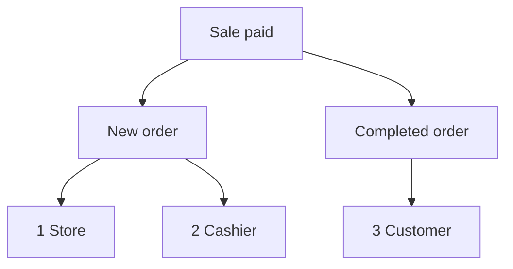

import Accordion from '@site/src/components/Accordion';
import AccordionItem from '@site/src/components/AccordionItem';
import LinkCards from '@site/src/components/LinkCards';
import LinkCard from '@site/src/components/LinkCard';

**WP admin:** `WP Admin → POS → Settings → Checkout`.

WooCommerce verstuurt e-mails over bestellingen: een e-mail Nieuwe bestelling naar jou, een e-mail Bestelling afgerond naar de klant, enzovoort. Voor verkopen via de POS kies je hier welke van deze e-mails worden verstuurd en wie ze ontvangt. Voor je online bestellingen blijven je gebruikelijke WooCommerce-e-mailinstellingen gelden.

Ga direct naar: [E-mails aan beheerder](#admin-emails) · [E-mails aan klanten](#customer-emails) · [Handmatig een bon versturen](#send-receipt-manually) · [E-mails aan kassamedewerker](#cashier-emails) · [Veelvoorkomende situaties](#common-scenarios) · [Als er iets misgaat](#goes-wrong)

## E-mails in- of uitschakelen {#switches}

:::note Voor POS-verkopen
Deze schakelaars hebben voor POS-bestellingen voorrang op **Deze e-mailmelding inschakelen** onder **WooCommerce > Instellingen > E-mails**. Een e-mail die in WooCommerce is uitgeschakeld, kan toch worden verstuurd als deze hier is aangevinkt.
:::

1. Ga in WP Admin naar **POS > Instellingen > Kassa**.
2. Onder **Oververkoop voorkomen** vind je de drie e-mailschakelaars: **E-mails aan beheerder**, **E-mails aan klanten** en **E-mails aan kassamedewerker**. Daaronder staat de lijst **Betaalmethoden**.
3. Zet een schakelaar aan. Er verschijnt dan een selectievakje voor elke e-mail in die groep. Vink een e-mail uit om alleen die e-mail uit te schakelen.
4. Zet een schakelaar uit om voor POS-verkopen geen enkele e-mail uit die groep te versturen, ongeacht de aangevinkte selectievakjes.

Elke wijziging wordt meteen opgeslagen: op het scherm verschijnt **Opslaan**, gevolgd door **Opgeslagen**.

{/* reshoot: WP Admin > POS > Settings > Checkout with all three email switches on and their checkboxes showing; see reshoot.md */}

Naar wie elke schakelaar e-mails verstuurt en wat de instelling bij installatie is:

- **E-mails aan beheerder**: ingeschakeld bij installatie\
  Naar de adressen onder **Ontvanger(s)** voor die e-mail, onder **WooCommerce > Instellingen > E-mails**
- **E-mails aan klanten**: ingeschakeld bij installatie\
  Naar het facturatie-e-mailadres van de bestelling
- **E-mails aan kassamedewerker**: uitgeschakeld bij installatie\
  Naar het e-mailadres van het WordPress-account van de kassamedewerker

Welke e-mails een aan de kassa betaalde verkoop verstuurt als de **Bestelstatus** van de betaalmethode is ingesteld op Afgerond:

1. **Winkel** — de **Ontvanger(s)** van **Nieuwe bestelling** in WooCommerce, als **E-mails aan beheerder** is ingeschakeld en **Nieuwe bestelling** is aangevinkt.
2. **Kassamedewerker** — het eigen adres van de kassamedewerker, als **E-mails aan kassamedewerker** is ingeschakeld en **Nieuwe bestelling** is aangevinkt.
3. **Klant** — het facturatie-e-mailadres van de bestelling, als **E-mails aan klanten** is ingeschakeld, **Bestelling afgerond** is aangevinkt en de bestelling een facturatie-e-mailadres heeft.

## E-mails aan beheerder {#admin-emails}

Deze gaan naar jou als winkel. Bij installatie is elke e-mail aangevinkt.

Om de ontvangers van een beheerdersmail te wijzigen, ga je naar **WooCommerce > Instellingen > E-mails**, open je de instellingen van die e-mail en pas je **Ontvanger(s)** aan.

| E-mail | Wordt verstuurd wanneer |
|---|---|
| **Nieuwe bestelling** | Een POS-bestelling de status Afgerond, In behandeling of In de wacht krijgt |
| **Geannuleerde bestelling** | Een bestelling met de status In behandeling of In de wacht wordt geannuleerd |
| **Mislukte bestelling** | Een bestelling met de status Wachtend op betaling of In de wacht mislukt |

Wanneer een POS-bestelling van **POS - Open** of **POS - Gedeeltelijke betaling** naar Afgerond, In behandeling of In de wacht gaat, wordt **Nieuwe bestelling** verstuurd als deze onder **E-mails aan beheerder** of **E-mails aan kassamedewerker** is aangevinkt en de bijbehorende schakelaar aanstaat, ook als **Nieuwe bestelling** in WooCommerce is uitgeschakeld. De status die elke verkoop krijgt, is de **Bestelstatus** die je voor de betaalmethode instelt: zie [Bestelstatus](./checkout.mdx#order-status).

Waarom WCPOS zelf Nieuwe bestelling verstuurt voor POS-verkopen

WooCommerce verstuurt **Nieuwe bestelling** alleen wanneer een bestelling de status Wachtend op betaling, Mislukt of Geannuleerd verlaat. Een POS-bestelling wacht echter in **POS - Open** of **POS - Gedeeltelijke betaling**, statussen die WooCommerce niet kent. WooCommerce zou de e-mail daarom niet versturen wanneer de bestelling verdergaat. WCPOS verstuurt deze namens WooCommerce op de hierboven genoemde momenten.

## E-mails aan klanten {#customer-emails}

Deze gaan naar het facturatie-e-mailadres van de bestelling. Voor een bestelling zonder facturatie-e-mailadres, zoals een gastverkoop waarbij je er geen hebt ingevuld, wordt geen klantmail verstuurd. Bij installatie is elke e-mail aangevinkt.

### Handmatig een bon versturen {#send-receipt-manually}

**Bon e-mailen** op het scherm na betaling staat hier los van. Hiermee verstuur je de factuurmail van WooCommerce, waarop deze schakelaars geen invloed hebben. Dit werkt dus ook als **E-mails aan klanten** is uitgeschakeld. Zie [De bon e-mailen](../../receipts/at-checkout.mdx#email-receipt).

### Automatisch verstuurde e-mails {#customer-emails-automatic}

| E-mail | Wordt verstuurd wanneer |
|---|---|
| **Bestelling in de wacht** | Een bestelling van Wachtend op betaling, Mislukt of Geannuleerd naar In de wacht gaat |
| **Bestelling in behandeling** | Een bestelling van Wachtend op betaling, In de wacht, Mislukt of Geannuleerd naar In behandeling gaat |
| **Bestelling afgerond** | Een bestelling de status Afgerond krijgt |
| **Terugbetaalde bestelling** | Een bestelling geheel of gedeeltelijk wordt terugbetaald. Zie [Terugbetalingen](../../orders/refunds.mdx) |
| **Mislukte bestelling** | Een bestelling mislukt |

Een verkoop die rechtstreeks van **POS - Open** naar In behandeling of In de wacht gaat, zoals een contante verkoop, verstuurt geen **Bestelling in de wacht** of **Bestelling in behandeling**: WooCommerce verstuurt die alleen vanuit de genoemde statussen. **Bestelling afgerond**, **Terugbetaalde bestelling** en **Mislukte bestelling** zijn niet afhankelijk van de vorige status en worden dus wel verstuurd voor POS-verkopen. Gebruik [Bon e-mailen](#send-receipt-manually) om de klant een e-mail te sturen voor een verkoop die eindigt met In behandeling of In de wacht.

## E-mails aan kassamedewerker {#cashier-emails}

Hiermee verstuur je de e-mail **Nieuwe bestelling** naar de kassamedewerker die de verkoop heeft afgehandeld, op het e-mailadres van diens WordPress-account. De schakelaar staat bij installatie uit. Als je deze aanzet, is **Nieuwe bestelling** aangevinkt.

De kassamedewerker krijgt de e-mail op dezelfde momenten als de beheerder (zie [E-mails aan beheerder](#admin-emails)). **E-mails aan beheerder** en **E-mails aan kassamedewerker** werken onafhankelijk van elkaar: de ene uitschakelen heeft geen invloed op de andere. Staat het adres van de kassamedewerker al bij de ontvangers van beheerdersmails, bijvoorbeeld bij een eigenaar die beide rollen heeft, dan ontvangt die één exemplaar in plaats van twee.

Welke WordPress-gebruikers zich als kassamedewerker bij de POS kunnen aanmelden, stel je in onder [Toegang voor kassamedewerkers](./access.mdx).

## Veelvoorkomende situaties {#common-scenarios}

<Accordion>
  <AccordionItem question="Voorkomen dat de inbox op drukke dagen volloopt">

Vink **Nieuwe bestelling** uit onder **E-mails aan beheerder**. Laat **Geannuleerde bestelling** en **Mislukte bestelling** aangevinkt: daarvan wil je wel op de hoogte blijven.

Gebruik [Rapporten](../../reports/index.mdx) om de omzet te volgen, in plaats van e-mails over nieuwe bestellingen te tellen.

  </AccordionItem>

  <AccordionItem question="E-mails over nieuwe bestellingen naar de dienstdoende kassamedewerker sturen in plaats van naar de beheerder">

Vink **Nieuwe bestelling** uit onder **E-mails aan beheerder**, of schakel **E-mails aan beheerder** uit, en schakel **E-mails aan kassamedewerker** in. De kassamedewerker die de verkoop afhandelt, krijgt de e-mail op het eigen adres en de inbox van de beheerder blijft rustig.

Als je **E-mails aan beheerder** uitschakelt, worden ook **Geannuleerde bestelling** en **Mislukte bestelling** niet meer verstuurd. Daarom is alleen **Nieuwe bestelling** uitvinken meestal de betere keuze.

  </AccordionItem>

  <AccordionItem question="Geen klantmails voor verkopen in de winkel">

Marktkramen en cafés willen vaak geen e-mail sturen naar een klant die al een geprinte bon heeft. Schakel **E-mails aan klanten** uit om voor POS-verkopen geen e-mails over bestellingen in behandeling, afgeronde of terugbetaalde bestellingen of andere klantmails te versturen.

Voor je online bestellingen worden klantmails nog gewoon verstuurd. Een klant die om een bon per e-mail vraagt, kan die nog steeds krijgen: druk op **Bon e-mailen** op het scherm na betaling.

  </AccordionItem>

  <AccordionItem question="Ik heb een upgrade uitgevoerd vanaf een versie vóór 1.8.9 en de enkele schakelaar 'E-mails inschakelen' is verdwenen">

In versie 1.8.9 is de enkele aan/uit-schakelaar vervangen door de drie groepen op deze pagina. WCPOS leest je oude instelling: stonden e-mails uit, dan staan **E-mails aan beheerder** en **E-mails aan klanten** uit. Stonden ze aan, dan staan beide aan met elke e-mail aangevinkt. **E-mails aan kassamedewerker** staat in beide gevallen aanvankelijk uit.

Je hoeft niets te doen.

  </AccordionItem>
</Accordion>

## Als er iets misgaat {#goes-wrong}

**De beheerder krijgt geen e-mail Nieuwe bestelling.** Controleer of **E-mails aan beheerder** is ingeschakeld en **Nieuwe bestelling** is aangevinkt. Controleer vervolgens **Ontvanger(s)** voor **Nieuwe bestelling** onder **WooCommerce > Instellingen > E-mails**.

**Een klant krijgt geen e-mail.** Controleer of **E-mails aan klanten** is ingeschakeld en de betreffende e-mail is aangevinkt. Open vervolgens de bestelling en controleer of er een facturatie-e-mailadres is ingevuld. Gebruik **Bon e-mailen** om meteen een bon te versturen.

**De kassamedewerker krijgt geen e-mail.** Controleer of **E-mails aan kassamedewerker** is ingeschakeld, **Nieuwe bestelling** is aangevinkt en het WordPress-account van de kassamedewerker een e-mailadres heeft. Als dat adres ook een ontvanger van beheerdersmails is, ontvangt de kassamedewerker maar één exemplaar.

**Een e-mail die je in WooCommerce hebt uitgeschakeld, komt toch aan voor POS-verkopen.** Voor POS-bestellingen zijn de selectievakjes hier bepalend. Vink de e-mail hier ook uit.

## Hooks voor ontwikkelaars {#developer-hooks}

Voor ontwikkelaars die meer controle nodig hebben dan deze schakelaars bieden. Winkeleigenaren kunnen dit overslaan.

Vier WordPress-filters en hoe de ontvangers van Nieuwe bestelling worden ingesteld

Vóór WCPOS 2.0 heetten deze filters `woocommerce_pos_*` (bijvoorbeeld `woocommerce_pos_admin_emails`). Die namen werken nog, maar zijn sinds 2.0 verouderd en worden op zijn vroegst in 2.2 verwijderd. Zie [Naamgeving van hooks](../../extensions/index.mdx#hook-naming).

**`wcpos_admin_emails`**: de ID's van beheerdersmails die WCPOS aanstuurt. Standaard: `cancelled_order`, `failed_order`.

**`wcpos_customer_emails`**: de ID's van klantmails die WCPOS aanstuurt. Standaard: `customer_failed_order`, `customer_on_hold_order`, `customer_processing_order`, `customer_completed_order`, `customer_refunded_order`.

**`wcpos_admin_email_enabled`**: of een bepaalde beheerdersmail voor een bepaalde POS-bestelling wordt verstuurd. Argumenten: `$is_enabled`, `$email_id`, `$order`, `$email`.

**`wcpos_customer_email_enabled`**: of een bepaalde klantmail voor een bepaalde POS-bestelling wordt verstuurd. Dezelfde argumenten.

**Nieuwe bestelling** staat niet in `wcpos_admin_emails`. WCPOS stelt de ontvangers in via het WooCommerce-filter `woocommerce_email_recipient_new_order`: het verwijdert de winkelontvangers wanneer de beheerder de e-mail niet wil ontvangen en voegt het adres van de kassamedewerker toe wanneer die de e-mail wel wil ontvangen. De kassamedewerker is de WordPress-gebruiker die in de metadata `_pos_user` van de bestelling is opgeslagen. Je eigen callback op dat filter kan adressen toevoegen of verwijderen, net als bij elke andere WooCommerce-e-mail.

## Gerelateerde documentatie {#related-documentation}

<LinkCards>
  <LinkCard title="Kassa-instellingen" to="/settings/checkout" description="Betaalmethoden en de bestelstatus die elke methode instelt, op hetzelfde scherm." />
  <LinkCard title="Bonnen bij het afrekenen" to="/sell/print-email-receipts" description="Print of e-mail een bon vanaf het scherm na betaling." />
  <LinkCard title="Bestellingen" to="/manage-store/orders" description="Vind de POS-bestellingen waar deze e-mails over gaan." />
</LinkCards>
