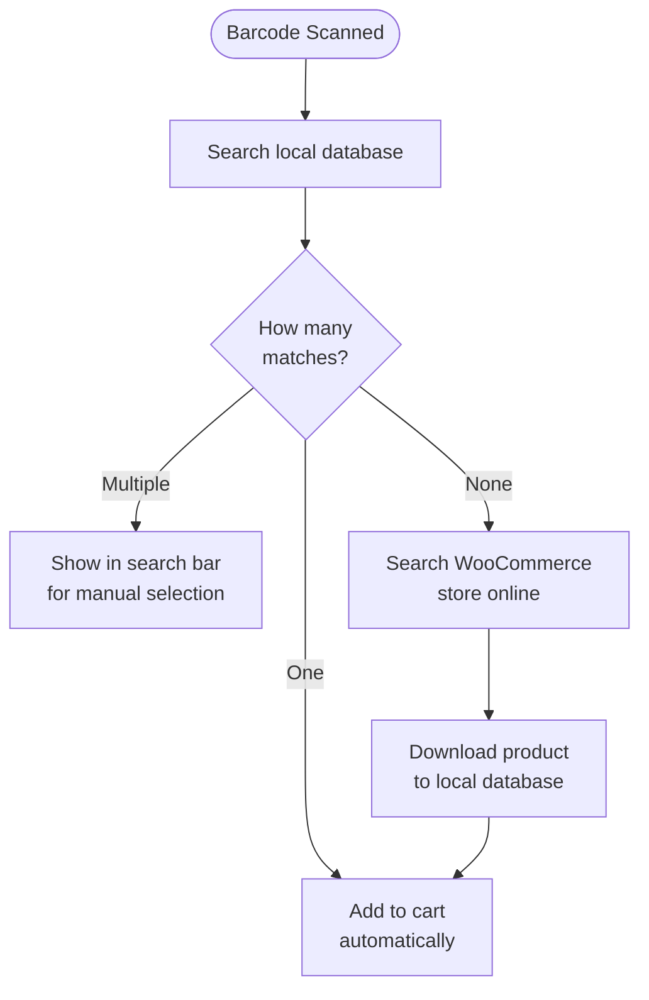

import Image from "@theme/IdealImage";
import Accordion from '@site/src/components/Accordion';
import AccordionItem from '@site/src/components/AccordionItem';

A maioria dos leitores de código de barras se comporta como um teclado conectado ao seu dispositivo.
Quando um código de barras é lido, o WCPOS detecta que os caracteres foram inseridos mais rápido do que na digitação normal.
Ele usa essas "teclas pressionadas rapidamente" para identificar a entrada como uma leitura de código de barras.
Isso funciona de imediato com quase todos os leitores — mas os leitores também oferecem outros [modos de conexão](#connection-modes) aos quais o WCPOS pode se conectar diretamente.

## Configuração da leitura de código de barras {#configuring-barcode-scanning}

Como a leitura de um código de barras acontece muito rapidamente, o POS consegue diferenciar um código de barras de algo digitado manualmente.
Nas configurações do POS, há opções para ajustar como a detecção de códigos de barras funciona.

  <Image
    alt="Configurações de leitura de código de barras nas configurações do POS"
    img="/img/barcode-scanning-settings.png"
    style={{ maxHeight: 500 }}
  />
  
Configurações de leitura de código de barras nas configurações do POS

| Configuração | Finalidade | Valor típico |
|---|---|---|
| **Tempo médio de entrada** | A velocidade com que a entrada deve ocorrer para ser reconhecida como código de barras | Um intervalo curto — rápido o suficiente para que a digitação manual não acione a detecção |
| **Comprimento mínimo** | O tamanho que a sequência contínua de caracteres deve ter para ser tratada como código de barras | Use o comprimento do código de barras mais curto que você utiliza (por exemplo, 8 para EAN-8) |
| **Remoção de prefixo/sufixo** | Remove os caracteres extras que seu leitor adiciona (um prefixo ou sufixo), para que apenas o código de barras principal permaneça | Deixe em branco, a menos que seu leitor esteja configurado para adicioná-los |

## Modos de conexão {#connection-modes}

Para seguir um passo a passo de configuração ou solução de problemas, use o [Assistente de configuração de leitores](/1.x/hardware/scanners/setup-wizard).

Todo leitor de código de barras vem configurado em um dos modos disponíveis, e esse modo determina como o WCPOS pode receber as leituras:

| Modo | Como a leitura chega | Configuração |
|---|---|---|
| **Teclado (HID)** — o padrão de fábrica em quase todos os leitores | O leitor "digita" o código de barras; o WCPOS reconhece as teclas pressionadas rapidamente | Nenhuma — pareie ou conecte e faça a leitura |
| **Serial (SPP / USB-COM)** | Uma conexão direta por USB serial ou Bluetooth SPP | Altere o modo do leitor e depois conecte-o nas configurações de Código de barras |
| **HID-POS** | Uma conexão direta para leitores USB (via WebHID) | Altere o modo do leitor e depois conecte-o nas configurações de Código de barras |
| **Bluetooth LE (GATT do fabricante)** | Uma conexão direta Bluetooth Low Energy | Pareie o leitor e depois adicione-o nas configurações de Código de barras usando seu UUID de serviço |

O modo teclado não exige configuração e é adequado para a maioria das lojas. Uma conexão direta vale a pena se as leituras às vezes chegam com caracteres incorretos (trocas de maiúsculas ou símbolos causadas por diferenças de layout de teclado) ou são inseridas no lugar errado quando o campo de busca não está em foco — um leitor conectado diretamente envia cada leitura direto ao WCPOS, independentemente da velocidade de digitação, do layout do teclado ou do foco.

:::info Um leitor em modo teclado não pode ser conectado diretamente
Seu dispositivo trata um leitor em modo teclado exatamente como um teclado, e nenhum aplicativo tem permissão para assumir o controle de um teclado.
Se você pressionar **Conectar leitor serial** ou **Conectar leitor HID** nas configurações de Código de barras e seu leitor não aparecer na lista, é quase certo que ele ainda está em modo teclado.
:::

**Para alternar de modo**, encontre o código de barras de configuração no manual do seu leitor (procure por *"modo SPP"*, *"modo serial"* ou *"modo HID-POS"*) e leia-o — o leitor se reconfigura sozinho. Em leitores Bluetooth, remova o pareamento antigo nas configurações de Bluetooth do dispositivo e pareie novamente após a troca. Ler o código de barras *"HID"* ou *"teclado"* do manual restaura o modo anterior a qualquer momento.

As conexões diretas são compatíveis com o aplicativo de desktop e navegadores baseados no Chrome (usando o suporte a Web Serial e WebHID do navegador). O aplicativo de desktop exibe um seletor de dispositivos dentro do próprio aplicativo; o Chrome exibe seu próprio seletor. No iOS e no Android, as opções compatíveis são o modo teclado e a leitura por câmera, e o Android também intercepta diretamente a entrada de teclas de leitores físicos.

## Leitura por câmera {#camera-scanning}

Todas as plataformas — web, desktop, iOS e Android — permitem ler códigos com a câmera do dispositivo, então você não precisa de um leitor dedicado para começar. Abra a câmera pelo ícone de leitura na barra de busca; ela aparece como um **painel redimensionável logo abaixo dos filtros**, mantendo a lista de produtos visível enquanto você faz as leituras. Aponte a câmera para um código de barras e o WCPOS o lerá exatamente como faria com um leitor físico.

## O que acontece quando um código de barras é detectado? {#what-happens-when-a-barcode-is-detected}

Quando o POS detecta um código de barras, ele procura no banco de dados local um produto ou uma variação de produto correspondente.
Há três resultados possíveis:

Quando uma leitura não encontra correspondência local, o WCPOS consulta sua loja online, baixa o produto correspondente e **o adiciona ao carrinho automaticamente** — assim, um código de barras desconhecido ainda permite concluir a venda, e a mesma leitura será instantânea da próxima vez.

:::tip Várias correspondências geralmente indicam um problema nos dados
Se mais de um produto compartilhar o mesmo código de barras, o POS não consegue saber qual adicionar; por isso, coloca o código na barra de pesquisa para que você escolha. Quando isso acontece, geralmente é sinal de que os dados dos produtos precisam ser organizados — cada produto deve ter um código de barras **único**.
:::

## Feedback e comportamento da leitura {#scan-feedback-and-behaviour}

- **Sons de leitura** — o WCPOS pode reproduzir um som a cada leitura para que os caixas recebam confirmação instantânea sem olhar para a tela. Os sons são opcionais e oferecem vários temas; ative-os e escolha um tema nas [Configurações de código de barras](/1.x/settings/store/barcode).
- **Na tela de Pedidos** — as leituras são direcionadas ao campo de busca de Pedidos, então você pode ler um código de barras para encontrar o pedido ou o produto que procura.
- **Códigos de barras UPC-A** — uma leitura UPC-A retorna os dígitos impressos na embalagem, de modo que o valor comparado pelo POS seja o mesmo usado nos dados dos seus produtos.

## Como entender a sincronização de produtos {#understanding-product-synchronisation}

O POS baixa seu catálogo em pequenos lotes em segundo plano, então nem todos os produtos estão no dispositivo desde o primeiro minuto — veja [Sincronização de produtos](/1.x/products/sync) para entender como isso funciona.

### Por que isso é importante para a leitura de códigos de barras {#why-it-matters-for-barcode-scanning}

Quando você lê um código de barras que ainda não está armazenado localmente, o POS consulta sua loja WooCommerce online, encontra o produto e o baixa — assim, a mesma leitura será instantânea da próxima vez. Você não precisa fazer nada para acelerar isso: a carga inicial do catálogo em segundo plano baixa o restante do seu inventário automaticamente, e você pode acompanhar o progresso em **Saúde da loja → Banco de dados**.

## Perguntas frequentes {#faq}

<Accordion>
  <AccordionItem question="Por que vejo '0 produtos encontrados localmente' ao ler um código de barras?">

Nem todos os produtos ficam no dispositivo logo no início — o POS faz a carga inicial do seu catálogo em segundo plano durante os primeiros minutos de uso.
Se o produto que você acabou de ler ainda não estiver armazenado, a leitura faz com que o POS o procure online e o baixe, para que a próxima leitura seja instantânea.

  </AccordionItem>

  <AccordionItem question="O POS gera e imprime códigos de barras?">

Não, no momento. Nosso POS foi desenvolvido para escanear e ler códigos de barras existentes, mas não inclui recursos para criá-los ou imprimi-los.
Se você precisa gerar códigos de barras para seus produtos, pode usar plugins de terceiros para WooCommerce especializados na criação e impressão de códigos de barras. Alguns exemplos incluem:

- [EAN for WooCommerce](https://wordpress.org/plugins/ean-for-woocommerce/)
- [A4 Barcode Generator](https://wordpress.org/plugins/a4-barcode-generator/)

Depois de gerar códigos de barras para seus produtos, você pode escaneá-los facilmente no caixa para agilizar o processo de checkout no POS.

  </AccordionItem>
</Accordion>
