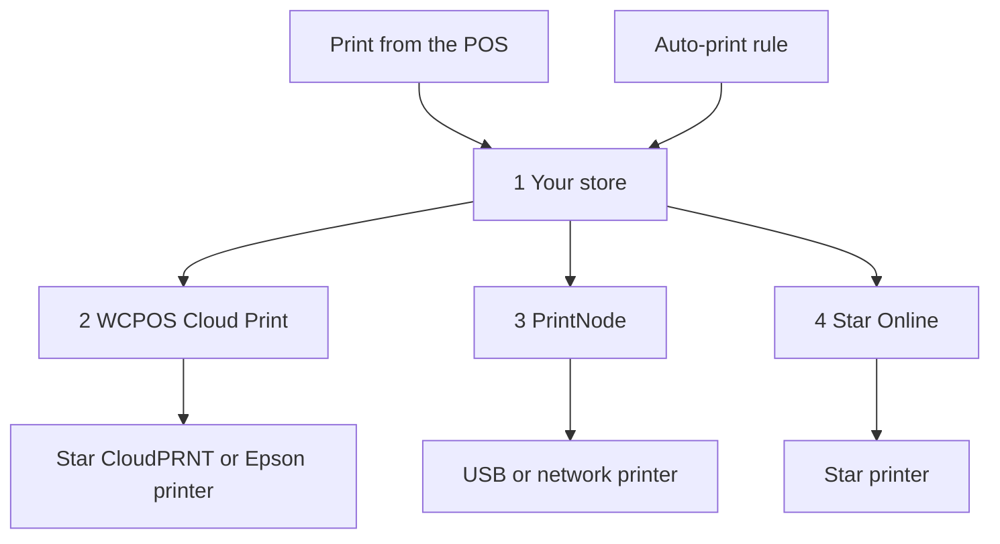

import LinkCards from '@site/src/components/LinkCards';
import LinkCard from '@site/src/components/LinkCard';

A impressão na nuvem envia recibos para uma impressora pela internet, sem que ela precise estar conectada ao dispositivo que executa o POS. Use esse recurso para uma impressora em uma rede diferente da do caixa, uma impressora de cozinha que imprime cada pedido automaticamente ou uma lista de embalagem para cada venda online.

Você configura a impressora na nuvem uma única vez, em **WP Admin > POS > Configurações > Impressão na nuvem**. A partir daí, ela aparece em todos os dispositivos, e os caixas podem usá-la pelo POS como qualquer outra impressora.

## Imprimir pelo POS {#manual}

A loja gera o recibo da impressora na nuvem a partir do pedido, por isso a venda precisa estar registrada na loja antes da impressão.

1. Na tela de pagamento concluído ou na janela **Recibo** de um pedido, abra o menu **Impressora** e escolha a impressora na nuvem.
2. Pressione **Imprimir recibo**.
3. A tela exibe **Impresso em** e o nome da impressora. Isso significa que a loja recebeu o trabalho de impressão; confira se o recibo saiu. Se não saiu, um gerente pode verificar o que aconteceu na [fila de impressão](#print-queue).

Veja [Imprimir o recibo](./at-checkout.mdx#print-receipt). Para enviar sempre um modelo a uma impressora na nuvem, escolha a impressora para esse modelo em **Configurações → Impressão**: veja [Roteamento de impressão](../hardware/printers/index.mdx#print-routing).

- **O pedido precisa estar na loja.** Se a loja ainda não confirmou a venda, por exemplo, uma venda feita offline, o POS exibe *Esta impressora imprime a cópia da loja, e a loja ainda não confirmou esta venda. Imprima novamente após a confirmação.* Pressione **Imprimir recibo** novamente quando o caixa estiver online e a loja tiver confirmado a venda. Enquanto o caixa estiver offline, a impressão em uma impressora na nuvem falha, mesmo para um pedido anterior.
- **Relatórios e fechamentos de sessão** enviados a uma impressora na nuvem abrem a caixa de diálogo de impressão do sistema.
- **Um modelo HTML em uma impressora na nuvem Star ou Epson** exibe *Esta impressora na nuvem só imprime modelos térmicos, portanto nada será impresso. Escolha um modelo térmico.*

As impressoras na nuvem aparecem automaticamente em **Configurações → Impressão** em todos os dispositivos, na seção **Impressoras**. A segunda linha de cada item informa o tipo, por exemplo, *Star CloudPRNT · gerenciada pelo WCPOS*. O caixa pode pressionar **Impressão de teste** na linha ou **Copiar relatório de configuração** no menu **⋯**, mas não pode editar nem excluir a impressora: isso é feito na tela **Impressão na nuvem**. Veja [Configuração de impressoras](../hardware/printers/index.mdx#printers-list).

## Escolher um tipo de impressora {#providers}

:::note A partir daqui, você precisa acessar o WP Admin
Adicionar impressoras e regras é uma tarefa do proprietário ou gerente da loja, em **WP Admin > POS > Configurações > Impressão na nuvem**.
:::

A tela **Impressão na nuvem** pergunta **Que tipo de impressora você está conectando?** Escolha a opção correspondente à sua impressora.

- **Star CloudPRNT** — para uma impressora Star com CloudPRNT integrado (mC-Print, TSP143IV…), quando você quer uma conexão gratuita sem precisar de outra conta. A impressora busca os trabalhos de impressão na sua loja. *Apenas modelos térmicos.*
- **Epson Server Direct Print** — para uma impressora Epson TM “inteligente” (TM-T88VI/VII, TM-m30III, série TM-i). A impressora busca os trabalhos de impressão na sua loja. *Apenas modelos térmicos.*
- **Star Online** — para uma impressora Star vinculada a uma conta stario.online (mC-Print3, TSP143IV, mC-Label3). Sua loja envia o trabalho de impressão ao Star Online, que faz a entrega. *Apenas modelos térmicos.*
- **PrintNode** — para uma impressora USB ou de rede comum, quando você pode executar o pequeno aplicativo PrintNode em um computador na loja. Sua loja envia o trabalho de impressão ao PrintNode, e o aplicativo nesse computador faz a impressão. *Qualquer modelo.*

Uma impressora na nuvem Star ou Epson não pode imprimir um modelo HTML: o recibo precisa ser convertido nos comandos da própria impressora. Para modelos HTML e de página inteira, use o PrintNode. Veja [Modelos térmicos](./thermal-templates.mdx).

<details>
<summary>Como os trabalhos de impressão chegam à sua impressora</summary>



<div className="pinned-legend">

1. **Sua loja** — gera o recibo a partir do pedido e do modelo e mantém o trabalho na [fila de impressão](#print-queue). Tanto uma impressão pelo POS quanto uma [regra de impressão automática](#auto-print) começam aqui.
2. **WCPOS Cloud Print** — o [serviço intermediário](#relay). Uma impressora Star CloudPRNT ou Epson normalmente busca os trabalhos de impressão por meio dele, por isso cada trabalho aguarda até a próxima consulta da impressora.
3. **PrintNode** — sua loja envia o trabalho de impressão ao PrintNode, e o aplicativo PrintNode em um computador na loja faz a impressão.
4. **Star Online** — sua loja envia o trabalho de impressão ao Star Online, que o entrega à impressora.

</div>

</details>

## Adicionar uma impressora {#setup}

1. Acesse **WP Admin > POS > Configurações > Impressão na nuvem**. Em **Suas impressoras na nuvem**, pressione **+ Adicionar uma impressora**.
2. Escolha o tipo.
3. Digite um **Nome da impressora**, por exemplo, *Impressora da cozinha*. O WCPOS gera o **ID da impressora** a partir do nome. O ID não pode ser alterado depois; para alterá-lo, remova a impressora e adicione-a novamente.
4. Conclua as etapas correspondentes ao tipo escolhido: [Star CloudPRNT ou Epson](#setup-polling), [PrintNode](#setup-printnode) ou [Star Online](#setup-star-online).
5. A impressora aparece como um cartão em **Suas impressoras na nuvem**. Pressione **Impressão de teste** nele. Veja [O cartão da impressora](#status).

### Star CloudPRNT ou Epson Server Direct Print {#setup-polling}

Essas impressoras buscam os próprios trabalhos de impressão, portanto não há uma conta para vincular. Como é a impressora que inicia a conexão com sua loja, você não precisa abrir uma porta, definir um IP estático nem alterar o firewall. O trabalho é impresso na próxima consulta da impressora. A última etapa de **+ Adicionar uma impressora** mostra a **URL de consulta** da impressora, que contém um token secreto.

<details>
<summary>Conectar uma impressora Star CloudPRNT ou Epson</summary>

1. Pressione **Copiar** ao lado da **URL de consulta**. O endereço completo é exibido **apenas uma vez**. Se você o perder, remova a impressora e adicione-a novamente para obter outro: a opção **Configuração e token** no cartão mostra o endereço com o token oculto.
2. Abra a página de configurações da própria impressora e cole o endereço no campo de URL do servidor: nas configurações de **CloudPRNT** em uma Star ou de **Server Direct Print** em uma Epson. Ative a consulta periódica, salve e reinicie a impressora.
3. De volta ao cartão, o status muda de **Aguardando impressora** para **Conectada** assim que a impressora faz a primeira consulta.

O endereço normalmente começa com `https://cloudprint.wcpos.com`. Esse é o [serviço intermediário WCPOS Cloud Print](#relay), e é o endereço que você deve usar. A opção **Avançado: conectar diretamente a este site (sem intermediário)** abaixo do endereço exibe uma **URL direta**; algumas impressoras não conseguem acessar um site diretamente e permanecem em **Aguardando impressora**.

Em uma Epson, mantenha **Server Direct Print** ativado enquanto o WCPOS imprimir dessa forma. Veja [Server Direct Print](../hardware/printers/server-direct-print.mdx).

</details>

### PrintNode {#setup-printnode}

O PrintNode precisa que seu aplicativo cliente esteja em execução em um computador próximo à impressora e de uma chave de API da sua conta PrintNode.

<details>
<summary>Conectar uma impressora PrintNode</summary>

1. Em um computador próximo à impressora, instale o cliente PrintNode e faça login. O computador precisa estar ligado e o cliente em execução para que qualquer impressão seja feita.
2. Na sua conta PrintNode, crie uma chave de API.
3. Em **+ Adicionar uma impressora**, escolha **PrintNode**, cole a chave em **Chave de API do PrintNode** e pressione **Buscar minhas impressoras**.
4. Em **Escolha uma impressora**, selecione a impressora informada pelo cliente e conclua. A última etapa exibe **Vinculada ao PrintNode**: não há endereço nem token para copiar.

</details>

Após a vinculação, defina o **Formato de impressão** no cartão da impressora:

- **PDF (recomendado)** imprime qualquer modelo, térmico ou HTML, como PDF. Mantenha essa opção, a menos que tenha um motivo para alterá-la.
- **ESC/POS RAW — apenas modelos térmicos** envia um modelo térmico como comandos da impressora de recibos, em vez de um PDF. Os modelos HTML continuam sendo enviados como PDF.

### Star Online {#setup-star-online}

O Star Online precisa do endereço do grupo da impressora e de uma chave de API, ambos obtidos na sua conta stario.online.

<details>
<summary>Conectar uma impressora Star Online</summary>

1. No stario.online, abra **Grupos de dispositivos** e copie a **URL do CloudPRNT** do grupo. Ela tem o formato `https://device.stario.online/cloudprnt/...` ou, na UE, `https://eu-device.stario.online/cloudprnt/...`.
2. No stario.online, crie uma chave de API com as permissões **EnumDevices**, **ViewDevice**, **PrintToDevice** e **ViewDeviceGroups**. Uma chave sem essas permissões é aceita, mas não permite listar dispositivos nem imprimir.
3. Em **+ Adicionar uma impressora**, escolha **Star Online**. Cole a **URL do CloudPRNT** e a **Chave de API do Star Online** e pressione **Buscar meus dispositivos**.
4. Em **Escolha um dispositivo**, selecione a impressora e conclua. O cartão passa a mostrar **Dispositivo**, **Grupo** e **AccessIdentifier**.

</details>

## O cartão da impressora {#status}

Cada impressora na nuvem tem um cartão em **Suas impressoras na nuvem**:

- **O nome** — clique nele para renomear a impressora. O tipo aparece abaixo.
- **O status** — veja a lista abaixo. Ele é atualizado a cada 30 segundos.
- **Última consulta** — quando uma impressora Star CloudPRNT ou Epson fez a última consulta, ou *nunca*.
- **ID da impressora** — definido quando você adicionou a impressora e não pode ser alterado.
- **Formato de impressão** — apenas PrintNode: **PDF (recomendado)** ou **ESC/POS RAW — apenas modelos térmicos**. Veja [PrintNode](#setup-printnode).
- **Impressão de teste** — envia uma pequena página de teste. Uma mensagem exibe *Impressão de teste enviada para …* ou o motivo da falha.
- **Ações da impressora** (**⋮**) — **Configuração e token** reabre a última etapa da configuração; **Remover impressora** impede que a impressora receba trabalhos de impressão. Você pode adicioná-la novamente mais tarde.

<details id="status-polling">
<summary>Status de Star CloudPRNT e Epson Server Direct Print</summary>

- **Aguardando impressora** — a impressora ainda não fez nenhuma consulta. Confira a URL de consulta na impressora: veja [Status permanece em Aguardando impressora](#trouble-polling).
- **Conectada** — a impressora fez uma consulta nos últimos dois minutos e meio.
- **Offline** — a impressora já fez consultas, mas não recentemente. Verifique se ela está ligada e online.
- **Bloqueada** — o serviço intermediário não consegue acessar sua loja. O cartão informa o motivo: um serviço de segurança como o Cloudflare ou um plugin de firewall está bloqueando o acesso, ou seu site respondeu com um erro de servidor. Veja [Problemas com Star CloudPRNT ou Epson](#trouble-polling).

</details>

<details id="status-services">
<summary>Status de Star Online e PrintNode</summary>

- **Online** — o serviço informa que a impressora está disponível.
- **Offline** — o serviço informa que a impressora ou o computador do PrintNode não está disponível. No caso do PrintNode, verifique se o computador não está em suspensão e se o cliente está em execução.
- **Desconhecido** — o WCPOS não conseguiu obter um status do serviço. Confira a chave de API em [PrintNode](#setup-printnode) ou [Star Online](#setup-star-online).

</details>

## Imprimir pedidos automaticamente {#auto-print}

As regras de impressão automática imprimem pedidos sem que ninguém precise pressionar nada. Elas são opcionais: sem regras, as impressoras na nuvem só imprimem quando um caixa solicita a impressão pelo POS.

Em **Regras de impressão automática**, pressione **+ Adicionar regra**. Cada regra é apresentada como uma frase, e cada trecho sublinhado é um menu:

> Imprimir automaticamente **cada pedido na loja física (POS)** na **Impressora da cozinha** usando o modelo **Comanda de cozinha**, **2 cópias**, **assim que for criado**.

- **Quais pedidos** — **cada pedido**, **cada pedido na loja física (POS)** ou **cada pedido online**. Com o WCPOS Pro, também há **pedidos da** loja escolhida: veja [Impressoras por loja](#per-store-printers).
- **Impressora** — uma das suas impressoras na nuvem.
- **Modelo** — só são oferecidos modelos que a impressora consegue imprimir. Os modelos vêm de **POS › Modelos**.
- **Cópias** — de 1 a 5.
- **Quando** — **assim que for pago** (o padrão) ou **assim que for criado**. Para um pedido do POS, a criação ocorre no momento em que o carrinho é salvo pela primeira vez, então a comanda de cozinha é impressa antes do pagamento.

Mais de uma regra pode imprimir o mesmo pedido, por exemplo, uma comanda de cozinha e um recibo do cliente. Cada regra imprime um determinado pedido apenas uma vez. O recibo é gerado na loja a partir do pedido e do modelo, sem que o caixa precise fazer nada. Impressões automáticas nunca abrem a gaveta de dinheiro.

Se você alterar a impressora de uma regra para outra que não consegue imprimir o modelo selecionado, a regra passa a usar o primeiro modelo que a nova impressora consegue imprimir; confira se é o modelo desejado. Se a impressora não conseguir imprimir nenhum dos seus modelos, o campo de modelo fica vazio e a regra não imprime até que você escolha um.

### Impressoras por loja (Pro) {#per-store-printers}

Com o [WCPOS Pro](../getting-started/pro-license.mdx) e mais de uma [loja](../stores/index.mdx), o menu **Quais pedidos** também lista **pedidos da** para cada loja. Uma regra de loja imprime os pedidos que pertencem a ela: os registrados nos seus caixas e qualquer pedido que você atribua à loja na tela de edição do pedido. Pedidos online não pertencem a nenhuma loja, a menos que você atribua uma, por isso apenas as regras para todas as lojas os imprimem.

As regras se somam: um pedido de uma loja é impresso pelas regras dessa loja **e** por todas as regras de **cada pedido**, **cada pedido na loja física (POS)** ou **cada pedido online**. Para evitar que as comandas de cozinha de uma unidade saiam na impressora de outra, crie uma regra de loja para cada unidade e não adicione uma regra para todas as lojas para essa comanda.

## A fila de impressão {#print-queue}

Abaixo das regras, a **Fila de impressão** lista todos os trabalhos: **Pedido**, **Impressora**, **Modelo**, **Status**, **Detalhes** e **Criado em**. O número do pedido é um link para o pedido.

- Use **Filtrar** por status (**Precisa de atenção**, **Todos os status** ou um entre **Aguardando**, **Imprimindo**, **Impresso**, **Malsucedido**, **Cancelado**) e por impressora.
- Use **Cancelar** para um trabalho em espera, **Tentar novamente** para um trabalho malsucedido (ele volta como um novo trabalho, *Nova tentativa como #…*) ou **Excluir** para excluir um trabalho. Marque várias linhas para usar **Cancelar selecionados** ou **Excluir selecionados**.
- **Detalhes** informa por que um trabalho falhou, por exemplo, *O Star Online rejeitou a solicitação. Verifique se a chave de API tem as permissões necessárias.*

Quando uma impressora Star CloudPRNT ou Epson tem recibos em espera e não faz consultas há 10 minutos, ou nunca fez, um aviso informa o nome da impressora, quando foi a última consulta e quantos recibos estão aguardando, além de oferecer a opção **Cancelar todos**.

:::warning Um trabalho que a impressora nunca confirmou
*A impressora nunca confirmou este trabalho* significa que o WCPOS não consegue determinar se ele foi impresso. O trabalho não é reenviado automaticamente, pois isso poderia imprimi-lo duas vezes. Verifique a impressora e pressione **Tentar novamente** apenas se nada tiver saído.
:::

<details>
<summary>Tempo de retenção dos trabalhos e novas tentativas</summary>

Trabalhos impressos e cancelados são excluídos após 7 dias; trabalhos malsucedidos, após 30. Um desenvolvedor pode alterar esses prazos com os filtros `wcpos_print_job_retention_days` e `wcpos_print_job_failed_retention_days`.

O WCPOS faz três tentativas de enviar um trabalho ao PrintNode ou ao Star Online, com um intervalo de um minuto e depois de dois minutos. Se o serviço recusar a chave ou a conta, o trabalho falha imediatamente, com o motivo em **Detalhes**.

</details>

## WCPOS Cloud Print, o serviço intermediário {#relay}

A URL de consulta de uma impressora Star CloudPRNT ou Epson aponta para **cloudprint.wcpos.com**, não para o seu próprio site. Esse é o **WCPOS Cloud Print**, um serviço intermediário gratuito operado pelo WCPOS entre suas impressoras e sua loja.

Não é preciso ativar nada. Os trabalhos passam pelo serviço intermediário a caminho da impressora; portanto, ao se conectar, o endereço do seu site é compartilhado com wcpos.com, e os recibos, que incluem detalhes dos pedidos, passam por esse serviço. Veja a [política de privacidade](https://wcpos.com/privacy).

<details>
<summary>Como funciona o serviço intermediário</summary>

Impressoras de recibos usam um firmware pequeno que raramente é atualizado. Muitas não conseguem estabelecer uma conexão segura com uma loja em uma hospedagem moderna ou têm o acesso negado por um serviço como o Cloudflare que protege o site. A impressora então permanece em **Aguardando impressora**, mesmo com todas as configurações corretas. O serviço intermediário oferece uma conexão que a impressora consegue estabelecer e encaminha as solicitações dela à sua loja.

- Seu site se conecta automaticamente ao serviço intermediário na primeira vez que você abre **Impressão na nuvem**.
- O serviço intermediário exige que seu site use **HTTPS**. Caso contrário, a tela **Impressão na nuvem** informa essa exigência.
- Se seu site não conseguir se conectar ao serviço intermediário, por exemplo, um site de teste local, a URL de consulta aponta diretamente para seu site.
- **Bloqueada** em um cartão significa que o serviço intermediário chegou ao seu site, mas teve o acesso negado. Permita o acesso do serviço intermediário no seu serviço de segurança, conforme indicado no cartão. Veja [Problemas com Star CloudPRNT ou Epson](#trouble-polling).

</details>

<details>
<summary>Desativar o serviço intermediário (desenvolvedores)</summary>

A última etapa da configuração de uma impressora Star CloudPRNT ou Epson tem a opção **Avançado: conectar diretamente a este site (sem intermediário)** com a **URL direta**. Para desativar o serviço intermediário em todo o site:

```php
add_filter( 'wcpos_cloud_print_relay_enabled', '__return_false' );
```

Antes do WCPOS 2.0, esse filtro era `woocommerce_pos_cloud_print_relay_enabled`. Esse nome ainda funciona, está obsoleto desde a versão 2.0 e só será removido a partir da versão 2.2. Veja [Nomenclatura dos hooks](../extensions/index.mdx#hook-naming).

</details>

<details>
<summary>Como um recibo chega a uma impressora Star CloudPRNT</summary>

O WCPOS oferece à impressora primeiro comandos StarPRNT, depois uma imagem PNG do recibo e, por fim, texto simples, e usa a melhor opção que a impressora informa conseguir ler. Modelos Star mais antigos que só leem Line Mode (TSP650II, TSP700II, TSP800II) recebem logotipos apenas por meio da imagem. A imagem exige as extensões PHP GD e FreeType no servidor. As impressoras Epson recebem ePOS-Print XML; o Star Online recebe Star Document Markup.

</details>

## Se algo der errado {#troubleshooting}

**O POS enviou a impressão para uma impressora na nuvem, mas nenhum recibo saiu.** O POS só sabe que a loja recebeu o trabalho. Abra a [fila de impressão](#print-queue) e encontre o pedido:

- **Aguardando** — a impressora ainda não recebeu o trabalho. Confira o status da impressora no cartão: [Status de Star CloudPRNT e Epson Server Direct Print](#status-polling) ou [Status de Star Online e PrintNode](#status-services).
- **Imprimindo** — o trabalho está a caminho, e a impressora ainda não confirmou a impressão.
- **Malsucedido** — **Detalhes** informa o motivo. Corrija o problema e pressione **Tentar novamente**. Se **Detalhes** exibir *A impressora nunca confirmou este trabalho*, ele pode ter sido impresso: verifique a impressora antes de pressionar **Tentar novamente**.
- **Impresso** — a impressora, o PrintNode ou o Star Online recebeu o trabalho. Confira o papel e se a coluna **Impressora** indica a impressora que você está verificando.

**Meu modelo não aparece nas opções.** Impressoras Star CloudPRNT, Epson e Star Online só aceitam [modelos térmicos](./thermal-templates.mdx). Escolha um deles ou imprima pelo PrintNode.

### Problemas com Star CloudPRNT ou Epson {#trouble-polling}

**Status permanece em Aguardando impressora.** A impressora nunca conseguiu acessar sua loja. Verifique se a URL de consulta na impressora corresponde exatamente à fornecida: um único caractere errado faz com que todas as consultas sejam recusadas. Se tiver dúvida, remova a impressora e adicione-a novamente para obter uma nova URL. Verifique se a consulta periódica está ativada nas configurações de **CloudPRNT** ou **Server Direct Print** da impressora e reinicie-a. Se você usou a **URL direta**, troque-a pelo endereço `cloudprint.wcpos.com`: [é para isso que serve o serviço intermediário](#relay).

**Bloqueada.** Um serviço de segurança ou plugin de firewall está negando o acesso do serviço intermediário, ou seu site está retornando erros de servidor. Siga a mensagem no cartão; no caso de um erro de servidor, verifique a saúde do site e os registros de erros.

**Configurada antes da existência do serviço intermediário.** Os endereços já salvos em uma impressora continuam funcionando. Se essa impressora permanecer em **Aguardando impressora**, remova-a e adicione-a novamente, depois insira o novo endereço `cloudprint.wcpos.com` na impressora.

### Problemas com PrintNode {#trouble-printnode}

**Buscar minhas impressoras falha.** Confira a chave de API e se o cliente PrintNode está em execução no computador.

**Um trabalho do PrintNode nunca é impresso.** O cliente precisa estar em execução e online: um computador em suspensão não imprime nada. Verifique se você escolheu a impressora informada pelo cliente e se a chave não foi revogada.

### Problemas com Star Online {#trouble-star-online}

**Buscar meus dispositivos falha.** A mensagem é *Não foi possível listar seus dispositivos Star Online. Confira a URL do CloudPRNT e a chave de API.* Verifique se a chave foi copiada por inteiro, não foi revogada e pertence à mesma conta e região do stario.online que a URL. Depois, verifique se a chave tem as permissões descritas em [Star Online](#setup-star-online). *Nenhum dispositivo encontrado neste grupo do Star Online* significa que o grupo não tem dispositivos ou que a URL é de outro grupo.

## Documentação relacionada {#related-documentation}

<LinkCards>
  <LinkCard to="/hardware/receipt-printers" title="Configuração de impressoras" description="Adicione uma impressora no dispositivo e direcione modelos para impressoras" />
  <LinkCard to="/sell/print-email-receipts" title="Recibos na finalização da compra" description="Imprima, envie por e-mail e reimprima o recibo" />
  <LinkCard to="/settings/receipt-templates/thermal-templates" title="Modelos térmicos" description="Crie recibos para impressoras Star e Epson" />
</LinkCards>
