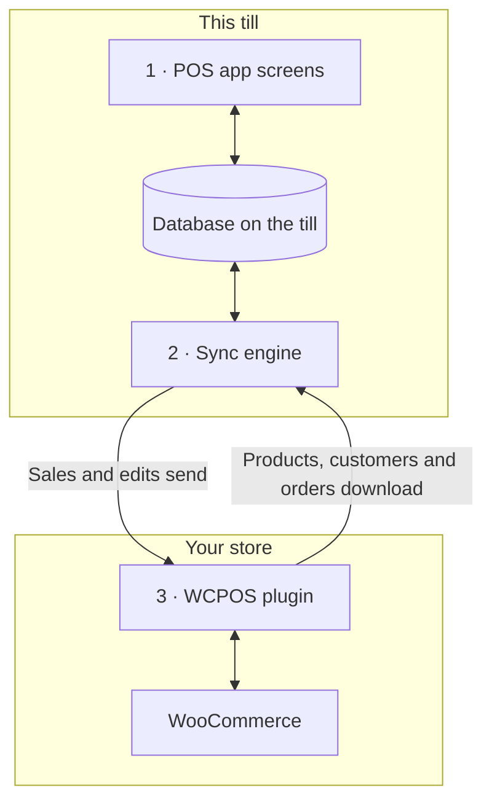

import LinkCards from '@site/src/components/LinkCards';
import LinkCard from '@site/src/components/LinkCard';
import JourneyShot from '@site/src/components/JourneyShot';
import manifest from '@site/static/img/2.x/reference/architecture/en/manifest.json';

O WCPOS tem duas partes: um plugin no seu site WordPress e o aplicativo POS em cada caixa. O caixa realiza vendas usando sua própria cópia dos dados da loja e mantém essa cópia sincronizada com o WooCommerce em segundo plano. Esta página mostra onde seus dados ficam e o que chega ao seu servidor, para desenvolvedores e lojistas que querem entender esse funcionamento.

Você está aqui para resolver um problema em vez de conhecer a arquitetura?

- **Vai atualizar o aplicativo?** Primeiro, [verifique se o caixa enviou tudo](../getting-started/previous-versions.mdx#check-sync). Consulte [Sincronize antes de atualizar](#storage).
- **Um produto não aparece no caixa:** consulte [Quando um produto não aparece ou está desatualizado](../products/sync.mdx#goes-wrong).
- **Uma venda não chegou à sua loja:** consulte [Vendas aguardando envio](../getting-started/offline.mdx#offline-writes).

## As duas partes {#two-part-system}

1. **O aplicativo POS** funciona em cada caixa: em um navegador no endereço `/pos/` do seu site (o endereço pode ser alterado), no aplicativo para desktop ou nos aplicativos para iOS e Android. Consulte [Instalação](../getting-started/installation.mdx) para saber o que cada um exige. Todas as telas leem e gravam em um banco de dados no caixa, então uma busca ou a inclusão de um item nunca precisa esperar pelo seu servidor.
2. **O mecanismo de sincronização** do aplicativo transfere alterações nos dois sentidos. Ele busca o que mudou na sua loja e envia o que foi alterado no caixa.
3. **O plugin WCPOS** funciona no seu site WordPress e conecta o caixa ao WooCommerce. O WooCommerce continua sendo a fonte oficial de cada produto, cliente e pedido.

## O que o caixa mantém no dispositivo {#local-database}

**Saúde** → **Banco de dados** mostra a cópia dos dados da loja no caixa: uma linha por tipo de registro, com a quantidade neste dispositivo (**No dispositivo**) e a quantidade na loja (**No servidor**). As funções do menu de cada linha estão em [Saúde da loja](../support/store-health.mdx#coverage).

<JourneyShot manifest={manifest} device="tablet" step={1} offsets={[[186, 0], [186, 0], [186, 0], [186, 0], [186, 0], [186, 0], [186, 0], [186, 0]]} alt="Saúde, aba Banco de dados: a tabela de registros neste caixa, de Produtos a Alíquotas de imposto, cada um com sua quantidade no dispositivo, quantidade no servidor, cobertura e tamanho">

1. **Produtos** — um lote inicial de 100 na ordenação padrão do POS (nome, de A a Z), seguido do restante enquanto o caixa está ocioso. Consulte [Download e sincronização](../products/sync.mdx).
2. **Variações** — são baixadas junto com seus produtos.
3. **Pedidos** — pedidos abertos e recentes ficam no caixa. Os mais antigos são baixados quando alguém os abre.
4. **Reembolsos** — reembolsos dos últimos 92 dias, além de qualquer reembolso de um pedido que você tenha aberto.
5. **Clientes** — são baixados aos poucos enquanto o caixa está ocioso.
6. **Categorias** — com **Marcas** e **Tags** abaixo.
7. **Cupons** — ficam no caixa com ou sem Pro.
8. **Alíquotas de imposto** — as alíquotas de imposto da sua loja.

</JourneyShot>

Um indicador vermelho **N travados** em uma linha significa que registros desse tipo precisam da sua atenção. Consulte [Registros que precisam de atenção](../support/store-health.mdx#stuck-records).

Acima da tabela, o número a acompanhar é **alterações aguardando envio**: vendas e edições feitas neste caixa que a loja ainda não recebeu. Elas ficam no dispositivo até serem recebidas. Pedidos abertos que você não sincronizou e alterações listadas em um painel não entram nessa contagem e também não chegaram à loja. Consulte [Vendas aguardando envio](../getting-started/offline.mdx#offline-writes).

Registros mantidos fora desta tabela

Alguns dados ficam fora desta tabela. Formas de pagamento, classes de imposto, métodos de entrega e status de pedidos são lidos da loja sempre que o aplicativo inicia, e a última resposta é mantida para quando o caixa estiver offline. Sessões de caixa, fechamentos e movimentações de dinheiro têm seus próprios registros e sua própria fila de envio à loja.

### Como o banco de dados é mantido {#storage}

Cada operador de caixa de cada loja tem sua própria cópia no caixa e, no navegador, apenas uma aba por vez executa o POS para um site. Quando uma atualização do aplicativo altera a forma de armazenamento dessa cópia, o caixa a baixa novamente.

:::warning Sincronize antes de atualizar
Vendas e edições que ainda aguardam envio na cópia antiga não são enviadas. Antes de atualizar o aplicativo, verifique em **Saúde** → **Banco de dados** se **alterações aguardando envio** mostra 0, sem nenhum painel abaixo dos números, e sincronize cada pedido aberto. Consulte [Verificar se um caixa enviou tudo](../getting-started/previous-versions.mdx#check-sync).
:::

Detalhes para desenvolvedores: mecanismo de armazenamento, abas e atualizações do aplicativo

- **Um banco de dados por site, loja e operador de caixa.** Dois operadores no mesmo caixa, ou um operador em duas lojas, nunca compartilham dados locais.
- **SQLite em todas as plataformas.** No navegador, o SQLite é executado sobre o armazenamento privado de arquivos do navegador, em um único worker; nos aplicativos para iOS e Android, é usado o SQLite do sistema; o aplicativo para desktop mantém os dados em SQLite no processo principal do aplicativo.
- **Armazenada em disco.** A cópia do caixa é preservada ao fechar o navegador ou o aplicativo e ao reiniciar o dispositivo.
- **Uma aba ativa por site.** No navegador, uma aba executa o POS para um site. Ao abrir uma segunda aba, ela oferece a opção de assumir o controle; a primeira aba para.
- **As listas são processadas no banco de dados.** Sempre que possível, a filtragem, a ordenação e a paginação são executadas dentro do banco de dados, de modo que uma lista com milhares de pedidos entrega à tela apenas as linhas que ela exibe.
- **Sem migração do banco existente.** Quando uma atualização do aplicativo altera a estrutura do banco de dados, o aplicativo abre um banco novo e baixa os dados da loja novamente. Alterações ainda aguardando envio no banco antigo não são enviadas, e pedidos abertos não são transferidos: sincronize o caixa antes de atualizar o aplicativo.

## Como o caixa e a loja se mantêm sincronizados {#data-synchronization}

O mecanismo de sincronização não espelha toda a loja em intervalos fixos. Ele trabalha conforme as necessidades das telas do caixa e faz o mínimo possível de solicitações ao servidor.

- **Verificação de alterações.** O caixa pergunta à loja o que mudou na frequência definida pelo seu [perfil de sincronização](../support/store-health.mdx#sync-presets) (**Eco**, **Equilibrado** ou **Tempo real**). Cada caixa mantém seu próprio perfil: alterá-lo em um caixa não muda os demais.
- **O que a tela precisa.** Cada tela informa ao mecanismo o que está exibindo. O mecanismo responde com os dados do banco do caixa quando já tem os registros e só os solicita à loja quando não os tem.
- **Em segundo plano.** O primeiro lote de produtos e os pedidos abertos e recentes são baixados primeiro. O restante dos produtos e clientes vem depois, enquanto o caixa está ocioso.
- **Envio de alterações.** Toda venda ou edição é salva primeiro no caixa e depois enviada à loja. Uma alteração recusada pela loja nunca é reenviada automaticamente: ela fica em **N alterações nunca chegaram ao seu servidor**, com as opções **Enviar novamente** e **Descartar**. Consulte [Saúde da loja](../support/store-health.mdx#refused-changes).

Detalhes para desenvolvedores: fluxo de alterações, limites de requisições e vias de sincronização

- Uma loja sem novidades responde à verificação de alterações com `304 Not Modified` e sem corpo na resposta.
- As gravações passam por uma fila persistente no caixa, que as envia para `wcpos/v2/push/{collection}`.
- Os limites de requisições, o recuo entre tentativas e os números medidos estão em [Desempenho da sincronização](./sync-performance.mdx). Todas as vias estão em [Como funciona o mecanismo de sincronização](./sync-engine.mdx).

## Como a finalização da compra registra uma venda {#checkout-architecture}

A finalização da compra faz parte do POS. O próprio caixa recebe cada pagamento e o registra em um único pedido do WooCommerce, em vez de abrir a página de pagamento de pedidos do WooCommerce a cada venda.

:::warning Para pagar offline, a venda já precisa estar na loja
Só é possível receber um pagamento offline de uma venda que chegou à loja antes da queda da conexão: o número do pedido aparece acima dos itens na [Finalização da compra](../pos/checkout/index.mdx). Uma venda iniciada depois da queda da conexão aguarda no caixa e é paga quando a loja volta a ficar disponível. Consulte [Receber um pagamento offline](../getting-started/offline.mdx#take-payment-offline).
:::

- **Um bloco para cada forma de pagamento.** O caixa exibe um bloco para cada forma de pagamento ativada no POS. Uma forma de pagamento que ele não consegue operar aparece desabilitada, com o motivo, e nunca fica oculta. Consulte [Quando um bloco não pode ser usado](../payment/index.mdx#unavailable-tiles).
- **Um pedido, vários pagamentos.** Uma venda com pagamento dividido continua sendo um único pedido do WooCommerce, com um conjunto de itens, impostos, alterações de estoque e um número de pedido, para que os relatórios a contem uma única vez. Um reembolso é um reembolso normal do WooCommerce, distribuído entre os pagamentos que ele devolve.
- **A loja decide.** Após cada pagamento, a loja responde com o valor pago e o que falta, e o caixa conclui a venda com base nos valores da loja, não nos seus próprios.
- **É seguro tentar novamente.** Cada pagamento tem um ID criado pelo caixa, então um pagamento enviado duas vezes é registrado apenas uma vez.
- **Offline.** Em uma venda que já está na loja, o pagamento em Dinheiro continua sendo concluído quando a conexão cai: o pagamento é registrado como **Liquidação posterior** e enviado quando a conexão volta. Consulte [Receber um pagamento offline](../getting-started/offline.mdx#take-payment-offline).

Modos de captura e rotas de pagamento

`GET wcpos/v2/payment-methods` descreve cada gateway de pagamento: seu `kind` (`cash`, `card`, `stored_value`, `bank_transfer` ou `other`), como recebe o dinheiro (`capture`) e o que permite (`capabilities`: valores parciais, troco, reembolsos, gorjetas, operação offline, anulação). Cada pagamento é uma linha no metadado `_wcpos_payments` do pedido e, após cada pagamento, a loja responde com `paid` e `balance` do pedido.

O `capture.mode` de cada forma de pagamento indica quem recebe o dinheiro. Toda chamada de pagamento vai para o manipulador registrado para seu modo.

| Modo | Como o dinheiro é recebido | Plugin |
| --- | --- | --- |
| `manual` | O operador de caixa recebe e registra o pagamento. É o padrão para Dinheiro, Cartão, Pagamento na entrega, Transferência bancária e Pagamentos em cheque. | Gratuito |
| `webview` | A página de pagamento do próprio gateway de pagamento, na aba **Legado** da finalização da compra. É o padrão para todos os outros gateways de pagamento. Consulte [Quando a página de pagamento da aba Legado não carrega](../payment/index.mdx#legacy-notices). | Gratuito |
| `gateway` | O `process_payment()` do próprio gateway de pagamento é executado com os valores coletados pelo caixa. O gateway de pagamento adere a esse modo por meio de um filtro. | Gratuito |
| `server` | A loja solicita ao provedor do terminal de cartões que receba o pagamento. | Pro |
| `device` | O caixa opera o leitor de cartões por meio do SDK do provedor, e o provedor confirma o pagamento. | Pro |

As rotas de pagamento estão vinculadas ao pedido pelo seu ID no WooCommerce:

- `POST wcpos/v2/orders/{id}/payments` registra um pagamento. O ID do pagamento torna seguro tentar novamente.
- `.../payments/{uuid}/intent`, `/capture`, `/void` e `/refund` (`POST`), e `/status` (`GET`), atuam sobre um pagamento. Cada comando leva seu próprio ID de comando.
- `POST wcpos/v2/orders/{id}/close` conclui o pedido.

Todo comando leva a `revision` do pedido; um comando sem ela é recusado com `428`.

Para criar um gateway de pagamento exclusivo para o POS, comece pelo [Modelo de gateway de pagamento](./gateway-template.mdx).

## Por que algumas alterações no site não chegam ao caixa {#api-extensions}

O caixa obtém produtos, clientes e pedidos do plugin WCPOS, que os lê do WooCommerce. Um plugin que altera os dados enviados pelo WooCommerce aos aplicativos afeta o caixa. Um plugin que altera apenas a aparência do site, ou apenas a finalização da compra online, não afeta. Para avaliar um plugin, comece por [Entenda a REST API do WooCommerce](./wc-rest-api.mdx).

Detalhes para desenvolvedores: versões da API

O caixa se comunica com a loja apenas pelas rotas REST do plugin, que leem os dados do WooCommerce dentro do seu site. O plugin registra dois namespaces junto ao `wc/v3` do próprio WooCommerce.

- **`wcpos/v2`** é o que o aplicativo usa: leitura de registros, fluxo de alterações, fila de alterações, pagamentos, caixas e sessões. Suas rotas de leitura encaminham as solicitações para `wc/v3` dentro do seu site, então um plugin que altera as respostas REST do WooCommerce altera o que o caixa vê.
- **`wcpos/v1`** continua sendo registrado. Suas rotas de dados (produtos, variações, pedidos, clientes, cupons, impostos, categorias, tags, marcas) estão congeladas. Suas rotas de serviço (lojas, configurações, recibos, modelos, trabalhos de impressão e outras) usam o mesmo código das versões em `wcpos/v2`.

### Atualizações do aplicativo e outras ferramentas de sincronização {#wcpos-v2-namespace}

O aplicativo e o plugin são atualizados juntos: um caixa com uma versão do aplicativo anterior à exigida pelo plugin mostra [SYNC341](../error-codes/SYNC341.mdx) até que o aplicativo seja atualizado. Os preços do POS nos itens do pedido são armazenados onde outras ferramentas de sincronização podem lê-los; consulte [Como as substituições de preço do POS são armazenadas](./pos-discounts.mdx#how-pos-price-overrides-are-stored).

Detalhes para desenvolvedores: requisições, login e IDs de pedidos

- **As rotas são carregadas para requisições do POS.** O plugin registra suas rotas apenas nas requisições direcionadas a elas: uma rota `wcpos/`, um cabeçalho `X-WCPOS` ou `?wcpos=1`. O restante do tráfego REST do site não as carrega.
- **O aplicativo e o plugin evoluem juntos.** Cada requisição do aplicativo leva `X-WCPOS-Protocol`. Um plugin que exige um protocolo mais recente responde com `426` e `wcpos_update_required`, e o caixa mostra [SYNC341](../error-codes/SYNC341.mdx) até que o aplicativo seja atualizado.
- **Rotas públicas.** `wcpos/v2/site`, `wcpos/v2/ping` e `wcpos/v2/echo` não exigem login. O aplicativo as usa para localizar seu site e testar a conexão antes que alguém entre. Em hospedagens que ocultam `/wp-json/` ou removem cabeçalhos, o aplicativo recorre ao endereço `/?rest_route=` do WordPress e a versões dos seus cabeçalhos como parâmetros de consulta (`?wcpos=1`, `wcpos_protocol`). Se nenhuma alternativa responder, o caixa mostra [AUTH431](../error-codes/AUTH431.mdx).
- **Login.** O aplicativo faz login pela página `/wcpos-auth` do seu site e recebe um token de acesso JWT válido por 30 minutos e um token de renovação válido por 30 dias. Os filtros `wcpos_jwt_access_token_expire` e `wcpos_jwt_refresh_token_expire` alteram esses prazos. Os perfis que podem acessar cada rota estão em [Acesso a endpoints por perfil](./role-endpoint-access.mdx).
- **Os pedidos levam um UUID.** O caixa cria um UUID para cada pedido, envia-o como o metadado `_woocommerce_pos_uuid`, e a loja o mantém. A busca de pedidos usa o UUID como chave.
- **Os preços do POS nos itens do pedido** são armazenados para que outras ferramentas de sincronização possam lê-los. Consulte [Como as substituições de preço do POS são armazenadas](./pos-discounts.mdx#how-pos-price-overrides-are-stored).
- **Lojas (Pro).** Quando há várias lojas, o caixa envia sua loja no cabeçalho `X-WCPOS-Store`, e o plugin a repassa ao WooCommerce como `store_id`. A loja de um pedido vem da entrada `_pos_store` nos seus metadados. As rotas do Pro para editar lojas e parear uma tela do cliente são registradas nos dois namespaces.

:::info Com o WCPOS Pro
O Pro adiciona leitores de cartões, edição de lojas e pareamento de uma tela do cliente. Quando há várias lojas, cada uma tem seus próprios preços no caixa. Consulte [Configurar lojas](../stores/setup.mdx).
:::

## Vantagens e custos da arquitetura {#architecture-pros-and-cons}

- **Busca e carrinho instantâneos.** Ambos leem o banco de dados do próprio caixa.
  - **O custo:** a cópia do caixa precisa ser mantida sincronizada com a loja. Essa é toda a função do mecanismo de sincronização.
- **Vendas durante uma queda de conexão.** Vendas e edições aguardam no caixa e são enviadas quando a conexão volta. O pagamento em Dinheiro continua sendo concluído em uma venda que já está na loja.
  - **O custo:** uma venda iniciada após a queda da conexão só é paga quando a loja volta a ficar disponível. Consulte [Receber um pagamento offline](../getting-started/offline.mdx#take-payment-offline).
- **Aplicativos feitos para um caixa.** Aplicativos para desktop, iOS e Android, não uma página web dentro de um quadro.
  - **O custo:** o POS acessa a loja apenas pela REST API. Temas e hooks do WordPress não podem alterar sua aparência, e um plugin que modifica apenas a finalização da compra na web ou o tema não afeta o caixa. Consulte [Por que alguns plugins não funcionam no POS?](./wc-rest-api.mdx#why-dont-some-plugins-work-in-the-pos)

## Documentação relacionada {#related-documentation}

<LinkCards>
  <LinkCard title="Como funciona o mecanismo de sincronização" to="/developers/sync-engine" description="Vias de sincronização, fluxo de alterações e fila de alterações em detalhes." />
  <LinkCard title="Saúde da loja" to="/troubleshooting/store-health" description="Veja o banco de dados do caixa, os perfis de sincronização e as alterações aguardando envio." />
  <LinkCard title="Entenda a REST API do WooCommerce" to="/developers/woocommerce-rest-api" description="O que é a REST API e por que alguns plugins não afetam o POS." />
</LinkCards>
