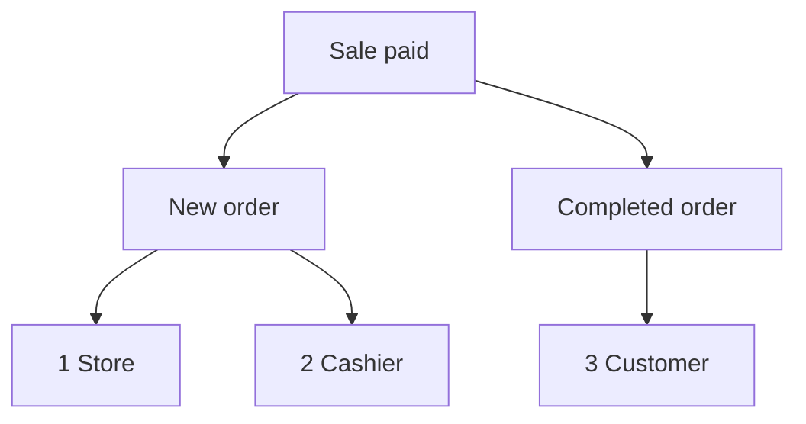

import Accordion from '@site/src/components/Accordion';
import AccordionItem from '@site/src/components/AccordionItem';
import LinkCards from '@site/src/components/LinkCards';
import LinkCard from '@site/src/components/LinkCard';

**WP admin:** `WP Admin → POS → Settings → Checkout`.

O WooCommerce envia e-mails sobre os pedidos: um e-mail de Novo pedido para você, um de Pedido concluído para o cliente e assim por diante. Nas vendas feitas pelo POS, você escolhe aqui quais desses e-mails são enviados e quem os recebe. Os pedidos online continuam usando suas configurações normais de e-mail do WooCommerce.

Vá direto para: [E-mails do administrador](#admin-emails) · [E-mails do cliente](#customer-emails) · [Enviar um recibo manualmente](#send-receipt-manually) · [E-mails do caixa](#cashier-emails) · [Situações comuns](#common-scenarios) · [Se algo der errado](#goes-wrong)

## Ativar ou desativar e-mails {#switches}

:::note Para vendas pelo POS
Estas opções substituem **Ativar esta notificação por e-mail** em **WooCommerce > Configurações > E-mails** para pedidos do POS. Um e-mail desativado no WooCommerce ainda pode ser enviado se estiver marcado aqui.
:::

1. No WP Admin, acesse **POS > Configurações > Caixa**.
2. Encontre as três opções de e-mail abaixo de **Evitar vendas acima do estoque**: **E-mails do administrador**, **E-mails do cliente** e **E-mails do caixa**. A lista **Gateways de pagamento** fica logo abaixo.
3. Ative uma opção para exibir uma caixa de seleção para cada e-mail daquele grupo. Desmarque um e-mail para interromper apenas o envio dele.
4. Desative uma opção para que nenhum e-mail daquele grupo seja enviado nas vendas pelo POS, independentemente das caixas marcadas.

Cada alteração é salva assim que você a faz: a tela mostra **Salvando** e depois **Salvo**.

{/* reshoot: WP Admin > POS > Settings > Checkout with all three email switches on and their checkboxes showing; see reshoot.md */}

Quem recebe os e-mails de cada opção e como ela vem configurada na instalação:

- **E-mails do administrador**: ativada na instalação\
  Para os endereços em **Destinatário(s)** daquele e-mail, em **WooCommerce > Configurações > E-mails**
- **E-mails do cliente**: ativada na instalação\
  Para o e-mail de cobrança do pedido
- **E-mails do caixa**: desativada na instalação\
  Para o endereço de e-mail da conta WordPress do caixa

O que uma venda paga no caixa envia quando o **Status do pedido** da forma de pagamento é Concluído:

1. **Loja** — os **Destinatário(s)** de **Novo pedido** no WooCommerce, se **E-mails do administrador** estiver ativada e **Novo pedido** estiver marcado.
2. **Caixa** — o endereço do próprio caixa, se **E-mails do caixa** estiver ativada e **Novo pedido** estiver marcado.
3. **Cliente** — o e-mail de cobrança do pedido, se **E-mails do cliente** estiver ativada, **Pedido concluído** estiver marcado e o pedido tiver um e-mail de cobrança.

## E-mails do administrador {#admin-emails}

Estes e-mails vão para você, a loja. Todos vêm marcados na instalação.

Para alterar quem recebe um e-mail do administrador, acesse **WooCommerce > Configurações > E-mails**, abra as configurações daquele e-mail e edite **Destinatário(s)**.

| E-mail | Enviado quando |
|---|---|
| **Novo pedido** | Um pedido do POS passa para Concluído, Processando ou Em espera |
| **Pedido cancelado** | Um pedido com status Processando ou Em espera é cancelado |
| **Pedido malsucedido** | Um pedido com status Aguardando pagamento ou Em espera falha |

Quando um pedido do POS passa de **POS - Aberto** ou **POS - Pagamento parcial** para Concluído, Processando ou Em espera, o e-mail **Novo pedido** é enviado se estiver marcado em **E-mails do administrador** ou **E-mails do caixa** e a respectiva opção estiver ativada, mesmo que **Novo pedido** esteja desativado no WooCommerce. O status para o qual cada venda passa é o **Status do pedido** definido para a forma de pagamento: veja [Status do pedido](./checkout.mdx#order-status).

Por que o próprio WCPOS envia o e-mail de Novo pedido nas vendas pelo POS

O WooCommerce envia **Novo pedido** apenas quando um pedido sai de Aguardando pagamento, Malsucedido ou Cancelado. Já um pedido do WCPOS fica em **POS - Aberto** ou **POS - Pagamento parcial**, status que o WooCommerce não reconhece. Por isso, o WooCommerce não enviaria esse e-mail quando o pedido mudasse de status. O WCPOS o envia no lugar do WooCommerce, nos momentos descritos acima.

## E-mails do cliente {#customer-emails}

Estes e-mails vão para o e-mail de cobrança do pedido. Um pedido sem e-mail de cobrança, como uma venda para visitante em que você não informou um endereço, não recebe e-mails do cliente. Todos os e-mails vêm marcados na instalação.

### Enviar um recibo manualmente {#send-receipt-manually}

**Enviar recibo por e-mail**, na tela de pagamento concluído, funciona separadamente. Essa opção envia o e-mail de fatura do WooCommerce, que não é controlado por estas opções, por isso funciona mesmo com **E-mails do cliente** desativada. Veja [Enviar o recibo por e-mail](../../receipts/at-checkout.mdx#email-receipt).

### E-mails enviados automaticamente {#customer-emails-automatic}

| E-mail | Enviado quando |
|---|---|
| **Pedido em espera** | Um pedido passa de Aguardando pagamento, Malsucedido ou Cancelado para Em espera |
| **Pedido em processamento** | Um pedido passa de Aguardando pagamento, Em espera, Malsucedido ou Cancelado para Processando |
| **Pedido concluído** | Um pedido passa para Concluído |
| **Pedido reembolsado** | Um pedido é reembolsado, total ou parcialmente. Veja [Reembolsos](../../orders/refunds.mdx) |
| **Pedido malsucedido** | Um pedido falha |

Uma venda que passa diretamente de **POS - Aberto** para Processando ou Em espera, como uma venda em dinheiro, não envia **Pedido em espera** nem **Pedido em processamento**: o WooCommerce só envia esses e-mails a partir dos status listados. **Pedido concluído**, **Pedido reembolsado** e **Pedido malsucedido** não dependem do status anterior, então são enviados nas vendas pelo POS. Para enviar um e-mail ao cliente de uma venda que termina em Processando ou Em espera, use [Enviar recibo por e-mail](#send-receipt-manually).

## E-mails do caixa {#cashier-emails}

Esta opção envia o e-mail **Novo pedido** para o caixa que fez a venda, no endereço de e-mail da conta WordPress dele. A opção vem desativada na instalação; ao ativá-la, **Novo pedido** já fica marcado.

O caixa recebe o e-mail nos mesmos momentos que o administrador (veja [E-mails do administrador](#admin-emails)). **E-mails do administrador** e **E-mails do caixa** funcionam de forma independente: desativar uma opção não altera a outra. Se o endereço do caixa já estiver entre os destinatários do administrador, como no caso de um proprietário que exerce as duas funções, ele recebe uma cópia, não duas.

Os usuários do WordPress que podem entrar no POS como caixas são definidos em [Acesso do caixa](./access.mdx).

## Situações comuns {#common-scenarios}

<Accordion>
  <AccordionItem question="Evitar que a caixa de entrada fique lotada em dias de movimento">

Desmarque **Novo pedido** em **E-mails do administrador**. Mantenha **Pedido cancelado** e **Pedido malsucedido** marcados: são esses que você precisa acompanhar.

Para acompanhar o faturamento, use [Relatórios](../../reports/index.mdx) em vez de contar e-mails de Novo pedido.

  </AccordionItem>

  <AccordionItem question="Enviar e-mails de Novo pedido ao caixa em serviço, não ao administrador">

Desmarque **Novo pedido** em **E-mails do administrador**, ou desative **E-mails do administrador**, e ative **E-mails do caixa**. O caixa que faz cada venda recebe o e-mail no próprio endereço, e a caixa de entrada do administrador deixa de receber essas mensagens.

Desativar **E-mails do administrador** também interrompe o envio de **Pedido cancelado** e **Pedido malsucedido**, então desmarcar apenas **Novo pedido** costuma ser a melhor escolha.

  </AccordionItem>

  <AccordionItem question="Não enviar e-mails ao cliente nas vendas em loja física">

Barracas de feira e cafeterias muitas vezes preferem não enviar e-mail a um cliente que já tem um recibo impresso. Desative **E-mails do cliente** para que nenhum e-mail de pedido em processamento, concluído, reembolsado ou outro e-mail do cliente seja enviado nas vendas pelo POS.

Os pedidos online continuam enviando e-mails aos clientes normalmente. Se um cliente pedir um recibo por e-mail, você ainda pode enviá-lo: pressione **Enviar recibo por e-mail** na tela de pagamento concluído.

  </AccordionItem>

  <AccordionItem question="Atualizei de uma versão anterior à 1.8.9 e a opção única 'Ativar e-mails' desapareceu">

A versão 1.8.9 substituiu a opção única de ativar ou desativar pelos três grupos desta página. O WCPOS lê sua configuração anterior: se os e-mails estavam desativados, **E-mails do administrador** e **E-mails do cliente** ficam desativadas; se estavam ativados, as duas ficam ativadas com todos os e-mails marcados. **E-mails do caixa** começa desativada em ambos os casos.

Você não precisa fazer nada.

  </AccordionItem>
</Accordion>

## Se algo der errado {#goes-wrong}

**O administrador não recebe o e-mail de Novo pedido.** Verifique se **E-mails do administrador** está ativada e **Novo pedido** está marcado. Depois, confira **Destinatário(s)** de **Novo pedido** em **WooCommerce > Configurações > E-mails**.

**Um cliente não recebe e-mail.** Verifique se **E-mails do cliente** está ativada e se aquele e-mail está marcado. Depois, abra o pedido e confira se ele tem um e-mail de cobrança. Para enviar um recibo agora, use **Enviar recibo por e-mail**.

**O caixa não recebe e-mail.** Verifique se **E-mails do caixa** está ativada, se **Novo pedido** está marcado e se a conta WordPress do caixa tem um endereço de e-mail. Se esse endereço também for um destinatário do administrador, ele recebe apenas uma cópia.

**Um e-mail que você desativou no WooCommerce ainda chega nas vendas pelo POS.** Para pedidos do POS, as caixas de seleção daqui determinam o envio. Desmarque o e-mail aqui também.

## Hooks para desenvolvedores {#developer-hooks}

Para desenvolvedores que precisam de mais controle do que estas opções oferecem. Proprietários de lojas podem pular esta seção.

Quatro filtros do WordPress e como os destinatários de Novo pedido são definidos

Antes do WCPOS 2.0, estes filtros se chamavam `woocommerce_pos_*` (por exemplo, `woocommerce_pos_admin_emails`). Esses nomes ainda funcionam, mas estão obsoletos desde a versão 2.0 e serão removidos, no mínimo, na versão 2.2. Veja [Nomenclatura dos hooks](../../extensions/index.mdx#hook-naming).

**`wcpos_admin_emails`**: os IDs dos e-mails do administrador que o WCPOS controla. Padrão: `cancelled_order`, `failed_order`.

**`wcpos_customer_emails`**: os IDs dos e-mails do cliente que o WCPOS controla. Padrão: `customer_failed_order`, `customer_on_hold_order`, `customer_processing_order`, `customer_completed_order`, `customer_refunded_order`.

**`wcpos_admin_email_enabled`**: define se um e-mail do administrador é enviado para um pedido do POS. Argumentos: `$is_enabled`, `$email_id`, `$order`, `$email`.

**`wcpos_customer_email_enabled`**: define se um e-mail do cliente é enviado para um pedido do POS. Os mesmos argumentos.

**Novo pedido** não está em `wcpos_admin_emails`. O WCPOS define seus destinatários pelo filtro `woocommerce_email_recipient_new_order` do WooCommerce: remove os destinatários da loja quando o administrador não quer recebê-lo e adiciona o endereço do caixa quando ele quer recebê-lo. O caixa é o usuário do WordPress salvo no metadado `_pos_user` do pedido. Seu próprio callback nesse filtro pode adicionar ou remover endereços da mesma forma que em qualquer e-mail do WooCommerce.

## Documentação relacionada {#related-documentation}

<LinkCards>
  <LinkCard title="Configurações do caixa" to="/settings/checkout" description="Gateways de pagamento e o status do pedido que cada um define, na mesma tela." />
  <LinkCard title="Recibos na finalização da compra" to="/sell/print-email-receipts" description="Imprima ou envie um recibo por e-mail na tela de pagamento concluído." />
  <LinkCard title="Pedidos" to="/manage-store/orders" description="Encontre os pedidos do POS a que estes e-mails se referem." />
</LinkCards>
