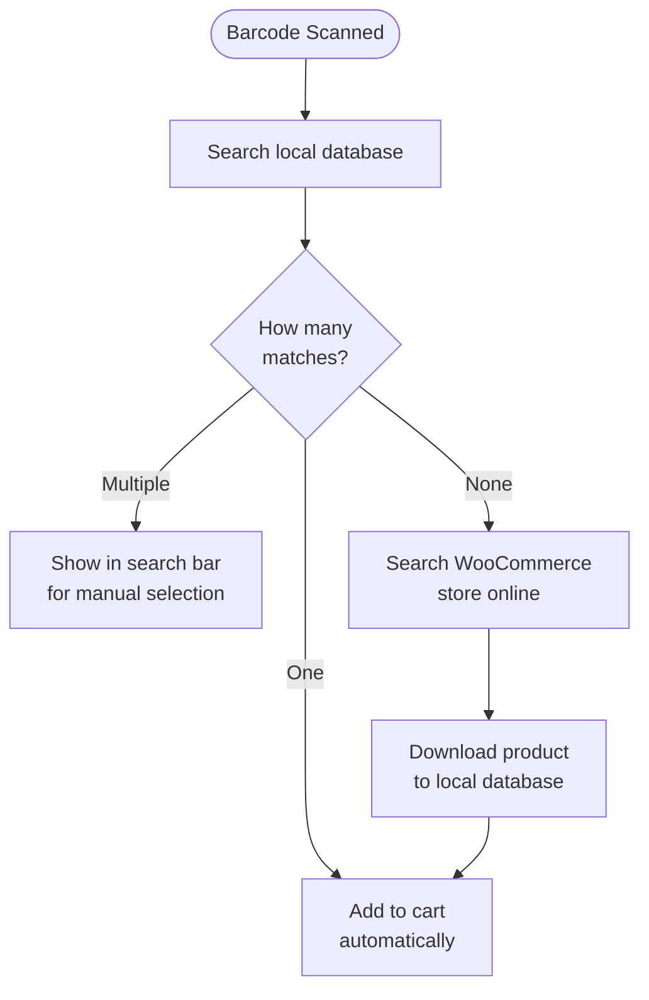

import Image from "@theme/IdealImage";
import Accordion from '@site/src/components/Accordion';
import AccordionItem from '@site/src/components/AccordionItem';

大多数条码扫描器的行为都类似于连接到你设备的键盘。
当你扫描条码时，WCPOS 会检测到字符的输入速度比正常打字更快。
它利用这些“快速按键”将输入识别为一次条码扫描。
这在几乎所有扫描器上都开箱即用 —— 但扫描器还支持其他[连接模式](#connection-modes)，WCPOS 可以直接与之连接。

## 配置条码扫描 {#configuring-barcode-scanning}

由于条码扫描发生得非常快，POS 可以区分条码与手动输入的内容。
在 POS 设置中，你会找到用于微调条码检测运作方式的选项。

  <Image
    alt="POS 设置中的条码扫描设置"
    img="/img/barcode-scanning-settings.png"
    style={{ maxHeight: 500 }}
  />
  
POS 设置中的条码扫描设置

| 设置 | 作用 | 典型取值 |
|---|---|---|
| **平均输入时间** | 输入速度达到多快才会被识别为条码 | 较短的间隔，确保手动打字不会触发识别 |
| **最小长度** | 连续输入的字符串达到多长才会被视为条码 | 与使用的最短条码一致（例如 EAN-8 为 8） |
| **前缀/后缀移除** | 移除扫描器添加的额外字符（前缀或后缀），只保留条码本身 | 除非扫描器已配置为添加这些字符，否则请留空 |

## 连接模式 {#connection-modes}

如需按步骤完成设置或排查问题，请使用[扫描器设置向导](/1.x/hardware/scanners/setup-wizard)。

每台条码扫描器出厂时都使用以下几种模式之一，该模式决定了 WCPOS 如何接收扫描结果：

| 模式 | 数据传输方式 | 设置 |
|---|---|---|
| **键盘（HID）**——几乎所有扫描器的出厂默认模式 | 扫描器“键入”条码，WCPOS 识别快速按键输入 | 无需设置，配对或插入后即可扫描 |
| **串行（SPP / USB-COM）** | 通过 USB 串行或蓝牙 SPP 直接连接 | 切换扫描器模式，然后在条码设置中连接 |
| **HID-POS** | USB 扫描器的直接连接（通过 WebHID） | 切换扫描器模式，然后在条码设置中连接 |
| **蓝牙 LE（厂商 GATT）** | 直接通过低功耗蓝牙连接 | 配对扫描器，然后在条码设置中通过其服务 UUID 添加 |

键盘模式无需设置，适合大多数店铺。如果扫描结果有时出现乱码（键盘布局差异导致的大小写或符号混乱），或在搜索框未获得焦点时输入到错误的位置，就值得使用直接连接。直接连接的扫描器会将每次扫描结果直接发送至 WCPOS，不受打字速度、键盘布局或焦点影响。

:::info 键盘模式下的扫描器无法直接连接
设备会将键盘模式下的扫描器完全视为键盘，而任何应用都不能接管键盘。
如果你在条码设置中点击 **连接串行扫描器** 或 **连接 HID 扫描器**，但列表中没有出现扫描器，那么它几乎可以确定仍处于键盘模式。
:::

**要切换模式**，请在扫描器手册中找到设置条码（查找 *“SPP 模式”*、*“串行模式”* 或 *“HID-POS 模式”*）并扫描，扫描器会自行重新配置。对于蓝牙扫描器，请在设备的蓝牙设置中忘记旧配对，并在切换模式后重新配对。随时扫描手册中的 *“HID”* 或 *“键盘”* 条码即可切换回来。

桌面应用和基于 Chrome 的浏览器支持直接连接（利用浏览器的 Web Serial 和 WebHID 支持）。桌面应用会在应用内显示设备选择器，Chrome 则显示自己的设备选择器。iOS 和 Android 支持键盘模式和摄像头扫描，此外 Android 还会直接截取硬件扫描器的按键输入。

## 摄像头扫描 {#camera-scanning}

网页、桌面、iOS 和 Android 平台都能使用设备摄像头扫描，无需专用扫描器即可开始使用。通过搜索栏中的扫描图标打开摄像头，它会以 **可调整大小的面板显示在筛选器正下方**，让你在扫描时仍能看到产品列表。将摄像头对准条码，WCPOS 会以与硬件扫描相同的方式读取条码。

## 检测到条码后会发生什么？ {#what-happens-when-a-barcode-is-detected}

POS 检测到条码后，会在本地数据库中查找匹配的产品或产品变体。
可能出现三种结果：

如果扫描未找到本地匹配项，WCPOS 会转而在线访问你的店铺，下载匹配的产品，并 **自动将其添加到购物车**。因此，未知条码也能用于完成销售，下次扫描同一条码时便会立即响应。

:::tip 多个匹配项通常意味着数据存在问题
如果多个产品使用同一条码，POS 无法判断应添加哪一个，因此会将条码填入搜索栏，供你选择。这通常意味着需要整理产品数据：每个产品都应有 **唯一** 的条码。
:::

## 扫描反馈与行为 {#scan-feedback-and-behaviour}

- **扫描声音**——WCPOS 可以在每次扫描时播放声音，让收银员无需查看屏幕即可立即确认。声音可选，并提供多种主题；请在[条码设置](/1.x/settings/store/barcode)中启用并选择主题。
- **在订单界面上**——扫描结果会传入订单搜索字段，因此你可以扫描条码来查找所需的订单或产品。
- **UPC-A 条码**——扫描 UPC-A 条码会得到包装上印刷的数字，因此 POS 用于匹配的值与产品数据中的值一致。

## 了解产品同步 {#understanding-product-synchronisation}

POS 会在后台分小批次下载产品目录，因此并非一开始所有产品都已存入设备。有关工作原理，请参阅[产品同步](/1.x/products/sync)。

### 为什么产品同步对条码扫描很重要 {#why-it-matters-for-barcode-scanning}

扫描尚未在本地存储的条码时，POS 会在线访问你的 WooCommerce 店铺，找到并下载对应产品，下次扫描同一条码时便会立即响应。你无需手动加快这一过程：后台目录预填充会自行补齐其余库存，你可以在 **店铺健康 → 数据库** 中查看进度。

## 常见问题解答 {#faq}

<Accordion>
  <AccordionItem question="为什么扫描条码时会提示“本地找到 0 个产品”？">

并非所有产品一开始就已存入设备，POS 会在最初使用的几分钟内在后台预填充产品目录。
如果刚扫描的产品尚未存储，扫描会触发 POS 在线查找并下载该产品，下次扫描时便会立即响应。

  </AccordionItem>

  <AccordionItem question="POS 能生成和打印条码吗？">

目前不支持。我们的 POS 用于扫描和读取已有条码，不包含创建或打印条码的功能。
如果需要为产品生成条码，可以使用专门用于创建和打印条码的第三方 WooCommerce 插件，例如：

- [EAN for WooCommerce](https://wordpress.org/plugins/ean-for-woocommerce/)
- [A4 Barcode Generator](https://wordpress.org/plugins/a4-barcode-generator/)

一旦你为产品生成了条码，就可以轻松地在收银台扫描它们，从而加快 POS 的结账流程。

  </AccordionItem>
</Accordion>
