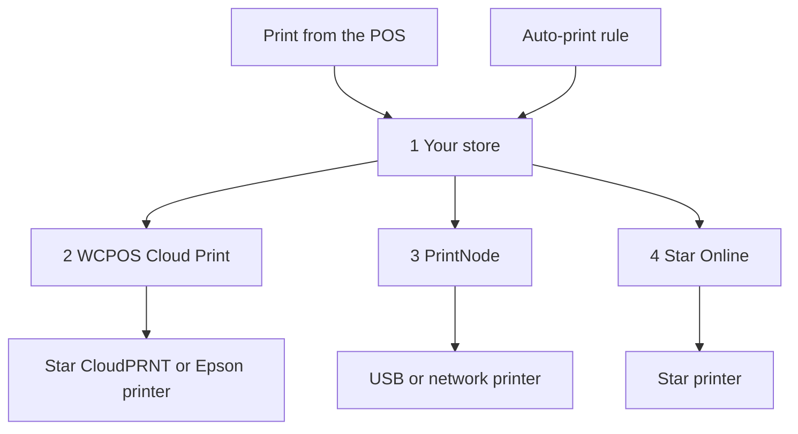

import LinkCards from '@site/src/components/LinkCards';
import LinkCard from '@site/src/components/LinkCard';

云打印通过互联网将收据发送到打印机，因此打印机无需连接运行 POS 的设备。它适用于与收银机不在同一网络的打印机、自动打印每笔订单的厨房打印机，或为每笔线上销售打印装箱单。

只需在 **WP Admin → POS → 设置 → 云打印** 中设置一次云打印机。之后，所有设备都会列出这台打印机，收银员可以像使用其他打印机一样，从 POS 向它发送打印任务。

## 从 POS 打印 {#manual}

网站根据订单生成云打印机所需的收据，因此打印前，网站必须已收到这笔销售。

1. 在付款完成界面或订单的**收据**窗口中，打开**打印机**菜单，选择云打印机。
2. 点击**打印收据**。
3. 屏幕会显示**已打印至**及打印机名称。这表示网站已收到任务；请确认收据是否已打印出来。如果没有，管理员可以在[打印队列](#print-queue)中查看任务的情况。

参阅[打印收据](./at-checkout.mdx#print-receipt)。如需每次都将某个模板发送到云打印机，请在**设置 → 打印**中为该模板选择打印机：参阅[打印路由](../hardware/printers/index.mdx#print-routing)。

- **订单必须已保存到网站。** 如果网站尚未确认这笔销售，例如离线完成的销售，POS 会提示：*此打印机打印网站上的副本，但网站尚未确认这笔销售。请在确认后重新打印。* 收银机联网且网站确认销售后，再次点击**打印收据**。收银机离线时，向云打印机发送打印任务会失败，即使打印的是之前的订单。
- 将**班次报告和交班报告**发送到云打印机时，会改为打开系统打印对话框。
- **在 Star 或 Epson 云打印机上使用 HTML 模板**时，会显示：*此云打印机仅支持热敏模板，因此不会打印任何内容。请选择热敏模板。*

云打印机会自动出现在每台设备的**设置 → 打印**页面的**打印机**列表中。每行的第二行文字显示类型，例如 *Star CloudPRNT · 由 WCPOS 管理*。收银员可以点击该行的**测试打印**，或在其 **⋯** 菜单中点击**复制设置报告**，但无法编辑或删除打印机：这些操作需要在**云打印**页面完成。参阅[打印机设置](../hardware/printers/index.mdx#printers-list)。

## 选择打印机类型 {#providers}

:::note 以下操作需要访问 WP Admin
添加打印机和规则需要由店主或管理员在 **WP Admin → POS → 设置 → 云打印** 中完成。
:::

**云打印**页面会询问**您要连接哪种打印机？** 请选择与您的打印机匹配的类型。

- **Star CloudPRNT** — 适用于内置 CloudPRNT 的 Star 打印机（mC-Print、TSP143IV…），可免费连接，无需其他账户。打印机会从您的网站获取任务。*仅支持热敏模板。*
- **Epson Server Direct Print** — 适用于 Epson“智能”TM 打印机（TM-T88VI/VII、TM-m30III、TM-i 系列）。打印机会从您的网站获取任务。*仅支持热敏模板。*
- **Star Online** — 适用于已关联 stario.online 账户的 Star 打印机（mC-Print3、TSP143IV、mC-Label3）。您的网站将任务交给 Star Online，由其负责发送。*仅支持热敏模板。*
- **PrintNode** — 适用于普通 USB 或网络打印机，前提是您能在店内的一台电脑上运行轻量的 PrintNode 应用。您的网站将任务交给 PrintNode，再由该电脑上的应用执行打印。*支持所有模板。*

Star 或 Epson 云打印机无法打印 HTML 模板：收据必须转换为打印机自身的指令。对于 HTML 和整页模板，请使用 PrintNode。参阅[热敏模板](./thermal-templates.mdx)。

<details>
<summary>任务如何到达打印机</summary>



<div className="pinned-legend">

1. **您的网站** — 根据订单和模板生成收据，并将任务保存在[打印队列](#print-queue)中。从 POS 发起的打印和[自动打印规则](#auto-print)都从这里开始。
2. **WCPOS Cloud Print** — [中继服务](#relay)。Star CloudPRNT 或 Epson 打印机通常通过它获取任务，因此任务会等待打印机下次连接时再处理。
3. **PrintNode** — 您的网站将任务交给 PrintNode，再由店内电脑上的 PrintNode 应用执行打印。
4. **Star Online** — 您的网站将任务交给 Star Online，由其发送到打印机。

</div>

</details>

## 添加打印机 {#setup}

1. 前往 **WP Admin → POS → 设置 → 云打印**。在**您的云打印机**下，点击 **+ 添加打印机**。
2. 选择类型。
3. 输入**打印机名称**，例如*厨房打印机*。WCPOS 会根据名称生成**打印机 ID**。ID 之后无法修改；如需更改，请移除打印机后重新添加。
4. 完成所选类型的设置步骤：[Star CloudPRNT 或 Epson](#setup-polling)、[PrintNode](#setup-printnode) 或 [Star Online](#setup-star-online)。
5. 打印机会以卡片形式出现在**您的云打印机**下。点击卡片上的**测试打印**。参阅[打印机卡片](#status)。

### Star CloudPRNT 或 Epson Server Direct Print {#setup-polling}

这些打印机会自行获取任务，因此无需关联账户。由于打印机会主动连接您的网站，您无需开放端口、设置静态 IP 或修改防火墙。任务会在打印机下次连接时打印。**+ 添加打印机**的最后一步会显示打印机的**轮询 URL**，其中包含一个私密令牌。

<details>
<summary>连接 Star CloudPRNT 或 Epson 打印机</summary>

1. 点击**轮询 URL**旁的**复制**。完整地址**仅显示一次**。如果丢失，请移除打印机后重新添加，以获取新地址：卡片上的**设置与令牌**会隐藏地址中的令牌。
2. 打开打印机自身的设置页面，将地址粘贴到服务器 URL 字段：Star 打印机在 **CloudPRNT** 设置中，Epson 打印机在 **Server Direct Print** 设置中。启用轮询，保存并重启打印机。
3. 返回卡片，打印机首次获取任务后，状态会从**等待打印机**变为**已连接**。

地址通常以 `https://cloudprint.wcpos.com` 开头。这是 [WCPOS Cloud Print 中继服务](#relay)，应使用此地址。地址下方的**高级：直接连接到此网站（不使用中继）**提供**直连 URL**；部分打印机无法直接连接网站，会一直处于**等待打印机**状态。

使用这种方式通过 WCPOS 向 Epson 打印机打印时，请始终保持 **Server Direct Print** 开启。参阅 [Server Direct Print](../hardware/printers/server-direct-print.mdx)。

</details>

### PrintNode {#setup-printnode}

PrintNode 需要在打印机旁的电脑上运行其客户端，并使用来自您 PrintNode 账户的 API 密钥。

<details>
<summary>连接 PrintNode 打印机</summary>

1. 在打印机旁的电脑上安装 PrintNode 客户端并登录。只有电脑开机且客户端运行时，才能打印。
2. 在您的 PrintNode 账户中创建 API 密钥。
3. 在 **+ 添加打印机**中选择 **PrintNode**，将密钥粘贴到 **PrintNode API 密钥**，然后点击**获取我的打印机**。
4. 在**选择打印机**下，选择客户端报告的打印机并完成设置。最后一步会显示**已关联 PrintNode**：无需复制地址或令牌。

</details>

关联后，在打印机卡片上设置**打印格式**：

- **PDF（推荐）** 会将任何模板（热敏或 HTML）以 PDF 形式打印。除非有理由更改，否则请保留此选项。
- **ESC/POS RAW — 仅支持热敏模板**会将热敏模板以收据打印机指令而非 PDF 的形式发送。HTML 模板仍以 PDF 形式发送。

### Star Online {#setup-star-online}

Star Online 需要打印机的组地址和 API 密钥，两者均来自您的 stario.online 账户。

<details>
<summary>连接 Star Online 打印机</summary>

1. 在 stario.online 中打开**设备组**，复制该组的 **CloudPRNT URL**。地址形式为 `https://device.stario.online/cloudprnt/...`，欧盟地区则为 `https://eu-device.stario.online/cloudprnt/...`。
2. 在 stario.online 中创建具有 **EnumDevices**、**ViewDevice**、**PrintToDevice** 和 **ViewDeviceGroups** 权限的 API 密钥。没有这些权限的密钥也会被接受，但无法列出设备或打印。
3. 在 **+ 添加打印机**中选择 **Star Online**。粘贴 **CloudPRNT URL** 和 **Star Online API 密钥**，然后点击**获取我的设备**。
4. 在**选择设备**下，选择打印机并完成设置。卡片随后会显示其**设备**、**组**和**访问标识符**。

</details>

## 打印机卡片 {#status}

每台云打印机在**您的云打印机**下都有一张卡片：

- **名称** — 点击可重命名打印机。名称下方显示类型。
- **状态** — 参见下方列表。每 30 秒刷新一次。
- **上次连接** — Star CloudPRNT 或 Epson 打印机上次获取任务的时间，或显示*从未连接*。
- **打印机 ID** — 添加打印机时确定，之后固定不变。
- **打印格式**——仅适用于 PrintNode：**PDF（推荐）** 或 **ESC/POS RAW — 仅限热敏模板**。请参阅 [PrintNode](#setup-printnode)。
- **测试打印** — 发送一张简短的测试页。系统会提示*已向…发送测试打印*，或说明失败原因。
- **打印机操作**（**⋮**）— **设置与令牌**会重新打开设置的最后一步；**移除打印机**会停止该打印机接收任务。您可以稍后重新添加。

<details id="status-polling">
<summary>Star CloudPRNT 和 Epson Server Direct Print 状态</summary>

- **等待打印机** — 打印机尚未获取过任务。检查打印机中的轮询 URL：参阅[一直处于等待打印机状态](#trouble-polling)。
- **已连接** — 打印机在过去两分半钟内获取过任务。
- **离线** — 打印机之前获取过任务，但最近没有。请检查它是否开机并联网。
- **被阻止** — 中继服务无法访问您的网站。卡片会说明原因：Cloudflare 等安全服务或防火墙插件阻止了连接，或您的网站返回了服务器错误。参阅 [Star CloudPRNT 或 Epson 问题](#trouble-polling)。

</details>

<details id="status-services">
<summary>Star Online 和 PrintNode 状态</summary>

- **在线** — 服务报告打印机可用。
- **离线** — 服务报告打印机或运行 PrintNode 的电脑不可用。对于 PrintNode，请检查电脑是否处于唤醒状态，以及客户端是否正在运行。
- **未知** — WCPOS 无法从服务获取状态。请检查 [PrintNode](#setup-printnode) 或 [Star Online](#setup-star-online) 中的 API 密钥。

</details>

## 自动打印订单 {#auto-print}

自动打印规则可在无需任何人点击的情况下打印订单。规则是可选的：没有规则时，云打印机仅在收银员从 POS 发起打印时才会打印。

在**自动打印规则**下，点击 **+ 添加规则**。每条规则都以一句话呈现，其中每个带下划线的部分都是一个菜单：

> 在**创建后立即**使用**厨房小票**模板，将**每笔店内（POS）订单**自动打印到**厨房打印机**，打印 **2 份**。

- **哪些订单** — **每笔订单**、**每笔店内（POS）订单**或**每笔线上订单**。使用 WCPOS Pro 时，还可以选择某个店铺的**所属订单**：参阅[按店铺设置打印机](#per-store-printers)。
- **打印机** — 您的一台云打印机。
- **模板** — 仅提供该打印机能够打印的模板。模板来自 **POS › 模板**。
- **份数** — 1 至 5。
- **打印时机** — **付款后**（默认）或**创建后立即**。对于 POS 订单，创建指购物车首次保存的时刻，因此厨房小票会在付款前打印。

多条规则可以打印同一笔订单，例如分别打印厨房小票和顾客收据。每条规则对同一笔订单只打印一次。收据由网站根据订单和模板生成，收银员无需操作。自动打印不会打开钱箱。

如果将规则的打印机改为不支持当前模板的打印机，规则会切换到该打印机支持的第一个模板，因此请确认这是否是您需要的模板。如果打印机不支持您的任何模板，模板将留空，规则在您选择模板之前不会执行打印。

### 按店铺设置打印机（Pro） {#per-store-printers}

使用 [WCPOS Pro](../getting-started/pro-license.mdx) 且有多个[店铺](../stores/index.mdx)时，**哪些订单**菜单还会列出每个店铺的**所属订单**。店铺规则会打印属于该店铺的订单：包括其收银机接收的订单，以及您在订单编辑页面分配给该店铺的任何订单。线上订单默认不属于任何店铺，除非您手动分配，因此只有适用于所有店铺的规则才会打印这些订单。

规则会叠加生效：店铺订单会按该店铺的规则打印，**同时**也会按所有针对**每笔订单**、**每笔店内（POS）订单**或**每笔线上订单**的规则打印。为避免一家店铺的厨房小票打印到另一家店铺的打印机，请为每家店铺设置独立的店铺规则，并且不要为这种小票添加适用于所有店铺的规则。

## 打印队列 {#print-queue}

规则下方的**打印队列**列出所有任务：**订单**、**打印机**、**模板**、**状态**、**详情**和**创建时间**。点击订单号可打开订单。

- 按状态（**需要处理**、**所有状态**，或**等待中**、**打印中**、**已打印**、**失败**、**已取消**之一）和打印机进行**筛选**。
- 可**取消**等待中的任务，**重试**失败的任务（它会作为新任务重新出现，显示*已重试为 #…*），或**删除**任务。勾选多行后，可选择**取消所选**或**删除所选**。
- **详情**会说明任务失败的原因，例如：*Star Online 拒绝了请求。请检查 API 密钥是否具有所需权限。*

当 Star CloudPRNT 或 Epson 打印机有收据等待打印，但已有 10 分钟未获取任务，或从未获取过任务时，系统会显示警告，列出打印机名称、上次获取任务的时间和等待打印的收据数量，并提供**全部取消**选项。

:::warning 打印机始终未确认的任务
*打印机始终未确认此任务*表示 WCPOS 无法确定是否已打印。系统不会自动重新发送，因为这可能导致重复打印。请检查打印机，仅在没有打印出任何内容时点击**重试**。
:::

<details>
<summary>任务保留时间与重试</summary>

已打印和已取消的任务会在 7 天后删除，失败的任务会在 30 天后删除。开发者可通过 `wcpos_print_job_retention_days` 和 `wcpos_print_job_failed_retention_days` 过滤器更改保留时间。

WCPOS 交给 PrintNode 或 Star Online 的任务会尝试三次，间隔依次为一分钟和两分钟。如果服务拒绝密钥或账户，任务会立即失败，原因显示在**详情**中。

</details>

## WCPOS Cloud Print 中继服务 {#relay}

Star CloudPRNT 或 Epson 打印机的轮询 URL 指向 **cloudprint.wcpos.com**，而非您的网站。这就是 **WCPOS Cloud Print**，由 WCPOS 运营，在您的打印机与网站之间提供免费中继服务。

无需手动开启。任务在发送到打印机的途中会经过中继服务，因此连接时会将您的网站地址共享给 wcpos.com，包含订单详情的收据也会经过该服务。参阅[隐私政策](https://wcpos.com/privacy)。

<details>
<summary>中继服务的工作原理</summary>

收据打印机运行的固件体积小，且很少更新。许多打印机无法与采用现代托管服务的网站建立安全连接，或会被网站前端的 Cloudflare 等服务拒绝访问。即使所有设置都正确，打印机仍会一直处于**等待打印机**状态。中继服务为打印机提供它能够使用的连接，并将其请求转发到您的网站。

- 首次打开**云打印**时，您的网站会自动连接中继服务。
- 中继服务要求您的网站使用 **HTTPS**。如果未使用，**云打印**会给出提示。
- 如果您的网站无法连接中继服务，例如本地测试网站，轮询 URL 会直接指向您的网站。
- 卡片上的**被阻止**表示中继服务已访问您的网站，但被拒绝。请按照卡片提示，在安全服务中允许中继服务访问。参阅 [Star CloudPRNT 或 Epson 问题](#trouble-polling)。

</details>

<details>
<summary>关闭中继服务（开发者）</summary>

Star CloudPRNT 或 Epson 打印机设置的最后一步提供**高级：直接连接到此网站（不使用中继）**选项及对应的**直连 URL**。要为整个网站关闭中继服务：

```php
add_filter( 'wcpos_cloud_print_relay_enabled', '__return_false' );
```

在 WCPOS 2.0 之前，此过滤器名为 `woocommerce_pos_cloud_print_relay_enabled`。该名称仍然有效，但自 2.0 起已弃用，最早会在 2.2 中移除。参阅[钩子命名](../extensions/index.mdx#hook-naming)。

</details>

<details>
<summary>收据如何到达 Star CloudPRNT 打印机</summary>

WCPOS 优先向打印机提供 StarPRNT 指令，其次是收据的 PNG 图像，最后是纯文本，并使用打印机声明支持的最佳格式。仅支持 Line Mode 的旧款 Star 型号（TSP650II、TSP700II、TSP800II）只能通过图像打印标志。生成图像需要服务器安装 GD 和 FreeType PHP 扩展。Epson 打印机接收 ePOS-Print XML；Star Online 接收 Star Document Markup。

</details>

## 遇到问题时 {#troubleshooting}

**POS 已向云打印机发送打印任务，但没有打印出收据。** POS 只能确认网站已收到任务。打开[打印队列](#print-queue)，找到该订单：

- **等待中** — 打印机尚未接收任务。检查卡片上的打印机状态：[Star CloudPRNT 和 Epson Server Direct Print 状态](#status-polling)或 [Star Online 和 PrintNode 状态](#status-services)。
- **打印中** — 任务正在传送，打印机尚未确认已打印。
- **失败** — **详情**会说明原因。解决问题后，点击**重试**。如果**详情**显示*打印机始终未确认此任务*，则可能已经打印：请先检查打印机，再点击**重试**。
- **已打印** — 打印机、PrintNode 或 Star Online 已接收任务。检查纸张，并确认**打印机**列显示的名称与您面前的打印机一致。

**找不到我的模板。** Star CloudPRNT、Epson 和 Star Online 打印机仅支持[热敏模板](./thermal-templates.mdx)。请选择热敏模板，或通过 PrintNode 打印。

### Star CloudPRNT 或 Epson 问题 {#trouble-polling}

**一直处于等待打印机状态。** 打印机从未成功访问您的网站。检查打印机中的轮询 URL 是否完全一致：一个字符错误就会导致所有获取请求被拒绝。如果不确定，请移除打印机后重新添加，以获取新地址。确保已在打印机的 **CloudPRNT** 或 **Server Direct Print** 设置中启用轮询，然后重启打印机。如果您使用的是**直连 URL**，请改用 `cloudprint.wcpos.com` 地址：[这正是中继服务的用途](#relay)。

**被阻止。** 安全服务或防火墙插件拒绝了中继服务的访问，或您的网站返回了服务器错误。请按照卡片上的提示操作；如果是服务器错误，请检查网站健康状态和错误日志。

**在中继服务推出之前完成的设置。** 已保存在打印机中的地址仍然有效。如果该打印机一直处于**等待打印机**状态，请移除后重新添加，再将新的 `cloudprint.wcpos.com` 地址填入打印机。

### PrintNode 问题 {#trouble-printnode}

**获取我的打印机失败。** 检查 API 密钥，并确认电脑上的 PrintNode 客户端正在运行。

**PrintNode 任务始终不打印。** 客户端必须运行并保持联网：电脑处于睡眠状态时无法打印。检查是否选择了客户端报告的打印机，以及密钥是否已被撤销。

### Star Online 问题 {#trouble-star-online}

**获取我的设备失败。** 提示为：*无法列出您的 Star Online 设备。请检查 CloudPRNT URL 和 API 密钥。* 检查密钥是否复制完整、是否已被撤销，以及是否与 URL 属于同一个 stario.online 账户和地区。然后检查密钥是否具有 [Star Online](#setup-star-online) 中列出的权限。*此 Star Online 组中未找到设备*表示该组没有设备，或 URL 指向的是另一个组。

## 相关文档 {#related-documentation}

<LinkCards>
  <LinkCard to="/hardware/receipt-printers" title="打印机设置" description="在设备上添加打印机，并将模板分配到打印机" />
  <LinkCard to="/sell/print-email-receipts" title="结账时的收据" description="打印、通过电子邮件发送和重新打印收据" />
  <LinkCard to="/settings/receipt-templates/thermal-templates" title="热敏模板" description="为 Star 和 Epson 打印机制作收据" />
</LinkCards>
