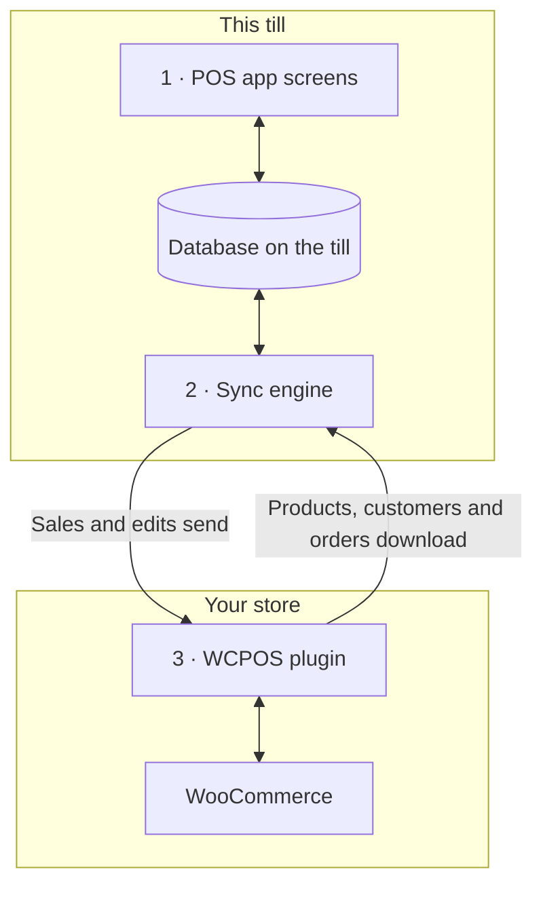

import LinkCards from '@site/src/components/LinkCards';
import LinkCard from '@site/src/components/LinkCard';
import JourneyShot from '@site/src/components/JourneyShot';
import manifest from '@site/static/img/2.x/reference/architecture/en/manifest.json';

WCPOS 由两部分组成：WordPress 网站上的插件，以及各收银设备上的 POS 应用。收银设备使用本地保存的店铺数据副本进行销售，并在后台让该副本与 WooCommerce 保持同步。本页面向开发者和希望了解这些机制的店主，介绍数据存放在哪里，以及哪些数据会传到服务器。

想直接解决问题，而不是了解设计？

- **更新应用：** 请先[检查收银设备是否已发送所有数据](../getting-started/previous-versions.mdx#check-sync)。参阅[更新前先同步](#storage)。
- **收银设备上缺少商品：** 参阅[商品缺失或未更新时](../products/sync.mdx#goes-wrong)。
- **销售记录尚未传到店铺：** 参阅[等待发送的销售记录](../getting-started/offline.mdx#offline-writes)。

## 两个组成部分 {#two-part-system}

1. **POS 应用**在各收银设备上运行：可以在浏览器中访问网站的 `/pos/` 地址（此地址可更改），也可以使用桌面应用或 iOS 和 Android 应用。各应用的要求请参阅[安装](../getting-started/installation.mdx)。每个界面都读写收银设备上的数据库，因此搜索或添加商品都无需等待服务器响应。
2. 应用内的**同步引擎**负责双向传输更改：拉取店铺中的更改，并发送收银设备上的更改。
3. **WCPOS 插件**在 WordPress 网站上运行，将收银设备连接到 WooCommerce。每个商品、客户和订单的权威数据始终保存在 WooCommerce 中。

## 收银设备在本地保存哪些数据 {#local-database}

**健康状况** → **数据库**显示收银设备上的店铺数据副本：每类记录占一行，列出本设备上的数量（**设备上**）和店铺中的数量（**服务器上**）。各行菜单的功能请参阅[店铺健康状况](../support/store-health.mdx#coverage)。

<JourneyShot manifest={manifest} device="tablet" step={1} offsets={[[186, 0], [186, 0], [186, 0], [186, 0], [186, 0], [186, 0], [186, 0], [186, 0]]} alt="健康状况的数据库选项卡：此收银设备上的记录表，从商品到税率，每项均显示设备上的数量、服务器上的数量、覆盖率和大小">

1. **商品**——先按 POS 的默认排序（名称，A 到 Z）下载首批 100 个商品，然后在收银设备空闲时下载其余商品。参阅[下载与同步](../products/sync.mdx)。
2. **变体**——随所属商品一同下载。
3. **订单**——未结订单和近期订单保留在收银设备上。更早的订单会在有人打开时下载。
4. **退款**——最近 92 天内的退款，以及您打开过的订单中的所有退款。
5. **客户**——在收银设备空闲时逐步下载。
6. **分类**——下方还有**品牌**和**标签**。
7. **优惠券**——无论是否使用 Pro，都会保存在收银设备上。
8. **税率**——店铺的税率。

</JourneyShot>

某行出现红色的 **N 条记录受阻**徽标，表示该类记录需要您处理。参阅[需要处理的记录](../support/store-health.mdx#stuck-records)。

表格上方需要关注的数字是**等待发送的更改**：即在此收银设备上产生、但店铺尚未收到的销售记录和修改。店铺收到之前，这些数据会一直保留在设备上。尚未同步的未结订单和面板中列出的更改不计入此数字，但它们也尚未传到店铺。参阅[等待发送的销售记录](../getting-started/offline.mdx#offline-writes)。

表格之外保存的记录

部分数据不在此表格中。每次启动应用时，都会从店铺读取付款方式、税类、配送方式和订单状态，并保存最近一次读取的结果，以供收银设备离线时使用。收银班次、结班记录和现金收支各有自己的记录，也有各自向店铺发送数据的队列。

### 数据库如何保存 {#storage}

每个店铺的每位收银员在收银设备上都有自己的数据副本。在浏览器中，同一网站每次只能由一个标签页运行 POS。如果应用更新改变了副本的存储方式，收银设备会重新下载副本。

:::warning 更新前先同步
旧副本中仍在等待的销售记录和修改不会被发送。更新应用前，请在**健康状况** → **数据库**中确认**等待发送的更改**为 0，且数字下方没有面板，并同步每个未结订单。参阅[检查收银设备是否已发送所有数据](../getting-started/previous-versions.mdx#check-sync)。
:::

开发者详情：存储引擎、标签页和应用更新

- **每个网站、店铺和收银员组合各有一个数据库。** 同一收银设备上的两位收银员，或同一收银员在两个店铺中使用的数据，都不会在本地共享。
- **所有平台都使用 SQLite。** 在浏览器中，SQLite 基于浏览器的私有文件存储运行于一个 worker 中；iOS 和 Android 应用使用系统的 SQLite；桌面应用则在应用主进程中使用 SQLite 保存数据。
- **保存在磁盘上。** 关闭浏览器或应用，以及重启设备，都不会清除收银设备上的副本。
- **每个网站只有一个活动标签页。** 在浏览器中，一个网站由一个标签页运行 POS。打开第二个标签页时，它会提示是否接管；接管后，第一个标签页会停止运行。
- **列表在数据库内处理。** 筛选、排序和分页会尽可能在数据库内执行，因此即使列表包含数千个订单，也只会将当前显示的行交给界面。
- **不进行原地迁移。** 应用更新改变数据库结构时，应用会打开一个新数据库，并重新从店铺下载数据。旧数据库中仍在等待的更改不会被发送，未结订单也不会迁移过去：请在更新应用前同步收银设备。

## 收银设备与店铺如何保持同步 {#data-synchronization}

同步引擎不会按定时任务镜像整个店铺。它根据收银设备界面的需要工作，并尽量减少对服务器的请求。

- **检查更改。** 收银设备按[同步预设](../support/store-health.mdx#sync-presets)规定的频率（**节能**、**均衡**或**实时**）向店铺查询更改。每台收银设备都有自己的预设：更改一台不会影响其他设备。
- **按界面需要获取数据。** 每个界面会告知引擎正在显示什么。如果收银设备的数据库已有所需记录，引擎就从本地提供数据；只有缺少记录时才向店铺请求。
- **后台下载。** 首批商品、未结订单和近期订单会优先下载。其余商品和客户数据随后在收银设备空闲时下载。
- **发送更改。** 每笔销售或修改都先保存在收银设备上，再发送到店铺。店铺拒绝的更改不会自动重试，而是留在 **N 项更改未能传到服务器**下，提供**重新发送**和**丢弃**操作。参阅[店铺健康状况](../support/store-health.mdx#refused-changes)。

开发者详情：更改流、请求预算和同步通道

- 店铺没有新更改时，会以 `304 Not Modified` 响应更改检查，不返回响应正文。
- 写入操作经过收银设备上的持久化队列，由队列将其提交到 `wcpos/v2/push/{collection}`。
- 请求预算、退避策略和实测数据见[同步性能](./sync-performance.mdx)。各同步通道的说明见[同步引擎的工作原理](./sync-engine.mdx)。

## 结账如何记录销售 {#checkout-architecture}

结账是 POS 的一部分。收银设备自行处理每笔付款，并将其记录到同一个 WooCommerce 订单中，而不是每次销售都打开 WooCommerce 的订单付款页面。

:::warning 离线收款要求店铺中已存在该笔销售
只有在断网前已传到店铺的销售才能离线收款：其订单号显示在[结账](../pos/checkout/index.mdx)界面的商品上方。断网后发起的销售会留在收银设备上等待，待店铺恢复连接后才能收款。参阅[离线收款](../getting-started/offline.mdx#take-payment-offline)。
:::

- **每种付款方式对应一个卡片。** 收银设备会为 POS 已启用的每种付款方式显示一个卡片。无法使用的方式会显示为灰色并注明原因，不会被隐藏。参阅[卡片无法使用时](../payment/index.mdx#unavailable-tiles)。
- **一个订单，多笔付款。** 拆分付款的销售仍然只有一个 WooCommerce 订单，共用一套商品、税费、库存变更和一个订单号，因此报表只会统计一次。退款是普通的 WooCommerce 退款，会分摊到对应退还的各笔付款中。
- **以店铺为准。** 每次付款后，店铺都会返回已付金额和剩余金额，收银设备以店铺返回的数字完成销售，而非以本地计算结果为准。
- **可以安全重试。** 每笔付款都有收银设备生成的 ID，因此同一笔付款即使发送两次，也只会记录一次。
- **离线处理。** 对于店铺中已有的销售，即使断网也仍可完成现金收款：付款会记录为**稍后结算**，并在恢复连接后发送。参阅[离线收款](../getting-started/offline.mdx#take-payment-offline)。

收款模式和付款路由

`GET wcpos/v2/payment-methods` 描述每个网关：类型 `kind`（`cash`、`card`、`stored_value`、`bank_transfer` 或 `other`）、收款方式(`capture`)以及支持的操作（`capabilities`：部分金额、找零、退款、小费、离线、撤销）。每笔付款是订单 `_wcpos_payments` 元数据中的一条记录，每次付款后，店铺都会返回订单的 `paid` 和 `balance`。

每种付款方式的 `capture.mode` 指定由谁收款。每次付款调用都会交给该模式注册的处理程序。

| 模式 | 收款方式 | 插件 |
| --- | --- | --- |
| `manual` | 收银员收款并记录。现金、银行卡、货到付款、银行转账和支票付款的默认模式。 | 免费版 |
| `webview` | 网关自身的付款页面，位于结账界面的**旧版**选项卡。其他所有网关的默认模式。参阅[旧版选项卡的付款页面无法加载时](../payment/index.mdx#legacy-notices)。 | 免费版 |
| `gateway` | 使用收银设备收集的值运行网关自身的 `process_payment()`。网关通过过滤器选择启用此模式。 | 免费版 |
| `server` | 店铺请求银行卡终端提供商收款。 | Pro |
| `device` | 收银设备通过提供商的 SDK 操作读卡器，由提供商确认付款。 | Pro |

付款路由位于订单之下，使用订单的 WooCommerce ID：

- `POST wcpos/v2/orders/{id}/payments` 记录一笔付款。付款 ID 确保重试安全。
- `.../payments/{uuid}/intent`、`/capture`、`/void` 和 `/refund`(`POST`)，以及 `/status`(`GET`)，均针对一笔付款执行操作。每条命令都有自己的命令 ID。
- `POST wcpos/v2/orders/{id}/close` 完成订单。

每条命令都携带订单的 `revision`；未携带此值的命令会被拒绝，返回 `428`。

要构建仅用于 POS 的网关，请从[网关模板](./gateway-template.mdx)开始。

## 为什么网站的某些更改不会影响收银设备 {#api-extensions}

收银设备从 WCPOS 插件获取商品、客户和订单，插件则从 WooCommerce 读取这些数据。如果插件改变了 WooCommerce 发送给应用的数据，就会影响收银设备。如果插件只改变网站外观或在线结账流程，则不会产生影响。要检查某个插件，请先阅读[了解 WooCommerce REST API](./wc-rest-api.mdx)。

开发者详情：API 版本

收银设备仅通过插件的 REST 路由与店铺通信，这些路由在网站内部从 WooCommerce 读取数据。除了 WooCommerce 自身的 `wc/v3`，插件还注册了两个命名空间。

- **`wcpos/v2`** 是应用使用的命名空间：用于读取记录、更改流、更改队列、付款、收银机和班次。它的读取路由会在网站内部转发到 `wc/v3`，因此改变 WooCommerce REST 响应的插件也会改变收银设备收到的内容。
- **`wcpos/v1`** 仍会注册。它的数据路由（商品、变体、订单、客户、优惠券、税费、分类、标签、品牌）已冻结。它的服务路由（店铺、设置、收据、模板、打印任务等）与对应的 `wcpos/v2` 版本使用相同代码。

### 应用更新与其他同步工具 {#wcpos-v2-namespace}

应用与插件需要配套更新：如果收银设备上的应用版本低于插件要求，会显示 [SYNC341](../error-codes/SYNC341.mdx)，直到应用更新。订单明细项的 POS 价格存储在其他同步工具能够读取的位置；参阅[POS 价格覆盖值的存储方式](./pos-discounts.mdx#how-pos-price-overrides-are-stored)。

开发者详情：请求、登录和订单 ID

- **仅为 POS 请求加载路由。** 插件只在收到面向自身的请求时注册路由：即请求使用 `wcpos/` 路由、`X-WCPOS` 请求头或 `?wcpos=1`。网站的其他 REST 请求不会加载这些路由。
- **应用与插件配套升级。** 每个应用请求都携带 `X-WCPOS-Protocol`。如果插件要求更新的协议，会返回 `426` 和 `wcpos_update_required`，收银设备则显示 [SYNC341](../error-codes/SYNC341.mdx)，直到应用更新。
- **公共路由。** `wcpos/v2/site`、`wcpos/v2/ping` 和 `wcpos/v2/echo` 无需登录。应用在用户登录前使用它们查找网站并测试连接。如果主机隐藏了 `/wp-json/` 或移除了请求头，应用会改用 WordPress 的 `/?rest_route=` 地址，并将请求头转换为查询字符串形式（`?wcpos=1`、`wcpos_protocol`）。如果两种方式都没有响应，收银设备会显示 [AUTH431](../error-codes/AUTH431.mdx)。
- **登录。** 应用通过网站上的 `/wcpos-auth` 页面登录，获得有效期为 30 分钟的 JWT 访问令牌和有效期为 30 天的刷新令牌。可以通过 `wcpos_jwt_access_token_expire` 和 `wcpos_jwt_refresh_token_expire` 过滤器更改有效期。各角色可访问哪些路由，请参阅[角色端点访问权限](./role-endpoint-access.mdx)。
- **订单携带 UUID。** 收银设备为每个订单创建 UUID，以 `_woocommerce_pos_uuid` 元数据形式发送，并由店铺保存。拉取订单时以 UUID 为键。
- **订单明细项的 POS 价格**会以其他同步工具可读取的方式存储。参阅[POS 价格覆盖值的存储方式](./pos-discounts.mdx#how-pos-price-overrides-are-stored)。
- **店铺（Pro）。** 有多个店铺时，收银设备会通过 `X-WCPOS-Store` 请求头发送所属店铺，插件将其作为 `store_id` 传给 WooCommerce。订单所属的店铺取自其元数据中的 `_pos_store` 条目。Pro 用于编辑店铺和配对顾客显示屏的路由会在两个命名空间下注册。

:::info 使用 WCPOS Pro
Pro 增加了读卡器、编辑店铺和配对顾客显示屏的功能。有多个店铺时，各店铺在收银设备上使用各自的价格。参阅[设置店铺](../stores/setup.mdx)。
:::

## 这种设计的优势与代价 {#architecture-pros-and-cons}

- **即时搜索和购物车操作。** 两者都读取收银设备自身的数据库。
  - **代价：** 收银设备上的副本必须与店铺保持同步。这正是同步引擎的全部职责。
- **断网时继续销售。** 销售记录和修改会在收银设备上等待，恢复连接后再发送。店铺中已有的销售仍可完成现金收款。
  - **代价：** 断网后发起的销售只能在店铺恢复连接后收款。参阅[离线收款](../getting-started/offline.mdx#take-payment-offline)。
- **为收银设备打造的应用。** 提供桌面、iOS 和 Android 应用，而非嵌在框架中的网页。
  - **代价：** POS 只能通过 REST API 访问店铺。WordPress 主题和钩子无法改变它的样式，只修改网页结账流程或主题的插件也不会影响收银设备。参阅[为什么有些插件无法在 POS 中使用？](./wc-rest-api.mdx#why-dont-some-plugins-work-in-the-pos)

## 相关文档 {#related-documentation}

<LinkCards>
  <LinkCard title="同步引擎的工作原理" to="/developers/sync-engine" description="详细了解同步通道、更改流和更改队列。" />
  <LinkCard title="店铺健康状况" to="/troubleshooting/store-health" description="查看收银设备的数据库、同步预设和等待发送的更改。" />
  <LinkCard title="了解 WooCommerce REST API" to="/developers/woocommerce-rest-api" description="了解 REST API 是什么，以及为什么有些插件不会影响 POS。" />
</LinkCards>
