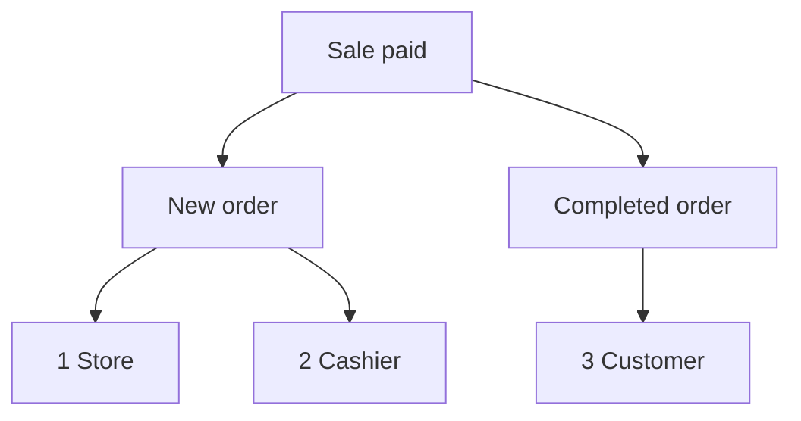

import Accordion from '@site/src/components/Accordion';
import AccordionItem from '@site/src/components/AccordionItem';
import LinkCards from '@site/src/components/LinkCards';
import LinkCard from '@site/src/components/LinkCard';

**WP 后台：** `WP Admin → POS → Settings → Checkout`。

WooCommerce 会发送订单相关邮件，例如向您发送新订单邮件、向客户发送已完成订单邮件等。对于在 POS 中完成的销售，您可以在此选择发送哪些邮件，以及发送给谁。线上订单仍沿用您原有的 WooCommerce 邮件设置。

快速跳转：[管理员邮件](#admin-emails) · [客户邮件](#customer-emails) · [手动发送收据](#send-receipt-manually) · [收银员邮件](#cashier-emails) · [常见场景](#common-scenarios) · [故障排查](#goes-wrong)

## 开启或关闭邮件 {#switches}

:::note 适用于 POS 销售
对于 POS 订单，这些开关会覆盖 **WooCommerce > 设置 > 电子邮件** 中的 **启用此电子邮件通知** 设置。即使某封邮件在 WooCommerce 中已关闭，只要在此勾选，仍可发送。
:::

1. 在 WP 后台中，前往 **POS > 设置 > 收银台**。
2. 在 **防止超卖** 下方找到三个邮件开关：**管理员邮件**、**客户邮件** 和 **收银员邮件**。它们下方是 **支付网关** 列表。
3. 打开开关后，该组中的每种邮件都会显示一个复选框。取消勾选某种邮件，即可仅停发该邮件。
4. 关闭开关后，无论复选框是否勾选，POS 销售都不会发送该组中的任何邮件。

每次更改都会立即保存：屏幕先显示 **正在保存**，随后显示 **已保存**。

{/* reshoot: WP Admin > POS > Settings > Checkout with all three email switches on and their checkboxes showing; see reshoot.md */}

各开关对应的收件人及安装后的初始状态如下：

- **管理员邮件**：安装后默认开启\
  发送至 **WooCommerce > 设置 > 电子邮件** 中该邮件的 **收件人** 所列地址
- **客户邮件**：安装后默认开启\
  发送至订单的账单邮箱
- **收银员邮件**：安装后默认关闭\
  发送至收银员 WordPress 账户上的邮箱地址

在收银台完成付款后，如果所用付款方式的 **订单状态** 设为已完成，将发送以下邮件：

1. **店铺** — 如果 **管理员邮件** 已开启且勾选了 **新订单**，则发送至 WooCommerce 中 **新订单** 的 **收件人**。
2. **收银员** — 如果 **收银员邮件** 已开启且勾选了 **新订单**，则发送至收银员本人的邮箱。
3. **客户** — 如果 **客户邮件** 已开启、勾选了 **已完成订单** 且订单填写了账单邮箱，则发送至该账单邮箱。

## 管理员邮件 {#admin-emails}

这些邮件发送给您，即店铺方。安装后默认勾选所有邮件。

要更改管理员邮件的收件人，请前往 **WooCommerce > 设置 > 电子邮件**，打开相应邮件的设置，编辑 **收件人**。

| 邮件 | 发送时机 |
|---|---|
| **新订单** | POS 订单变为已完成、处理中或保留状态时 |
| **已取消订单** | 处于处理中或保留状态的订单被取消时 |
| **失败订单** | 处于等待付款或保留状态的订单失败时 |

当 POS 订单从 **POS - 未结账** 或 **POS - 部分付款** 变为已完成、处理中或保留状态时，只要 **管理员邮件** 或 **收银员邮件** 开关已开启，且在该组下勾选了 **新订单**，就会发送该邮件，即使 WooCommerce 中已关闭 **新订单** 邮件也不例外。每笔销售转入的状态由其付款方式的 **订单状态** 设置决定：请参阅[订单状态](./checkout.mdx#order-status)。

为什么 WCPOS 自行发送 POS 销售的新订单邮件

WooCommerce 仅在订单从等待付款、失败或已取消状态转出时发送 **新订单** 邮件。而 POS 订单会先处于 **POS - 未结账** 或 **POS - 部分付款** 状态，WooCommerce 不识别这些状态，因此订单转入后续状态时，WooCommerce 不会发送该邮件。WCPOS 会在上述时机代替 WooCommerce 发送。

## 客户邮件 {#customer-emails}

这些邮件发送至订单的账单邮箱。如果订单没有账单邮箱，例如访客购物时您未填写邮箱，就不会发送客户邮件。安装后默认勾选所有邮件。

### 手动发送收据 {#send-receipt-manually}

付款完成页面上的 **通过邮件发送收据** 是独立功能。它发送的是 WooCommerce 的发票邮件，不受这些开关控制，因此关闭 **客户邮件** 后仍可使用。请参阅[通过邮件发送收据](../../receipts/at-checkout.mdx#email-receipt)。

### 自动发送的邮件 {#customer-emails-automatic}

| 邮件 | 发送时机 |
|---|---|
| **保留订单** | 订单从等待付款、失败或已取消状态变为保留状态时 |
| **处理中订单** | 订单从等待付款、保留、失败或已取消状态变为处理中时 |
| **已完成订单** | 订单变为已完成状态时 |
| **已退款订单** | 订单全额或部分退款时。请参阅[退款](../../orders/refunds.mdx) |
| **失败订单** | 订单失败时 |

如果销售直接从 **POS - 未结账** 变为处理中或保留状态（例如现金销售），则不会发送 **保留订单** 或 **处理中订单** 邮件：WooCommerce 仅在订单从表中列出的状态转出时发送这些邮件。**已完成订单**、**已退款订单** 和 **失败订单** 邮件不受之前状态的影响，因此 POS 销售也会发送。如果销售最终处于处理中或保留状态，而您希望给客户发送邮件，请使用[通过邮件发送收据](#send-receipt-manually)。

## 收银员邮件 {#cashier-emails}

此功能将 **新订单** 邮件发送给完成销售的收银员，使用其 WordPress 账户上的邮箱地址。安装后开关默认关闭；打开后，**新订单** 会默认勾选。

收银员收到邮件的时机与管理员相同（请参阅[管理员邮件](#admin-emails)）。**管理员邮件** 和 **收银员邮件** 各自独立：关闭其中一个不会影响另一个。如果收银员的邮箱已在管理员收件人列表中，例如店主同时兼任收银员，则只会收到一封邮件，不会重复发送。

哪些 WordPress 用户可以作为收银员登录 POS，由[收银员访问权限](./access.mdx)设置决定。

## 常见场景 {#common-scenarios}

<Accordion>
  <AccordionItem question="避免繁忙时收件箱被邮件淹没">

取消勾选 **管理员邮件** 下的 **新订单**。保留 **已取消订单** 和 **失败订单** 的勾选，这些才是需要您留意的通知。

要了解营业收入，请使用[报表](../../reports/index.mdx)，无需逐封统计新订单邮件。

  </AccordionItem>

  <AccordionItem question="将新订单邮件发给当班收银员，而非管理员">

取消勾选 **管理员邮件** 下的 **新订单**，或关闭 **管理员邮件**，然后开启 **收银员邮件**。完成每笔销售的收银员会在自己的邮箱中收到邮件，管理员收件箱则不再收到此类通知。

关闭 **管理员邮件** 也会停发 **已取消订单** 和 **失败订单** 邮件，因此通常只取消勾选 **新订单** 更合适。

  </AccordionItem>

  <AccordionItem question="店内销售不发送客户邮件">

集市摊位和咖啡馆通常不希望给已拿到纸质收据的客户再发邮件。关闭 **客户邮件** 后，POS 销售便不会发送处理中、已完成、已退款或其他客户邮件。

线上订单仍会正常发送客户邮件。如果客户要求通过邮件接收收据，您仍可在付款完成页面上点击 **通过邮件发送收据**。

  </AccordionItem>

  <AccordionItem question="从 1.8.9 之前的版本升级后，原来的“启用邮件”总开关不见了">

1.8.9 版本将原来的单一开关替换为本页中的三组设置。WCPOS 会读取您的旧设置：如果之前关闭了邮件，**管理员邮件** 和 **客户邮件** 都会关闭；如果之前开启了邮件，两者都会开启，且所有邮件均被勾选。无论之前如何设置，**收银员邮件** 初始都为关闭状态。

您无需进行任何操作。

  </AccordionItem>
</Accordion>

## 故障排查 {#goes-wrong}

**管理员收不到新订单邮件。** 请确认 **管理员邮件** 已开启，且 **新订单** 已勾选。然后检查 **WooCommerce > 设置 > 电子邮件** 中 **新订单** 的 **收件人**。

**客户收不到邮件。** 请确认 **客户邮件** 已开启，且相应邮件已勾选。然后打开订单，确认已填写账单邮箱。要立即发送收据，请使用 **通过邮件发送收据**。

**收银员收不到邮件。** 请确认 **收银员邮件** 已开启、**新订单** 已勾选，且收银员的 WordPress 账户已填写邮箱地址。如果该地址也在管理员收件人列表中，只会收到一封邮件。

**在 WooCommerce 中已关闭的邮件，POS 销售时仍会发送。** POS 订单是否发送邮件由此处的复选框决定。请在此处也取消勾选该邮件。

## 开发者钩子 {#developer-hooks}

本节面向需要在这些开关之外进一步控制邮件行为的开发者。店主可以跳过。

四个 WordPress 过滤器及新订单收件人的设置方式

在 WCPOS 2.0 之前，这些过滤器的名称以 `woocommerce_pos_*` 开头（例如 `woocommerce_pos_admin_emails`）。旧名称仍可使用，但自 2.0 起已弃用，最早将在 2.2 中移除。请参阅[钩子命名](../../extensions/index.mdx#hook-naming)。

**`wcpos_admin_emails`**：WCPOS 控制的管理员邮件 ID。默认值：`cancelled_order`、`failed_order`。

**`wcpos_customer_emails`**：WCPOS 控制的客户邮件 ID。默认值：`customer_failed_order`、`customer_on_hold_order`、`customer_processing_order`、`customer_completed_order`、`customer_refunded_order`。

**`wcpos_admin_email_enabled`**：是否为某个 POS 订单发送某种管理员邮件。参数：`$is_enabled`、`$email_id`、`$order`、`$email`。

**`wcpos_customer_email_enabled`**：是否为某个 POS 订单发送某种客户邮件。参数同上。

**新订单** 不在 `wcpos_admin_emails` 中。WCPOS 通过 WooCommerce 的 `woocommerce_email_recipient_new_order` 过滤器设置收件人：管理员不需要接收时，清空店铺收件人；收银员需要接收时，添加收银员的邮箱地址。收银员是保存在订单 `_pos_user` 元数据中的 WordPress 用户。您可以在该过滤器的自定义回调中添加或移除地址，方式与其他 WooCommerce 邮件相同。

## 相关文档 {#related-documentation}

<LinkCards>
  <LinkCard title="收银台设置" to="/settings/checkout" description="同一页面中的支付网关及各网关设置的订单状态。" />
  <LinkCard title="结账时的收据" to="/sell/print-email-receipts" description="在付款完成页面打印收据或通过邮件发送收据。" />
  <LinkCard title="订单" to="/manage-store/orders" description="查找这些邮件对应的 POS 订单。" />
</LinkCards>
