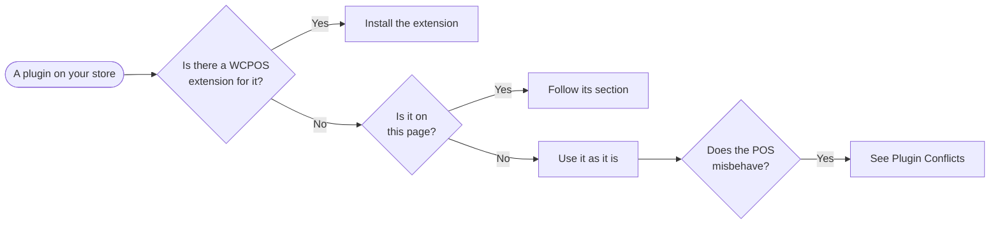

import LinkCards from '@site/src/components/LinkCards';
import LinkCard from '@site/src/components/LinkCard';

This page covers the plugins WCPOS treats specially: two that can't be used with the POS, one you set up, and one WCPOS handles for you. Any other plugin you use as it is, and if it misbehaves, [Plugin Conflicts](../support/troubleshooting/plugin-conflicts.mdx) helps you find out why.

Why some plugins miss POS orders

The POS saves its orders straight into WooCommerce, not through your online checkout. A plugin that only acts in the online checkout, or on the WP Admin order screen, never sees them. WooCommerce Tax is one of those, so WCPOS asks it for rates on the POS's behalf.

## Check your plugin {#check}

Find extensions on [Extensions](../extensions/index.mdx). For a plugin that misbehaves, see [Plugin Conflicts](../support/troubleshooting/plugin-conflicts.mdx).

## Plugins that don't work with the POS {#not-supported}

:::warning Deactivate or replace these
**wePOS.** WCPOS can't run alongside it: wePOS changes how your store sends variable products, which breaks variations in the POS. WP Admin warns you when both are active. Deactivate wePOS before you use WCPOS.

**Stripe Tax.** It doesn't work with POS orders, and there is no workaround. For automated tax use [WooCommerce Tax](#woocommerce-tax), or keep your own rates in the WooCommerce tax table.
:::

## Plugins WCPOS works with {#plugins}

### WooCommerce Tax {#woocommerce-tax}

**What WCPOS does:** asks WooCommerce Tax for tax rates each time an open POS order saves, so POS sales get the same rates as your online orders.

**What you do:** turn on automated taxes, then match the POS tax settings. The four [setup steps](./woocommerce-tax.mdx#setup) are on its page.

<LinkCards>
  <LinkCard
    to="/integrations/woocommerce-tax"
    title="WooCommerce Tax"
    description="Automated sales tax through TaxJar: how POS orders get their rates, setup, and what to expect at the till."
    icon="calculator"
  />
</LinkCards>

### Yoast SEO {#yoast-seo}

**What WCPOS does:** leaves Yoast's SEO data out of what the POS downloads, so syncs stay light. It also keeps the link the apps use to find your store, even if Yoast is set to remove it.

**What you do:** nothing.

## Integrations and extensions {#extensions}

An integration is a plugin you already run for your online store, and WCPOS works with it as it is. An extension is an add-on built for WCPOS, such as a card terminal or the bridge for a translation plugin like WPML. If the plugin you use has a WCPOS extension, set it up from [Extensions](../extensions/index.mdx).

## Something not working? {#something-not-working}

If a plugin you rely on misbehaves with the POS, start with [Plugin Conflicts](../support/troubleshooting/plugin-conflicts.mdx). It lists the [known conflicts](../support/troubleshooting/plugin-conflicts.mdx#known-plugin-conflicts) and how to find a new one.

:::info With WCPOS Pro
Extensions install from the extension directory. The free version shows the directory with its install buttons turned off.
:::

## Related Documentation {#related-documentation}

<LinkCards>
  <LinkCard to="/integrations/woocommerce-tax" title="WooCommerce Tax" description="Automated sales tax for POS orders." />
  <LinkCard to="/extensions" title="Extensions" description="Add-ons built for WCPOS." />
  <LinkCard to="/support/troubleshooting/plugin-conflicts" title="Plugin Conflicts" description="Known conflicts and how to find a new one." />
</LinkCards>
