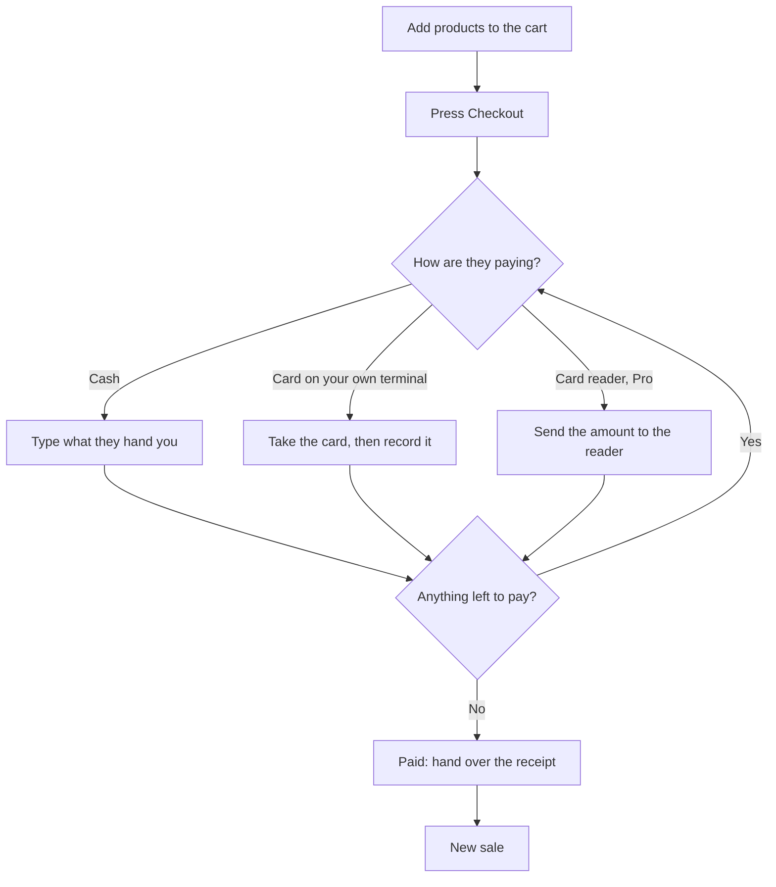

import LinkCards from '@site/src/components/LinkCards';
import LinkCard from '@site/src/components/LinkCard';
import JourneyShot from '@site/src/components/JourneyShot';
import manifest from '@site/static/img/2.x/pos/checkout/en/manifest.json';

A customer walks up with something to buy. You don't need their name: every sale starts as a guest sale. This page walks through one cash sale, from the first product to the next customer.

:::note Open the register first
With register sessions switched on, the till won't record a payment while the register is closed, and a card you've already taken would have to be refunded. See [Stores, Registers and Devices](../../stores/registers-and-devices.mdx).
:::

## Start a sale for a guest {#start}

The products are on one side and the cart on the other. On a phone, they're on separate tabs. The cart already says **Guest**, so there's nothing to set up.

<JourneyShot manifest={manifest} device="tablet" step={1} offsets={[[345, 0], [146, 0]]} alt="The POS with an empty cart: the product grid, the search box above it, and Guest as the customer" />

1. **Search products** — type a name or SKU, or scan a barcode.
2. **Guest** — who the sale is for. Leave it as it is for a guest.

## Add a product {#add}

Tap a product and it lands in the cart. Tap it again for one more.

<JourneyShot manifest={manifest} device="tablet" step={2} offsets={[[-36, 0]]} alt="One product in the cart, with its quantity, price and the order total" />

1. **Quantity** — how many of this product are on the sale.

## Change the quantity {#quantity}

Tap the quantity, type the new number and press **Done**. The line and the total update as you go. See [Line Items](../cart/line-items.mdx) for prices, discounts and removing a line.

<JourneyShot manifest={manifest} device="tablet" step={3} offsets={[[-36, 0]]} alt="The same line with a higher quantity, and the Checkout button showing the new total" />

1. **Quantity** — now shows the new number.
2. **Checkout** — names the total. Press it when the cart is right.

## Check out {#check-out}

Press **Checkout**. The tender pane opens with the full amount due and the first payment method already selected. **✕** takes you back to the cart with nothing lost.

<JourneyShot manifest={manifest} device="tablet" step={4} alt="The tender pane: the amount to pay, the payment method tiles, quick amounts and the keypad, with the order beside it" />

1. **Tender pane** — everything you need to take the payment. Tap a tile to change the payment method.

## Take cash {#take-cash}

Type what the customer hands you, or tap a quick amount, and the change appears as you type. The button names the amount and the method, so you can check it before you press.

<JourneyShot manifest={manifest} device="tablet" step={5} offsets={[[-35, 0]]} alt="The amount handed over, the change due, and the button to take the cash" />

1. **Amount** — what the customer handed you, and the change to give back.
2. **Take** — records the payment.

:::tip If the connection drops
Cash still completes. The receipt keeps the real time and register, and the order syncs when the connection returns. See [Offline Mode](../../getting-started/offline.mdx).
:::

Paying another way? A card on your own terminal works the same: take the card first, then record it. See [Payment Methods](./details.mdx#payment-methods), [Split Payments](./details.mdx#split-payments) and [Card Readers](./details.mdx#card-readers).

## See it paid {#paid}

When nothing is left to pay, the sale is done. The screen shows the change to give back, and the receipt is ready to print, email or download. See [Receipts](../../receipts/at-checkout.mdx).

<JourneyShot manifest={manifest} device="tablet" step={6} offsets={[[344, -44]]} alt="The paid screen: the change to give, the amount paid, the receipt preview, and buttons to email, download or print it or start a new sale" />

1. **Paid** — the sale is complete and the order is on its way to your store.

A yellow note above the receipt means the template is a thermal one with no receipt printer chosen. Printing still works, through the print dialog. See [Receipts](../../receipts/at-checkout.mdx).

## Start the next sale {#next-sale}

Press **New sale**. The cart is empty and back to **Guest**, ready for the next customer.

<JourneyShot manifest={manifest} device="tablet" step={7} offsets={[[146, 0]]} alt="The POS with an empty cart again, ready for the next customer" />

1. **Guest** — the new sale starts as a guest sale, whoever bought last.

:::info With WCPOS Pro
A paired customer display shows the cart to the customer as you ring it up.
:::

## Related Documentation {#related-documentation}

[Checkout in Detail](./details.mdx) covers every part of the tender pane, and what to do when a payment doesn't go to plan.

<LinkCards>
  <LinkCard to="/receipts/at-checkout" title="Receipts" description="Print or email the receipt after checkout" />
  <LinkCard to="/payment" title="Payment Methods" description="Set up the ways your store takes payment" />
</LinkCards>
