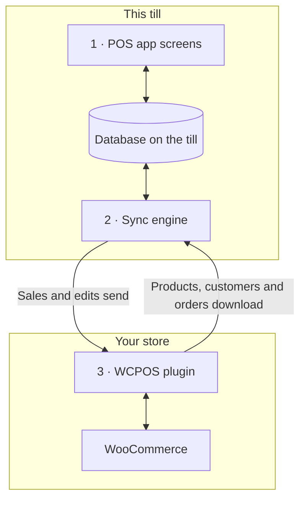

import LinkCards from '@site/src/components/LinkCards';
import LinkCard from '@site/src/components/LinkCard';

WCPOS comes in two halves: a plugin on your WordPress site, and the POS app on each till. The till sells from its own copy of your store and keeps that copy in step with WooCommerce in the background. This page shows where your data lives and what reaches your server, for developers and for store owners who want to know.

## The two halves {#two-part-system}

1. **The POS app** runs on each till: in a browser at `/pos/` on your site (the address can be changed), in the desktop app, or in the iOS and Android apps. See [Installation](../getting-started/installation.mdx) for what each one needs. Every screen reads and writes a database on the till, so a search or an added item never waits for your server.
2. **The sync engine** inside the app moves changes both ways. It pulls what changed in your store and sends what the till changed.
3. **The WCPOS plugin** runs on your WordPress site. It adds its own REST routes and answers them from WooCommerce, so WooCommerce stays the one true copy of every product, customer and order.

## What the till keeps on the device {#local-database}

**Health** → **Database** shows the till's copy of your store, one row per kind of record, with how much of it is on this device. What each row's menu does is on [Store Health](../support/store-health.mdx#coverage).

The figure to watch is **changes waiting to send**: sales and edits made on this till that your store hasn't received yet. They stay on the device until it has. See [Sales waiting to send](../getting-started/offline.mdx#offline-writes).

Stored products, orders, refunds, customers and other records

- **changes waiting to send** — sales and edits made on this till that your store hasn't received yet.
- **Products** — a starting batch of 100 in the POS's default sort (name, A to Z), then the rest while the till is quiet. See [Download & Sync](../products/sync.mdx).
- **Variations** — download with their products.
- **Orders** — open and recent orders stay on the till. Older ones download when someone opens them.
- **Refunds** — refunds from the last 92 days, plus any refund on an order you've opened.
- **Customers** — download a little at a time while the till is quiet.
- **Categories** — with **Brands** and **Tags** below it.
- **Coupons** — on the till with or without Pro.
- **Tax rates** — your store's tax rates.

A few things live outside this table. Payment methods, tax classes, shipping methods and order statuses are read from your store each time the app starts, and the last answer is kept for when the till is offline. Register sessions, closures and cash movements have their own records, and their own queue to your store.

### How the database is kept {#storage}

Each cashier in each store has their own copy on the till, and in a browser one tab runs the POS for a site at a time. When an app update changes how that copy is stored, the till downloads it again, after sending anything still waiting.

Developer detail: storage engine, tabs and app updates

- **One database per site, store and cashier.** Two cashiers on one till, or one cashier in two stores, never share local data.
- **SQLite on every platform.** In the browser it is SQLite running over the browser's private file storage, in one worker; in the iOS and Android apps it is the system's SQLite; the desktop app keeps it in SQLite in the app's main process.
- **Kept on disk.** The till's copy survives closing the browser or the app and restarting the device.
- **One live tab per site.** In a browser, one tab runs the POS for a site. Open a second tab and it offers to take over; the first tab stops.
- **Lists are worked out in the database.** Filtering, sorting and paging run inside the database where they can, so a list of thousands of orders hands the screen only the rows it shows.
- **No migration in place.** When an app update changes the database layout, the app opens a fresh database and downloads again from your store. Anything still waiting to send in the old one is sent first.

## How the till and your store stay in step {#data-synchronization}

The sync engine doesn't mirror your whole store on a timer. It works from what the till's screens need, and asks your server as little as it can.

- **Checking for changes.** The till asks your store what has changed, as often as its [sync preset](../support/store-health.mdx#sync-presets) says (**Eco**, **Balanced** or **Realtime**). Each till keeps its own preset: changing it on one till doesn't change the others.
- **What the screen needs.** Each screen tells the engine what it is showing. The engine answers from the till's database when it already has the records, and asks your store only when it doesn't.
- **In the background.** The first batch of products and the open and recent orders download first. The rest of the products and customers follow while the till is quiet.
- **Sending changes.** Every sale or edit is saved on the till first, then sent to your store. A change your store refuses is never retried on its own: it waits under **Changes that never reached your server** with **Send again** and **Discard**. See [Store Health](../support/store-health.mdx#refused-changes).

Developer detail: change feed, request budgets and lanes

- A store with nothing new answers the change check with `304 Not Modified` and no body.
- Writes go through a durable queue on the till, which posts them to `wcpos/v2/push/{collection}`.
- The request budgets, back-off and measured numbers are on [Sync Performance](./sync-performance.mdx). Every lane is on [How the Sync Engine Works](./sync-engine.mdx).

## How checkout records a sale {#checkout-architecture}

The checkout is part of the POS. The till takes each payment itself and records it against one WooCommerce order, instead of opening WooCommerce's order-pay page for every sale.

:::warning Paying offline needs a sale your store already has
A payment can be taken offline only on a sale that reached your store before the connection dropped: its order number shows above the items in [Checkout](../pos/checkout/index.mdx). A sale started after the connection dropped waits on the till and is paid once the store is back. See [Take a payment offline](../getting-started/offline.mdx#take-payment-offline).
:::

- **A tile for each method.** The till draws a tile for each payment method switched on for the POS. A method it can't drive shows greyed out with the reason, never hidden. See [When a tile can't be used](../payment/index.mdx#unavailable-tiles).
- **One order, many payments.** A split sale stays one WooCommerce order, with one set of items, taxes, stock changes and one order number, so reports count it once. A refund is a normal WooCommerce refund, shared out across the payments it pays back.
- **The store decides.** After each payment, your store answers with what has been paid and what is left, and the till completes the sale on your store's figures, not its own.
- **Safe to retry.** Each payment has an ID the till creates, so a payment sent twice is recorded once.
- **Offline.** On a sale your store already has, Cash still completes when the connection drops: the payment is recorded as **Settles later** and sent when the connection returns. See [Take a payment offline](../getting-started/offline.mdx#take-payment-offline).

Capture modes and payment routes

`GET wcpos/v2/payment-methods` describes every gateway: its `kind` (`cash`, `card`, `stored_value`, `bank_transfer` or `other`), how it takes the money (`capture`), and what it allows (`capabilities`: partial amounts, change, refunds, tips, offline, void). Each payment is a row in the order's `_wcpos_payments` meta, and after each payment the store answers with the order's `paid` and `balance`.

Each method's `capture.mode` says who takes the money. Every payment call goes to the handler registered for its mode.

| Mode | How the money is taken | Plugin |
| --- | --- | --- |
| `manual` | The cashier takes it and records it. The default for Cash, Card, Cash on delivery, Direct bank transfer and Check payments. | Free |
| `webview` | The gateway's own payment page, on the checkout's **Legacy** tab. The default for every other gateway. See [When the Legacy tab's payment page won't load](../payment/index.mdx#legacy-notices). | Free |
| `gateway` | The gateway's own `process_payment()` runs with the values the till collected. A gateway opts in through a filter. | Free |
| `server` | Your store asks the card terminal's provider to take the payment. | Pro |
| `device` | The till drives the card reader through the provider's SDK, and the provider confirms the payment. | Pro |

The payment routes hang off the order, by its WooCommerce ID:

- `POST wcpos/v2/orders/{id}/payments` records a payment. The payment's ID makes a retry safe.
- `.../payments/{uuid}/intent`, `/capture`, `/void` and `/refund` (`POST`), and `/status` (`GET`), act on one payment. Each command carries its own command ID.
- `POST wcpos/v2/orders/{id}/close` completes the order.

Every command carries the order's `revision`; a command without one is refused with `428`.

To build a POS-only gateway, start from the [Gateway Template](./gateway-template.mdx).

## The REST API {#api-extensions}

The till talks to your store only through the plugin's REST routes, which read from WooCommerce inside your site. So a plugin that changes WooCommerce's REST responses changes what the till sees, and one that changes only the web checkout or your theme doesn't. New to the REST API? Start with [Understanding the WooCommerce REST API](./wc-rest-api.mdx).

Developer detail: the wcpos/v2 and wcpos/v1 namespaces

The plugin registers two namespaces next to WooCommerce's own `wc/v3`.

- **`wcpos/v2`** is what the app uses: reading records, the change feed, the queue of changes, payments, registers and sessions. Its read routes forward to `wc/v3` inside your site, so a plugin that changes WooCommerce's REST responses changes what the till sees.
- **`wcpos/v1`** still registers. Its data routes (products, variations, orders, customers, coupons, taxes, categories, tags, brands) are frozen. Its service routes (stores, settings, receipts, templates, print jobs and the rest) are the same code as their `wcpos/v2` versions.

### What integrators need to know {#wcpos-v2-namespace}

The app and the plugin are updated together: a till on an older app than the plugin needs shows [SYNC341](../error-codes/SYNC341.mdx) until the app is updated. POS prices on line items are stored where other sync tools can read them; see [How POS price overrides are stored](./pos-discounts.mdx#how-pos-price-overrides-are-stored).

Developer detail: routes, headers, sign-in and order IDs

- **Routes load for POS requests.** The plugin registers its routes only on requests aimed at them: a `wcpos/` route, an `X-WCPOS` header or `?wcpos=1`. The rest of your site's REST traffic doesn't load them.
- **The app and the plugin move together.** Each app request carries `X-WCPOS-Protocol`. A plugin that needs a newer protocol answers `426` with `wcpos_update_required`, and the till shows [SYNC341](../error-codes/SYNC341.mdx) until the app is updated.
- **Public routes.** `wcpos/v2/site`, `wcpos/v2/ping` and `wcpos/v2/echo` need no sign-in. The app uses them to find your site and test the connection before anyone signs in. On hosts that hide `/wp-json/` or strip headers, the app falls back to WordPress's `/?rest_route=` address and to query-string forms of its headers (`?wcpos=1`, `wcpos_protocol`). If neither answers, the till shows [AUTH431](../error-codes/AUTH431.mdx).
- **Signing in.** The app signs in through the `/wcpos-auth` page on your site and receives a JWT access token that lasts 30 minutes and a refresh token that lasts 30 days. The filters `wcpos_jwt_access_token_expire` and `wcpos_jwt_refresh_token_expire` change them. Which role reaches which route is on [Role Endpoint Access](./role-endpoint-access.mdx).
- **Orders carry a UUID.** The till creates a UUID for each order, sends it as the `_woocommerce_pos_uuid` meta, and your store keeps it. Order pulls key on the UUID.
- **POS prices on line items** are stored so other sync tools can read them. See [How POS price overrides are stored](./pos-discounts.mdx#how-pos-price-overrides-are-stored).
- **Stores (Pro).** With several stores, the till sends its store in the `X-WCPOS-Store` header and the plugin passes it to WooCommerce as `store_id`. An order's store comes from the `_pos_store` entry in its meta. Pro's routes for editing stores and pairing a customer display register under both namespaces.

:::info With WCPOS Pro
Pro adds card readers (the `server` and `device` capture modes), editing stores, and pairing a customer display. With several stores, each store gets its own prices on the till. See [Setting up stores](../stores/setup.mdx).
:::

## What the design gives and costs {#architecture-pros-and-cons}

- **Instant search and cart.** Both read the till's own database.
  - **The cost:** the till's copy has to be kept in step with your store. That is the sync engine's whole job.
- **Selling through a dropped connection.** Sales and edits wait on the till and send when the connection returns. Cash still completes on a sale your store already has.
  - **The cost:** a sale started after the connection dropped is paid only once the store is back. See [Take a payment offline](../getting-started/offline.mdx#take-payment-offline).
- **Apps built for a till.** Desktop, iOS and Android apps, not a web page in a frame.
  - **The cost:** the POS sees your store only through the REST API. WordPress themes and hooks can't restyle it, and a plugin that changes only the web checkout or your theme doesn't reach the till. See [Why don't some plugins work in the POS?](./wc-rest-api.mdx#why-dont-some-plugins-work-in-the-pos)

## Related Documentation {#related-documentation}

<LinkCards>
  <LinkCard title="How the Sync Engine Works" to="/reference/sync-engine" description="Lanes, the change feed and the queue of changes, in detail." />
  <LinkCard title="Store Health" to="/support/store-health" description="See the till's database, sync presets and changes waiting to send." />
  <LinkCard title="Understanding the WooCommerce REST API" to="/reference/wc-rest-api" description="What the REST API is, and why some plugins don't reach the POS." />
</LinkCards>
