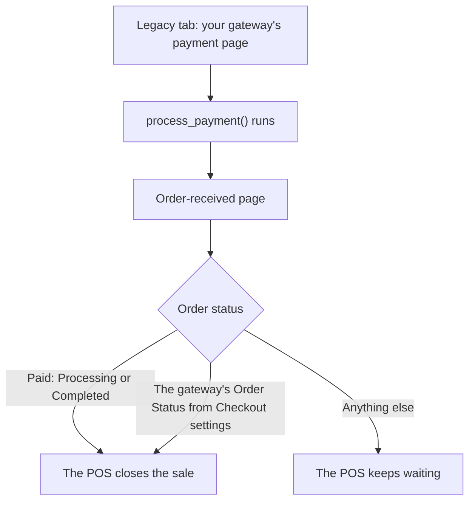

import Steps from '@site/src/components/Steps';
import StepCard from '@site/src/components/StepCard';
import RequirementsList from '@site/src/components/RequirementsList';
import RequirementItem from '@site/src/components/RequirementItem';
import LinkCards from '@site/src/components/LinkCards';
import LinkCard from '@site/src/components/LinkCard';

:::info Pro Feature
Gateways other than Cash and Card need [WCPOS Pro](../getting-started/pro-license.mdx). Without it, your gateway is listed in the POS checkout settings but can't be turned on.
:::

The gateway template is a starting point for your own payment method at the till: a WordPress plugin made of one PHP file. A setup script fills in your gateway's name and builds the plugin for you. The gateway stays off on your web store's checkout, and appears in the POS once you turn it on in the POS settings.

At the till, your gateway is on the checkout's [Legacy tab](../pos/checkout/legacy-tab.mdx). The tab opens your gateway's WooCommerce payment page inside the POS, and the cashier presses the payment button there.

## Build your gateway {#build}

<Steps>
  <StepCard number="1" title="Get the template">

```bash
git clone https://github.com/wcpos/woocommerce-gateway-template.git
cd woocommerce-gateway-template
```

Or press **Use this template** on the [GitHub repository](https://github.com/wcpos/woocommerce-gateway-template) to make your own copy, then clone that.

  </StepCard>
  <StepCard number="2" title="Run the setup script">

```bash
./create-gateway.sh
```

It's a Bash script. It asks for:

- **Gateway name** — the only answer it needs, for example `Cash Payment`.
- **Gateway slug** — press Enter to use the one made from the name (`cash-payment`). Lowercase letters, numbers and hyphens only.
- **Gateway description** and **default checkout description** — optional.
- **GitHub username**, **repository name** and **author name** — optional. The repository name defaults to the slug plus `-gateway`.
- **Target directory** — where to put the plugin. It defaults to the folder that holds the template.

The plugin lands in a folder named after the repository, for example `cash-payment-gateway/`, with `wcpos-cash-payment.php` inside.

  </StepCard>
  <StepCard number="3" title="Install the plugin">

Either copy the generated folder into your site's `wp-content/plugins/` directory, or zip the folder, then in WordPress admin go to **Plugins**, add a new plugin, choose **Upload Plugin** and upload the zip.

Then activate it. WooCommerce has to be active too: without it, the plugin loads nothing.

  </StepCard>
  <StepCard number="4" title="Turn it on for the POS" isLast>

1. Go to **WP Admin > POS > Settings > Checkout**.
2. Find your gateway in the **Gateways** list, under the name you gave it. Its **Gateway ID** is `wcpos_` plus your slug with underscores, for example `wcpos_cash_payment`.
3. Switch **Enabled** on, and pick the **Order Status** a sale paid this way should end on. See [Checkout Settings](../settings/wp-admin/checkout.mdx#payment-gateways).

The gateway shows on the POS's Legacy tab the next time the POS loads.

  </StepCard>
</Steps>

## What happens at the till {#at-the-till}

The cashier opens the **Legacy** tab, picks your gateway on the payment page and presses the payment button. WooCommerce calls your gateway's `process_payment()`. When that returns the order-received address, the POS reads the order's status and closes the sale or keeps waiting:



The Legacy tab needs your store to be reachable, and it charges the whole order, so it can't be used once any payment has been taken on the order. See [The Legacy Tab](../pos/checkout/legacy-tab.mdx).

## What's in the plugin file {#how-it-works}

The plugin registers one WooCommerce payment gateway class. The lines that matter:

- **`$this->enabled = 'no';`** in the constructor — keeps the gateway off your web store's checkout, even if it's switched on in WooCommerce's payment settings. WCPOS switches it on only for POS requests, and only when it's enabled in the POS checkout settings.
- **`process_payment()`** — calls `$order->payment_complete()`, which marks the order paid and reduces stock. For a POS order, WCPOS sets the status to the gateway's **Order Status** from the POS checkout settings (**Completed** unless you chose another). It returns `get_return_url( $order )`, the order-received address the POS waits for.
- **`init_form_fields()`** — the **Title** and **Description** fields in WooCommerce's payment settings. The POS can give the gateway its own title from **POS settings** in the gateway's menu.

The plugin also loads its own text domain, `woocommerce-pos-<your-slug>-gateway`, with a `.pot` file in `languages/`.

## Customise your gateway {#customise}

### Ask the cashier for something {#payment-fields}

If your gateway needs input from the cashier, such as a reference number, set `$this->has_fields = true;` in the constructor and add a `payment_fields()` method. Its fields show on the gateway's payment page in the Legacy tab:

```php
public function payment_fields() {
    if ( $this->description ) {
        echo wpautop( wptexturize( $this->description ) );
    }

    woocommerce_form_field( 'my_gateway_reference', array(
        'type'     => 'text',
        'label'    => __( 'Reference Number', 'your-text-domain' ),
        'required' => true,
    ) );
}
```

Read the value in `process_payment()` from `$_POST['my_gateway_reference']`, cleaned with `sanitize_text_field( wp_unslash( ... ) )`.

### Let the customer pay later {#pay-later}

The template marks the order paid straight away. For a gateway where the money arrives later, such as an invoice, set the status yourself instead:

```php
public function process_payment( $order_id ) {
    $order = wc_get_order( $order_id );

    if ( ! $order ) {
        return array( 'result' => 'failure' );
    }

    // The customer pays later.
    $order->update_status( 'pending', __( 'Awaiting payment', 'your-text-domain' ) );

    // payment_complete() is not called, so reduce stock here.
    wc_reduce_stock_levels( $order_id );

    return array(
        'result'   => 'success',
        'redirect' => $this->get_return_url( $order ),
    );
}
```

Then set the gateway's **Order Status** to **Pending payment** in **WP Admin > POS > Settings > Checkout**. **Pending payment** isn't a paid status, so without that setting the POS keeps waiting and the sale stays open. See [How the till treats the status](../settings/wp-admin/checkout.mdx#order-status-at-the-till).

<details>
<summary>Fill in the placeholders by hand</summary>

If you'd rather not run the script, use **Use this template** on GitHub, then find and replace these placeholders in every file:

| Placeholder | What to enter | Example |
|---|---|---|
| `{{GATEWAY_NAME}}` | Your gateway's name | Cash Payment |
| `{{GATEWAY_SLUG}}` | Lowercase, with hyphens | cash-payment |
| `{{GATEWAY_DESCRIPTION}}` | A short description of the gateway | Accept cash payments in WCPOS |
| `{{GATEWAY_DEFAULT_DESCRIPTION}}` | The description shown on the payment page | Pay with cash at the point of sale |
| `{{GITHUB_USERNAME}}` | Your GitHub username | kilbot |
| `{{REPO_NAME}}` | Your repository name | cash-payment-gateway |
| `{{AUTHOR_NAME}}` | Your name | kilbot |
| `{{GATEWAY_ID}}` | The slug, with underscores instead of hyphens | cash_payment |
| `{{GATEWAY_CLASS_NAME}}` | Each word of the name capitalised, joined by underscores | Cash_Payment |
| `{{GATEWAY_FUNCTION_PREFIX}}` | The same as the gateway ID | cash_payment |

Then rename `wcpos-{{GATEWAY_SLUG}}.php` to match your slug, for example `wcpos-cash-payment.php`. The script works out the last three values from the name and slug for you.

</details>

## Release an update {#updates}

Edit `wcpos-<your-slug>.php`, raise the `Version:` number in the plugin header (for example `0.1.0` to `0.2.0`), then install it again: replace the folder in `wp-content/plugins/`, or upload a new zip. WordPress asks before it replaces the installed plugin; choose **Replace current with uploaded**.

### Automatic releases on GitHub {#github-releases}

The generated plugin includes two GitHub Actions workflows. If you push it to a GitHub repository:

1. Raise the `Version:` number in the plugin header.
2. Commit and push to `main`.
3. The release workflow sees a version with no `v<version>` tag yet and publishes a release with `woocommerce-pos-<your-slug>-gateway.zip` attached.

Anyone can then download that zip from the repository's **Releases** page and install it like any WordPress plugin. The second workflow regenerates the `.pot` translation file whenever a PHP file changes on `main`.

## If something goes wrong {#troubleshooting}

- **The gateway isn't in the POS checkout settings** — check the plugin is activated in **WP Admin > Plugins** and that WooCommerce is active.
- **The gateway is listed but its Enabled switch is greyed out** — the free plugin only turns on **Cash** and **Card**. Activate [WCPOS Pro](../getting-started/pro-license.mdx).
- **It isn't on the Legacy tab** — switch **Enabled** on in **WP Admin > POS > Settings > Checkout**, then reload the POS. If a payment has already been taken on the order, the Legacy tab can't be used until it's [cancelled](../pos/checkout/cancelling-a-payment.mdx).
- **It shows on the web store's checkout** — check that `$this->enabled = 'no';` is still in the constructor, after `init_settings()`.
- **The sale doesn't close after payment** — the order isn't paid and isn't at the gateway's **Order Status**. Match the status `process_payment()` sets to the gateway's **Order Status** in the POS checkout settings, and make sure `process_payment()` returns `get_return_url( $order )`.
- **The order ends on a status you didn't expect** — for POS sales, the gateway's **Order Status** in the POS checkout settings decides it, not the products in the order. See [Order Status](../settings/wp-admin/checkout.mdx#order-status).

## Requirements {#requirements}

<RequirementsList>
  <RequirementItem label="WCPOS Pro">To turn the gateway on in the POS</RequirementItem>
  <RequirementItem label="WooCommerce">Installed and active</RequirementItem>
  <RequirementItem label="Bash">To run the setup script</RequirementItem>
  <RequirementItem label="PHP">Some PHP, to customise the payment logic</RequirementItem>
</RequirementsList>

## Examples and resources {#resources}

Two WCPOS gateways are built the same way, one PHP file each, and are good to read next to the template:

- **[Email Invoice](../payment/gateways/email-invoice.mdx)** — sets the order to **Pending payment**, reduces stock and emails the customer a link to pay ([source](https://github.com/wcpos/email-invoice-gateway)).
- **[Web Checkout](../payment/gateways/web-checkout.mdx)** — sends the customer to your web store's checkout to pay ([source](https://github.com/wcpos/web-checkout-gateway)).

The template is on [GitHub](https://github.com/wcpos/woocommerce-gateway-template). For everything a gateway class can do, see WooCommerce's [WC_Payment_Gateway reference](https://woocommerce.github.io/code-reference/classes/WC-Payment-Gateway.html).

## Related Documentation {#related-documentation}

<LinkCards>
  <LinkCard to="/pos/checkout/legacy-tab" title="The Legacy Tab" description="Where your gateway's payment page opens at the till" />
  <LinkCard to="/settings/wp-admin/checkout" title="Checkout Settings" description="Turn the gateway on and choose its order status" />
  <LinkCard to="/payment/gateways" title="Payment Gateways" description="The gateways WCPOS already has" />
</LinkCards>
