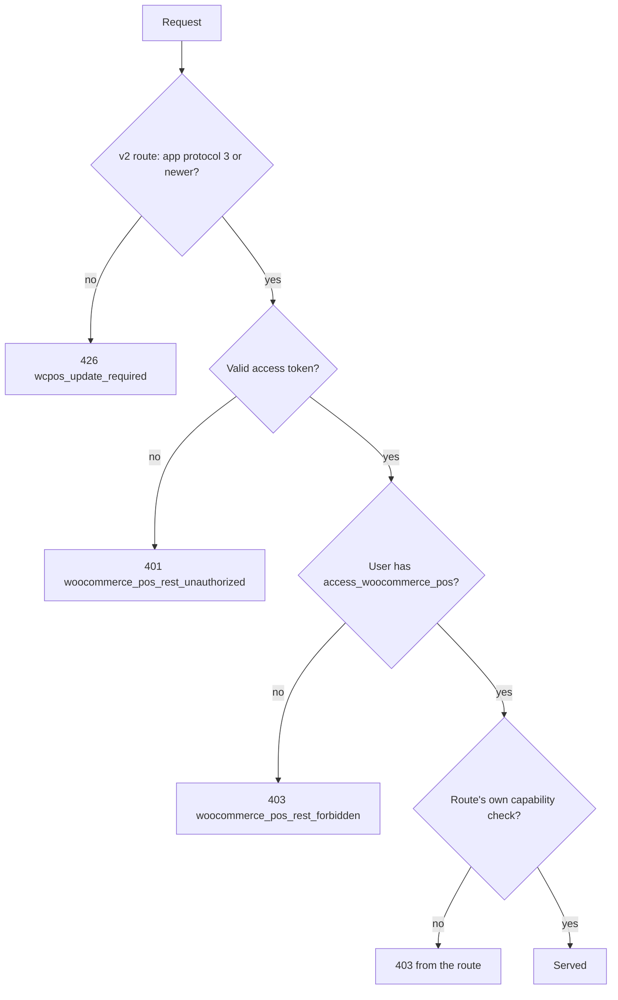

import LinkCards from '@site/src/components/LinkCards';
import LinkCard from '@site/src/components/LinkCard';

This page is for developers and site administrators. It lists which WCPOS REST endpoints each default role can reach, and what the server answers when it refuses one. To change what a role may do, use [Accessing the POS](../settings/wp-admin/access.mdx).

## Summary {#summary}

- **`administrator`**: every endpoint on this page.
- **`shop_manager`**: every endpoint except Pro's extension install and update action, which needs the WordPress `install_plugins` capability.
- **`cashier`**: everything the selling workflow uses, including refunds. No settings, logs, extensions or store management.

The tables come from the plugin's integration tests. Each test signs in with a WCPOS access token, the way the app does, and calls the endpoint as each role. In the Free tests an allowed endpoint must answer with a status below `400`. The Pro tests also accept `400` or `404`, because their fixtures are minimal: either answer still proves the user got past the permission check. A refused endpoint must answer `403` with the user still signed in.

## How the server checks a request {#how-the-server-checks}

A request to `/wcpos/v1/` or `/wcpos/v2/` passes these checks in order, and the first one that fails answers. The public sign-in routes and printer polling skip them.



| Check | Fails with | The app shows |
|---|---|---|
| App protocol (most v2 routes) | `426`, code `wcpos_update_required` | [SYNC341](../error-codes/SYNC341.mdx): update the app |
| Access token | `401`, code `woocommerce_pos_rest_unauthorized`, no user signed in | [AUTH101](../error-codes/AUTH101.mdx): Session expired, after one silent token refresh |
| POS access | `403`, code `woocommerce_pos_rest_forbidden` | [AUTH201](../error-codes/AUTH201.mdx): Insufficient role |
| The route's own check | `403`, for example `rest_forbidden` | [AUTH201](../error-codes/AUTH201.mdx): Insufficient role |

The checks use three capabilities. The plugin grants its own two, as below, when it is activated or updated; `install_plugins` is WordPress's own:

| Capability | What it opens | Administrator | Shop Manager | Cashier |
|---|---|:---:|:---:|:---:|
| `access_woocommerce_pos` | Every POS endpoint | ✅ | ✅ | ✅ |
| `manage_woocommerce_pos` | Settings, logs, extensions list, Pro store management | ✅ | ✅ | ❌ |
| `install_plugins` (WordPress) | Pro extension install and update | ✅ | ❌ | ❌ |

## Sync endpoints (v2) {#sync-endpoints}

The 2.0 app syncs through `/wcpos/v2/`. Every default role can reach every route below.

| Area | Endpoints | Admin | Shop Manager | Cashier |
|---|---|:---:|:---:|:---:|
| Status | `GET /wcpos/v2/status` | ✅ | ✅ | ✅ |
| Catalogue | `GET /wcpos/v2/products`, `/variations`, `/products/categories`, `/products/tags`, `/products/brands` | ✅ | ✅ | ✅ |
| Customers, coupons, taxes | `GET /wcpos/v2/customers`, `/coupons`, `/taxes` | ✅ | ✅ | ✅ |
| Orders | `GET /wcpos/v2/orders`, `/orders/pull` | ✅ | ✅ | ✅ |
| Change feed | `GET /wcpos/v2/changes/sequence-log`, `/changes/revision-hash`, `/changes/range-checksum`, `/changes/config-fingerprint`, `/changes/tick` | ✅ | ✅ | ✅ |
| Integrity checks | `GET /wcpos/v2/digests`, `/integrity/scan`, `/integrity/bucket` | ✅ | ✅ | ✅ |
| Barcode lookup | `GET /wcpos/v2/resolve/barcode` | ✅ | ✅ | ✅ |
| Send a new order | `POST /wcpos/v2/push/orders` | ✅ | ✅ | ✅ |

## Free Plugin Endpoint Access Matrix {#free-plugin-endpoint-access-matrix}

These `/wcpos/v1/` routes serve sign-in, checkout, receipts and the settings screens.

| Area | Endpoint examples | Admin | Shop Manager | Cashier | Notes |
|---|---|:---:|:---:|:---:|---|
| Stores | `GET /wcpos/v1/stores` | ✅ | ✅ | ✅ | Stores the app can open |
| Cashier profile | `GET /wcpos/v1/cashier/{id}` | ✅ | ✅ | ✅ | The signed-in cashier |
| Cashier stores | `GET /wcpos/v1/cashier/{id}/stores` | ✅ | ✅ | ✅ | Stores this cashier may use |
| Products | `GET /wcpos/v1/products` | ✅ | ✅ | ✅ | Catalogue |
| Variations | `GET /wcpos/v1/products/variations` | ✅ | ✅ | ✅ | Catalogue |
| Categories, tags, brands | `GET /wcpos/v1/products/categories`, `/tags`, `/brands` | ✅ | ✅ | ✅ | Catalogue filters |
| Coupons | `GET /wcpos/v1/coupons` | ✅ | ✅ | ✅ | Coupon lookup |
| Orders read | `GET /wcpos/v1/orders` | ✅ | ✅ | ✅ | Order history |
| Orders create | `POST /wcpos/v1/orders` | ✅ | ✅ | ✅ | Selling |
| Orders update | `PATCH /wcpos/v1/orders/{id}` | ✅ | ✅ | ✅ | Completing an order |
| Checkout | `GET` and `POST /wcpos/v1/orders/{id}/checkout` | ✅ | ✅ | ✅ | Taking payment |
| Receipts | `GET /wcpos/v1/receipts/{order_id}` | ✅ | ✅ | ✅ | Receipt rendering |
| Order statuses | `GET /wcpos/v1/data/order_statuses` | ✅ | ✅ | ✅ | Status names |
| Customers read | `GET /wcpos/v1/customers` | ✅ | ✅ | ✅ | Customer search |
| Customers create | `POST /wcpos/v1/customers` | ✅ | ✅ | ✅ | Add a customer |
| Customers update | `PATCH /wcpos/v1/customers/{id}` | ✅ | ✅ | ✅ | Edit a customer |
| Taxes | `GET /wcpos/v1/taxes`, `/taxes/classes` | ✅ | ✅ | ✅ | Tax rates and classes |
| Shipping methods | `GET /wcpos/v1/shipping_methods` | ✅ | ✅ | ✅ | Shipping lines |
| Payment gateways | `GET /wcpos/v1/payment-gateways` | ✅ | ✅ | ✅ | Payment options |
| Gateway bootstrap | `POST /wcpos/v1/payment-gateways/{id}/bootstrap` | ✅ | ✅ | ✅ | Payment setup |
| Templates | `GET /wcpos/v1/templates`, `/templates/active`, `/templates/gallery` | ✅ | ✅ | ✅ | Receipt templates |
| General settings | `GET /wcpos/v1/settings/general` | ✅ | ✅ | ❌ | `manage_woocommerce_pos` |
| Checkout settings | `GET /wcpos/v1/settings/checkout` | ✅ | ✅ | ❌ | `manage_woocommerce_pos` |
| Tax ID settings | `GET /wcpos/v1/settings/tax_ids` | ✅ | ✅ | ❌ | `manage_woocommerce_pos` |
| Payment gateway settings | `GET /wcpos/v1/settings/payment-gateways` | ✅ | ✅ | ❌ | `manage_woocommerce_pos` |
| Extensions list | `GET /wcpos/v1/extensions` | ✅ | ✅ | ❌ | `manage_woocommerce_pos` |
| Logs | `GET /wcpos/v1/logs` | ✅ | ✅ | ❌ | `manage_woocommerce_pos` |

`/wcpos/v1/settings` itself has no readable index: read a section such as `/settings/general` instead.

## Pro Plugin Endpoint Access Matrix {#pro-plugin-endpoint-access-matrix}

WCPOS Pro adds these routes.

| Area | Endpoint examples | Admin | Shop Manager | Cashier | Notes |
|---|---|:---:|:---:|:---:|---|
| Order refunds | `POST /wcpos/v1/orders/{id}/refunds` | ✅ | ✅ | ✅ | A till operation |
| Store edit data | `GET /wcpos/v1/stores/{id}/edit` | ✅ | ✅ | ❌ | `manage_woocommerce_pos` |
| Store create | `POST /wcpos/v1/stores` | ✅ | ✅ | ❌ | `manage_woocommerce_pos` |
| Store update | `PATCH /wcpos/v1/stores/{id}` | ✅ | ✅ | ❌ | `manage_woocommerce_pos` |
| License | `POST /wcpos/v1/settings/license` | ✅ | ✅ | ❌ | `manage_woocommerce_pos` |
| Extension install and update | `POST /wcpos/v1/extensions/action` | ✅ | ❌ | ❌ | WordPress `install_plugins` |

## Token Expiry Coverage {#token-expiry-coverage}

The app signs in with an access token that lasts 30 minutes and a refresh token that lasts 30 days. Code can change both with the `wcpos_jwt_access_token_expire` and `wcpos_jwt_refresh_token_expire` filters. The same tests cover what happens when each one runs out, for all three roles.

| Situation | Server answer | What happens next |
|---|---|---|
| Valid access token | The endpoint's normal answer | Nothing |
| Expired, missing or malformed access token | `401`, code `woocommerce_pos_rest_unauthorized`, no user signed in | The app refreshes the token once and retries |
| Expired access token, valid refresh token | A new access token | The retry succeeds |
| Expired refresh token | Refresh refused with `woocommerce_pos_auth_token_expired` | The cashier signs in again ([AUTH101](../error-codes/AUTH101.mdx)) |

An expired access token never signs a user in, so it never reaches a role check: it is always a `401`, never a `403`. The tests prove the same on the v2 routes for the cashier role.

## Diagnosing Failures {#diagnosing-failures}

**Request still unauthorized after token refresh - please log in again** (AUTH101)
: The app got a `401`, refreshed the token, and the retry was still a `401`. This is the sign-in layer, not the role: a `403` never triggers a refresh. Something between the app and WordPress is dropping or refusing the token, often a security or authentication plugin ([AUTH301](../error-codes/AUTH301.mdx)). [AUTH101](../error-codes/AUTH101.mdx) has the steps.

**Insufficient role** (AUTH201)
: The server answered `403` to a signed-in user. Either the user lacks `access_woocommerce_pos`, or the route needs `manage_woocommerce_pos` or `install_plugins`. On a default `shop_manager` or `cashier` this points to a role changed by a role-editor plugin, an extra role that denies a capability, or custom code. [AUTH201](../error-codes/AUTH201.mdx) has the steps.

**Update required** (SYNC341)
: The server answered `426` on a v2 route: the app is older than the plugin's sync protocol. Update the app.

### Permission failure vs. token failure {#permission-failure-vs-token-failure}

Read the refused response in the browser's network panel, or in a server-side log. **WP Admin > POS > Settings > Tools > Logs** also records each `401` whose token was malformed or refused for a reason other than plain expiry. The status, the error code and the signed-in user tell the two apart:

```text
Role or capability failure
  status: 403
  code:   woocommerce_pos_rest_forbidden (or the route's own, e.g. rest_forbidden)
  user:   the cashier's WordPress user ID

Token or sign-in failure
  status: 401
  code:   woocommerce_pos_rest_unauthorized
  data.reason: the token error, e.g. woocommerce_pos_auth_token_expired
  user:   0 (nobody signed in)
```

A non-zero user points at capabilities. A user of `0` points at the token, or at something between the app and WordPress.

## Related Documentation {#related-documentation}

<LinkCards>
  <LinkCard title="Accessing the POS" to="/settings/wp-admin/access" description="Grant or remove what each role can do." />
  <LinkCard title="Sessions" to="/settings/wp-admin/sessions" description="Signed-in devices and ending a session." />
  <LinkCard title="Error codes" to="/error-codes" description="Every code the app can show, with fixes." />
</LinkCards>
