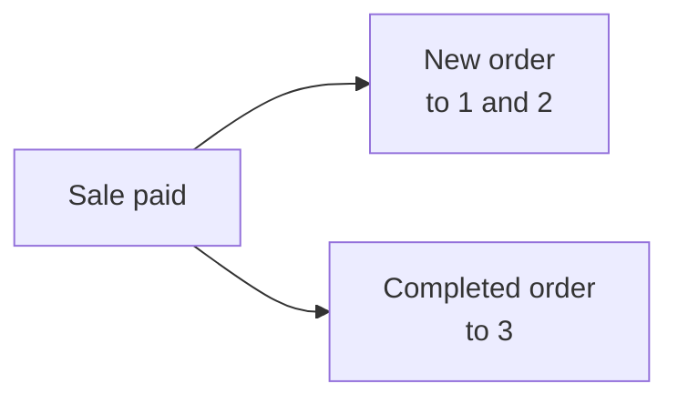

import Accordion from '@site/src/components/Accordion';
import AccordionItem from '@site/src/components/AccordionItem';
import LinkCards from '@site/src/components/LinkCards';
import LinkCard from '@site/src/components/LinkCard';

WooCommerce sends emails about orders: a New order email to you, a Completed order email to the customer, and so on. For sales made in the POS, you choose here which of those emails go out and who gets them. Your online orders keep your normal WooCommerce email settings.

Go straight to: [Admin emails](#admin-emails) · [Customer emails](#customer-emails) · [Send a receipt manually](#send-receipt-manually) · [Cashier emails](#cashier-emails) · [Common scenarios](#common-scenarios) · [If something goes wrong](#goes-wrong)

## Turn emails on or off {#switches}

:::note These switches replace WooCommerce's own for POS sales
For a POS order, the checkboxes here decide whether each email is sent, in place of **Enable this email notification** in **WooCommerce > Settings > Emails**. So an email you switched off in WooCommerce can still go out for POS sales if it's ticked here.
:::

1. In WP Admin, go to **POS > Settings > Checkout**.
2. Find the three email switches under **Prevent overselling**: **Admin emails**, **Customer emails** and **Cashier emails**. The **Gateways** list is below them.
3. Turn a switch on, and a checkbox appears for each email in that group. Untick an email to stop just that one.
4. Turn a switch off, and no email in that group goes out for POS sales, whatever the checkboxes say.

Each change saves as you make it: the screen shows **Saving**, then **Saved**.

{/* reshoot: WP Admin > POS > Settings > Checkout with all three email switches on and their checkboxes showing; see reshoot.md */}

Who each switch emails, and how it starts when you install:

- **Admin emails**: on when you install\
  To the addresses in **Recipient(s)** for that email, in **WooCommerce > Settings > Emails**
- **Customer emails**: on when you install\
  To the order's billing email
- **Cashier emails**: off when you install\
  To the email address on the cashier's WordPress account

What one sale paid at the till sends, when its payment method's **Order Status** is Completed:

1. **Store** — the **Recipient(s)** of **New order** in WooCommerce, if **Admin emails** is on and **New order** is ticked.
2. **Cashier** — the cashier's own address, if **Cashier emails** is on and **New order** is ticked.
3. **Customer** — the order's billing email, if **Customer emails** is on, **Completed order** is ticked and the order has a billing email.

## Admin emails {#admin-emails}

These go to you, the store. Every email is ticked when you install.

To change who receives an admin email, go to **WooCommerce > Settings > Emails**, open that email's settings and edit **Recipient(s)**.

| Email | Sent when |
|---|---|
| **New order** | A POS order moves to Completed, Processing or On hold |
| **Cancelled order** | A Processing or On hold order is cancelled |
| **Failed order** | A Pending payment or On hold order fails |

When a POS order moves to Completed, Processing or On hold, **New order** is sent if it is ticked under **Admin emails** or **Cashier emails** and that switch is on, even if **New order** is switched off in WooCommerce. The status each sale moves to is the **Order Status** you set for its payment method: see [Order Status](./checkout.mdx#order-status).

Why WCPOS sends New order for POS sales itself

WooCommerce sends **New order** only when an order leaves Pending payment, Failed or Cancelled. A POS sale starts in the POS's own open status instead, so WooCommerce would not send it. WCPOS sends it in WooCommerce's place, at the moments above.

## Customer emails {#customer-emails}

These go to the order's billing email. An order with no billing email, such as a guest sale where you didn't enter one, gets no customer email. Every email is ticked when you install.

### Send a receipt manually {#send-receipt-manually}

**Email Receipt** on the paid screen is separate. It sends WooCommerce's invoice email, which these switches don't control, so it works with **Customer emails** off. See [Email the receipt](../../receipts/at-checkout.mdx#email-receipt).

### Emails sent automatically {#customer-emails-automatic}

| Email | Sent when |
|---|---|
| **Order on hold** | An order moves to On hold from Pending payment, Failed or Cancelled |
| **Processing order** | An order moves to Processing from Pending payment, On hold, Failed or Cancelled |
| **Completed order** | An order moves to Completed |
| **Refunded order** | An order is refunded, in full or in part. See [Refunds](../../orders/refunds.mdx) |
| **Failed order** | An order fails |

## Cashier emails {#cashier-emails}

This sends the **New order** email to the cashier who made the sale, at the email address on their WordPress account. The switch is off when you install; turn it on and **New order** is ticked.

The cashier gets the email at the same moments the admin does (see [Admin emails](#admin-emails)). **Admin emails** and **Cashier emails** work on their own: turning one off doesn't change the other. If the cashier's address is already among the admin recipients, for example an owner who is both, they get one copy, not two.

Which WordPress users can sign in to the POS as cashiers is set in [Cashier Access](./access.mdx).

## Common scenarios {#common-scenarios}

<Accordion>
  <AccordionItem question="Stop the inbox getting flooded on busy days">

Untick **New order** under **Admin emails**. Keep **Cancelled order** and **Failed order** ticked: those are the ones you want to hear about.

To follow takings, use [Reports](../../reports/index.mdx) rather than counting New order emails.

  </AccordionItem>

  <AccordionItem question="Send New order emails to the cashier on duty, not the admin">

Untick **New order** under **Admin emails**, or turn **Admin emails** off, and turn **Cashier emails** on. The cashier who makes each sale gets the email at their own address, and the admin inbox stays quiet.

Turning **Admin emails** off also stops **Cancelled order** and **Failed order**, so unticking **New order** alone is usually the better choice.

  </AccordionItem>

  <AccordionItem question="No customer emails for in-store sales">

Market stalls and cafes often don't want to email a customer who already has a printed receipt. Turn **Customer emails** off, and no Processing, Completed, Refunded or other customer email goes out for POS sales.

Your online orders still send their customer emails as normal. A customer who asks for a receipt by email can still get one: press **Email Receipt** on the paid screen.

  </AccordionItem>

  <AccordionItem question="I upgraded from before 1.8.9 and the single 'Enable emails' switch is gone">

Version 1.8.9 replaced the single on/off switch with the three groups on this page. WCPOS reads your old setting: if emails were off, **Admin emails** and **Customer emails** are off; if they were on, both are on with every email ticked. **Cashier emails** starts off either way.

You don't need to do anything.

  </AccordionItem>
</Accordion>

## If something goes wrong {#goes-wrong}

**The admin gets no New order email.** Check that **Admin emails** is on and **New order** is ticked. Then check **Recipient(s)** for **New order** in **WooCommerce > Settings > Emails**.

**A customer gets no email.** Check that **Customer emails** is on and that email is ticked. Then open the order and check it has a billing email. To send a receipt now, use **Email Receipt**.

**The cashier gets no email.** Check that **Cashier emails** is on and **New order** is ticked, and that the cashier's WordPress account has an email address. If that address is also an admin recipient, they get only one copy.

**An email you switched off in WooCommerce still arrives for POS sales.** For POS orders the checkboxes here decide. Untick the email here as well.

## Developer hooks {#developer-hooks}

For a developer who needs control beyond these switches. Store owners can skip this.

Four WordPress filters, and how New order recipients are set

Before WCPOS 2.0 these filters were named `woocommerce_pos_*` (for example `woocommerce_pos_admin_emails`). Those names still work but are deprecated since 2.0 and are removed in 2.2 at the earliest. See [Hook naming](../../extensions/index.mdx#hook-naming).

**`wcpos_admin_emails`**: the admin email IDs WCPOS controls. Default: `cancelled_order`, `failed_order`.

**`wcpos_customer_emails`**: the customer email IDs WCPOS controls. Default: `customer_failed_order`, `customer_on_hold_order`, `customer_processing_order`, `customer_completed_order`, `customer_refunded_order`.

**`wcpos_admin_email_enabled`**: whether one admin email is sent for one POS order. Arguments: `$is_enabled`, `$email_id`, `$order`, `$email`.

**`wcpos_customer_email_enabled`**: whether one customer email is sent for one POS order. Same arguments.

**New order** is not in `wcpos_admin_emails`. WCPOS sets its recipients through WooCommerce's `woocommerce_email_recipient_new_order` filter: it clears the store recipients when the admin doesn't want it, and adds the cashier's address when the cashier does. The cashier is the WordPress user saved in the order's `_pos_user` meta. Your own callback on that filter can add or remove addresses the same way as for any WooCommerce email.

## Related Documentation {#related-documentation}

<LinkCards>
  <LinkCard title="Checkout Settings" to="/settings/wp-admin/checkout" description="Gateways and the order status each one sets, on the same screen." />
  <LinkCard title="Receipts at checkout" to="/receipts/at-checkout" description="Print or email a receipt from the paid screen." />
  <LinkCard title="Orders" to="/orders" description="Find the POS orders these emails are about." />
</LinkCards>
